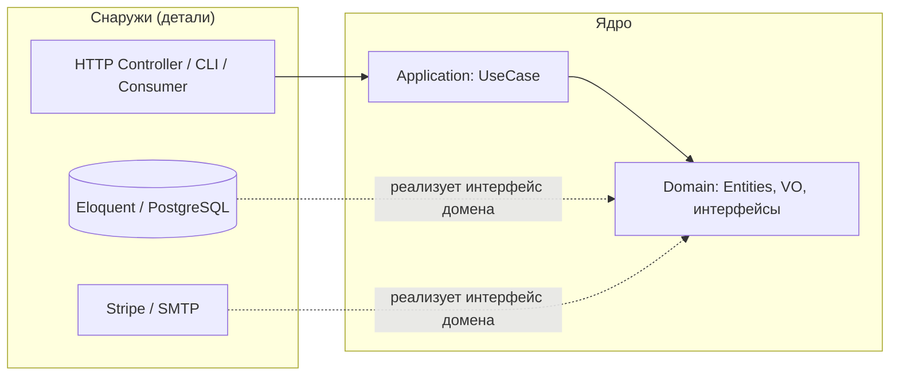
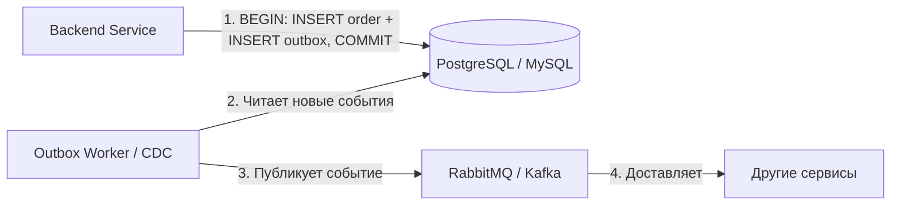
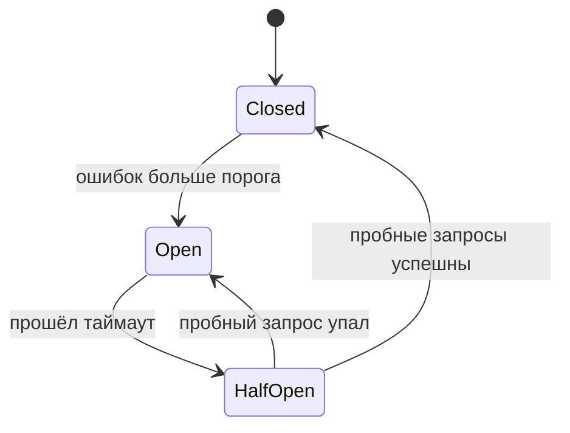

# Backend Architecture — конспект для собеседования

> [!info] Как пользоваться конспектом
> В каждом разделе одна и та же структура: **Коротко** → **Теория (RU)** → **🇬🇧 English** (термины + фразы для ответа вслух) → **Код / схема** → **Вопросы и ответы**. Перед собеседованием читай «Коротко», «Say it in English» и раздел 11.

## Оглавление

1. [[#1. Принципы SOLID, DRY, KISS, YAGNI]]
2. [[#2. Паттерны проектирования (GoF) для PHP-разработчика]]
3. [[#3. Архитектурные слои и подходы: MVC, Layered, Clean/Hexagonal, DDD]]
4. [[#4. Монолит, Модульный монолит и Микросервисы]]
5. [[#5. Брокеры сообщений и Асинхронность: RabbitMQ vs Kafka vs Redis]]
6. [[#6. Распределённые транзакции: Transactional Outbox и Saga]]
7. [[#7. Кэширование: Стратегии, Инвалидация и Проблемы высоких нагрузок]]
8. [[#8. Отказоустойчивость: Rate Limiting, Circuit Breaker, Retries]]
9. [[#9. Балансировка нагрузки, Проксирование и Масштабирование]]
10. [[#10. Наблюдаемость (Observability): Логи, Метрики и Трейсинг]]
11. [[#11. Шпаргалка перед собеседованием]]

---

## 1. Принципы SOLID, DRY, KISS, YAGNI

> [!abstract] Коротко
> **SOLID** управляет зависимостями и ответственностью классов. **DRY**, **KISS**, **YAGNI** защищают от дублирования и преждевременного усложнения. Это не законы, а ориентиры: слепое следование тоже вредит.

### Теория (🇷🇺 Русский)

| Принцип | Суть | Типичное нарушение | Как исправить |
| :--- | :--- | :--- | :--- |
| **S** — Single Responsibility (единственная ответственность) | У класса одна причина для изменения (один актор) | «Толстый контроллер»: валидирует запрос, ходит в БД, считает скидку, шлёт письмо, пишет лог | Вынести в `FormRequest`, `Service`/`Action`, `Notifier` |
| **O** — Open/Closed (открытости/закрытости) | Открыт для расширения, закрыт для модификации | Гигантский `if/else` по типу оплаты в `PaymentService` | Интерфейс `PaymentGateway` + новый класс `ApplePayGateway` |
| **L** — Liskov Substitution (подстановки Лисков) | Наследника можно подставить вместо родителя без поломки поведения | `Square extends Rectangle`, где `setWidth()` меняет и высоту; наследник кидает исключение, которого нет в контракте | Не наследовать «по виду»; композиция, общий интерфейс `Shape` |
| **I** — Interface Segregation (разделения интерфейсов) | Много узких интерфейсов лучше одного «толстого» | `WorkerInterface` с `work()`, `eat()`, `sleep()`: у робота пустой `eat()` | Разделить на `Workable`, `Feedable` |
| **D** — Dependency Inversion (инверсии зависимостей) | Бизнес-логика и детали зависят от **абстракций**, а не друг от друга | `new StripeClient()` внутри `OrderService` | Зависимость от `PaymentGateway`, реализацию подставляет DI-контейнер |

- **DRY (Don't Repeat Yourself)**: у каждого *знания* (бизнес-правила) один источник истины. Внешне похожий код не всегда дубликат: два DTO с одинаковыми полями могут меняться по разным причинам, и склеивать их не нужно (иначе получится ложная связность).
- **KISS (Keep It Simple, Stupid)**: выбирай самое простое решение, которое закрывает задачу. Не тащи Kafka и микросервисы туда, где хватит монолита и PostgreSQL.
- **YAGNI (You Aren't Gonna Need It)**: не пиши код и абстракции «на будущее». Добавляй их, когда появилась вторая реальная реализация.

> [!tip] DI ≠ DIP
> **DIP** — принцип проектирования (зависеть от абстракций). **DI (Dependency Injection)** — техника: зависимости передают снаружи (через конструктор). **DI-контейнер** — инструмент, который это автоматизирует. Можно использовать DI и нарушать DIP (внедрять конкретный класс вместо интерфейса).

### 🇬🇧 English

| Term | Meaning |
| :--- | :--- |
| **Single Responsibility** | A class should have only one reason to change. |
| **Open/Closed** | Open for extension (new classes), closed for modification (no edits to old code). |
| **Liskov Substitution** | A subtype must work anywhere its base type is expected, without breaking behavior. |
| **Interface Segregation** | Many small, role-specific interfaces are better than one big interface. |
| **Dependency Inversion** | High-level logic and low-level details both depend on abstractions. |
| **DRY / KISS / YAGNI** | Don't duplicate knowledge / keep it simple / don't build it until you need it. |

> [!quote] Say it in English
> «SOLID is a set of five design principles that make code easier to change and test. For example, thanks to the Open/Closed Principle, I can add a new payment method by creating a new class, without touching the existing code.»

### Код: OCP + DIP на PHP

```php
<?php
declare(strict_types=1);

interface PaymentGateway
{
    public function charge(int $amountCents, string $currency): string; // вернёт id платежа
}

final class StripeGateway implements PaymentGateway
{
    public function charge(int $amountCents, string $currency): string
    {
        // ... вызов SDK Stripe
        return 'pi_123';
    }
}

// Сервис зависит от абстракции (DIP) и не знает про Stripe
final class CheckoutService
{
    public function __construct(private PaymentGateway $gateway) {}

    public function pay(int $amountCents): string
    {
        return $this->gateway->charge($amountCents, 'USD');
    }
}
// Новый способ оплаты = новый класс, CheckoutService не меняется (OCP)
```

### Вопросы и ответы

> [!question] Чем DIP отличается от Dependency Injection?
>
> DIP — **принцип**: модули зависят от интерфейсов. DI — **способ** передать зависимость снаружи. DI-контейнер (Laravel, Symfony) — инструмент, который создаёт и подставляет объекты.

> [!question] Приведи пример нарушения Liskov.
>
> `Square extends Rectangle`: код, который ставит ширину 5 и высоту 4 и ждёт площадь 20, получит 16, потому что квадрат синхронизирует стороны. Подкласс сломал ожидания, заданные родителем.

> [!question] Когда нарушение DRY — это нормально?
>
> Когда два фрагмента похожи случайно и меняются по разным причинам (разные DTO, разные bounded contexts). Преждевременное объединение создаёт связность хуже, чем дубликат. Правило: подожди третьего повторения (*rule of three*).

---

## 2. Паттерны проектирования (GoF) для PHP-разработчика

> [!abstract] Коротко
> Паттерны — типовые решения типовых проблем. Чаще всего спрашивают: **Strategy**, **Factory**, **Decorator**, **Adapter**, **Observer**, **Singleton** (почему он плох), а также **DTO** и **Value Object**.

### Теория (🇷🇺 Русский)

**Порождающие (Creational)** — как создавать объекты:

- **Factory Method / Simple Factory (Фабрика)**: инкапсулирует выбор конкретной реализации (`NotificationFactory::create('sms')`).
- **Builder (Строитель)**: пошаговая сборка сложного объекта с множеством необязательных параметров (Laravel `QueryBuilder`).
- **Singleton (Одиночка)**: один экземпляр и глобальная точка доступа. На собеседованиях считается **антипаттерном**: скрытые зависимости, сложно тестировать, утечки состояния между запросами в Octane/Swoole/RoadRunner. Вместо него — DI-контейнер с «shared» (общей) регистрацией сервиса.

**Структурные (Structural)** — как собирать объекты:

- **Decorator (Декоратор)**: оборачивает объект с тем же интерфейсом и добавляет поведение (`CachedProductRepository`, `LoggingProductRepository`).
- **Adapter (Адаптер)**: приводит чужой интерфейс (SDK Stripe, ЮKassa) к нашему `PaymentGatewayInterface`.
- **Facade (Фасад)**: простой интерфейс к сложной подсистеме. *Осторожно: Laravel Facade — это не GoF-фасад, а статический доступ к сервису из контейнера.*
- **Proxy (Заместитель)**: подставка с тем же интерфейсом, управляет доступом (lazy loading, кэш, права). Отличие от Decorator: Proxy контролирует **доступ**, Decorator добавляет **поведение**.

**Поведенческие (Behavioral)** — как объекты взаимодействуют:

- **Strategy (Стратегия)**: взаимозаменяемые алгоритмы за единым интерфейсом (доставка: СДЭК, Почта, Курьер).
- **Observer (Наблюдатель)**: подписка на события (Events & Listeners).
- **Chain of Responsibility (Цепочка обязанностей)**: запрос идёт по цепочке обработчиков (**HTTP Middleware**).
- **Template Method**, **Command** (задачи в очереди — это Command), **State** — тоже полезно знать названия.

**Объекты данных:**

- **DTO (Data Transfer Object)**: «тупой» контейнер для передачи типизированных данных между слоями, без бизнес-логики.
- **Value Object (Объект-значение)**: неизменяемый объект без идентификатора, равенство по значениям (`Email`, `Money`, `DateRange`). Валидирует себя в конструкторе, поэтому невалидный `Email` в системе не существует.
- **Entity (Сущность)**: имеет идентичность (`id`), равенство по `id`, состояние со временем меняется.

> [!tip] Strategy vs State
> Структура почти одинаковая. **Strategy**: клиент сам выбирает алгоритм, алгоритмы не знают друг о друге. **State**: объект сам меняет поведение при смене состояния (заказ `new → paid → shipped`).

### 🇬🇧 English

| Pattern | One-line definition |
| :--- | :--- |
| **Factory** | Creates objects without exposing the concrete class. |
| **Builder** | Builds a complex object step by step. |
| **Singleton** | One global instance; usually avoided because it hides dependencies. |
| **Decorator** | Wraps an object to add behavior, keeping the same interface. |
| **Adapter** | Makes a third-party interface fit the one our code expects. |
| **Strategy** | A family of interchangeable algorithms behind one interface. |
| **Observer** | Objects subscribe to events and react when they happen. |
| **Chain of Responsibility** | A request passes through handlers in sequence (e.g. HTTP middleware). |
| **DTO** | A plain object that carries data between layers. |
| **Value Object** | An immutable object compared by its values, not by an ID. |

> [!quote] Say it in English
> «I use the Strategy pattern for delivery pricing: each carrier is a separate class behind one interface, so adding a carrier doesn't change the existing code. I wrap the calculator in a Decorator to add caching.»

### Код: Strategy + Decorator + Value Object (PHP 8.2+)

```php
<?php
declare(strict_types=1);

// Value Object: всегда валидный и неизменяемый
final readonly class Money
{
    public function __construct(
        public int $cents,
        public string $currency,
    ) {
        if ($cents < 0) {
            throw new \InvalidArgumentException('Amount cannot be negative');
        }
    }
}

// Strategy: общий интерфейс для разных способов расчёта
interface ShippingCalculatorInterface
{
    public function calculate(Money $orderAmount, string $city): Money;
}

final class CourierShipping implements ShippingCalculatorInterface
{
    public function calculate(Money $orderAmount, string $city): Money
    {
        return $orderAmount->cents >= 500_000
            ? new Money(0, $orderAmount->currency)      // бесплатно от 5000 руб.
            : new Money(50_000, $orderAmount->currency);
    }
}

// Decorator: добавляет кэширование к ЛЮБОЙ стратегии
final readonly class CachedShippingCalculator implements ShippingCalculatorInterface
{
    public function __construct(
        private ShippingCalculatorInterface $inner,
        private \Psr\SimpleCache\CacheInterface $cache,
    ) {}

    public function calculate(Money $orderAmount, string $city): Money
    {
        $key = "shipping:{$city}:{$orderAmount->cents}";

        $cached = $this->cache->get($key);
        if ($cached instanceof Money) {
            return $cached;
        }

        $cost = $this->inner->calculate($orderAmount, $city);
        $this->cache->set($key, $cost, 3600);

        return $cost;
    }
}
```

### Вопросы и ответы

> [!question] Почему Singleton считают антипаттерном?
>
> Глобальное состояние и скрытые зависимости: класс «достаёт» объект из воздуха, поэтому его сложно подменить в тестах. В долгоживущих процессах (Octane, Swoole, очереди) состояние Singleton утекает между запросами. Решение: DI-контейнер, который создаёт один объект и передаёт его явно.

> [!question] Decorator vs Proxy vs Adapter — в чём разница?
>
> **Decorator** — тот же интерфейс + новое поведение. **Proxy** — тот же интерфейс + контроль доступа к реальному объекту. **Adapter** — **меняет** интерфейс, чтобы чужой код подошёл нашему.

> [!question] Чем DTO отличается от Value Object?
>
> DTO — просто переносчик данных, без поведения и инвариантов. Value Object содержит правила (валидация, операции вроде `Money::add`), неизменяем и сравнивается по значению.

> [!question] Какой паттерн реализует Middleware?
>
> Chain of Responsibility (в Laravel часто описывают и как Pipeline): каждый обработчик либо отвечает сам, либо передаёт запрос дальше через `$next($request)`.

---

## 3. Архитектурные слои и подходы: MVC, Layered, Clean/Hexagonal, DDD

> [!abstract] Коротко
> Архитектура задаёт границы между **бизнес-логикой (домен)** и **инфраструктурой** (БД, HTTP, очереди). Главное правило: **зависимости направлены снаружи внутрь**, к домену. Домен ничего не знает про фреймворк и БД.

### Теория (🇷🇺 Русский)

- **MVC (Model — View — Controller)**: разделяет представление и данные. В API-бэкенде `View` заменяется JSON-сериализацией (`API Resource`), а бизнес-логику выносят из контроллеров и моделей в сервисы/экшены (`Action` / `UseCase`), чтобы не получить «толстые контроллеры» и «толстые модели».
- **Слоистая архитектура (Layered)**:
  1. *Presentation / HTTP*: контроллеры, `FormRequest`, middleware, API Resources (знает HTTP, не знает SQL).
  2. *Application / Service*: UseCases/Actions: оркестрируют сценарий (транзакция, вызов домена, отправка событий).
  3. *Domain*: Entities, Value Objects, Domain Services, **интерфейсы** репозиториев. Чистая бизнес-логика без фреймворка.
  4. *Infrastructure*: Eloquent/Doctrine-репозитории, клиенты внешних API, почта, Redis. Реализует интерфейсы домена.
- **Hexagonal (Ports & Adapters)**: ядро общается с миром только через **порты** (интерфейсы). *Входящие* адаптеры (HTTP-контроллер, CLI, consumer очереди) вызывают приложение; *исходящие* (PostgreSQL, Stripe, SMTP) реализуют порты. Бизнес-логику можно тестировать без БД и фреймворка.
- **Clean Architecture**: те же идеи концентрическими кругами (Entities → Use Cases → Interface Adapters → Frameworks). Правило зависимостей то же: внутрь.
- **DDD (Domain-Driven Design)**:
  - *Ubiquitous Language (единый язык)*: бизнес и разработчики используют одни термины, в том числе в коде.
  - *Bounded Context (ограниченный контекст)*: границы подсистем. `Product` в «Каталоге» — описание и фото, на «Складе» — габариты и остаток.
  - *Aggregate (агрегат)*: кластер объектов (`Order` + `OrderItem`), изменяемый только через **Aggregate Root**, который охраняет инварианты.
- **CQRS (Command Query Responsibility Segregation)**: раздельные модели для записи (команды) и чтения (запросы). Часто чтение идёт из денормализованной витрины/реплики. Не применяй везде: нужен, когда нагрузки на чтение и запись сильно различаются.



### 🇬🇧 English

| Term | Meaning |
| :--- | :--- |
| **Layered architecture** | Code split into layers (presentation, application, domain, infrastructure). |
| **Hexagonal (Ports & Adapters)** | The core talks to the outside only through interfaces (ports); adapters implement them. |
| **Dependency Rule** | Source code dependencies point inward, toward the domain. |
| **Bounded Context** | A boundary inside which a domain model and its terms have one clear meaning. |
| **Aggregate / Aggregate Root** | A cluster of objects changed only through one entry point that protects invariants. |
| **CQRS** | Separate models for writing (commands) and reading (queries). |

> [!quote] Say it in English
> «In Clean Architecture, the domain doesn't depend on the framework or the database. The database is just a detail: I define a repository interface in the domain, and the infrastructure layer implements it. That way I can test business logic without a database.»

### Вопросы и ответы

> [!question] Чем Hexagonal/Clean отличаются от обычной Layered?
>
> В классической Layered зависимости идут сверху вниз (контроллер → сервис → БД), и бизнес-логика часто зависит от слоя данных. В Hexagonal/Clean **инфраструктура зависит от домена** (инверсия через интерфейсы), поэтому домен чист и тестируется изолированно.

> [!question] Где в Laravel живёт бизнес-логика?
>
> Не в контроллерах и не в Eloquent-моделях «на всё». Варианты: `Action`/`UseCase`-классы (одно действие — один класс), доменные сервисы, агрегаты. Контроллер только принимает запрос, вызывает Action и возвращает Resource.

> [!question] Когда DDD избыточен?
>
> Для CRUD-приложений и простых админок: тактические паттерны (агрегаты, VO) дадут больше кода, чем пользы. DDD оправдан при сложной предметной области с богатыми правилами.

---

## 4. Монолит, Модульный монолит и Микросервисы

> [!abstract] Коротко
> Не начинай с микросервисов. Разумный путь: **монолит → модульный монолит → микросервисы только там, где это реально нужно** (независимое масштабирование, независимые команды).

### Теория (🇷🇺 Русский)

| Критерий | Монолит / Модульный монолит | Микросервисы |
| :--- | :--- | :--- |
| **Деплой и инфраструктура** | Один репозиторий, один CI/CD, простое локальное окружение | Десятки сервисов, Kubernetes, Service Discovery, сложный CI/CD |
| **Транзакции и данные** | Локальные ACID-транзакции и `JOIN` в одной БД | У каждого сервиса своя БД (**Database per Service**), распределённые транзакции (Saga) |
| **Сеть** | Вызов метода в памяти, нет сетевых сбоев | HTTP/gRPC, таймауты, ретраи, сериализация |
| **Масштабирование** | Только приложение целиком | Можно масштабировать только нагруженный сервис (поиск, биллинг) |
| **Команды и релизы** | При росте > 20–30 разработчиков конфликты при деплое | Независимые команды и релизы, возможен разный стек |
| **Отладка** | Один стек-трейс | Нужны распределённый трейсинг и централизованные логи |

- **Модульный монолит**: один деплой, но внутри чёткие модули с границами (по bounded contexts), общение через публичные интерфейсы/события, без обращения к чужим таблицам. Хороший шаг перед микросервисами.
- **Distributed Monolith (распределённый монолит)**: худший вариант, когда сервисы разнесены физически, но жёстко связаны (общая БД, синхронные цепочки вызовов, совместный деплой). Все минусы микросервисов без плюсов.
- **API Gateway**: единая точка входа для клиентов (маршрутизация, аутентификация, rate limiting). **BFF (Backend For Frontend)**: свой шлюз под каждый тип клиента (web, mobile).
- **Strangler Fig (Фиговое дерево-душитель)**: постепенный перенос функций из старого монолита в новые сервисы за общим фасадом, без «большого переписывания».

### 🇬🇧 English

| Term | Meaning |
| :--- | :--- |
| **Monolith** | The whole app is built and deployed as a single unit. |
| **Modular monolith** | One deployable unit, but with strict module boundaries inside. |
| **Microservices** | Small independent services, each with its own database and deployment. |
| **Database per Service** | Each service owns its data; others access it only via API/events. |
| **Distributed monolith** | Services are split physically but still tightly coupled. |

> [!quote] Say it in English
> «I'd start with a modular monolith. It's simpler to deploy and debug, and we keep ACID transactions. If one module needs independent scaling or its own team, we can extract it into a service later.»

### Вопросы и ответы

> [!question] Когда стоит переходить на микросервисы?
>
> Когда есть реальная боль: разные части масштабируются по-разному, несколько команд мешают друг другу при релизах, нужны разные технологии или изоляция отказов. И когда есть зрелость: CI/CD, мониторинг, трейсинг. Если этого нет, микросервисы только усложнят жизнь.

> [!question] Как обеспечить согласованность данных между сервисами?
>
> Нет общей ACID-транзакции, поэтому используют **eventual consistency**: события + **Transactional Outbox** + **Saga** (раздел 6), идемпотентных потребителей и компенсирующие действия.

---

## 5. Брокеры сообщений и Асинхронность: RabbitMQ vs Kafka vs Redis

> [!abstract] Коротко
> Брокеры дают асинхронность, сглаживают пики нагрузки (**backpressure**) и развязывают сервисы. Выбор: **Redis** — простые фоновые задачи, **RabbitMQ** — сложная маршрутизация и надёжная доставка, **Kafka** — огромные потоки событий и возможность перечитывать историю.

### Теория (🇷🇺 Русский)

**Зачем нужны очереди:**

1. Быстрый ответ пользователю (PDF, email, ресайз фото делаются в фоне).
2. Сглаживание пиков («Чёрная пятница»: заказы копятся в очереди, воркеры разбирают их с постоянной скоростью, не убивая БД).
3. Надёжность при временном сбое внешнего сервиса (retries + **Dead Letter Queue**).

| Характеристика | Redis (Lists / Streams) | RabbitMQ (AMQP) | Apache Kafka |
| :--- | :--- | :--- | :--- |
| **Модель** | In-memory хранилище, списки/стримы | Классический **Message Broker**, push: брокер отдаёт сообщения воркерам | Распределённый **Commit Log**, pull: консьюмеры читают лог по `offset` |
| **Хранение** | В RAM (риск потери без AOF/RDB) | Удаляется после `ACK` | На диске заданное время (дни/недели), можно перечитать (**Replay**) |
| **Маршрутизация** | Простая (по имени очереди) | Гибкая (Exchanges: Direct, Topic, Fanout, Headers) | Простая (Topics + Partitions) |
| **Порядок** | Внутри одного списка | Внутри одной очереди (теряется при нескольких консьюмерах) | Гарантирован **внутри партиции** (ключ сообщения определяет партицию) |
| **Масштабирование консьюмеров** | Несколько воркеров на один список | Несколько консьюмеров на очередь (competing consumers) | **Consumer Group**: партиция читается одним консьюмером группы |
| **Пропускная способность** | Очень высокая | Средняя (десятки тыс. msg/s) | Огромная (миллионы msg/s) |
| **Типичный кейс** | Фоновые задачи Laravel (письма, ресайз) | Сложная маршрутизация, RPC, надёжные воркеры | Стриминг, Event Sourcing, аудит-логи, шина данных между сервисами |

*Цифры пропускной способности ориентировочные и зависят от железа и настроек.*

**Семантика доставки:**

- **At-most-once** (не более одного раза): отправили и забыли; сообщение может потеряться, дубликатов нет.
- **At-least-once** (минимум один раз, стандарт на практике): доставка повторяется, пока нет `ACK`; возможны дубликаты. **Нужен идемпотентный консьюмер**.
- **Exactly-once** (ровно один раз): на практике достигается как *at-least-once + идемпотентная обработка*. (Kafka умеет транзакции exactly-once внутри самой Kafka, но побочные эффекты во внешнем мире всё равно требуют идемпотентности.)

**Важные термины:** `ACK`/`NACK` (подтверждение/отказ), **Dead Letter Queue (DLQ)** — очередь «ядовитых» сообщений, которые не удалось обработать после N попыток; **prefetch** — сколько сообщений воркер забирает заранее; **Backpressure** — механизм, не дающий производителю завалить потребителя.

### 🇬🇧 English

| Term | Meaning |
| :--- | :--- |
| **Message broker** | Middleware that receives messages from producers and delivers them to consumers. |
| **At-least-once delivery** | A message is delivered one or more times, so duplicates are possible. |
| **Idempotent consumer** | Processing the same message twice has the same result as processing it once. |
| **Dead Letter Queue** | A queue for messages that repeatedly fail processing. |
| **Consumer group** | A set of consumers that share the work of reading a topic. |
| **Offset** | A message's position in a Kafka partition. |

> [!quote] Say it in English
> «For simple background jobs in Laravel I'd use Redis. If I need complex routing or guaranteed delivery, RabbitMQ is a better fit. For high-volume event streams where consumers need to replay history, I'd choose Kafka. In any case, consumers must be idempotent, because delivery is at-least-once.»

### Код: идемпотентный консьюмер

```sql
-- Таблица обработанных сообщений
CREATE TABLE processed_messages (
    message_id UUID PRIMARY KEY,
    processed_at TIMESTAMPTZ NOT NULL DEFAULT NOW()
);
```

```php
<?php
// Внутри обработчика: всё в одной транзакции
DB::transaction(function () use ($message) {
    // Если message_id уже есть, вставка ничего не сделает -> дубликат
    $inserted = DB::table('processed_messages')->insertOrIgnore([
        'message_id' => $message->id,
    ]);

    if ($inserted === 0) {
        return; // уже обрабатывали, пропускаем
    }

    // ... бизнес-логика (списать деньги, обновить заказ)
});
```

### Вопросы и ответы

> [!question] Почему exactly-once «на самом деле» невозможен в сети?
>
> Если ответ `ACK` потерялся, отправитель не знает, дошло ли сообщение, и вынужден повторить. Поэтому доставка либо at-most-once (может потеряться), либо at-least-once (может дублироваться). Эффект «ровно один раз» получают идемпотентной обработкой.

> [!question] Как сохранить порядок сообщений в Kafka?
>
> Порядок гарантирован только внутри партиции. Сообщения с одним ключом (например, `order_id`) попадают в одну партицию, поэтому события одного заказа обрабатываются по порядку.

> [!question] Что делать с «ядовитым» сообщением, которое постоянно падает?
>
> Ограничить число ретраев (с экспоненциальной задержкой), затем отправить в **DLQ**, поднять алерт и разобрать вручную. Иначе оно блокирует очередь или бесконечно жрёт ресурсы.

---

## 6. Распределённые транзакции: Transactional Outbox и Saga

> [!abstract] Коротко
> Нельзя сделать один `BEGIN ... COMMIT` одновременно на БД и на брокер. Для согласованности используют **Transactional Outbox** (надёжная публикация событий) и **Saga** (бизнес-процесс из локальных транзакций с компенсациями).

### Теория (🇷🇺 Русский)

- **Проблема Dual Write (двойной записи)**: код делает `Order::create(...)`, а следующей строкой `publish(OrderCreated)`. Если процесс или сеть упадёт между строками, заказ в БД есть, а событие **не уйдёт никогда**. Меняем порядок — получим событие без заказа.
- **Transactional Outbox**:
  1. В **одной локальной ACID-транзакции** сохраняем заказ в `orders` **и** событие в таблицу `outbox_messages` той же БД.
  2. Отдельный процесс (Relay/Worker или CDC вроде Debezium) читает неотправленные записи, публикует их в RabbitMQ/Kafka и помечает отправленными. Гарантия **at-least-once** → консьюмеры идемпотентны.
- **Saga**: процесс, затрагивающий несколько сервисов (*создать заказ → зарезервировать товар → списать оплату*). У каждого шага есть **компенсирующая транзакция** (если оплата не прошла: *снять резерв*, *перевести заказ в `Cancelled`*).
  - **Хореография**: сервисы обмениваются событиями напрямую (просто, но сложно понять общий поток).
  - **Оркестрация**: центральный оркестратор говорит, что делать каждому шагу (прозрачнее, но появляется «центр»).
- **Eventual consistency (конечная согласованность)**: данные в разных сервисах временно расходятся, но со временем приходят к согласованному состоянию.
- **2PC (Two-Phase Commit)**: классический распределённый коммит; даёт строгую согласованность, но блокирует ресурсы и плохо масштабируется, поэтому в микросервисах его избегают.
- **CAP-теорема**: при сетевом разделении (**P**) распределённая система выбирает между согласованностью (**C**) и доступностью (**A**).



### 🇬🇧 English

| Term | Meaning |
| :--- | :--- |
| **Dual write problem** | Writing to two systems (DB and broker) without a shared transaction can leave them inconsistent. |
| **Transactional Outbox** | Save the event in the same DB transaction as the data; a relay publishes it later. |
| **Saga** | A long process made of local transactions, each with a compensating action. |
| **Compensating transaction** | A business-level undo (e.g. release reserved stock). |
| **Eventual consistency** | Data becomes consistent after some delay, not instantly. |

> [!quote] Say it in English
> «We can't update the database and publish to a broker atomically. So I save the event to an outbox table in the same transaction as the order, and a background worker publishes it. It's at-least-once delivery, so consumers have to be idempotent.»

### Код: таблица outbox и relay

```sql
CREATE TABLE outbox_messages (
    id           BIGINT GENERATED ALWAYS AS IDENTITY PRIMARY KEY,
    aggregate_id BIGINT       NOT NULL,
    type         VARCHAR(100) NOT NULL,           -- 'OrderCreated'
    payload      JSONB        NOT NULL,
    created_at   TIMESTAMPTZ  NOT NULL DEFAULT NOW(),
    sent_at      TIMESTAMPTZ  NULL
);

-- Relay: берёт пачку, не мешая другим воркерам (PostgreSQL / MySQL 8+)
SELECT id, type, payload
FROM outbox_messages
WHERE sent_at IS NULL
ORDER BY id
LIMIT 100
FOR UPDATE SKIP LOCKED;
```

### Вопросы и ответы

> [!question] Почему нельзя просто опубликовать событие после `commit()`?
>
> Между `commit()` и `publish()` процесс может упасть: данные сохранены, событие потеряно. Outbox переносит «запись события» внутрь транзакции, а публикация становится повторяемой.

> [!question] Хореография или оркестрация саги?
>
> Хореография проще для 2–3 шагов и слабой связности. Оркестрация лучше для длинных процессов с ветвлением: логика в одном месте, проще мониторить и отлаживать.

> [!question] Зачем `FOR UPDATE SKIP LOCKED`?
>
> Чтобы несколько воркеров брали **разные** строки outbox параллельно и не ждали друг друга на блокировках.

---

## 7. Кэширование: Стратегии, Инвалидация и Проблемы высоких нагрузок

> [!abstract] Коротко
> Кэш — главный способ разгрузить БД при чтении. Нужно знать стратегии (**Cache-Aside**, **Write-Through**, **Write-Behind**) и три проблемы: **Stampede**, **Penetration**, **Avalanche**.

### Теория (🇷🇺 Русский)

**Стратегии:**

- **Cache-Aside (Lazy Loading)**: приложение смотрит в кэш; при промахе (*cache miss*) читает из БД и кладёт в кэш. Самый популярный вариант.
- **Write-Through**: запись идёт и в кэш, и в БД синхронно (кэш всегда актуален, запись медленнее).
- **Write-Behind (Write-Back)**: запись только в кэш, в БД сбрасывается позже асинхронно (быстро, но есть риск потери данных при сбое).

**Инвалидация** (самое сложное в кэшировании): TTL, явное удаление ключа при изменении данных, версионирование ключей (`product:42:v7`), теги. **Eviction (вытеснение)** при нехватке памяти: LRU, LFU (в Redis `maxmemory-policy`, например `allkeys-lru`).

**Три проблемы под нагрузкой:**

1. **Cache Stampede (Dog-pile, «лавина промахов»)**: истёк TTL популярного ключа, и сотни запросов одновременно идут в БД за тяжёлым запросом.
   - *Защита*: распределённый мьютекс (`Cache::lock`), раннее фоновое обновление (stale-while-revalidate, `Cache::flexible` в Laravel 11+), singleflight.
2. **Cache Penetration (пробивание)**: запросы к несуществующим ключам (`/users/999999999`) всегда мимо кэша и бьют в БД.
   - *Защита*: кэшировать пустой результат (`null`/404) на короткий TTL (30–60 с), **фильтр Блума**, валидация входных ID.
3. **Cache Avalanche (лавина истечения)**: у множества ключей одинаковый TTL, и они протухают одновременно.
   - *Защита*: **TTL Jitter**: `3600 + random_int(0, 300)`.

> [!note] Ещё про «hot key»
> Один очень популярный ключ может перегрузить один узел Redis. Решения: локальный in-memory кэш (APCu) перед Redis, репликация ключа под несколькими именами.

### 🇬🇧 English

| Term | Meaning |
| :--- | :--- |
| **Cache-Aside** | The app checks the cache first and loads from the DB on a miss. |
| **Write-Through / Write-Behind** | Write to cache and DB together / write to cache first, flush to DB later. |
| **TTL (Time To Live)** | How long a cache entry stays valid. |
| **Cache stampede** | Many requests rebuild the same expired key at once. |
| **Cache penetration** | Requests for non-existent keys always reach the database. |
| **Cache avalanche** | Many keys expire at the same moment. |
| **Jitter** | A small random value added to avoid synchronized behavior. |

> [!quote] Say it in English
> «I use cache-aside with Redis. To prevent a stampede, I add a lock so only one request rebuilds the value. To prevent an avalanche, I add random jitter to the TTL.»

### Код: Cache-Aside + Jitter + Lock (Laravel)

```php
<?php
use Illuminate\Support\Facades\Cache;

function getProduct(int $id): array
{
    $key = "product:{$id}";

    if (($cached = Cache::get($key)) !== null) {
        return $cached;
    }

    // Lock: только один процесс пересчитывает значение (защита от stampede)
    return Cache::lock("lock:{$key}", 10)->block(5, function () use ($key, $id) {
        // Повторная проверка: пока ждали, кто-то мог уже заполнить кэш
        return Cache::get($key) ?? tap(
            Product::findOrFail($id)->toArray(),
            fn (array $data) => Cache::put($key, $data, 3600 + random_int(0, 300)) // jitter
        );
    });
}
```

### Вопросы и ответы

> [!question] Чем Stampede отличается от Avalanche?
>
> **Stampede** — один горячий ключ истёк, и на него одновременно набрасывается много запросов. **Avalanche** — истекает **много разных** ключей сразу. Защита: lock/SWR против первого, jitter против второго.

> [!question] Как бороться с рассинхронизацией кэша и БД?
>
> Инвалидировать ключ при изменении данных (после коммита), задать разумный TTL, не хранить в кэше то, что требует строгой согласованности. Для критичных данных читать из БД.

> [!question] Чем Write-Behind опасен?
>
> Данные, записанные только в кэш, пропадут при падении узла до сброса в БД. Подходит для счётчиков и аналитики, не для денег.

---

## 8. Отказоустойчивость: Rate Limiting, Circuit Breaker, Retries

> [!abstract] Коротко
> Любой внешний сервис может тормозить или падать. Задача бэкенда — **не упасть вслед за ним** (предотвратить каскадный отказ): таймауты, ретраи с backoff, Circuit Breaker, Rate Limiting, плавная деградация.

### Теория (🇷🇺 Русский)

- **Rate Limiting (ограничение частоты)**: защита от DDoS, брутфорса и перегрузки; возвращает `429 Too Many Requests` (+ заголовок `Retry-After`).
  - *Token Bucket (ведро с токенами)*: токены добавляются с постоянной скоростью, запрос забирает токен. Допускает кратковременные всплески (bursts).
  - *Fixed Window*: счётчик за фиксированное окно (просто, но на границе окон возможен двойной всплеск).
  - *Sliding Window (скользящее окно)*: точный подсчёт за последние N секунд (Redis `ZSET` или Lua-скрипт).
- **Timeouts**: всегда задавай `connect_timeout` и `timeout` на исходящие запросы. Без них зависший сервис займёт все воркеры PHP-FPM.
- **Retries с экспоненциальной задержкой и Jitter**: `1с → 2с → 4с` + случайный разброс, чтобы клиенты не били по восстанавливающемуся серверу синхронной волной. Повторять можно только **идемпотентные** операции (или с `Idempotency-Key`) и только на временные ошибки (`5xx`, таймаут), не на `4xx`.
- **Circuit Breaker (предохранитель)**: три состояния:
  1. *Closed (замкнут)*: всё работает, запросы идут.
  2. *Open (разомкнут)*: процент ошибок превысил порог (например, 50% за 10 с), вызовы **сразу** возвращают ошибку/фолбэк без обращения к сервису.
  3. *Half-Open (полуоткрыт)*: после паузы пропускает 1–2 пробных запроса; успех → Closed, неудача → Open.
- **Bulkhead (переборки)**: изоляция ресурсов (отдельные пулы/очереди для разных зависимостей), чтобы сбой одной не съел все ресурсы.
- **Graceful Degradation (плавная деградация)**: при отказе второстепенной функции (рекомендации) отдаём страницу без неё или со статическим топом, а не `500`.



### 🇬🇧 English

| Term | Meaning |
| :--- | :--- |
| **Rate limiting** | Restricting how many requests a client can make in a time window. |
| **Token bucket** | Tokens refill at a steady rate; each request uses one; allows short bursts. |
| **Exponential backoff** | Waiting longer after each failed attempt (1s, 2s, 4s…). |
| **Circuit breaker** | Stops calls to a failing service for a while so it can recover. |
| **Cascading failure** | One failing component causes others to fail in a chain. |
| **Graceful degradation** | Keep the core feature working when a secondary part fails. |

> [!quote] Say it in English
> «For every external call I set strict timeouts and retry only idempotent requests, with exponential backoff and jitter. If the error rate is high, a circuit breaker stops the calls and returns a fallback, so we don't overload the failing service or block our own workers.»

### Код: HTTP-клиент с таймаутами и ретраями (Laravel)

```php
<?php
use Illuminate\Support\Facades\Http;

$response = Http::connectTimeout(2)   // сек на установку соединения
    ->timeout(5)                      // общий таймаут ответа
    ->retry(
        3,                            // максимум попыток
        fn (int $attempt) => 200 * (2 ** $attempt) + random_int(0, 100), // backoff + jitter, мс
        fn ($exception) => $exception instanceof \Illuminate\Http\Client\ConnectionException,
    )
    ->get('https://api.partner.example/prices');
```

### Вопросы и ответы

> [!question] Почему нельзя ретраить без ограничений и без jitter?
>
> Это создаёт «шторм ретраев»: все клиенты повторяют запросы одновременно и добивают сервис, который пытается восстановиться. Нужны лимит попыток, экспоненциальная пауза и случайный разброс.

> [!question] Что вернуть клиенту, когда Circuit Breaker открыт?
>
> Быстрый отказ (`503`) или **fallback**: закэшированное значение, значение по умолчанию, упрощённый ответ. Главное: не ждать таймаута.

> [!question] Какой алгоритм rate limiting выбрать?
>
> Token Bucket — если нужны всплески и простота. Sliding Window — если нужна точность. Fixed Window — самый простой и дешёвый, но с граничным эффектом.

---

## 9. Балансировка нагрузки, Проксирование и Масштабирование

> [!abstract] Коротко
> **Load Balancer** (Nginx, HAProxy, AWS ALB) распределяет трафик между **stateless**-серверами, проверяет их здоровье (**Health Checks**) и часто берёт на себя SSL-терминацию. Горизонтальное масштабирование требует, чтобы приложение не хранило состояние на сервере.

### Теория (🇷🇺 Русский)

- **Reverse Proxy vs Load Balancer**:
  - *Reverse Proxy* (Nginx) стоит перед приложением: принимает запросы, отдаёт статику, сжимает ответы (`gzip`/`brotli`), терминирует HTTPS и проксирует динамику в PHP-FPM.
  - *Load Balancer* распределяет трафик между несколькими серверами (upstreams) и исключает упавшие по **Health Check** (`GET /health`).
  - Один и тот же Nginx часто выполняет обе роли.
- **L4 vs L7 балансировка**: L4 (TCP/UDP) смотрит только на IP и порт, очень быстро. L7 (HTTP) видит URL, заголовки, куки, поэтому умеет маршрутизировать по пути/хосту и терминировать TLS.
- **Алгоритмы**:
  - *Round Robin*: по кругу.
  - *Weighted Round Robin*: с учётом мощности серверов.
  - *Least Connections*: серверу с наименьшим числом активных соединений (хорошо, когда запросы разной длительности).
  - *IP Hash / Consistent Hashing*: клиент привязывается к серверу по хэшу (для stateful-сервисов, например WebSockets, и для кэш-кластеров).
- **Sticky sessions**: привязка клиента к серверу. Лучше избегать: ломает равномерность и мешает отказоустойчивости; вместо этого хранить сессии в Redis.
- **Scale Up (вертикально)**: больше CPU/RAM на одном сервере. Быстро, но есть потолок и **SPOF** (единая точка отказа).
- **Scale Out (горизонтально)**: больше серверов за балансировщиком. Требует **Stateless**-приложения:
  - сессии и кэш — в Redis;
  - загруженные файлы — в S3/MinIO;
  - планировщик — только на одном узле (`onOneServer()`);
  - конфигурация через переменные окружения (12-factor app).
- **Автомасштабирование (Autoscaling)**: добавление/удаление инстансов по метрикам (CPU, RPS, длина очереди).

### 🇬🇧 English

| Term | Meaning |
| :--- | :--- |
| **Load balancer** | Distributes incoming traffic across multiple servers. |
| **Reverse proxy** | A server in front of the app that forwards client requests to it. |
| **Health check** | A periodic request that tells the balancer if a server is alive. |
| **SSL termination** | Decrypting HTTPS at the proxy and sending plain HTTP to backends. |
| **Stateless** | The server keeps no client state between requests. |
| **Scale up / Scale out** | Bigger server / more servers. |
| **SPOF** | Single Point Of Failure. |

> [!quote] Say it in English
> «To scale horizontally, the application must be stateless: sessions and cache go to Redis, files go to S3. Then a load balancer can send any request to any server, and a failed node is removed automatically after a health check.»

### Вопросы и ответы

> [!question] Почему приложение должно быть stateless для горизонтального масштабирования?
>
> Если состояние (сессия, файл) лежит на конкретном сервере, запрос должен попасть именно на него. Тогда нельзя свободно добавлять/убирать серверы и балансировать нагрузку. Состояние выносят во внешние хранилища.

> [!question] Какой алгоритм выбрать для запросов разной длительности?
>
> Least Connections: он учитывает реальную загрузку, а не просто очередь по кругу.

> [!question] Что такое SPOF и как его убрать?
>
> Компонент, отказ которого роняет всю систему (один балансировщик, одна БД). Убирают резервированием: несколько узлов, реплики, failover (VRRP/keepalived, облачные managed-балансировщики).

---

## 10. Наблюдаемость (Observability): Логи, Метрики и Трейсинг

> [!abstract] Коротко
> Три столпа отвечают на разные вопросы: **Логи** — *что именно случилось*; **Метрики** — *насколько система здорова в цифрах*; **Трейсинг** — *где именно тормозит запрос*.

### Теория (🇷🇺 Русский)

1. **Structured Logging (структурированные логи)**:
   - Пишем **JSON** (Monolog) с контекстом: `request_id`, `user_id`, `order_id`, уровень (`DEBUG`, `INFO`, `WARNING`, `ERROR`, `CRITICAL`).
   - Централизованный сбор: **ELK** (Elasticsearch + Logstash + Kibana) или **Grafana Loki**.
   - **Никогда** не логируй пароли, токены, номера карт и персональные данные.
2. **Metrics (метрики: Prometheus + Grafana)**:
   - Числовые ряды во времени: RPS, доля `5xx`, **перцентили времени ответа (p50, p95, p99)** (среднее обманчиво!), CPU/RAM, длина очередей.
   - **RED** (для сервисов): Rate, Errors, Duration. **USE** (для ресурсов): Utilization, Saturation, Errors.
   - **Four Golden Signals** (Google SRE): latency, traffic, errors, saturation.
3. **Distributed Tracing (трассировка: OpenTelemetry + Jaeger/Tempo)**:
   - На входе запросу присваивается сквозной `trace_id` (`X-Request-ID` / `traceparent`), который пробрасывается во все сервисы, SQL и фоновые задачи. Получаем «водопад»: из 2 с ответа 1.7 с заняло конкретное обращение к API.
4. **SLI / SLO / SLA**: SLI — измеряемый показатель (доля успешных запросов), SLO — цель (99.9%), SLA — обязательство перед клиентом (с последствиями). **Алерты** строят по SLO, а не по каждому всплеску.

### 🇬🇧 English

| Term | Meaning |
| :--- | :--- |
| **Observability** | How well you can understand a system's internal state from its outputs. |
| **Structured logging** | Logs as machine-readable JSON with context fields. |
| **Percentile (p95, p99)** | 95% / 99% of requests are faster than this value. |
| **Distributed tracing** | Following one request across many services using a shared trace ID. |
| **SLI / SLO / SLA** | Indicator (metric) / objective (target) / agreement (contract). |

> [!quote] Say it in English
> «I look at p95 and p99 latency instead of the average, because averages hide slow requests. When something is slow, I use the trace ID to find which service or query takes most of the time.»

### Код: пример структурированного лога

```json
{
  "timestamp": "2026-11-15T10:21:04Z",
  "level": "ERROR",
  "message": "Payment failed",
  "request_id": "9f1c2e7a",
  "user_id": 42,
  "order_id": 1001,
  "gateway": "stripe",
  "duration_ms": 1840
}
```

### Вопросы и ответы

> [!question] Почему p99 важнее среднего времени ответа?
>
> Среднее скрывает «хвост»: 1% очень медленных запросов не виден, а именно они бьют по пользователям и таймаутам в цепочках вызовов. p95/p99 показывают реальный пользовательский опыт.

> [!question] Чем логи, метрики и трейсы отличаются?
>
> Логи — отдельные события с деталями; метрики — агрегированные числа, дёшево хранить и алертить; трейсы — путь одного запроса через систему. Вместе они дают полную картину.

---

## 11. Шпаргалка перед собеседованием

> [!important] Ключевые тезисы по Backend-архитектуре
> 1. **SOLID + паттерны**: зависи от интерфейсов (DIP), расширяй через `Strategy` и `Decorator`, передавай данные через `readonly` DTO, держи инварианты в `Value Object`.
> 2. **Архитектура**: зависимости направлены к домену; инфраструктура реализует интерфейсы домена (Hexagonal/Clean). Начинай с модульного монолита.
> 3. **Очереди**: Redis — простые задачи; RabbitMQ — маршрутизация и надёжность; Kafka — потоки и replay. Доставка at-least-once → **идемпотентные консьюмеры**, DLQ для ядовитых сообщений.
> 4. **Согласованность**: БД + событие = **Transactional Outbox**; процесс из нескольких сервисов = **Saga** с компенсациями.
> 5. **Кэш**: Cache-Aside; lock/SWR от **Stampede**, пустые значения/Bloom от **Penetration**, **jitter** от **Avalanche**.
> 6. **Отказоустойчивость**: таймауты везде, ретраи только идемпотентных с backoff + jitter, Circuit Breaker, Rate Limiting, Graceful Degradation.
> 7. **Масштабирование**: stateless (сессии/кэш в Redis, файлы в S3), балансировщик + health checks, `onOneServer()` для планировщика.
> 8. **Observability**: JSON-логи + метрики (p95/p99, RED) + трейсинг по `trace_id`.

### 🇬🇧 Фразы-заготовки для ответов

| Ситуация | Фраза |
| :--- | :--- |
| Объяснить выбор | «I chose X because…, the trade-off is…» |
| Сравнить варианты | «The main difference between A and B is…» |
| Признать компромисс | «It depends on the requirements. If we need…, I'd use…» |
| Привести пример из опыта | «In my previous project, we used… to solve…» |
| Не знаешь точного ответа | «I haven't used it in production, but as far as I understand…» |

> [!tip] Вопросы, которые часто задают
> - Объясни SOLID на примере. Чем DIP отличается от DI?
> - Почему Singleton — антипаттерн? Decorator vs Proxy vs Adapter?
> - Монолит или микросервисы: что выберешь и почему?
> - Как гарантировать, что событие уйдёт в брокер после записи в БД?
> - Что такое идемпотентность и где она нужна?
> - Cache stampede / penetration / avalanche: что это и как защититься?
> - Как масштабировать PHP-приложение горизонтально?
> - Что мониторишь в продакшене? Зачем нужен `trace_id`?
