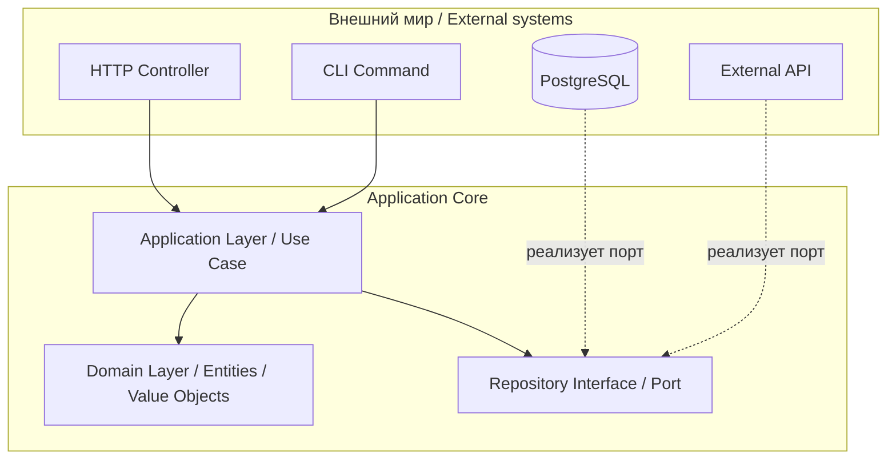
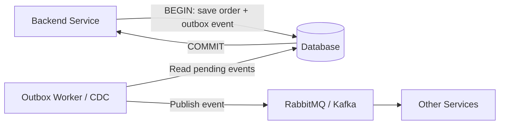
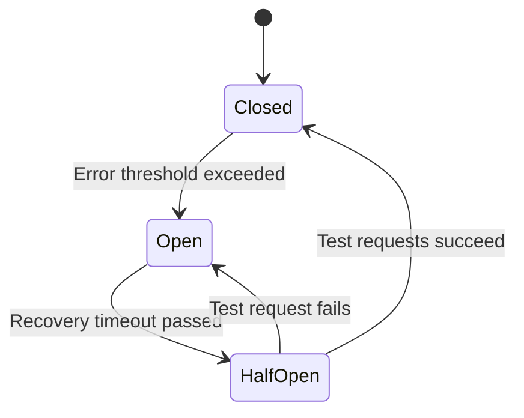

---
## Оглавление

1. [[#1. Принципы SOLID, DRY, KISS, YAGNI]]
    
2. [[#2. Паттерны проектирования (GoF) для PHP-разработчика]]
    
3. [[#3. Архитектурные слои и подходы: MVC, Layered, Clean, Hexagonal, DDD]]
    
4. [[#4. Монолит, модульный монолит и микросервисы]]
    
5. [[#5. Брокеры сообщений и асинхронность]]
    
6. [[#6. Распределённые транзакции: Transactional Outbox и Saga]]
    
7. [[#7. Кэширование: стратегии, инвалидация и проблемы высокой нагрузки]]
    
8. [[#8. Отказоустойчивость: Rate Limiting, Circuit Breaker, Retries]]
    
9. [[#9. Балансировка нагрузки, проксирование и масштабирование]]
    
10. [[#10. Наблюдаемость: логи, метрики и трейсинг]]
    
11. [[#11. Шпаргалка перед собеседованием]]
    

---

# 1. Принципы SOLID, DRY, KISS, YAGNI

## Коротко

**SOLID** помогает проектировать классы с понятными обязанностями, устойчивыми зависимостями и возможностью расширения. **DRY**, **KISS** и **YAGNI** помогают не создавать дублирование и ненужную сложность.

Это рекомендации по проектированию, а не строгие законы. Их применение должно зависеть от требований и сложности приложения.

**SOLID** helps us design classes with clear responsibilities, stable dependencies, and room for extension. **DRY**, **KISS**, and **YAGNI** help us avoid duplicated knowledge and unnecessary complexity.

These principles are design guidelines rather than strict rules. Their application should depend on the actual requirements and complexity of the system.

## Теория

### SOLID

|Принцип|Суть|Типичное нарушение|Как исправить|
|---|---|---|---|
|**S — Single Responsibility**|У класса одна основная ответственность и одна причина для изменения|Контроллер одновременно валидирует, работает с БД, рассчитывает скидку и отправляет email|Разделить обязанности между Request, Action, Service и Notifier|
|**O — Open/Closed**|Код открыт для расширения, но существующее поведение не нужно постоянно изменять|Большой `if/else` для каждого способа оплаты|Интерфейс и отдельные реализации|
|**L — Liskov Substitution**|Наследника можно использовать вместо родителя без нарушения ожидаемого поведения|Наследник изменяет смысл методов родителя|Пересмотреть наследование, использовать композицию или подходящий интерфейс|
|**I — Interface Segregation**|Лучше несколько небольших интерфейсов, чем один большой|Интерфейс содержит методы, которые некоторые реализации не могут поддержать|Разделить интерфейс на узкие контракты|
|**D — Dependency Inversion**|Высокоуровневая бизнес-логика зависит от абстракций, а не от конкретных деталей|Сервис напрямую создаёт `new StripeClient()`|Зависеть от интерфейса и передавать реализацию через DI|

### S — Single Responsibility Principle

Класс должен иметь одну основную ответственность и одну причину для изменения. Это не означает, что класс может содержать только один метод. Важно, чтобы его методы относились к одной логической обязанности.

Например, `OrderService` не должен одновременно рассчитывать стоимость заказа, сохранять его в БД, отправлять email и генерировать PDF. Эти обязанности могут изменяться по разным причинам.

The Single Responsibility Principle states that a class should have one primary responsibility and one reason to change. It does not mean that a class can contain only one method. Its methods should belong to the same logical responsibility.

For example, an `OrderService` should not calculate order prices, persist orders, send emails, and generate PDF documents all at once. These responsibilities may change for different reasons, so they should usually be separated.

### O — Open/Closed Principle

Программные сущности должны быть открыты для расширения, но закрыты для постоянного изменения существующего кода.

Например, если система поддерживает оплату картой, а затем требуется добавить PayPal, желательно добавить новую реализацию интерфейса, а не переписывать существующий `CheckoutService`.

Software entities should be open for extension but closed for modification. This means that new behavior should ideally be introduced without repeatedly changing stable existing code.

For example, if an application already supports card payments and we need to add PayPal, we should preferably create another implementation of the payment interface instead of rewriting the existing `CheckoutService`.

### L — Liskov Substitution Principle

Объекты дочернего класса должны корректно заменять объекты родительского класса, не нарушая ожиданий кода, который работает с родительским типом.

Классический пример — `Square extends Rectangle`. Если родитель позволяет независимо менять ширину и высоту, а квадрат синхронизирует эти значения, то он нарушает ожидаемое поведение прямоугольника.

Subtypes must be usable wherever their base types are expected without breaking the behavior that clients rely on.

A classic example is `Square extends Rectangle`. If the rectangle allows its width and height to be changed independently, but the square automatically changes both dimensions, the subclass violates the expected behavior of the parent class.

### I — Interface Segregation Principle

Клиенты не должны зависеть от методов, которые они не используют. Вместо одного большого интерфейса лучше создавать несколько небольших интерфейсов с конкретными обязанностями.

Например, `Robot` может выполнять работу, но не должен реализовывать бессмысленные методы `eat()` и `sleep()` только потому, что они находятся в общем `WorkerInterface`.

Clients should not be forced to depend on methods they do not use. Instead of one large interface, we should create smaller interfaces with specific responsibilities.

For example, a `Robot` can perform work but should not be forced to implement meaningless `eat()` or `sleep()` methods just because they are part of a general `WorkerInterface`.

### D — Dependency Inversion Principle

Высокоуровневая бизнес-логика не должна напрямую зависеть от низкоуровневых деталей реализации. Оба уровня должны зависеть от абстракций.

Например, `CheckoutService` должен зависеть от `PaymentGatewayInterface`, а не от конкретного SDK Stripe. Тогда реализацию можно заменить, не переписывая бизнес-логику.

High-level business logic should not directly depend on low-level implementation details. Both should depend on abstractions.

For example, `CheckoutService` should depend on `PaymentGatewayInterface`, not on the Stripe SDK directly. This allows us to replace the payment provider without changing the business logic.

### DRY — Don't Repeat Yourself

DRY означает, что одно и то же знание или бизнес-правило не должно дублироваться в нескольких независимых местах.

Например, если правило расчёта скидки повторяется в трёх контроллерах, его лучше вынести в отдельный компонент.

Однако одинаковый код не всегда означает одинаковое знание. Два DTO с одинаковыми полями могут принадлежать разным бизнес-контекстам и изменяться независимо. Не нужно объединять их только ради устранения визуального дублирования.

DRY means that the same piece of knowledge or business rule should not be duplicated across multiple independent places.

For example, if the same discount calculation is repeated in three controllers, it should probably be extracted into a dedicated component.

However, identical code does not always represent identical knowledge. Two DTOs may contain the same fields but belong to different business contexts and evolve independently. We should not merge them just to remove visual duplication.

### KISS — Keep It Simple

Выбирай наиболее простое решение, которое полностью удовлетворяет требованиям.

Не нужно внедрять микросервисы, Kafka и сложную распределённую архитектуру, если обычный монолит и PostgreSQL решают задачу надёжно.

Choose the simplest solution that fully satisfies the requirements.

There is no reason to introduce microservices, Kafka, or a complex distributed architecture if a conventional monolith and PostgreSQL can solve the problem reliably.

### YAGNI — You Aren't Gonna Need It

Не реализуй функциональность и абстракции только потому, что они могут когда-нибудь понадобиться.

Например, не нужно создавать пять интерфейсов и десять реализаций для сервиса, у которого существует только один реальный сценарий использования. Абстракции должны решать существующую проблему, а не гипотетическую.

Do not implement functionality or abstractions just because they might be useful someday.

For example, there is no need to create five interfaces and ten implementations for a service that currently has only one real use case. Abstractions should solve actual problems rather than hypothetical future requirements.

## DI, DIP и DI Container — различия

- **DIP** — принцип проектирования: зависеть от абстракций.
    
- **DI (Dependency Injection)** — техника передачи зависимостей объекту извне.
    
- **DI Container** — инструмент, который автоматически создаёт объекты и разрешает их зависимости.
    

Можно использовать Dependency Injection и при этом нарушать Dependency Inversion, если внедрять конкретный класс вместо абстракции.

- **DIP** is a design principle that tells us to depend on abstractions.
    
- **DI (Dependency Injection)** is a technique for providing dependencies from outside an object.
    
- A **DI Container** is a tool that automatically creates objects and resolves their dependencies.
    

It is possible to use Dependency Injection while still violating Dependency Inversion. For example, injecting a concrete implementation instead of an abstraction does not necessarily follow DIP.

## Код: OCP и DIP на PHP

```php
<?php

declare(strict_types=1);

interface PaymentGateway
{
    public function charge(int $amountCents, string $currency): string;
}

final class StripeGateway implements PaymentGateway
{
    public function charge(int $amountCents, string $currency): string
    {
        // Call Stripe SDK.
        return 'pi_123';
    }
}

final class CheckoutService
{
    public function __construct(
        private PaymentGateway $gateway,
    ) {}

    public function pay(int $amountCents): string
    {
        return $this->gateway->charge($amountCents, 'USD');
    }
}
```

`CheckoutService` зависит от интерфейса `PaymentGateway`, а не от Stripe. Для добавления другого провайдера достаточно создать новую реализацию интерфейса.

`CheckoutService` depends on the `PaymentGateway` interface rather than Stripe itself. To add another payment provider, we only need to create another implementation of the interface.

## Вопросы и ответы

### Чем DIP отличается от Dependency Injection?

DIP — это принцип проектирования, согласно которому модули должны зависеть от абстракций. DI — это способ передать зависимости объекту извне, например через конструктор.

**English answer:**

DIP is a design principle that requires high-level and low-level modules to depend on abstractions. Dependency Injection is a technique for providing those dependencies from outside the class, usually through its constructor.

### Приведи пример нарушения Liskov Substitution Principle.

Если `Square` наследуется от `Rectangle`, но изменение ширины квадрата автоматически изменяет высоту, то код, который ожидает независимое управление сторонами прямоугольника, может работать неправильно.

**English answer:**

A common example is a `Square` extending a `Rectangle`. If changing the square's width also changes its height, code that expects a rectangle to have independently adjustable dimensions may break. The subtype does not preserve the behavioral contract of the parent type.

### Когда нарушение DRY может быть оправдано?

Когда похожие фрагменты кода представляют разные бизнес-правила и могут изменяться независимо. Объединение таких фрагментов создаёт ненужную связанность.

**English answer:**

Some duplication is acceptable when similar code represents different business rules or belongs to separate business contexts. Combining such code may introduce unnecessary coupling. It is often better to keep independent concepts separate than to create a shared abstraction too early.

---

# 2. Паттерны проектирования (GoF) для PHP-разработчика

## Коротко

Паттерны проектирования — это проверенные способы решения повторяющихся проблем в структуре и взаимодействии объектов.

Для PHP-разработчика особенно полезно понимать Strategy, Factory, Decorator, Adapter, Observer, Proxy, Chain of Responsibility, а также DTO, Entity и Value Object.

Design patterns are reusable approaches to common problems in object-oriented software design.

For a PHP developer, the most useful patterns to understand include Strategy, Factory, Decorator, Adapter, Observer, Proxy, Chain of Responsibility, as well as DTOs, Entities, and Value Objects.

## Теория

### Creational Patterns — порождающие паттерны

|Паттерн|Назначение|Пример|
|---|---|---|
|Factory Method / Simple Factory|Инкапсулирует создание объектов|`NotificationFactory`|
|Builder|Пошагово создаёт сложный объект|Сложный HTTP-запрос или объект конфигурации|
|Singleton|Обеспечивает один общий экземпляр|Обычно заменяется shared-сервисом в DI-контейнере|

**Factory** скрывает логику выбора конкретного класса. Клиенту не нужно знать, как именно создаётся объект.

**Builder** полезен, когда объект имеет много необязательных параметров и его неудобно создавать через длинный конструктор.

**Singleton** обеспечивает один экземпляр класса и глобальную точку доступа к нему. Однако он часто считается антипаттерном, потому что создаёт глобальное состояние и скрытые зависимости.

**Factory** hides the logic used to select and create a concrete class. The client does not need to know how the object is instantiated.

**Builder** is useful when an object has many optional parameters and creating it through a long constructor becomes inconvenient.

**Singleton** provides one shared instance and a global access point. However, it is often considered an anti-pattern because it introduces global state and hidden dependencies.

### Structural Patterns — структурные паттерны

|Паттерн|Назначение|Пример|
|---|---|---|
|Decorator|Добавляет поведение, сохраняя интерфейс|Кэширование репозитория|
|Adapter|Преобразует один интерфейс в другой|Адаптер стороннего платёжного SDK|
|Facade|Предоставляет простой интерфейс к сложной подсистеме|Упрощённый API нескольких сервисов|
|Proxy|Контролирует доступ к реальному объекту|Lazy loading, access control|

**Decorator** оборачивает объект с тем же интерфейсом и добавляет дополнительное поведение. Например, можно обернуть репозиторий декоратором, который добавляет кэширование или логирование.

**Adapter** позволяет использовать сторонний класс с интерфейсом, который ожидает наше приложение. Например, адаптер может преобразовать API Stripe или другого платёжного провайдера к внутреннему `PaymentGatewayInterface`.

**Facade** предоставляет простой интерфейс для работы со сложной подсистемой.

Важно: Laravel Facades — это не буквальная реализация классического GoF Facade. Laravel использует фасадный синтаксис для доступа к сервисам через контейнер.

**Proxy** предоставляет объект-заместитель с тем же интерфейсом и контролирует доступ к реальному объекту. Это может использоваться для ленивой загрузки, проверки прав или удалённых вызовов.

**Decorator** wraps an object that implements the same interface and adds extra behavior. For example, we can wrap a repository with a decorator that adds caching or logging.

**Adapter** allows an external class to work with an interface expected by our application. For example, an adapter can translate the Stripe API into our internal `PaymentGatewayInterface`.

**Facade** provides a simplified interface to a complex subsystem.

An important distinction is that Laravel Facades are not a literal implementation of the classic GoF Facade pattern. Laravel uses facade syntax to access services registered in the service container.

**Proxy** provides a substitute object with the same interface and controls access to the real object. It can be used for lazy loading, access checks, or remote calls.

### Behavioral Patterns — поведенческие паттерны

|Паттерн|Назначение|Пример|
|---|---|---|
|Strategy|Взаимозаменяемые алгоритмы|Расчёт стоимости доставки|
|Observer|Подписка на события|Events & Listeners|
|Chain of Responsibility|Последовательная передача запроса обработчикам|HTTP Middleware|
|Command|Представление действия отдельным объектом|Queue Job|
|State|Поведение зависит от состояния объекта|Состояния заказа|
|Template Method|Общий алгоритм с переопределяемыми шагами|Базовый процесс импорта|

**Strategy** позволяет выбирать между несколькими алгоритмами через общий интерфейс. Например, доставка может рассчитываться разными классами для разных перевозчиков.

**Observer** позволяет объектам подписываться на события и реагировать на них. В Laravel похожий механизм реализован через Events и Listeners.

**Chain of Responsibility** передаёт запрос по цепочке обработчиков. Каждый обработчик может обработать запрос или передать его дальше. HTTP Middleware — типичный пример такого подхода.

**Command** представляет действие отдельным объектом. Например, задача отправки email может быть представлена отдельным Queue Job.

**State** позволяет объекту изменять поведение в зависимости от текущего состояния. Например, заказ может иметь разные правила для `Pending`, `Paid`, `Shipped` и `Cancelled`.

**Strategy** allows us to choose between several algorithms through a common interface. For example, different shipping providers can have separate classes implementing the same calculation contract.

**Observer** allows objects to subscribe to events and react when those events occur. Laravel provides a similar mechanism through Events and Listeners.

**Chain of Responsibility** passes a request through a sequence of handlers. Each handler can process the request or pass it to the next handler. HTTP Middleware is a typical example.

**Command** represents an action as a separate object. For example, sending an email can be represented by a dedicated Queue Job.

**State** allows an object's behavior to change depending on its current state. An order, for example, may have different rules in the `Pending`, `Paid`, `Shipped`, and `Cancelled` states.

### Strategy vs State

Структурно эти паттерны могут выглядеть похоже, поскольку оба используют композицию и интерфейсы.

- **Strategy**: клиент выбирает алгоритм и передаёт его объекту.
    
- **State**: сам объект изменяет поведение при смене внутреннего состояния.
    

For example, with Strategy, a client selects a shipping calculation algorithm. With State, an order changes its behavior automatically when its internal state changes.

Although these patterns may have similar structures, their intent is different:

- **Strategy**: the client selects an algorithm and provides it to an object.
    
- **State**: an object changes its behavior when its internal state changes.
    

### DTO, Entity и Value Object

|Тип|Идентичность|Изменяемость|Назначение|
|---|---|---|---|
|DTO|Обычно отсутствует|Может быть изменяемым или неизменяемым|Передача данных|
|Entity|Есть идентификатор|Обычно изменяемая|Бизнес-сущность|
|Value Object|Нет отдельной идентичности|Обычно неизменяемый|Представление значения с правилами|

**DTO (Data Transfer Object)** — объект для передачи данных между слоями или системами. Обычно он не содержит бизнес-логики.

**Entity** имеет идентичность, обычно выраженную через ID. Два объекта с одинаковыми полями могут быть разными сущностями, если у них разные идентификаторы.

**Value Object** определяется своими значениями, а не идентификатором. Обычно он неизменяемый и гарантирует соблюдение собственных правил. Примеры: `Money`, `Email`, `DateRange`.

A **DTO (Data Transfer Object)** carries data between layers or systems. It usually contains no business logic.

An **Entity** has an identity, commonly represented by an ID. Two entities with identical field values may still be different entities if their identifiers are different.

A **Value Object** is defined by its values rather than by an identifier. It is usually immutable and protects its own invariants. Examples include `Money`, `Email`, and `DateRange`.

## Код: Strategy, Decorator и Value Object

```php
<?php

declare(strict_types=1);

final readonly class Money
{
    public function __construct(
        public int $cents,
        public string $currency,
    ) {
        if ($cents < 0) {
            throw new InvalidArgumentException(
                'Amount cannot be negative'
            );
        }
    }
}

interface ShippingCalculatorInterface
{
    public function calculate(
        Money $orderAmount,
        string $city,
    ): Money;
}

final class CourierShipping implements ShippingCalculatorInterface
{
    public function calculate(
        Money $orderAmount,
        string $city,
    ): Money {
        return $orderAmount->cents >= 500_000
            ? new Money(0, $orderAmount->currency)
            : new Money(50_000, $orderAmount->currency);
    }
}

final readonly class CachedShippingCalculator
    implements ShippingCalculatorInterface
{
    public function __construct(
        private ShippingCalculatorInterface $inner,
        private Psr\SimpleCache\CacheInterface $cache,
    ) {}

    public function calculate(
        Money $orderAmount,
        string $city,
    ): Money {
        $key = "shipping:{$city}:{$orderAmount->cents}";

        $cached = $this->cache->get($key);

        if ($cached instanceof Money) {
            return $cached;
        }

        $cost = $this->inner->calculate(
            $orderAmount,
            $city,
        );

        $this->cache->set($key, $cost, 3600);

        return $cost;
    }
}
```

В этом примере `CourierShipping` реализует Strategy. `CachedShippingCalculator` — Decorator: он использует другой калькулятор и добавляет кэширование. `Money` — Value Object.

In this example, `CourierShipping` implements the Strategy pattern. `CachedShippingCalculator` is a Decorator: it delegates the calculation to another calculator and adds caching. `Money` is a Value Object.

## Вопросы и ответы

### Почему Singleton часто считают антипаттерном?

Он создаёт глобальное состояние и скрытые зависимости. Класс самостоятельно получает общий экземпляр, поэтому сложнее контролировать его зависимости и подменять реализацию в тестах.

В долгоживущих PHP-процессах, например Laravel Octane или RoadRunner, состояние общего объекта может случайно сохраняться между запросами, если приложение неправильно управляет его жизненным циклом.

**English answer:**

Singleton is often considered an anti-pattern because it introduces global state and hidden dependencies. A class can access the shared instance directly, which makes dependencies harder to control and implementations harder to replace in tests.

In long-running PHP processes, such as Laravel Octane or RoadRunner, shared object state may accidentally leak between requests if the application does not manage object lifecycles correctly.

### Decorator vs Proxy vs Adapter?

- Decorator сохраняет интерфейс и добавляет поведение.
    
- Proxy сохраняет интерфейс и контролирует доступ к объекту.
    
- Adapter преобразует один интерфейс в другой.
    

**English answer:**

A Decorator keeps the same interface and adds behavior. A Proxy also keeps the same interface but controls access to the underlying object. An Adapter changes the interface of an existing component so that it matches the interface expected by the application.

### Чем DTO отличается от Value Object?

DTO предназначен для передачи данных между компонентами. Value Object представляет конкретное значение и обычно содержит правила валидации и операции над этим значением.

**English answer:**

A DTO is primarily used to transfer data between components and usually contains no business logic. A Value Object represents a domain value and may contain validation rules and operations related to that value. It is typically immutable and compared by its contents rather than by an ID.

### Какой паттерн реализует Middleware?

Chain of Responsibility. Каждый middleware получает запрос и либо обрабатывает его, либо передаёт следующему обработчику через `$next($request)`.

**English answer:**

HTTP Middleware is commonly based on the Chain of Responsibility pattern. Each middleware receives a request and can process it or pass it to the next handler using `$next($request)`.

---

# 3. Архитектурные слои и подходы: MVC, Layered, Clean, Hexagonal, DDD

## Коротко

Архитектура определяет, как разделить систему на компоненты и как они должны взаимодействовать.

Главная идея Clean и Hexagonal Architecture: **бизнес-логика не должна зависеть от инфраструктурных деталей**, таких как конкретная БД, HTTP-фреймворк или внешний API.

Software architecture defines how an application is divided into components and how those components communicate.

The central idea behind Clean and Hexagonal Architecture is that **business logic should not depend on infrastructure details**, such as a specific database, HTTP framework, or external API.

## Теория

### MVC — Model, View, Controller

MVC разделяет приложение на три основные части:

- **Model** — данные и связанная с ними логика.
    
- **View** — представление данных пользователю.
    
- **Controller** — принимает запрос и координирует обработку.
    

В API-приложениях View часто заменяется JSON-ответом или API Resource.

MVC помогает разделять обработку запросов и отображение данных, но сам по себе не гарантирует правильное разделение бизнес-логики. Если контроллеры становятся слишком большими, бизнес-сценарии лучше выносить в Actions или Services.

MVC separates an application into three main components:

- **Model** — data and related logic.
    
- **View** — presentation of data to the user.
    
- **Controller** — receives requests and coordinates their processing.
    

In API applications, the View is often replaced by a JSON response or an API Resource.

MVC helps separate request handling from presentation, but it does not automatically guarantee a clean separation of business logic. If controllers become too large, business use cases should be extracted into Actions or Services.

### Layered Architecture — слоистая архитектура

Типичная слоистая архитектура может включать четыре уровня:

1. **Presentation / HTTP Layer** — контроллеры, middleware, request validation, API Resources.
    
2. **Application Layer** — Use Cases, Actions, Services, оркестрация бизнес-сценариев.
    
3. **Domain Layer** — сущности, Value Objects, доменные сервисы, бизнес-правила и контракты.
    
4. **Infrastructure Layer** — PostgreSQL, Redis, Eloquent, внешние API, email, файловое хранилище.
    

Например, контроллер принимает HTTP-запрос, вызывает Application Service, тот выполняет бизнес-сценарий и обращается к репозиторию через интерфейс. Конкретный репозиторий находится в Infrastructure.

A typical layered architecture may contain four layers:

1. **Presentation / HTTP Layer** — controllers, middleware, request validation, and API Resources.
    
2. **Application Layer** — Use Cases, Actions, Services, and business workflow orchestration.
    
3. **Domain Layer** — entities, Value Objects, domain services, business rules, and contracts.
    
4. **Infrastructure Layer** — PostgreSQL, Redis, Eloquent, external APIs, email, and file storage.
    

For example, a controller receives an HTTP request and calls an Application Service. The service executes a business use case and accesses a repository through an interface. The concrete repository implementation belongs to the Infrastructure layer.

### Hexagonal Architecture — Ports and Adapters

Hexagonal Architecture разделяет систему на ядро и внешние компоненты.

- **Ports** — интерфейсы, через которые ядро взаимодействует с внешним миром.
    
- **Adapters** — конкретные реализации этих интерфейсов.
    

Входящие адаптеры вызывают приложение: HTTP Controller, CLI Command, Queue Consumer.

Исходящие адаптеры реализуют взаимодействие с внешними системами: PostgreSQL Repository, Stripe Client, SMTP Mailer.

Например, доменный или application-компонент зависит от `OrderRepositoryInterface`, а инфраструктура предоставляет `PostgresOrderRepository`.

Hexagonal Architecture separates the application into a core and external components.

- **Ports** are interfaces through which the core communicates with the outside world.
    
- **Adapters** are concrete implementations that connect external technologies to those interfaces.
    

Incoming adapters invoke the application, such as HTTP controllers, CLI commands, and queue consumers.

Outgoing adapters connect the application to external systems, such as PostgreSQL repositories, Stripe clients, and SMTP mailers.

For example, an application component depends on `OrderRepositoryInterface`, while the infrastructure layer provides `PostgresOrderRepository`.

### Clean Architecture

Clean Architecture использует идею концентрических слоёв:

1. **Entities** — основные бизнес-правила.
    
2. **Use Cases** — сценарии приложения.
    
3. **Interface Adapters** — контроллеры, presenters, repositories.
    
4. **Frameworks and Drivers** — Laravel, PostgreSQL, Redis, HTTP-клиенты.
    

Главное правило — **Dependency Rule**: зависимости исходного кода направлены внутрь, к бизнес-логике.

Внутренние слои не должны знать о внешних деталях. Например, Domain Entity не должна наследоваться от Eloquent Model, если цель — сохранить независимость домена от Laravel.

Clean Architecture uses the idea of concentric layers:

1. **Entities** — core business rules.
    
2. **Use Cases** — application-specific business workflows.
    
3. **Interface Adapters** — controllers, presenters, and repositories.
    
4. **Frameworks and Drivers** — Laravel, PostgreSQL, Redis, and HTTP clients.
    

The most important rule is the **Dependency Rule**: source code dependencies must point inward, toward the business logic.

Inner layers should not know about outer implementation details. For example, a Domain Entity should not extend an Eloquent Model if the goal is to keep the domain independent from Laravel.

### DDD — Domain-Driven Design

DDD — подход к проектированию сложных систем вокруг предметной области бизнеса.

Основные понятия:

- **Ubiquitous Language** — единый язык бизнеса и разработки. Термины в коде должны соответствовать реальным бизнес-понятиям.
    
- **Bounded Context** — граница, внутри которой модель и термины имеют определённое значение.
    
- **Entity** — объект с идентичностью.
    
- **Value Object** — объект, определяемый значениями.
    
- **Aggregate** — группа связанных объектов, которая должна сохранять бизнес-инварианты.
    
- **Aggregate Root** — единственная внешняя точка изменения агрегата.
    

Например, `Product` в контексте каталога может содержать название, описание и фотографии, а в контексте склада — SKU, остаток и складское расположение. Это разные модели одного бизнес-понятия.

DDD is an approach to designing complex systems around the business domain.

Its main concepts include:

- **Ubiquitous Language** — a shared language used by both business stakeholders and developers. Code terminology should reflect real business concepts.
    
- **Bounded Context** — a boundary within which a domain model and its terminology have a specific meaning.
    
- **Entity** — an object with a unique identity.
    
- **Value Object** — an object defined by its values.
    
- **Aggregate** — a group of related objects that must preserve business invariants.
    
- **Aggregate Root** — the only external entry point through which an aggregate can be modified.
    

For example, a `Product` in the Catalog context may contain a name, description, and images, while a `Product` in the Warehouse context may contain an SKU, stock quantity, and storage location. These are different models of the same business concept.

### CQRS — Command Query Responsibility Segregation

CQRS разделяет операции изменения данных и чтения данных.

- **Command** изменяет состояние системы.
    
- **Query** возвращает данные, не изменяя состояние.
    

В простом варианте можно использовать разные классы и модели для чтения и записи, даже если они работают с одной БД.

В более сложной системе чтение может использовать отдельную денормализованную модель или read replica. При этом появляется дополнительная сложность синхронизации и возможная eventual consistency.

CQRS separates operations that modify data from operations that read data.

- A **Command** changes the state of the system.
    
- A **Query** retrieves data without changing the system state.
    

In a simple implementation, we can use separate classes and models for reading and writing while still using the same database.

In a more advanced system, reads may use a separate denormalized model or a read replica. This introduces additional synchronization complexity and may result in eventual consistency.

## Схема



## Вопросы и ответы

### Чем Clean Architecture отличается от обычной Layered Architecture?

В обычной Layered Architecture зависимости часто идут сверху вниз, и бизнес-логика может зависеть от конкретного слоя данных.

В Clean Architecture зависимости направлены внутрь. Инфраструктура реализует интерфейсы, определённые внутренними слоями. Благодаря этому бизнес-логика не зависит от конкретной БД или фреймворка.

**English answer:**

In a traditional Layered Architecture, dependencies often flow from the presentation layer toward the data layer. As a result, business logic may become tightly coupled to database implementations.

In Clean Architecture, dependencies point inward toward the domain and application core. Infrastructure implements interfaces defined by the inner layers. This keeps business logic independent of a specific database or framework.

### Где должна находиться бизнес-логика в Laravel?

Контроллер должен отвечать за HTTP-взаимодействие: получить запрос, вызвать нужный сценарий и вернуть ответ.

Бизнес-сценарии можно выносить в Actions или Use Cases. Сложные доменные правила лучше размещать в Domain Services, Entities или Value Objects. Eloquent-модели можно использовать для persistence, но не стоит превращать их в объекты, отвечающие за всю бизнес-логику системы.

**English answer:**

A Laravel controller should handle HTTP-related responsibilities: receive the request, invoke the appropriate use case, and return a response.

Business workflows can be extracted into Actions or Use Cases. Complex domain rules belong in Domain Services, Entities, or Value Objects. Eloquent models can handle persistence, but they should not become objects responsible for the entire business logic of the application.

### Когда DDD будет избыточен?

Для простых CRUD-приложений, административных панелей и небольших проектов полноценный DDD может добавить больше сложности, чем пользы.

DDD оправдан, когда предметная область содержит сложные правила, процессы, множество бизнес-состояний и несколько контекстов.

**English answer:**

Full DDD may be excessive for simple CRUD applications, admin panels, or small projects because it can introduce more complexity than value.

DDD becomes useful when the business domain contains complex rules, workflows, multiple states, and clearly separated business contexts.

---

# 4. Монолит, модульный монолит и микросервисы

## Коротко

Монолит — приложение, которое развёртывается как единое целое. Модульный монолит сохраняет единый deployment, но разделяет код на независимые модули.

Микросервисы дают независимое развёртывание и масштабирование, но добавляют сетевую сложность, распределённые транзакции и необходимость развитой инфраструктуры.

A monolith is an application deployed as a single unit. A modular monolith keeps a single deployment but divides the codebase into well-defined modules.

Microservices provide independent deployment and scaling, but introduce network communication, distributed transaction complexity, and greater infrastructure requirements.

## Теория

|Критерий|Монолит / модульный монолит|Микросервисы|
|---|---|---|
|Deployment|Один deployable unit|Несколько независимых сервисов|
|База данных|Часто общая БД|Обычно отдельная БД на сервис|
|Взаимодействие|Вызовы в памяти|HTTP, gRPC, messaging|
|Транзакции|Локальные ACID-транзакции|Локальные транзакции и Saga|
|Масштабирование|Обычно приложение целиком|Отдельные сервисы|
|Отладка|Проще локально|Нужны distributed tracing и централизованные логи|
|Инфраструктура|Проще|Сложнее|
|Команды|Часто общий release process|Возможны независимые команды и релизы|

### Monolith

Монолит — приложение, в котором основные компоненты собираются и развёртываются как единое целое.

Это не означает, что код обязательно плохо организован. Монолит может иметь хорошее разделение на слои и модули.

A monolith is an application whose main components are built and deployed as a single unit.

This does not mean that the code must be poorly structured. A monolithic application can still have clear layers, modules, and well-defined boundaries.

### Modular Monolith

Модульный монолит — единое приложение с чёткими внутренними границами.

Например, приложение электронной коммерции может иметь модули:

- Catalog
    
- Orders
    
- Payments
    
- Inventory
    
- Users
    

Модули взаимодействуют через публичные интерфейсы или события. Желательно не допускать прямого доступа к внутренним таблицам и классам другого модуля без необходимости.

Модульный монолит часто является хорошим компромиссом между простотой разработки и архитектурной дисциплиной.

A modular monolith is a single application with clearly defined internal boundaries.

For example, an e-commerce application may contain the following modules:

- Catalog
    
- Orders
    
- Payments
    
- Inventory
    
- Users
    

Modules communicate through public interfaces or events. Direct access to another module's internal tables and classes should be avoided where possible.

A modular monolith is often a good compromise between development simplicity and architectural discipline.

### Microservices

Микросервисы — архитектура, в которой система разделена на небольшие независимо развёртываемые сервисы.

Обычно каждый сервис владеет собственными данными и предоставляет другим сервисам доступ через API или события.

Например, `Payment Service` отвечает за платежи, а `Inventory Service` — за складские остатки.

Преимущества:

- независимое масштабирование;
    
- независимые релизы;
    
- возможность использовать разные технологии;
    
- изоляция некоторых отказов;
    
- независимая ответственность команд.
    

Недостатки:

- сетевые задержки и ошибки;
    
- сложность распределённых транзакций;
    
- необходимость централизованного логирования и трейсинга;
    
- усложнение локальной разработки и тестирования;
    
- дополнительная инфраструктура.
    

Microservices are an architectural style in which a system is divided into small, independently deployable services.

Each service typically owns its own data and exposes access to other services through APIs or events.

For example, a `Payment Service` handles payments, while an `Inventory Service` manages stock quantities.

Advantages include:

- independent scaling;
    
- independent deployments;
    
- the ability to use different technologies;
    
- isolation of some failures;
    
- independent team ownership.
    

Disadvantages include:

- network latency and communication failures;
    
- distributed transaction complexity;
    
- the need for centralized logging and tracing;
    
- more complicated local development and testing;
    
- additional infrastructure requirements.
    

### Database per Service

Каждый микросервис должен владеть своими данными. Другие сервисы не должны напрямую изменять его таблицы.

Если сервису нужны данные другого сервиса, он обращается к его API или получает события.

Это снижает связанность, но усложняет запросы, которые раньше можно было выполнить через обычный SQL JOIN.

Each microservice should own its data. Other services should not directly modify its database tables.

If a service needs information from another service, it should use that service's API or consume its events.

This reduces coupling, but makes cross-service queries more complicated than ordinary SQL JOIN operations.

### Distributed Monolith

Распределённый монолит — система, в которой компоненты физически разделены на сервисы, но остаются тесно связанными.

Например, сервисы используют общую БД, постоянно синхронно вызывают друг друга и не могут выпускаться независимо.

Такая архитектура получает недостатки микросервисов, но не использует их основные преимущества.

A distributed monolith is a system in which components are physically separated into services but remain tightly coupled.

For example, services may share one database, depend on long chains of synchronous calls, and require coordinated deployments.

This architecture introduces many disadvantages of microservices without providing their main benefits.

### API Gateway и BFF

**API Gateway** — единая точка входа для клиентов. Он может выполнять маршрутизацию, аутентификацию, rate limiting и другие общие функции.

**BFF (Backend For Frontend)** — отдельный backend-слой для конкретного типа клиента. Например, отдельный BFF для мобильного приложения и веб-приложения.

An **API Gateway** is a single entry point for clients. It may handle routing, authentication, rate limiting, and other shared responsibilities.

A **BFF (Backend For Frontend)** is a backend layer designed for a specific client type. For example, a mobile application and a web application may use different BFFs with different response formats.

### Strangler Fig Pattern

Strangler Fig — стратегия постепенной миграции со старого монолита на новую архитектуру.

Вместо полного переписывания приложения отдельные функции постепенно переносятся в новые сервисы, а маршрутизация запросов переключается на новые компоненты.

The Strangler Fig pattern is a gradual migration strategy for replacing a legacy monolith.

Instead of rewriting the entire application at once, individual features are gradually moved into new services. Requests are progressively routed to the new components while the remaining functionality continues to run in the old system.

## Вопросы и ответы

### Когда стоит переходить на микросервисы?

Когда существуют реальные причины: отдельные части системы требуют независимого масштабирования, команды мешают друг другу при релизах, есть необходимость в независимом владении данными или изоляции отказов.

Также необходима инфраструктурная зрелость: CI/CD, мониторинг, логирование, distributed tracing и автоматизированное тестирование.

**English answer:**

I would consider microservices when there are clear business or technical reasons. For example, different parts of the system may need independent scaling, development teams may need independent release cycles, or certain components may require stronger isolation.

However, the organization must also have sufficient operational maturity, including CI/CD, monitoring, centralized logging, distributed tracing, and automated testing.

### Почему модульный монолит часто лучше для старта?

Он сохраняет простоту единого deployment и локальных транзакций, но позволяет разделять бизнес-области на модули.

Если позже появится реальная необходимость, отдельный модуль можно будет выделить в сервис.

**English answer:**

A modular monolith is often a better starting point because it keeps deployment and local transactions simple while maintaining clear boundaries between business modules.

If a particular module later requires independent scaling or deployment, it can be extracted into a separate service.

### Как обеспечить согласованность данных между микросервисами?

Обычно используют локальные транзакции, события, Transactional Outbox, Saga и идемпотентных consumers.

Вместо одной общей ACID-транзакции система может использовать eventual consistency.

**English answer:**

Consistency between microservices is usually handled through local transactions, events, the Transactional Outbox pattern, Sagas, and idempotent consumers.

Instead of relying on one global ACID transaction, the system often uses eventual consistency.

---

# 5. Брокеры сообщений и асинхронность: RabbitMQ, Kafka и Redis

## Коротко

Брокеры сообщений позволяют выполнять работу асинхронно, снижать связанность компонентов и сглаживать пики нагрузки.

**Redis** подходит для простых фоновых задач и быстрых очередей, **RabbitMQ** — для гибкой маршрутизации и традиционной модели сообщений, **Kafka** — для потоков событий, высокой пропускной способности и повторного чтения истории.

Message brokers allow applications to process work asynchronously, reduce coupling between components, and absorb traffic spikes.

**Redis** is useful for simple background jobs and lightweight queues, **RabbitMQ** is suitable for flexible routing and traditional message processing, and **Kafka** is designed for event streams, high throughput, and replaying historical data.

## Теория

### Зачем нужны очереди

1. **Быстрый ответ пользователю.** Тяжёлые задачи, например отправка email или генерация PDF, выполняются в фоне.
    
2. **Сглаживание нагрузки.** Если приходит много заказов, сообщения накапливаются, а workers обрабатывают их с доступной скоростью.
    
3. **Изоляция сбоев.** Временная недоступность внешнего сервиса не обязательно должна блокировать основной пользовательский запрос.
    
4. **Повторная обработка.** Неудачные задачи могут быть повторены после временной ошибки.
    
5. **Ослабление связанности.** Producer не обязан знать детали реализации consumer.
    

Queues provide several important benefits:

1. **Faster user responses.** Expensive tasks, such as sending emails or generating PDFs, can run in the background.
    
2. **Load smoothing.** If many orders arrive at once, messages can accumulate while workers process them at a sustainable rate.
    
3. **Failure isolation.** A temporary failure of an external service does not necessarily need to block the main user request.
    
4. **Retry support.** Failed jobs can be retried after temporary errors.
    
5. **Reduced coupling.** A producer does not need to know the internal implementation details of a consumer.
    

### Redis vs RabbitMQ vs Kafka

|Характеристика|Redis|RabbitMQ|Kafka|
|---|---|---|---|
|Основная модель|In-memory data store, Lists, Streams|Message Broker, exchanges и queues|Distributed append-only log|
|Хранение|Зависит от persistence и конфигурации|Сообщения обычно удаляются после ACK|Хранит сообщения по retention policy|
|Маршрутизация|Обычно через ключи и очереди|Exchanges: Direct, Topic, Fanout, Headers|Topics и Partitions|
|Порядок|Зависит от структуры и механизма обработки|Порядок зависит от очереди и конкурирующих consumers|Внутри одной partition|
|Повторное чтение|Зависит от механизма|Обычно ограничено моделью очереди|Поддерживается через offsets и retention|
|Основное применение|Background jobs, cache, простые очереди|Надёжная маршрутизация сообщений|Event streaming, analytics, event pipelines|

### Redis

Redis — быстрое in-memory хранилище данных, которое поддерживает разные структуры: Lists, Sets, Sorted Sets, Streams и другие.

Для фоновых задач Redis часто используется как backend очередей, например в Laravel Queue.

При этом Redis — не только брокер сообщений. Это универсальное хранилище, а поведение очереди зависит от выбранного механизма и конфигурации persistence.

Redis is a fast in-memory data store that supports several data structures, including Lists, Sets, Sorted Sets, and Streams.

For background jobs, Redis is often used as a queue backend, for example with Laravel Queue.

However, Redis is not exclusively a message broker. It is a general-purpose data store, and queue durability and delivery behavior depend on the selected mechanism and persistence configuration.

### RabbitMQ

RabbitMQ — классический message broker, который поддерживает AMQP и гибкую маршрутизацию сообщений.

Основные компоненты:

- **Producer** — отправляет сообщение.
    
- **Exchange** — принимает сообщение и определяет маршрутизацию.
    
- **Queue** — хранит сообщения до обработки.
    
- **Binding** — связывает exchange с очередью.
    
- **Consumer** — получает и обрабатывает сообщение.
    
- **ACK** — подтверждает успешную обработку.
    

Основные типы exchange:

- **Direct** — маршрутизация по точному routing key.
    
- **Topic** — маршрутизация по шаблону routing key.
    
- **Fanout** — отправка во все связанные очереди.
    
- **Headers** — маршрутизация на основе заголовков.
    

RabbitMQ is a traditional message broker that supports AMQP and flexible message routing.

Its main components are:

- **Producer** — publishes a message.
    
- **Exchange** — receives a message and determines where it should be routed.
    
- **Queue** — stores messages until they are processed.
    
- **Binding** — connects an exchange to a queue.
    
- **Consumer** — receives and processes a message.
    
- **ACK** — confirms successful processing.
    

The main exchange types are:

- **Direct** — routes messages using an exact routing key.
    
- **Topic** — routes messages using routing key patterns.
    
- **Fanout** — sends messages to all bound queues.
    
- **Headers** — routes messages based on message headers.
    

### Apache Kafka

Kafka — распределённая платформа потоковой обработки событий, основанная на append-only log.

Сообщения записываются в **Topics**, которые разделяются на **Partitions**.

Consumer читает сообщения и отслеживает позицию чтения через **Offset**.

Основные понятия:

- **Topic** — логическая категория событий.
    
- **Partition** — упорядоченная часть topic.
    
- **Offset** — позиция сообщения в partition.
    
- **Consumer Group** — группа consumers, совместно читающих topic.
    
- **Retention** — период или политика хранения сообщений.
    

Kafka сохраняет сообщения независимо от того, прочитал ли их consumer. Поэтому consumer может повторно прочитать историю, если сообщения ещё находятся в retention period.

Порядок сообщений гарантируется внутри одной partition, но не между всеми partition одного topic.

Kafka is a distributed event streaming platform based on an append-only log.

Messages are written to **Topics**, which are divided into **Partitions**.

A consumer reads messages and tracks its reading position through an **Offset**.

Important Kafka concepts include:

- **Topic** — a logical category of events.
    
- **Partition** — an ordered part of a topic.
    
- **Offset** — the position of a message within a partition.
    
- **Consumer Group** — a group of consumers that share the work of reading a topic.
    
- **Retention** — the policy that determines how long messages are stored.
    

Kafka retains messages independently of whether a consumer has already read them. Therefore, a consumer can replay historical messages while they are still within the retention period.

Message ordering is guaranteed within a single partition, but not across all partitions of a topic.

### Семантика доставки сообщений

|Семантика|Поведение|Риск|
|---|---|---|
|At-most-once|Сообщение доставляется не более одного раза|Возможна потеря|
|At-least-once|Сообщение может доставляться повторно|Возможны дубликаты|
|Exactly-once|Обработка имеет эффект ровно один раз в заданных границах|Сложно гарантировать для внешних систем|

**At-most-once** означает, что сообщение не будет обработано повторно, но может потеряться.

**At-least-once** означает, что система повторяет доставку до подтверждения. Поэтому сообщение может прийти несколько раз.

**Exactly-once** требует особых механизмов координации и транзакций. Kafka поддерживает exactly-once processing в определённых границах Kafka, например при чтении и записи в Kafka с транзакциями. Однако это автоматически не гарантирует exactly-once эффект во внешней БД или платёжном API.

Практический подход для внешних побочных эффектов — at-least-once delivery вместе с идемпотентной обработкой.

**At-most-once** means that a message is not processed more than once, but it may be lost.

**At-least-once** means that the system retries delivery until it receives confirmation. As a result, the same message may be delivered multiple times.

**Exactly-once** requires additional coordination and transaction mechanisms. Kafka supports exactly-once processing within specific Kafka boundaries, such as consuming and producing Kafka records transactionally. However, this does not automatically guarantee exactly-once effects in an external database or payment API.

A practical approach for external side effects is at-least-once delivery combined with idempotent processing.

### Idempotency — идемпотентность

Операция идемпотентна, если повторное выполнение с теми же данными не меняет конечный результат после первого успешного выполнения.

Например, обработка одного и того же `OrderPaid` event не должна списать деньги дважды.

An operation is idempotent if repeating it with the same input does not change the final result after the first successful execution.

For example, processing the same `OrderPaid` event twice must not charge the customer twice.

### ACK, NACK, DLQ и Backpressure

- **ACK** — consumer подтвердил успешную обработку.
    
- **NACK** — consumer сообщил, что обработка не удалась.
    
- **DLQ (Dead Letter Queue)** — очередь для сообщений, которые не удалось обработать после заданного числа попыток или по другой установленной политике.
    
- **Prefetch** — ограничивает количество сообщений, которые consumer получает заранее.
    
- **Backpressure** — механизм, позволяющий не перегружать consumer потоком входящих сообщений.
    
- **ACK** means that the consumer has successfully processed the message.
    
- **NACK** indicates that message processing failed.
    
- **DLQ (Dead Letter Queue)** stores messages that cannot be processed after a configured number of attempts or according to another failure policy.
    
- **Prefetch** limits the number of messages a consumer receives in advance.
    
- **Backpressure** prevents producers from overwhelming consumers with more work than they can handle.
    

## Код: идемпотентный consumer

```sql
CREATE TABLE processed_messages (
    message_id UUID PRIMARY KEY,
    processed_at TIMESTAMPTZ NOT NULL DEFAULT NOW()
);
```

```php
<?php

DB::transaction(function () use ($message): void {
    $inserted = DB::table('processed_messages')->insertOrIgnore([
        'message_id' => $message->id,
    ]);

    if ($inserted === 0) {
        return;
    }

    // Business logic is executed only once
    // within this transaction boundary.
    // Update order, reserve inventory, etc.
});
```

Запись идентификатора сообщения и бизнес-изменения должны выполняться в одной транзакции. Тогда повторная доставка не приведёт к повторному применению бизнес-операции.

The message ID and business changes must be stored in the same transaction. This ensures that a repeated delivery does not apply the same business operation again.

## Вопросы и ответы

### Почему exactly-once сложно гарантировать?

Потому что отправитель может не получить подтверждение, даже если consumer уже обработал сообщение. Отправитель повторит доставку, и consumer получит дубликат.

Идемпотентная обработка позволяет сделать повторную доставку безопасной в рамках определённой транзакционной границы.

**English answer:**

Exactly-once processing is difficult because a producer may not receive an acknowledgement even when the consumer has already processed the message. The producer may retry, causing the consumer to receive a duplicate.

Idempotent processing makes repeated delivery safe within a defined transaction boundary.

### Как сохранить порядок сообщений в Kafka?

Порядок гарантируется внутри одной partition. Если все события одного заказа должны обрабатываться по порядку, можно использовать `order_id` как message key.

**English answer:**

Kafka guarantees ordering within a single partition. If all events for the same order must be processed in order, we can use `order_id` as the message key so that events for that order are routed to the same partition.

### Что делать с сообщением, которое постоянно вызывает ошибку?

Ограничить число повторных попыток, использовать exponential backoff, затем отправить сообщение в DLQ и создать alert для дальнейшего анализа.

**English answer:**

We should limit the number of retries, use exponential backoff, and move the message to a Dead Letter Queue after repeated failures. We should also generate an alert so that the message can be investigated.

---

# 6. Распределённые транзакции: Transactional Outbox и Saga

## Коротко

Обычная ACID-транзакция не может атомарно охватить запись в PostgreSQL и публикацию сообщения в отдельный RabbitMQ или Kafka.

**Transactional Outbox** решает проблему надёжной публикации событий, а **Saga** помогает управлять бизнес-процессами, которые затрагивают несколько сервисов.

A regular ACID transaction cannot atomically cover a PostgreSQL write and publishing a message to a separate RabbitMQ or Kafka system.

The **Transactional Outbox** pattern solves the reliable event publishing problem, while a **Saga** coordinates business workflows that involve multiple services.

## Теория

### Dual Write Problem

Предположим, приложение создаёт заказ и публикует событие:

```php
$order = Order::create($data);

$broker->publish(new OrderCreated($order->id));
```

Здесь две независимые операции:

1. Запись заказа в БД.
    
2. Публикация события в брокер.
    

Если процесс упадёт между ними, заказ сохранится, но событие не будет опубликовано.

Если сначала публиковать событие, а затем сохранять заказ, возможна обратная проблема: событие опубликовано, но заказ не создан.

This is called the **Dual Write Problem**.

The application performs two independent operations:

1. Saving the order in the database.
    
2. Publishing an event to the message broker.
    

If the process crashes between these operations, the order may be saved while the event is never published.

If we publish the event first and save the order afterwards, the opposite problem can occur: the event is published, but the order is not created.

### Transactional Outbox

Outbox решает проблему через локальную транзакцию:

1. Создать заказ.
    
2. Создать запись о событии в таблице `outbox_messages`.
    
3. Зафиксировать обе операции одним `COMMIT`.
    
4. Отдельный worker или CDC-процесс читает outbox.
    
5. Worker публикует событие в брокер.
    
6. После успешной публикации событие помечается отправленным.
    

Заказ и событие сохраняются в одной транзакции одной БД.

При этом публикация может повторяться, поэтому consumer всё равно должен быть идемпотентным.

The Outbox pattern solves this problem through a local database transaction:

1. Create the order.
    
2. Insert an event record into the `outbox_messages` table.
    
3. Commit both operations in the same transaction.
    
4. A separate worker or CDC process reads the outbox.
    
5. The worker publishes the event to the broker.
    
6. After successful publication, the event is marked as sent.
    

The order and its event are saved in one transaction within the same database.

However, publication may be repeated, so consumers must still be idempotent.

### Saga Pattern

Saga — последовательность локальных транзакций в нескольких сервисах.

Например:

1. Order Service создаёт заказ.
    
2. Inventory Service резервирует товар.
    
3. Payment Service списывает деньги.
    
4. Order Service подтверждает заказ.
    

Если платёж не прошёл, необходимо выполнить компенсирующие действия: снять резерв товара и отменить заказ.

Saga не делает распределённый процесс одной ACID-транзакцией. Вместо этого она управляет последовательностью локальных транзакций и компенсаций.

A Saga is a sequence of local transactions across multiple services.

For example:

1. Order Service creates an order.
    
2. Inventory Service reserves the product.
    
3. Payment Service charges the customer.
    
4. Order Service confirms the order.
    

If payment fails, compensating actions must be executed: release the reserved stock and cancel the order.

A Saga does not turn the entire distributed workflow into one ACID transaction. Instead, it coordinates local transactions and compensating actions.

### Choreography vs Orchestration

**Choreography** — сервисы реагируют на события друг друга без центрального управляющего компонента.

Преимущества: слабая централизация и относительно простая реализация небольших процессов.

Недостатки: общий бизнес-процесс сложнее отслеживать, поскольку логика распределена между сервисами.

**Orchestration** — центральный orchestrator управляет последовательностью шагов.

Преимущества: общий workflow находится в одном месте, проще отслеживать состояние и ошибки.

Недостатки: orchestrator становится дополнительным компонентом, который нужно поддерживать.

In **Choreography**, services react to each other's events without a central coordinator.

Advantages include less centralized control and relatively simple implementation for small workflows.

The disadvantage is that the overall business process becomes harder to understand because its logic is distributed across several services.

In **Orchestration**, a central orchestrator controls the sequence of steps.

The main advantage is that the workflow is defined in one place, making its state and failures easier to monitor.

The disadvantage is that the orchestrator becomes another component that must be maintained and operated.

### Eventual Consistency

Eventual consistency означает, что разные части системы могут временно содержать разные версии данных, но при успешной обработке событий со временем приходят к согласованному состоянию.

Например, после создания заказа информация о нём может появиться в аналитической системе через несколько секунд.

Eventual consistency means that different parts of a system may temporarily contain different versions of the data, but they eventually converge to a consistent state if processing succeeds.

For example, after an order is created, it may take a few seconds before the order appears in an analytics system.

### Two-Phase Commit

2PC — протокол распределённой транзакции, состоящий из двух фаз:

1. **Prepare** — участники подтверждают готовность к commit.
    
2. **Commit** — координатор при успешной подготовке отправляет команду фиксации.
    

2PC может обеспечить атомарность между участвующими системами при поддержке соответствующего протокола, но создаёт блокировки и дополнительные зависимости от координатора.

В микросервисной архитектуре чаще предпочитают Saga и eventual consistency.

2PC is a distributed transaction protocol with two phases:

1. **Prepare** — participants confirm that they are ready to commit.
    
2. **Commit** — if all participants are prepared, the coordinator instructs them to commit.
    

2PC can provide atomicity across participating systems when they support the protocol, but it introduces blocking behavior and additional dependency on the coordinator.

In microservice architectures, Saga and eventual consistency are often preferred.

## Схема Outbox



## Код: таблица Outbox

```sql
CREATE TABLE outbox_messages (
    id BIGINT GENERATED ALWAYS AS IDENTITY PRIMARY KEY,
    aggregate_id BIGINT NOT NULL,
    type VARCHAR(100) NOT NULL,
    payload JSONB NOT NULL,
    created_at TIMESTAMPTZ NOT NULL DEFAULT NOW(),
    sent_at TIMESTAMPTZ NULL
);
```

Worker может использовать блокировку строк:

```sql
SELECT id, type, payload
FROM outbox_messages
WHERE sent_at IS NULL
ORDER BY id
LIMIT 100
FOR UPDATE SKIP LOCKED;
```

`SKIP LOCKED` позволяет нескольким workers выбирать разные доступные строки, не ожидая блокировок друг друга. Для надёжной реализации необходимо продумать границу транзакции, обработку публикации и восстановление после падения worker.

`SKIP LOCKED` allows multiple workers to select different available rows without waiting for one another's row locks. A reliable implementation must also define transaction boundaries, publication handling, and recovery after worker failures.

## Вопросы и ответы

### Почему нельзя просто опубликовать событие после commit?

Между commit и публикацией процесс может упасть. Данные уже сохранены, но событие потеряно.

Outbox сохраняет намерение опубликовать событие в той же транзакции, что и бизнес-данные.

**English answer:**

The process may crash between the database commit and message publication. The business data is already saved, but the event is lost.

The Outbox pattern stores the intention to publish the event in the same transaction as the business data. A separate worker publishes it later.

### Чем отличается Choreography от Orchestration?

Choreography основана на взаимодействии через события без центрального координатора. Orchestration использует отдельный компонент, который управляет процессом.

**English answer:**

Choreography is based on services reacting to events without a central coordinator. Orchestration uses a dedicated component that controls the workflow and coordinates the participating services.

### Зачем нужен FOR UPDATE SKIP LOCKED?

Он позволяет нескольким workers параллельно выбирать разные строки. Worker пропускает строки, которые уже заблокированы другим worker, вместо того чтобы ждать их освобождения.

**English answer:**

`FOR UPDATE SKIP LOCKED` allows multiple workers to process different rows concurrently. A worker skips rows that are already locked by another worker instead of waiting for those locks to be released.

---

# 7. Кэширование: стратегии, инвалидация и проблемы высокой нагрузки

## Коротко

Кэширование позволяет уменьшить количество обращений к базе данных и ускорить получение часто используемых данных.

Основные стратегии — Cache-Aside, Write-Through и Write-Behind. Основные проблемы под нагрузкой — Cache Stampede, Cache Penetration и Cache Avalanche.

Caching reduces the number of database queries and improves access to frequently used data.

The main caching strategies are Cache-Aside, Write-Through, and Write-Behind. Common high-load problems include Cache Stampede, Cache Penetration, and Cache Avalanche.

## Теория

### Cache-Aside

Приложение сначала проверяет кэш.

1. Если данные есть — возвращает их.
    
2. Если данных нет — читает из БД.
    
3. Сохраняет результат в кэш.
    
4. Возвращает данные клиенту.
    

Это популярная стратегия, потому что приложение само управляет загрузкой данных и обновлением кэша.

The application checks the cache first.

1. If the data exists, it returns the cached value.
    
2. If the data is missing, it loads the data from the database.
    
3. It stores the result in the cache.
    
4. It returns the data to the client.
    

This is a common strategy because the application controls both data loading and cache updates.

### Write-Through

При записи приложение обновляет БД и кэш в рамках синхронной операции.

Преимущество — кэш может оставаться актуальным сразу после записи.

Недостаток — операция записи становится сложнее и может занимать больше времени. При этом атомарность между кэшем и БД не гарантируется автоматически.

With Write-Through, the application updates the database and cache as part of the same synchronous write workflow.

The main advantage is that the cache can be updated immediately after the database write.

The disadvantage is that writes become more complex and may take longer. Atomic consistency between the cache and database is not guaranteed automatically.

### Write-Behind / Write-Back

Приложение сначала записывает данные в кэш, а затем сохраняет их в БД асинхронно.

Преимущество — быстрый ответ на операцию записи.

Недостаток — если данные потеряются до сохранения в БД, изменения могут быть утрачены.

Такой подход требует надёжной очереди, механизма повторной обработки и продуманной стратегии восстановления.

With Write-Behind, the application writes data to the cache first and persists it to the database asynchronously.

The main advantage is faster write responses.

The disadvantage is that changes may be lost if the cache fails before the data is persisted to the database.

This approach requires a reliable queue, retry mechanism, and a well-defined recovery strategy.

### TTL и инвалидация

**TTL (Time To Live)** — срок жизни записи в кэше.

Основные стратегии инвалидации:

- **TTL-based expiration** — запись автоматически истекает через заданное время.
    
- **Explicit invalidation** — приложение удаляет или обновляет ключ после изменения данных.
    
- **Versioned keys** — ключ содержит версию данных, например `product:42:v7`.
    
- **Cache tags** — позволяют группировать и инвалидировать связанные записи, если хранилище поддерживает такую возможность.
    

Самая сложная часть кэширования часто заключается не в сохранении данных, а в обеспечении их актуальности.

**TTL (Time To Live)** defines how long a cache entry remains valid.

Common invalidation strategies include:

- **TTL-based expiration** — an entry expires automatically after a configured period.
    
- **Explicit invalidation** — the application deletes or updates a cache key after the underlying data changes.
    
- **Versioned keys** — a key contains a data version, for example `product:42:v7`.
    
- **Cache tags** — allow related cache entries to be grouped and invalidated together when the storage system supports this feature.
    

The most difficult part of caching is often not storing data but keeping cached data sufficiently fresh.

### Cache Eviction

Если кэш достигает лимита памяти, система может удалять некоторые записи.

Распространённые алгоритмы:

- **LRU (Least Recently Used)** — удаляет данные, которые давно не использовались.
    
- **LFU (Least Frequently Used)** — удаляет данные, которые реже всего использовались.
    
- **Random** — случайное вытеснение.
    

В Redis политика задаётся через `maxmemory-policy`. Конкретное поведение зависит от выбранной политики.

When a cache reaches its memory limit, it may need to remove existing entries.

Common eviction strategies include:

- **LRU (Least Recently Used)** — removes entries that have not been accessed recently.
    
- **LFU (Least Frequently Used)** — removes entries with the lowest access frequency.
    
- **Random** — removes entries randomly.
    

Redis eviction behavior is configured through `maxmemory-policy`. The actual behavior depends on the selected policy.

### Cache Stampede

Stampede возникает, когда популярный ключ истекает, и множество запросов одновременно пытаются получить данные из БД и пересчитать кэш.

Решения:

- distributed lock;
    
- singleflight;
    
- stale-while-revalidate;
    
- предварительное обновление популярных ключей.
    

A Cache Stampede occurs when a popular cache entry expires and many requests simultaneously query the database to rebuild the same value.

Possible solutions include:

- distributed locks;
    
- singleflight request deduplication;
    
- stale-while-revalidate;
    
- refreshing popular cache entries before they expire.
    

### Cache Penetration

Penetration возникает, когда приложение постоянно получает запросы к несуществующим данным. Поскольку таких ключей нет в кэше, каждый запрос обращается к БД.

Решения:

- кратковременное кэширование отрицательного результата (`null` или 404);
    
- валидация входных данных;
    
- Bloom Filter для больших наборов идентификаторов.
    

A Cache Penetration problem occurs when the application repeatedly receives requests for data that does not exist. Since these values are not cached, every request reaches the database.

Possible solutions include:

- caching negative results, such as `null` or 404 responses, for a short period;
    
- validating input data;
    
- using a Bloom Filter for large sets of identifiers.
    

### Cache Avalanche

Avalanche возникает, когда большое количество записей истекает примерно одновременно. Это может вызвать резкий рост нагрузки на БД.

Решение — **TTL Jitter**: добавление случайного значения к TTL.

Например:

```php
$ttl = 3600 + random_int(0, 300);
```

A Cache Avalanche occurs when a large number of cache entries expire at approximately the same time. This can cause a sudden increase in database load.

A common solution is **TTL Jitter**, which adds a random value to the expiration time.

For example:

```php
$ttl = 3600 + random_int(0, 300);
```

### Hot Key

Hot Key — ключ, к которому обращается непропорционально большое количество запросов.

Даже если Redis работает быстро, один популярный ключ может создать значительную нагрузку на отдельный узел.

Возможные решения: локальный in-memory cache перед Redis, репликация, распределение нагрузки и изменение структуры ключей.

A Hot Key is a cache entry that receives a disproportionately high number of requests.

Even when Redis is fast, one extremely popular key can create significant load on a single node.

Possible solutions include a local in-memory cache in front of Redis, replication, load distribution, and changes to the key design.

## Код: Cache-Aside с Lock и TTL Jitter

```php
<?php

use Illuminate\Support\Facades\Cache;

function getProduct(int $id): array
{
    $key = "product:{$id}";

    $cached = Cache::get($key);

    if ($cached !== null) {
        return $cached;
    }

    return Cache::lock("lock:{$key}", 10)->block(
        5,
        function () use ($key, $id): array {
            $cached = Cache::get($key);

            if ($cached !== null) {
                return $cached;
            }

            $product = Product::findOrFail($id)->toArray();

            Cache::put(
                $key,
                $product,
                3600 + random_int(0, 300),
            );

            return $product;
        },
    );
}
```

Повторная проверка внутри lock важна: пока текущий запрос ожидал блокировку, другой процесс мог уже заполнить кэш.

The second cache check inside the lock is important. While the current request was waiting for the lock, another process may already have populated the cache.

## Вопросы и ответы

### Чем Stampede отличается от Avalanche?

Stampede — множество запросов одновременно перестраивают один и тот же истёкший ключ.

Avalanche — множество разных ключей истекают одновременно.

**English answer:**

A Cache Stampede happens when many requests try to rebuild the same expired cache key at the same time.

A Cache Avalanche happens when many different cache keys expire simultaneously, causing a sudden increase in database traffic.

### Как бороться с рассинхронизацией кэша и БД?

После успешного изменения данных инвалидировать или обновлять соответствующие ключи. Для важных данных использовать разумный TTL и при необходимости читать напрямую из БД.

Если изменение данных и публикация события должны быть согласованы, можно использовать Transactional Outbox.

**English answer:**

After successfully changing the underlying data, we should invalidate or update the related cache keys. Important data should have an appropriate TTL, and in some cases it should be read directly from the database.

If the data update and event publication must remain consistent, we can use the Transactional Outbox pattern.

### Почему Write-Behind опасен?

Потому что данные могут находиться только в кэше до момента сохранения в БД. Если кэш потеряет данные, изменения будут утрачены.

**English answer:**

Write-Behind is risky because data may exist only in the cache until it is persisted to the database. If the cache loses that data before persistence, the changes are lost.

---

# 8. Отказоустойчивость: Rate Limiting, Circuit Breaker, Retries

## Коротко

Отказоустойчивость позволяет системе продолжать работать при временных ошибках отдельных компонентов.

Основные инструменты: таймауты, ограниченные retries, exponential backoff, jitter, Circuit Breaker, Rate Limiting, Bulkhead и Graceful Degradation.

Resilience allows an application to continue operating when individual components experience temporary failures.

The main techniques include timeouts, bounded retries, exponential backoff, jitter, Circuit Breaker, Rate Limiting, Bulkhead, and Graceful Degradation.

## Теория

### Rate Limiting

Rate Limiting ограничивает количество запросов от пользователя, клиента или IP-адреса за определённый период.

Применяется для:

- защиты от brute force;
    
- снижения риска перегрузки;
    
- ограничения потребления API;
    
- защиты дорогостоящих endpoints.
    

При превышении лимита сервер обычно возвращает `429 Too Many Requests`. При необходимости добавляется заголовок `Retry-After`.

Rate Limiting restricts how many requests a user, client, or IP address can make within a specified period.

It is used for:

- protecting against brute-force attacks;
    
- reducing the risk of overload;
    
- limiting API consumption;
    
- protecting expensive endpoints.
    

When the limit is exceeded, the server usually returns `429 Too Many Requests`. A `Retry-After` header may also be provided.

### Алгоритмы Rate Limiting

**Fixed Window** — счётчик запросов для фиксированного временного окна.

Простой и дешёвый алгоритм, но на границе окон возможен всплеск запросов.

**Sliding Window** — учитывает запросы в скользящем временном интервале.

Обеспечивает более точное ограничение, но может требовать больше ресурсов.

**Token Bucket** — токены постепенно добавляются в bucket. Каждый запрос расходует один токен.

Позволяет обрабатывать короткие всплески запросов, если в bucket накопились токены.

**Fixed Window** uses a counter for a fixed time interval.

It is simple and inexpensive, but it may allow bursts of requests at the boundary between two windows.

**Sliding Window** tracks requests over a continuously moving time interval.

It provides more accurate rate limiting but may require more resources.

**Token Bucket** gradually adds tokens to a bucket. Each incoming request consumes one token.

It allows short traffic bursts when enough tokens have accumulated.

### Timeouts

Для каждого внешнего HTTP-вызова необходимо задавать таймауты.

- **Connection Timeout** — максимальное время установления соединения.
    
- **Request Timeout** — максимальное время выполнения запроса.
    

Без таймаутов зависший внешний сервис может занять большое количество PHP-FPM workers и привести к недоступности собственного приложения.

Timeouts should be configured for every external HTTP call.

- **Connection Timeout** — the maximum time allowed to establish a connection.
    
- **Request Timeout** — the maximum time allowed for the request to complete.
    

Without timeouts, an unresponsive external service may occupy many PHP-FPM workers and eventually make our own application unavailable.

### Retries

Retry — повторная попытка выполнения операции после временной ошибки.

Повторять запросы можно не всегда. Например, повторный `POST` может создать дублирующий заказ или повторно списать деньги.

Поэтому retries особенно безопасны для идемпотентных операций или операций с `Idempotency-Key`.

Необходимо ограничивать количество попыток и повторять только подходящие временные ошибки: например, некоторые сетевые ошибки и временные `5xx`.

A retry is another attempt to execute an operation after a temporary failure.

Requests should not always be retried. For example, retrying a `POST` request may create a duplicate order or charge a customer twice.

Retries are therefore safer for idempotent operations or operations protected by an `Idempotency-Key`.

The number of attempts should be limited, and retries should be performed only for appropriate temporary failures, such as selected network errors and temporary `5xx` responses.

### Exponential Backoff и Jitter

Exponential Backoff увеличивает задержку после каждой неудачной попытки.

Например:

```text
1 second → 2 seconds → 4 seconds → 8 seconds
```

**Jitter** добавляет случайное отклонение к задержке.

Это предотвращает ситуацию, когда множество клиентов одновременно повторяют запросы и создают новый всплеск нагрузки.

Exponential Backoff increases the delay after each failed attempt.

For example:

```text
1 second → 2 seconds → 4 seconds → 8 seconds
```

**Jitter** adds a random variation to the delay.

This prevents many clients from retrying at exactly the same time and creating another traffic spike.

### Circuit Breaker

Circuit Breaker защищает приложение от постоянных обращений к сервису, который уже испытывает проблемы.

Существует три основных состояния:

1. **Closed** — запросы проходят к внешнему сервису.
    
2. **Open** — запросы временно блокируются, чтобы дать сервису восстановиться.
    
3. **Half-Open** — выполняются ограниченные пробные запросы.
    

Если пробные запросы успешны, Circuit Breaker возвращается в Closed. Если ошибки продолжаются, он снова переходит в Open.

Circuit Breaker protects an application from continuously calling a service that is already failing.

It has three main states:

1. **Closed** — requests are allowed to reach the external service.
    
2. **Open** — requests are temporarily blocked to give the service time to recover.
    
3. **Half-Open** — a limited number of test requests are allowed.
    

If the test requests succeed, the circuit returns to Closed. If failures continue, it moves back to Open.

### Bulkhead

Bulkhead изолирует ресурсы разных компонентов.

Например, можно выделить отдельные worker pools для отправки email и обработки платежей.

Если email-сервис начинает тормозить, его задачи не должны занимать все workers и блокировать обработку платежей.

Bulkhead isolates resources used by different components.

For example, we can create separate worker pools for email delivery and payment processing.

If the email service becomes slow, its jobs should not consume all available workers and block payment processing.

### Graceful Degradation

Graceful Degradation означает, что приложение продолжает предоставлять основные функции, даже если второстепенный компонент недоступен.

Например, если сервис рекомендаций упал, страница товара должна продолжать открываться без блока рекомендаций.

Graceful Degradation means that an application continues providing its core functionality even when a secondary component is unavailable.

For example, if the recommendation service fails, the product page should still load without the recommendation section.

## Схема Circuit Breaker



## Код: HTTP-клиент с таймаутами и retries в Laravel

```php
<?php

use Illuminate\Support\Facades\Http;

$response = Http::connectTimeout(2)
    ->timeout(5)
    ->retry(
        3,
        fn (int $attempt): int =>
            200 * (2 ** $attempt) + random_int(0, 100),
        fn ($exception): bool =>
            $exception instanceof
                \Illuminate\Http\Client\ConnectionException,
    )
    ->get('https://api.partner.example/prices');
```

Здесь заданы connection timeout, общий timeout и ограниченное число повторных попыток. Для production-системы дополнительно необходимо учитывать HTTP status codes, идемпотентность операции и поведение конкретного HTTP-клиента при retries.

This example defines a connection timeout, an overall timeout, and a limited number of retry attempts. In production, we should also consider HTTP status codes, operation idempotency, and the retry behavior of the specific HTTP client.

## Вопросы и ответы

### Почему нельзя делать бесконечные retries?

Бесконечные retries могут перегрузить сервис, который пытается восстановиться. Это создаёт retry storm и может вызвать каскадный отказ.

**English answer:**

Unlimited retries can overload a service that is already trying to recover. This may create a retry storm and trigger a cascading failure.

### Что происходит, когда Circuit Breaker открыт?

Запросы к проблемному сервису временно блокируются. Приложение может вернуть быстрый отказ или использовать fallback, например закэшированные данные.

**English answer:**

When the Circuit Breaker is open, requests to the failing service are temporarily blocked. The application can return a fast failure response or use a fallback, such as cached data.

### Какой алгоритм Rate Limiting выбрать?

Token Bucket подходит, когда нужно разрешать короткие всплески запросов. Sliding Window обеспечивает более точный контроль. Fixed Window — простой вариант с минимальными затратами, но с проблемой границ временных окон.

**English answer:**

Token Bucket is useful when short traffic bursts should be allowed. Sliding Window provides more accurate rate limiting. Fixed Window is simple and inexpensive, but it has a boundary problem that may allow unexpected bursts.

---

# 9. Балансировка нагрузки, проксирование и масштабирование

## Коротко

Load Balancer распределяет входящие запросы между несколькими серверами.

Для горизонтального масштабирования приложение должно быть максимально stateless: сессии, файлы и другие данные, которые должны быть доступны всем экземплярам приложения, необходимо хранить во внешних системах.

A Load Balancer distributes incoming requests across multiple application servers.

For horizontal scaling, the application should be as stateless as possible. Sessions, files, and other data that must be available to every application instance should be stored in external systems.

## Теория

### Reverse Proxy vs Load Balancer

**Reverse Proxy** находится перед приложением и принимает запросы от клиентов.

Он может:

- завершать HTTPS;
    
- отдавать статические файлы;
    
- выполнять сжатие;
    
- маршрутизировать запросы;
    
- проксировать запросы в PHP-FPM или application servers.
    

**Load Balancer** распределяет запросы между несколькими backend-серверами.

Один Nginx может одновременно выполнять функции reverse proxy и load balancer.

A **Reverse Proxy** sits in front of an application and receives client requests.

It can:

- terminate HTTPS;
    
- serve static files;
    
- compress responses;
    
- route requests;
    
- forward requests to PHP-FPM or application servers.
    

A **Load Balancer** distributes requests across multiple backend servers.

A single Nginx instance can perform both reverse proxy and load balancing responsibilities.

### L4 vs L7 Load Balancing

**L4** работает на транспортном уровне и принимает решения на основе IP-адресов, портов и сетевых соединений.

**L7** работает на уровне приложений и может учитывать HTTP host, URL path, headers и cookies.

L7 позволяет, например, направлять `/api` на один backend, а `/admin` — на другой.

**L4** operates at the transport layer and makes decisions based on IP addresses, ports, and network connections.

**L7** operates at the application layer and can inspect HTTP hosts, URL paths, headers, and cookies.

For example, L7 routing can send `/api` requests to one backend and `/admin` requests to another.

### Алгоритмы балансировки

|Алгоритм|Описание|
|---|---|
|Round Robin|Запросы распределяются по кругу|
|Weighted Round Robin|Распределение с учётом весов серверов|
|Least Connections|Выбор сервера с наименьшим количеством активных соединений|
|IP Hash|Выбор сервера на основе IP клиента|
|Consistent Hashing|Стабильное распределение ключей при изменении состава узлов|

**Round Robin** distributes requests sequentially across servers.

**Weighted Round Robin** assigns more traffic to servers with higher configured weights.

**Least Connections** selects the server with the fewest active connections. It can be useful when requests have different processing times.

**IP Hash** maps a client IP address to a particular server.

**Consistent Hashing** distributes keys across nodes while minimizing reassignment when the node set changes.

### Sticky Sessions

Sticky Sessions привязывают пользователя к одному серверу.

Это может быть полезно для некоторых stateful-сценариев, но снижает гибкость масштабирования и может создавать неравномерную нагрузку.

Предпочтительнее хранить сессии во внешнем хранилище, например Redis, чтобы любой сервер мог обработать запрос пользователя.

Sticky Sessions bind a client to a particular application server.

This may be useful for certain stateful scenarios, but it reduces scaling flexibility and can lead to uneven load distribution.

A better approach is often to store sessions in an external system such as Redis, allowing any application server to process the user's request.

### Vertical vs Horizontal Scaling

**Vertical Scaling (Scale Up)** — увеличение ресурсов одного сервера: CPU, RAM, disk.

Преимущества: проще внедрить и не всегда требует изменения архитектуры.

Недостатки: есть физический и финансовый предел, а сервер может оставаться единой точкой отказа.

**Horizontal Scaling (Scale Out)** — добавление новых серверов или экземпляров приложения.

Преимущества: возможность распределять нагрузку и повышать доступность.

Недостатки: требуется stateless-подход, внешние хранилища и более сложная инфраструктура.

**Vertical Scaling (Scale Up)** means increasing the resources of a single server, such as CPU, RAM, and disk capacity.

Advantages include simplicity and the fact that it may not require architectural changes.

Disadvantages include physical and financial limits, while the server may remain a single point of failure.

**Horizontal Scaling (Scale Out)** means adding more application servers or instances.

Advantages include distributing traffic and improving availability.

Disadvantages include the need for a stateless architecture, external storage, and more complex infrastructure.

### Stateless Application

Stateless означает, что конкретный экземпляр приложения не хранит критичное пользовательское состояние между запросами.

Для PHP-приложения это обычно означает:

- сессии хранятся в Redis или другом общем хранилище;
    
- загруженные файлы хранятся в S3 или MinIO;
    
- кэш доступен всем экземплярам приложения;
    
- конфигурация задаётся через environment variables;
    
- фоновые задачи обрабатываются общими workers.
    

Это позволяет балансировщику отправлять запрос на любой доступный сервер.

A stateless application does not keep critical user state inside a specific application instance between requests.

For a PHP application, this usually means:

- sessions are stored in Redis or another shared storage system;
    
- uploaded files are stored in S3 or MinIO;
    
- cache data is available to all application instances;
    
- configuration is provided through environment variables;
    
- background jobs are processed by shared workers.
    

This allows the load balancer to send a request to any available application server.

### Health Checks

Health Check — проверка состояния сервера или сервиса.

Обычно различают:

- **Liveness Check** — процесс работает и не завис.
    
- **Readiness Check** — сервис готов принимать запросы.
    

Важно не смешивать эти проверки. Например, временная недоступность внешней системы не всегда означает, что приложение полностью неработоспособно.

A Health Check verifies the state of a server or service.

Two common types are:

- **Liveness Check** — verifies that the process is running and not stuck.
    
- **Readiness Check** — verifies that the service is ready to receive traffic.
    

These checks should not be treated as identical. For example, temporary unavailability of an external dependency does not always mean that the application itself is completely unavailable.

### Autoscaling

Autoscaling автоматически добавляет или удаляет экземпляры приложения в зависимости от нагрузки.

Метрики могут включать:

- CPU usage;
    
- RAM usage;
    
- request rate;
    
- response latency;
    
- queue length;
    
- количество активных соединений.
    

Autoscaling automatically adds or removes application instances based on workload.

Possible scaling metrics include:

- CPU usage;
    
- RAM usage;
    
- request rate;
    
- response latency;
    
- queue length;
    
- number of active connections.
    

## Вопросы и ответы

### Почему приложение должно быть stateless для горизонтального масштабирования?

Если пользовательская сессия хранится только на одном сервере, следующий запрос должен попасть именно на этот сервер. Это ограничивает балансировку и усложняет отказоустойчивость.

При хранении состояния во внешнем хранилище любой экземпляр приложения может обработать запрос.

**English answer:**

If a user session is stored only on one application server, the next request must reach that specific server. This limits load balancing and makes failure recovery more difficult.

When state is stored externally, any application instance can process the request.

### Какой алгоритм выбрать для запросов разной длительности?

Least Connections может быть полезен, поскольку учитывает количество активных соединений, а не просто распределяет запросы по очереди.

Однако выбор зависит от характера нагрузки и возможностей конкретного балансировщика.

**English answer:**

Least Connections can be useful when requests have different processing times because it considers the number of active connections instead of distributing requests in a simple sequence.

However, the best algorithm depends on the workload and the capabilities of the specific load balancer.

### Что такое SPOF?

SPOF (Single Point of Failure) — компонент, отказ которого приводит к отказу всей системы или критичной её части.

Примеры: единственный load balancer, единственный сервер БД или единственный экземпляр важного сервиса.

Устраняют SPOF через резервирование, репликацию, failover и отказоустойчивую инфраструктуру.

**English answer:**

A SPOF (Single Point of Failure) is a component whose failure can bring down the entire system or a critical part of it.

Examples include a single load balancer, a single database server, or one instance of a critical service.

SPOFs can be reduced through redundancy, replication, failover mechanisms, and highly available infrastructure.

---

# 10. Наблюдаемость (Observability): логи, метрики и трейсинг

## Коротко

Observability позволяет понять внутреннее состояние приложения на основе его внешних сигналов.

Три основных инструмента:

- **Logs** — что именно произошло.
    
- **Metrics** — насколько хорошо работает система в числах.
    
- **Traces** — через какие компоненты прошёл конкретный запрос и где он задержался.
    

Observability helps us understand the internal state of an application through its external outputs.

The three main observability signals are:

- **Logs** — what exactly happened.
    
- **Metrics** — how well the system is performing in numerical terms.
    
- **Traces** — which components handled a particular request and where it spent time.
    

## Теория

### Structured Logging

Структурированные логи хранят информацию в машиночитаемом формате, например JSON.

Полезные поля:

- `timestamp`;
    
- `level`;
    
- `message`;
    
- `request_id`;
    
- `trace_id`;
    
- `user_id`, если это допустимо с точки зрения приватности;
    
- `order_id`;
    
- `duration_ms`.
    

Уровни логирования обычно включают:

- DEBUG;
    
- INFO;
    
- NOTICE;
    
- WARNING;
    
- ERROR;
    
- CRITICAL;
    
- ALERT;
    
- EMERGENCY.
    

В PHP часто используется Monolog, а Laravel предоставляет удобный logging API поверх него.

Нельзя записывать в логи пароли, access tokens, секреты и полные данные банковских карт. Персональные данные необходимо обрабатывать в соответствии с политикой безопасности и требованиями законодательства.

Structured logs store information in a machine-readable format, such as JSON.

Useful fields include:

- `timestamp`;
    
- `level`;
    
- `message`;
    
- `request_id`;
    
- `trace_id`;
    
- `user_id`, where permitted by privacy requirements;
    
- `order_id`;
    
- `duration_ms`.
    

Common logging levels include:

- DEBUG;
    
- INFO;
    
- NOTICE;
    
- WARNING;
    
- ERROR;
    
- CRITICAL;
    
- ALERT;
    
- EMERGENCY.
    

In PHP applications, Monolog is commonly used, and Laravel provides a convenient logging API on top of it.

Passwords, access tokens, secrets, and full payment card details must never be written to logs. Personal data must be handled according to security policies and applicable legal requirements.

### Centralized Logging

Когда приложение состоит из нескольких экземпляров или микросервисов, логи необходимо собирать централизованно.

Популярные инструменты:

- ELK Stack: Elasticsearch, Logstash, Kibana;
    
- Grafana Loki;
    
- OpenSearch.
    

Централизованные логи позволяют искать события сразу по нескольким сервисам и сопоставлять их по request ID или trace ID.

When an application consists of multiple instances or microservices, logs should be collected centrally.

Common tools include:

- ELK Stack: Elasticsearch, Logstash, and Kibana;
    
- Grafana Loki;
    
- OpenSearch.
    

Centralized logging makes it possible to search across multiple services and correlate events using a request ID or trace ID.

### Metrics

Метрики — числовые показатели, которые собираются во времени.

Примеры:

- **RPS** — количество запросов в секунду;
    
- **Error Rate** — доля неуспешных запросов;
    
- **Latency** — время ответа;
    
- **CPU / RAM Usage** — потребление ресурсов;
    
- **Queue Length** — длина очереди;
    
- **Database Connections** — количество соединений с БД.
    

Среднее время ответа может скрывать проблемы. Поэтому важно отслеживать перцентили:

- **p50** — половина запросов выполняется быстрее этого значения;
    
- **p95** — 95% запросов выполняются быстрее этого значения;
    
- **p99** — 99% запросов выполняются быстрее этого значения.
    

Metrics are numerical measurements collected over time.

Examples include:

- **RPS** — requests per second;
    
- **Error Rate** — the percentage of failed requests;
    
- **Latency** — response time;
    
- **CPU / RAM Usage** — resource consumption;
    
- **Queue Length** — the number of pending messages or jobs;
    
- **Database Connections** — the number of active database connections.
    

Average response time can hide performance problems. Therefore, it is important to monitor percentiles:

- **p50** — 50% of requests complete faster than this value;
    
- **p95** — 95% of requests complete faster than this value;
    
- **p99** — 99% of requests complete faster than this value.
    

### RED Method

RED используется для мониторинга сервисов:

- **Rate** — количество запросов;
    
- **Errors** — количество или доля ошибок;
    
- **Duration** — время выполнения запросов.
    

RED is a monitoring method focused on services:

- **Rate** — the number of requests;
    
- **Errors** — the number or percentage of failed requests;
    
- **Duration** — request execution time.
    

### USE Method

USE применяется для мониторинга ресурсов:

- **Utilization** — степень использования ресурса;
    
- **Saturation** — наличие очередей или перегрузки;
    
- **Errors** — ошибки ресурса.
    

Например, для CPU можно отслеживать использование процессора, очередь runnable processes и аппаратные ошибки.

USE is a method for monitoring infrastructure resources:

- **Utilization** — how much of a resource is being used;
    
- **Saturation** — how much queued or waiting work exists;
    
- **Errors** — resource-related errors.
    

For example, CPU monitoring may include processor utilization, runnable process queues, and hardware-related errors.

### Four Golden Signals

Google SRE выделяет четыре основных сигнала:

1. Latency;
    
2. Traffic;
    
3. Errors;
    
4. Saturation.
    

Они помогают оценивать пользовательский опыт и способность системы обрабатывать нагрузку.

Google SRE identifies four important monitoring signals:

1. Latency;
    
2. Traffic;
    
3. Errors;
    
4. Saturation.
    

These signals help evaluate user experience and the system's ability to handle its workload.

### Distributed Tracing

Distributed Tracing отслеживает прохождение одного запроса через несколько сервисов.

Каждый запрос имеет `trace_id`, а отдельные операции внутри него представлены spans.

Например:

```text
HTTP Request
  ├── API Gateway: 20 ms
  ├── Order Service: 50 ms
  │     └── PostgreSQL Query: 15 ms
  └── Payment Service: 1800 ms
```

В этом примере основная задержка находится в Payment Service.

Для стандартизации tracing часто используют OpenTelemetry. Trace context можно передавать через заголовки W3C Trace Context, например `traceparent`.

Distributed Tracing follows a single request as it moves through multiple services.

Each request has a `trace_id`, while individual operations within that request are represented by spans.

For example:

```text
HTTP Request
  ├── API Gateway: 20 ms
  ├── Order Service: 50 ms
  │     └── PostgreSQL Query: 15 ms
  └── Payment Service: 1800 ms
```

In this example, most of the latency comes from the Payment Service.

OpenTelemetry is commonly used to standardize tracing. Trace context can be propagated through W3C Trace Context headers, such as `traceparent`.

### SLI, SLO и SLA

|Термин|Значение|Пример|
|---|---|---|
|SLI|Измеряемый показатель|Доля успешных запросов|
|SLO|Целевое значение показателя|99.9% успешных запросов|
|SLA|Соглашение с клиентом|Условия доступности и компенсации|

**SLI (Service Level Indicator)** — конкретный показатель качества сервиса.

**SLO (Service Level Objective)** — целевое значение SLI.

**SLA (Service Level Agreement)** — соглашение между поставщиком сервиса и клиентом, которое может включать обязательства и последствия нарушения.

**SLI (Service Level Indicator)** is a measurable indicator of service quality.

**SLO (Service Level Objective)** is the target value for an SLI.

**SLA (Service Level Agreement)** is an agreement between a service provider and a customer. It may define service commitments and consequences for failing to meet them.

## Код: пример структурированного лога

```json
{
  "timestamp": "2026-11-15T10:21:04Z",
  "level": "ERROR",
  "message": "Payment failed",
  "request_id": "9f1c2e7a",
  "trace_id": "4bf92f3577b34da6",
  "order_id": 1001,
  "gateway": "stripe",
  "duration_ms": 1840
}
```

## Вопросы и ответы

### Почему p95 и p99 важнее среднего времени ответа?

Среднее значение может скрывать медленные запросы. Например, если большинство запросов выполняется за 100 мс, но небольшая часть занимает 5 секунд, среднее значение не всегда покажет серьёзность проблемы.

p95 и p99 позволяют анализировать медленный хвост распределения и лучше оценивать пользовательский опыт.

**English answer:**

Average response time can hide slow requests. For example, if most requests complete in 100 milliseconds but a small percentage take five seconds, the average may not clearly reveal the problem.

p95 and p99 help us analyze the slow tail of the latency distribution and understand the actual user experience more accurately.

### Чем логи отличаются от метрик и трейсов?

Логи содержат отдельные события с деталями. Метрики показывают агрегированные числовые показатели. Трейсы показывают путь конкретного запроса через систему.

**English answer:**

Logs contain individual events and detailed context. Metrics provide aggregated numerical measurements. Traces show the path of a particular request through the system.

### Зачем нужен trace_id?

Он позволяет связать операции одного запроса, даже если запрос проходит через несколько микросервисов.

При расследовании ошибки можно найти все связанные spans и логи по одному trace ID.

**English answer:**

A trace ID allows us to correlate operations belonging to the same request, even when the request passes through multiple microservices.

When investigating an issue, we can use a single trace ID to find related spans and log entries across the system.

---

# 11. Шпаргалка перед собеседованием

## Основные тезисы

### 1. SOLID и паттерны

- SOLID помогает управлять ответственностью и зависимостями.
    
- DIP требует зависеть от абстракций.
    
- DI — техника передачи зависимостей.
    
- Strategy позволяет заменять алгоритмы.
    
- Decorator добавляет поведение без изменения исходного класса.
    
- Adapter преобразует интерфейс.
    
- Value Object представляет неизменяемое значение с бизнес-правилами.
    

SOLID helps manage responsibilities and dependencies.

DIP requires modules to depend on abstractions, while DI is a technique for providing dependencies.

Strategy allows us to replace algorithms, Decorator adds behavior without modifying the original class, Adapter translates interfaces, and Value Objects represent immutable domain values with business rules.

### 2. Архитектура

- Разделяй Presentation, Application, Domain и Infrastructure.
    
- Бизнес-логика не должна зависеть от конкретной БД и фреймворка.
    
- Clean и Hexagonal используют Dependency Rule.
    
- DDD полезен для сложных предметных областей.
    
- CQRS разделяет чтение и запись.
    

Separate Presentation, Application, Domain, and Infrastructure responsibilities.

Business logic should not depend on a specific database or framework.

Clean and Hexagonal Architecture follow the Dependency Rule. DDD is useful for complex business domains, while CQRS separates read and write operations.

### 3. Монолит и микросервисы

- Начинай с монолита или модульного монолита.
    
- Микросервисы нужны при реальных требованиях к независимому масштабированию и deployment.
    
- Database per Service снижает связанность данных.
    
- Распределённый монолит объединяет недостатки обеих архитектур.
    

Start with a monolith or modular monolith.

Microservices should be introduced when there are real requirements for independent scaling and deployment.

Database per Service reduces data coupling, while a distributed monolith combines many disadvantages of both architectural styles.

### 4. Очереди

- Redis — простые фоновые задачи и быстрые очереди.
    
- RabbitMQ — гибкая маршрутизация сообщений.
    
- Kafka — event streaming и replay.
    
- At-least-once означает возможность дубликатов.
    
- Consumers должны быть идемпотентными.
    
- DLQ нужна для сообщений, которые не удалось обработать.
    

Redis is suitable for simple background jobs and lightweight queues.

RabbitMQ provides flexible message routing, while Kafka is designed for event streaming and replay.

At-least-once delivery allows duplicate messages, so consumers must be idempotent. A DLQ stores messages that cannot be processed successfully.

### 5. Распределённые транзакции

- Dual Write создаёт риск рассинхронизации БД и брокера.
    
- Transactional Outbox сохраняет событие в той же транзакции, что и бизнес-данные.
    
- Saga управляет процессом из нескольких локальных транзакций.
    
- Компенсирующая транзакция выполняет бизнес-откат.
    
- Eventual Consistency допускает временное расхождение данных.
    

Dual Write creates a risk of inconsistency between the database and the message broker.

Transactional Outbox saves an event in the same transaction as the business data.

Saga coordinates multiple local transactions, while compensating transactions perform business-level recovery.

Eventual Consistency allows data to remain temporarily inconsistent.

### 6. Кэширование

- Cache-Aside — приложение сначала проверяет кэш.
    
- Write-Through — запись синхронно обновляет кэш и БД.
    
- Write-Behind — запись в БД происходит позже.
    
- Stampede — множество запросов перестраивают один истёкший ключ.
    
- Penetration — запросы к отсутствующим данным постоянно идут в БД.
    
- Avalanche — множество ключей истекают одновременно.
    
- TTL Jitter снижает риск Avalanche.
    

Cache-Aside means the application checks the cache before querying the database.

Write-Through updates the cache and database synchronously, while Write-Behind persists data later.

Stampede involves many requests rebuilding the same expired key. Penetration involves repeated requests for missing data. Avalanche occurs when many keys expire simultaneously.

TTL Jitter helps reduce the risk of an Avalanche.

### 7. Отказоустойчивость

- Таймауты должны быть у внешних запросов.
    
- Retries должны быть ограниченными.
    
- Exponential Backoff увеличивает задержку.
    
- Jitter предотвращает синхронные всплески повторных запросов.
    
- Circuit Breaker защищает от каскадных отказов.
    
- Rate Limiting ограничивает частоту запросов.
    
- Bulkhead изолирует ресурсы.
    

External requests should always have timeouts.

Retries must be bounded. Exponential Backoff increases the delay between attempts, while Jitter prevents synchronized retry spikes.

Circuit Breaker helps prevent cascading failures, Rate Limiting controls request frequency, and Bulkhead isolates resources.

### 8. Масштабирование

- Scale Up — увеличить ресурсы одного сервера.
    
- Scale Out — добавить больше серверов.
    
- Stateless-приложение легче масштабировать горизонтально.
    
- Сессии и кэш можно хранить в Redis.
    
- Файлы можно хранить в S3 или MinIO.
    
- Load Balancer распределяет запросы.
    
- Health Checks определяют состояние серверов.
    

Scale Up means increasing the resources of one server, while Scale Out means adding more servers.

Stateless applications are easier to scale horizontally.

Sessions and cache can be stored in Redis, files can be stored in S3 or MinIO, and a Load Balancer distributes traffic between application instances.

Health Checks determine whether servers are available and ready to receive traffic.

### 9. Observability

- Logs показывают конкретные события.
    
- Metrics показывают состояние системы в числах.
    
- Traces показывают путь запроса.
    
- p95 и p99 помогают анализировать latency.
    
- RED используется для мониторинга сервисов.
    
- USE используется для мониторинга ресурсов.
    
- SLI — показатель, SLO — цель, SLA — соглашение.
    

Logs describe individual events, Metrics provide numerical measurements, and Traces show the path of a request.

p95 and p99 help analyze latency. RED is used to monitor services, while USE is used to monitor infrastructure resources.

SLI is a measurable indicator, SLO is a target, and SLA is a service agreement.