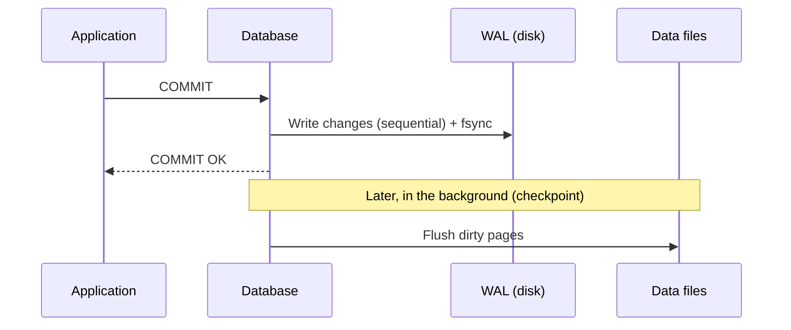
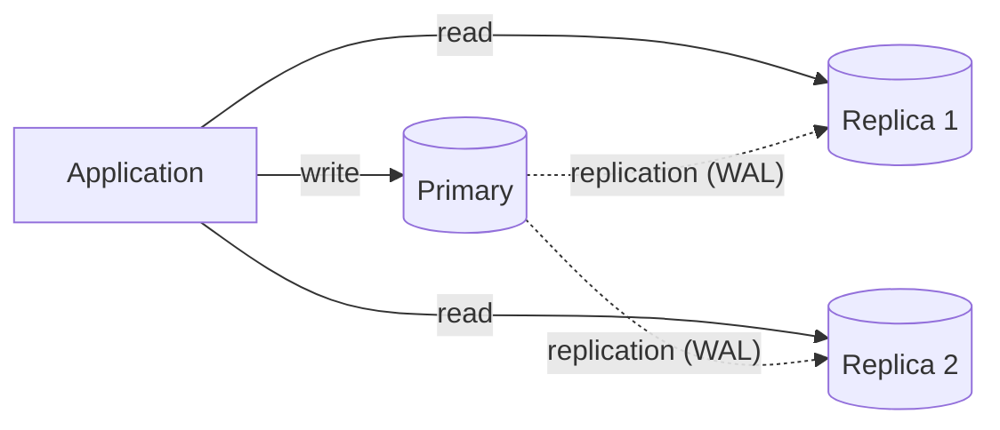

---
## Contents

- [[#1. Database types, relational vs NoSQL]]
- [[#2. SQL command groups, DDL, DML, DQL, DCL, TCL]]
- [[#3. Basic commands, JOIN, UNION, DELETE vs TRUNCATE vs DROP]]
- [[#4. ACID and the life of a transaction, WAL]]
- [[#5. Concurrent access, MVCC, anomalies and isolation levels]]
- [[#6. Indexes, B-Tree, Hash, GIN, composite and covering]]
- [[#7. Query optimization and reading EXPLAIN]]
- [[#8. Schema design, normalization, denormalization, keys]]
- [[#9. Locks, pessimistic vs optimistic, and deadlocks]]
- [[#10. Advanced SQL, GROUP BY, HAVING, window functions, CTE]]
- [[#11. Scaling a database, replication, partitioning, sharding]]
- [[#12. Cheat sheet before the interview]]

---

# 1. Database types, relational vs NoSQL

## Main idea

Реляционные базы данных (PostgreSQL, MySQL) хранят структурированные данные в таблицах со связями и дают гарантии ACID. NoSQL базы выбирают под конкретные задачи: быстрая запись, гибкая схема, кэш, поиск или аналитика.

Relational databases such as PostgreSQL and MySQL store structured data in tables with relations, and they give ACID guarantees. We choose NoSQL databases for specific tasks, for example fast writes, a flexible schema, caching, search or analytics.

## Relational databases

Реляционная СУБД хранит данные в таблицах со строгой схемой (Schema-on-Write), то есть структура проверяется в момент записи. В ней есть внешние ключи, язык SQL, JOIN-ы, агрегации и полноценные ACID-транзакции. Я использую её для большинства бизнес-задач (финансы, заказы, пользователи, каталоги, CRM), где важна целостность данных.

A relational database stores data in tables with a strict schema (Schema-on-Write), which means the structure is checked when the data is written. It has foreign keys, the SQL language, JOINs, aggregations and full ACID transactions. I use it for most business tasks, such as finance, orders, users, catalogs and CRM, where data integrity is important.

## NoSQL databases

Существует несколько типов NoSQL баз.

- Key-Value (Redis, Memcached) хранят данные по ключу, и доступ к ним занимает O(1). Их используют для кэша, сессий, счётчиков, rate limiting и очередей. У них нет сложных запросов по значению.
- Document (MongoDB) хранят JSON-документы с гибкой схемой, например профили с разным набором полей. У них слабее связи и JOIN, а транзакции более ограничены.
- Columnar (Cassandra, ClickHouse) хранят данные по колонкам. Они подходят для огромных объёмов и быстрой аналитики (OLAP), но не для частых точечных обновлений.
- Search engine (Elasticsearch, OpenSearch) делают полнотекстовый поиск на инвертированных индексах и анализируют логи. Их не используют как основное хранилище, потому что согласованность в них наступает «в итоге».
- Graph (Neo4j) хранят связи между объектами, например в соцсетях и рекомендациях. Это узкая специализация.

There are several types of NoSQL databases.

- Key-Value stores (Redis, Memcached) keep data by key, and access takes O(1). They are used for caching, sessions, counters, rate limiting and queues. They do not support complex queries by value.
- Document stores (MongoDB) keep JSON documents with a flexible schema, for example profiles with different sets of fields. They have weaker relations and JOINs, and their transactions are more limited.
- Columnar databases (Cassandra, ClickHouse) store data by columns. They are good for huge volumes and fast analytics (OLAP), but not for frequent point updates.
- Search engines (Elasticsearch, OpenSearch) provide full-text search on inverted indexes and analyze logs. We do not use them as the main storage, because their consistency is only eventual.
- Graph databases (Neo4j) store relations between objects, for example in social networks and recommendations. This is a narrow specialization.

## OLTP, OLAP and polyglot persistence

OLTP означает много коротких транзакций, например заказы и платежи. Для этого подходят строчные базы (PostgreSQL, MySQL). OLAP означает сложную аналитику по огромным данным, и для неё используют колоночные базы (ClickHouse). Polyglot persistence значит, что в одной системе мы применяем разные хранилища под разные задачи: PostgreSQL для основных данных, Redis для кэша, Elasticsearch для поиска. У многих NoSQL систем согласованность мягче (модель BASE: Basically Available, Soft state, Eventually consistent), и они меняют её на доступность и масштабирование.

OLTP means many short transactions, for example orders and payments. Row-based databases like PostgreSQL and MySQL are good for this. OLAP means complex analytics over huge data, and we use columnar databases like ClickHouse for it. Polyglot persistence means that one system uses different storages for different jobs: PostgreSQL for the main data, Redis for the cache and Elasticsearch for search. Many NoSQL systems have weaker consistency (the BASE model: Basically Available, Soft state, Eventually consistent), and they trade it for availability and scalability.

> [!question] Почему не хранить всё в MongoDB, «потому что гибко»? / Why not store everything in MongoDB just because it is flexible?
> 
> Гибкая схема переносит ответственность за целостность данных в код приложения. Для связанных данных (заказ, позиции, платежи) нам нужны транзакции, ограничения и JOIN-ы, а реляционная база даёт их из коробки.
> 
> A flexible schema moves the responsibility for data integrity into the application code. For related data, such as an order, its items and its payments, we need transactions, constraints and JOINs, and a relational database gives them out of the box.

> [!question] Когда Redis, а когда PostgreSQL? / When do you use Redis and when PostgreSQL?
> 
> Redis подходит для быстрых временных данных: кэша, сессий, счётчиков и блокировок. PostgreSQL нужен для данных, которые нельзя потерять и по которым нужны запросы. Redis не заменяет основную базу данных.
> 
> Redis is good for fast temporary data, such as cache, sessions, counters and locks. PostgreSQL is for data that we cannot lose and that we need to query. Redis does not replace the main database.

---

# 2. SQL command groups, DDL, DML, DQL, DCL, TCL

## Main idea

SQL делится на пять групп по тому, с чем работает команда: со структурой, с данными, с выборкой, с правами или с транзакциями.

SQL commands are divided into five groups, depending on what the command works with: structure, data, queries, permissions or transactions.

## The five groups

- DDL (Data Definition Language) определяет и меняет структуру объектов: таблиц, индексов и схем. Команды: CREATE, ALTER, DROP, TRUNCATE, RENAME.
- DML (Data Manipulation Language) меняет данные в таблицах. Команды: INSERT, UPDATE, DELETE, MERGE.
- DQL (Data Query Language) читает данные. Это команда SELECT.
- DCL (Data Control Language) управляет правами доступа. Команды: GRANT, REVOKE.
- TCL (Transaction Control Language) управляет транзакциями. Команды: BEGIN (или START TRANSACTION), COMMIT, ROLLBACK, SAVEPOINT.

Некоторые источники относят SELECT к DML и не выделяют DQL. Если спросят, об этом полезно упомянуть.

- DDL (Data Definition Language) defines and changes the structure of objects, such as tables, indexes and schemas. Commands: CREATE, ALTER, DROP, TRUNCATE, RENAME.
- DML (Data Manipulation Language) changes the data in tables. Commands: INSERT, UPDATE, DELETE, MERGE.
- DQL (Data Query Language) reads data. This is the SELECT command.
- DCL (Data Control Language) manages access permissions. Commands: GRANT, REVOKE.
- TCL (Transaction Control Language) controls transactions. Commands: BEGIN (or START TRANSACTION), COMMIT, ROLLBACK, SAVEPOINT.

Some sources put SELECT into DML and do not use the term DQL. It is useful to mention this if the interviewer asks.

## DDL and transactions

В MySQL команда DDL (ALTER TABLE, DROP, TRUNCATE) вызывает неявный COMMIT текущей транзакции, и откатить её нельзя. В PostgreSQL DDL транзакционный: последовательность BEGIN, ALTER TABLE, DROP TABLE, ROLLBACK вернёт структуру в исходное состояние.

In MySQL, a DDL command (ALTER TABLE, DROP, TRUNCATE) causes an implicit COMMIT of the current transaction, and it cannot be rolled back. In PostgreSQL, DDL is transactional: the sequence BEGIN, ALTER TABLE, DROP TABLE, ROLLBACK returns the structure to its original state.

> [!question] К какой группе относится TRUNCATE и почему это важно? / Which group does TRUNCATE belong to, and why does it matter?
> 
> TRUNCATE относится к DDL, хотя он удаляет данные. Поэтому в MySQL он делает неявный COMMIT и не откатывается, а в PostgreSQL его можно откатить внутри транзакции.
> 
> TRUNCATE belongs to DDL, even though it removes data. This is why in MySQL it makes an implicit COMMIT and cannot be rolled back, while in PostgreSQL it can be rolled back inside a transaction.

> [!question] Чем GRANT отличается от роли? / What is the difference between GRANT and a role?
> 
> GRANT выдаёт права. Роль это именованный набор прав, который можно выдать пользователям. Так проще управлять доступом, и это соответствует принципу наименьших привилегий.
> 
> GRANT gives permissions. A role is a named set of permissions that we can give to users. This makes access management easier, and it follows the principle of least privilege.

---

# 3. Basic commands, JOIN, UNION, DELETE vs TRUNCATE vs DROP

## Main idea

Нужно различать три команды. DELETE удаляет строки с логированием, TRUNCATE быстро очищает всю таблицу, а DROP удаляет саму таблицу. JOIN соединяет таблицы по горизонтали, а UNION по вертикали.

We need to distinguish three commands. DELETE removes rows with logging, TRUNCATE quickly clears the whole table, and DROP removes the table itself. JOIN connects tables horizontally, and UNION connects them vertically.

## DELETE vs TRUNCATE vs DROP

DELETE относится к DML. Он удаляет строки по условию WHERE или все строки, работает построчно, обновляет индексы и пишет каждую строку в журнал, поэтому он медленный. Его можно откатить. Он не сбрасывает счётчик AUTO_INCREMENT (SERIAL) и вызывает триггеры ON DELETE для каждой строки.

TRUNCATE относится к DDL. Он удаляет все строки сразу (WHERE нет), освобождая страницы данных, поэтому он очень быстрый и почти ничего не пишет в журнал. В PostgreSQL его можно откатить, в MySQL нельзя. Счётчик в MySQL сбрасывается, а в PostgreSQL только с опцией RESTART IDENTITY. Обычные триггеры ON DELETE не срабатывают (в PostgreSQL есть триггер ON TRUNCATE). Если на таблицу ссылаются внешние ключи, TRUNCATE не работает (в PostgreSQL нужен TRUNCATE ... CASCADE).

DROP тоже относится к DDL. Он удаляет всю таблицу вместе с данными, структурой, индексами и триггерами. Он работает мгновенно. В PostgreSQL его можно откатить, в MySQL нельзя. Если на таблицу ссылаются другие объекты, нужен CASCADE или предварительное удаление зависимостей.

DELETE is DML. It removes rows by a WHERE condition, or all rows. It works row by row, updates the indexes and writes every row to the log, so it is slow. It can be rolled back. It does not reset the AUTO_INCREMENT (SERIAL) counter, and it fires the ON DELETE triggers for each row.

TRUNCATE is DDL. It removes all rows at once (there is no WHERE) by freeing the data pages, so it is very fast and writes almost nothing to the log. In PostgreSQL it can be rolled back, but in MySQL it cannot. In MySQL it resets the counter, but in PostgreSQL it does this only with the RESTART IDENTITY option. Normal ON DELETE triggers do not fire (PostgreSQL has an ON TRUNCATE trigger). If foreign keys reference the table, TRUNCATE does not work (PostgreSQL needs TRUNCATE ... CASCADE).

DROP is also DDL. It removes the whole table with its data, structure, indexes and triggers. It works instantly. In PostgreSQL it can be rolled back, but in MySQL it cannot. If other objects depend on the table, we need CASCADE or we must remove the dependencies first.

## All kinds of JOIN

JOIN соединяет таблицы по горизонтали: он добавляет столбцы из второй таблицы по условию ON.

- INNER JOIN (или просто JOIN) возвращает только строки, которые совпали в обеих таблицах.
- LEFT JOIN возвращает все строки левой таблицы и совпавшие строки правой. Если пары нет, значения справа равны NULL.
- RIGHT JOIN работает зеркально LEFT JOIN. На практике его заменяют на LEFT JOIN ради читаемости.
- FULL OUTER JOIN возвращает все строки обеих таблиц, а где пары нет, там NULL. В MySQL его нет, и его эмулируют.
- CROSS JOIN даёт декартово произведение, то есть N × M строк, и условия ON у него нет.
- SELF JOIN соединяет таблицу саму с собой, например employees.manager_id с employees.id.

Анти-джойн это приём для поиска записей без связей, например пользователей без заказов: LEFT JOIN ... WHERE right.id IS NULL. Альтернатива это NOT EXISTS. Чтобы эмулировать FULL OUTER JOIN в MySQL, объединяют LEFT JOIN и RIGHT JOIN через UNION (именно UNION, чтобы убрать дубликаты совпавших строк).

JOIN connects tables horizontally: it adds columns from the second table by the ON condition.

- INNER JOIN (or just JOIN) returns only the rows that match in both tables.
- LEFT JOIN returns all rows from the left table and the matching rows from the right table. If there is no pair, the values on the right are NULL.
- RIGHT JOIN works as a mirror of LEFT JOIN. In practice, we replace it with LEFT JOIN for readability.
- FULL OUTER JOIN returns all rows from both tables, and NULL where there is no pair. MySQL does not have it, so we emulate it.
- CROSS JOIN gives the Cartesian product, which means N × M rows, and it has no ON condition.
- SELF JOIN joins a table with itself, for example employees.manager_id with employees.id.

An anti-join is a technique to find records without relations, for example users without orders: LEFT JOIN ... WHERE right.id IS NULL. The alternative is NOT EXISTS. To emulate FULL OUTER JOIN in MySQL, we combine LEFT JOIN and RIGHT JOIN with UNION (exactly UNION, so that duplicates of matched rows are removed).

## UNION vs UNION ALL

Обе команды склеивают результаты SELECT по вертикали, при этом число и типы колонок должны совпадать. UNION убирает дубликаты (через сортировку или хэширование), поэтому он медленнее. UNION ALL склеивает результаты как есть, поэтому он быстрее. Я использую UNION ALL, если дубликаты невозможны или не мешают.

Both commands combine the results of SELECT queries vertically, and the number and types of columns must match. UNION removes duplicates (by sorting or hashing), so it is slower. UNION ALL combines the results as they are, so it is faster. I use UNION ALL when duplicates are impossible or do not matter.

## DML, UPSERT and NULL

INSERT может вставлять одну или несколько строк, и пакетная вставка (batch insert) быстрее множества одиночных. UPDATE и DELETE никогда нельзя запускать без WHERE. Хорошая привычка: сначала выполнить SELECT с тем же WHERE и запускать изменение внутри транзакции.

UPSERT вставляет строку или обновляет её, если уникальный ключ уже существует. В PostgreSQL это INSERT ... ON CONFLICT (email) DO UPDATE SET name = EXCLUDED.name. В MySQL это INSERT ... ON DUPLICATE KEY UPDATE. В MySQL 8.0.20 и новее функция VALUES() считается устаревшей, и лучше использовать синтаксис с алиасом: INSERT ... VALUES (...) AS new ON DUPLICATE KEY UPDATE name = new.name.

NULL означает «неизвестно», а не ноль и не пустую строку. Сравнение NULL = NULL даёт NULL, а не TRUE, поэтому проверять нужно через IS NULL и IS NOT NULL.

INSERT can add one or several rows, and a batch insert is faster than many single inserts. We must never run UPDATE or DELETE without WHERE. A good habit is to run a SELECT with the same WHERE first, and to run the change inside a transaction.

UPSERT inserts a row, or updates it if the unique key already exists. In PostgreSQL it is INSERT ... ON CONFLICT (email) DO UPDATE SET name = EXCLUDED.name. In MySQL it is INSERT ... ON DUPLICATE KEY UPDATE. In MySQL 8.0.20 and newer, the VALUES() function is deprecated, and it is better to use the alias syntax: INSERT ... VALUES (...) AS new ON DUPLICATE KEY UPDATE name = new.name.

NULL means "unknown", not zero and not an empty string. The comparison NULL = NULL gives NULL, not TRUE, so we must check with IS NULL and IS NOT NULL.

## Code examples

```sql
-- DDL: a table with constraints and a foreign key
CREATE TABLE orders (
    id         BIGINT GENERATED ALWAYS AS IDENTITY PRIMARY KEY,
    user_id    BIGINT        NOT NULL REFERENCES users(id) ON DELETE CASCADE,
    total      NUMERIC(10,2) NOT NULL CHECK (total >= 0),
    status     VARCHAR(20)   NOT NULL DEFAULT 'new',
    created_at TIMESTAMPTZ   NOT NULL DEFAULT NOW()
);

-- DDL: change the structure
ALTER TABLE orders ADD COLUMN comment TEXT;

-- DML: UPSERT in PostgreSQL
INSERT INTO user_stats (user_id, logins_count)
VALUES (42, 1)
ON CONFLICT (user_id)
DO UPDATE SET logins_count = user_stats.logins_count + 1;

-- LEFT JOIN: users WITHOUT orders
SELECT u.id, u.email
FROM users u
LEFT JOIN orders o ON o.user_id = u.id
WHERE o.id IS NULL;

-- The same result with NOT EXISTS (often just as fast)
SELECT u.id, u.email
FROM users u
WHERE NOT EXISTS (SELECT 1 FROM orders o WHERE o.user_id = u.id);

-- SELF JOIN: an employee and their manager
SELECT e.name AS employee, m.name AS manager
FROM employees e
LEFT JOIN employees m ON e.manager_id = m.id;

-- Emulating FULL OUTER JOIN in MySQL
SELECT * FROM a LEFT JOIN b ON a.id = b.a_id
UNION
SELECT * FROM a RIGHT JOIN b ON a.id = b.a_id;
```

> [!question] В чём ловушка фильтрации правой таблицы при LEFT JOIN? / What is the trap when we filter the right table in a LEFT JOIN?
> 
> Условие по правой таблице в WHERE неявно превращает LEFT JOIN в INNER JOIN. У строк без пары o.status равен NULL, и они отбрасываются. Если поставить условие в ON, все пользователи сохранятся.
> 
> A condition on the right table in WHERE silently turns a LEFT JOIN into an INNER JOIN. For rows without a pair, o.status is NULL, so they are dropped. If we put the condition into ON, all users are kept.
> 
> ```sql
> -- BAD: users without orders disappear
> SELECT u.id, o.total FROM users u
> LEFT JOIN orders o ON o.user_id = u.id
> WHERE o.status = 'paid';
> 
> -- GOOD: the condition in ON keeps all users
> SELECT u.id, o.total FROM users u
> LEFT JOIN orders o ON o.user_id = u.id AND o.status = 'paid';
> ```

> [!question] Почему TRUNCATE быстрее, чем DELETE без WHERE? / Why is TRUNCATE faster than DELETE without WHERE?
> 
> DELETE обрабатывает и логирует каждую строку, обновляет индексы и вызывает триггеры. TRUNCATE освобождает или пересоздаёт страницы данных целиком и почти не логирует отдельные строки.
> 
> DELETE processes and logs every row, updates the indexes and fires triggers. TRUNCATE frees or recreates the data pages as a whole and almost does not log single rows.

> [!question] Что вернёт SELECT 1 WHERE NULL = NULL? / What does SELECT 1 WHERE NULL = NULL return?
> 
> Ничего. Сравнение с NULL даёт NULL (неизвестно), а WHERE пропускает только TRUE. Для проверки используют IS NULL или IS NOT DISTINCT FROM.
> 
> It returns nothing. A comparison with NULL gives NULL (unknown), and WHERE lets only TRUE through. To check for NULL, we use IS NULL or IS NOT DISTINCT FROM.

---

# 4. ACID and the life of a transaction, WAL

## Main idea

Транзакция это неделимая единица работы. Атомарность и долговечность обеспечиваются через WAL (Write-Ahead Log), то есть журнал упреждающей записи.

A transaction is an indivisible unit of work. Atomicity and durability are provided by the WAL (Write-Ahead Log).

## The four ACID properties

- Atomicity (атомарность) означает «всё или ничего». Если из пяти запросов упал четвёртый, первые три откатываются.
    
- Consistency (согласованность) означает, что транзакция переводит базу из одного корректного состояния в другое и не нарушает ограничения (NOT NULL, UNIQUE, FOREIGN KEY, CHECK).
    
- Isolation (изолированность) означает, что параллельные транзакции не видят чужих незафиксированных изменений в той степени, которую задаёт уровень изоляции.
    
- Durability (долговечность) означает, что если СУБД ответила «COMMIT OK», данные не пропадут, даже если отключится питание.
    
- Atomicity means "all or nothing". If the fourth of five queries fails, the first three are rolled back.
    
- Consistency means that a transaction moves the database from one correct state to another and does not break constraints (NOT NULL, UNIQUE, FOREIGN KEY, CHECK).
    
- Isolation means that concurrent transactions do not see each other's uncommitted changes, to the degree that the isolation level defines.
    
- Durability means that if the database answered "COMMIT OK", the data will not be lost, even if the power goes off.
    

## How WAL works

Писать изменения сразу в случайные места файлов таблиц (Random I/O) медленно. Поэтому при COMMIT СУБД сначала последовательно (Sequential I/O, это быстро) дописывает изменения в журнал WAL и сбрасывает его на диск командой fsync. Изменённые страницы в памяти (Buffer Pool) помечаются как «грязные» (dirty pages), и позже в фоне их записывает checkpoint. Если происходит сбой, при старте база проигрывает WAL (crash recovery) и восстанавливает все зафиксированные транзакции. В MySQL InnoDB аналог WAL называется Redo Log, а для отката и MVCC используется Undo Log. WAL также нужен для репликации (реплики применяют поток WAL) и для восстановления на момент времени (point-in-time recovery).

Writing changes directly to random places in the table files (random I/O) is slow. So, on COMMIT, the database first appends the changes to the WAL sequentially (sequential I/O, which is fast) and flushes it to disk with fsync. The changed pages in memory (the buffer pool) are marked as "dirty pages", and a checkpoint writes them to disk later in the background. If a crash happens, the database replays the WAL at startup (crash recovery) and restores all committed transactions. In MySQL InnoDB, the equivalent of WAL is called the Redo Log, and the Undo Log is used for rollback and MVCC. WAL is also used for replication (replicas apply the WAL stream) and for point-in-time recovery.



> [!question] Зачем нужен WAL, если можно писать сразу в файлы таблиц? / Why do we need WAL if we can write directly to the table files?
> 
> Запись в разные места файлов это случайный I/O, и он медленный. Журнал пишется последовательно, это быстро, и он гарантирует, что после сбоя зафиксированные изменения можно восстановить. Данные в таблицах при этом можно сбрасывать лениво.
> 
> Writing to different places in files is random I/O, and it is slow. The log is written sequentially, which is fast, and it guarantees that committed changes can be restored after a crash. The data in the tables can then be flushed lazily.

> [!question] Что такое «грязная страница»? / What is a dirty page?
> 
> Это страница в буферном пуле, которая изменена в памяти, но ещё не записана в файл данных. Её сбрасывают в фоне, а безопасность обеспечивает уже записанный WAL.
> 
> It is a page in the buffer pool that was changed in memory but is not yet written to the data file. It is flushed in the background, and safety is provided by the WAL that is already written.

> [!question] «C» в ACID и «C» в CAP это одно и то же? / Is the "C" in ACID the same as the "C" in CAP?
> 
> Нет. C в ACID означает соблюдение ограничений целостности. C в CAP означает согласованность копий данных в распределённой системе, то есть все узлы видят одно и то же.
> 
> No. The C in ACID means that integrity constraints are respected. The C in CAP means the consistency of data copies in a distributed system, so that all nodes see the same data.

---

# 5. Concurrent access, MVCC, anomalies and isolation levels

## Main idea

MVCC позволяет читателям не блокировать писателей и наоборот. Уровень изоляции это баланс между корректностью и производительностью.

MVCC lets readers and writers work without blocking each other. The isolation level is a balance between correctness and performance.

## MVCC

MVCC (Multi-Version Concurrency Control) работает так: при обновлении база не перезаписывает строку, а создаёт её новую версию. В PostgreSQL для этого есть поля xmin и xmax, а в InnoDB это цепочка версий в Undo Log. Каждая транзакция видит снимок (snapshot) данных. Старые версии убирает VACUUM в PostgreSQL или purge в InnoDB.

MVCC (Multi-Version Concurrency Control) works like this: when we update a row, the database does not overwrite it, but creates a new version of it. In PostgreSQL there are the xmin and xmax fields for this, and in InnoDB it is a chain of versions in the Undo Log. Every transaction sees a snapshot of the data. Old versions are removed by VACUUM in PostgreSQL or by purge in InnoDB.

## Concurrency anomalies

1. Dirty Read (грязное чтение): мы читаем изменения другой транзакции, которая ещё не сделала COMMIT и может откатиться.
    
2. Non-Repeatable Read (неповторяющееся чтение): при повторном чтении той же строки мы видим другое значение, потому что другая транзакция успела сделать UPDATE и COMMIT.
    
3. Phantom Read (фантомное чтение): повторный запрос по условию (например, WHERE amount > 100) возвращает новые строки, которые добавила другая транзакция.
    
4. Lost Update (потерянное обновление): две транзакции прочитали balance = 100, обе прибавили 50 и записали 150 вместо 200.
    
5. Write Skew: две транзакции читают пересекающиеся данные и пишут в разные строки, из-за чего нарушается общий инвариант, например «в смене должен остаться хотя бы один дежурный врач». Это лечится только уровнем Serializable или явными блокировками.
    
6. Dirty Read: we read changes from another transaction that has not committed yet and may roll back.
    
7. Non-Repeatable Read: when we read the same row again, we see a different value, because another transaction managed to run UPDATE and COMMIT.
    
8. Phantom Read: when we repeat a query with a condition (for example WHERE amount > 100), it returns new rows that another transaction added.
    
9. Lost Update: two transactions read balance = 100, both add 50, and both write 150 instead of 200.
    
10. Write Skew: two transactions read overlapping data and write to different rows, which breaks a shared invariant, for example "at least one doctor must stay on duty". This can be solved only by the Serializable level or by explicit locks.
    

## Isolation levels

Read Uncommitted допускает все аномалии, но в PostgreSQL он ведёт себя как Read Committed. Read Committed защищает от грязного чтения, но допускает неповторяющееся и фантомное чтение. Это уровень по умолчанию в PostgreSQL, потому что каждый запрос получает новый снимок. Repeatable Read защищает ещё и от неповторяющегося чтения, а по стандарту допускает фантомы. Это уровень по умолчанию в MySQL InnoDB, потому что снимок создаётся на всю транзакцию. Serializable даёт полную изоляцию. На нём возможны ошибки сериализации, поэтому приложение должно повторять транзакцию (retry).

Есть нюанс для собеседования. В PostgreSQL уровень Repeatable Read это Snapshot Isolation: фантомы не возникают, но возможен Write Skew, а Lost Update приводит к ошибке could not serialize access, которую нужно повторить. В MySQL InnoDB обычный SELECT читает из снимка и фантомов не видит, а блокирующие чтения (SELECT ... FOR UPDATE) используют Next-Key Locks (запись плюс промежуток), которые тоже защищают от фантомов.

Read Uncommitted allows all anomalies, but in PostgreSQL it behaves like Read Committed. Read Committed protects from dirty reads, but it allows non-repeatable and phantom reads. It is the default level in PostgreSQL, because every query gets a new snapshot. Repeatable Read also protects from non-repeatable reads, and by the standard it allows phantoms. It is the default level in MySQL InnoDB, because the snapshot is created for the whole transaction. Serializable gives full isolation. It can produce serialization errors, so the application has to retry the transaction.

There is one nuance for the interview. In PostgreSQL, Repeatable Read is Snapshot Isolation: phantoms do not appear, but Write Skew is possible, and a Lost Update causes the error "could not serialize access", which we must retry. In MySQL InnoDB, a normal SELECT reads from a snapshot and sees no phantoms, and locking reads (SELECT ... FOR UPDATE) use Next-Key Locks (a record plus the gap), which also protect from phantoms.

> [!question] Как MVCC позволяет читателям не блокировать писателей? / How does MVCC let readers not block writers?
> 
> Писатель создаёт новую версию строки, а читатель продолжает видеть старую версию из своего снимка. Поэтому блокировки на чтение не нужны.
> 
> The writer creates a new version of the row, and the reader continues to see the old version from its own snapshot. This is why we do not need read locks.

> [!question] Какой уровень изоляции выбрать для денежных операций? / Which isolation level should we choose for money operations?
> 
> Обычно хватает Read Committed или Repeatable Read плюс явные блокировки (SELECT ... FOR UPDATE) или атомарные обновления вида UPDATE ... SET balance = balance - X WHERE balance >= X. Для сложных инвариантов используют Serializable с повторными попытками.
> 
> Usually Read Committed or Repeatable Read is enough, together with explicit locks (SELECT ... FOR UPDATE) or atomic updates like UPDATE ... SET balance = balance - X WHERE balance >= X. For complex invariants, we use Serializable with retries.

> [!question] Что такое VACUUM и зачем он нужен? / What is VACUUM and why do we need it?
> 
> В PostgreSQL старые версии строк после UPDATE и DELETE остаются в таблице (dead tuples). VACUUM освобождает это место для повторного использования, а autovacuum делает это автоматически. Без него таблицы и индексы «пухнут» (bloat).
> 
> In PostgreSQL, old row versions stay in the table after UPDATE and DELETE (dead tuples). VACUUM frees this space for reuse, and autovacuum does it automatically. Without it, tables and indexes grow too big (bloat).

---

# 6. Indexes, B-Tree, Hash, GIN, composite and covering

## Main idea

Индекс это отдельная структура, которая ускоряет поиск с O(N) до O(log N), но замедляет запись (INSERT, UPDATE, DELETE) и занимает место. Индексов должно быть ровно столько, сколько нужно реальным запросам.

An index is a separate structure that speeds up search from O(N) to O(log N), but it slows down writes (INSERT, UPDATE, DELETE) and takes space. We should have exactly as many indexes as the real queries need.

## Index types

B-Tree (сбалансированное дерево) это индекс по умолчанию. Ключи в нём отсортированы в листьях, а листья связаны между собой. Он поддерживает равенство, диапазоны (>, <, BETWEEN), ORDER BY и поиск по префиксу (LIKE 'ivan%'). Он не помогает при ведущем wildcard (LIKE '%ivan%') и когда над колонкой стоит функция (WHERE LOWER(email) = ...). Для такого случая нужен функциональный индекс на LOWER(email).

Hash-индекс ищет за O(1), но только по равенству. Диапазоны и сортировка ему недоступны.

GIN (Generalized Inverted Index, PostgreSQL) это инвертированный индекс для массивов, JSONB и полнотекстового поиска. GiST нужен для геоданных и поиска по «похожести».

B-Tree (a balanced tree) is the default index. Its keys are sorted in the leaves, and the leaves are linked to each other. It supports equality, ranges (>, <, BETWEEN), ORDER BY and prefix search (LIKE 'ivan%'). It does not help with a leading wildcard (LIKE '%ivan%') or when a function is applied to the column (WHERE LOWER(email) = ...). For that case, we need a functional index on LOWER(email).

A Hash index searches in O(1), but only by equality. It cannot do ranges or sorting.

GIN (Generalized Inverted Index, PostgreSQL) is an inverted index for arrays, JSONB and full-text search. GiST is used for geodata and similarity search.

## Clustered vs non-clustered

В MySQL InnoDB первичный ключ кластерный: сама таблица физически хранится в листьях B-Tree по PRIMARY KEY. Вторичные индексы хранят значение первичного ключа, поэтому поиск по ним требует двух проходов по дереву (double lookup). В PostgreSQL все индексы некластерные: таблица это куча (heap), а индексы хранят физический адрес строки (ctid).

In MySQL InnoDB, the primary key is clustered: the table itself is physically stored in the B-Tree leaves ordered by the PRIMARY KEY. Secondary indexes store the primary key value, so a search through them needs two passes through the tree (double lookup). In PostgreSQL, all indexes are non-clustered: the table is a heap, and the indexes store the physical address of the row (ctid).

## Composite, covering and partial indexes

Составной индекс (a, b, c) работает по правилу левого префикса (Leftmost Prefix Rule). Он используется для условий по a, по a и b, по a, b и c, а также для a = 1 AND b > 5. Для WHERE b = 2 или WHERE c = 3 он бесполезен. Порядок колонок такой: сначала колонки с равенством, потом с диапазоном, и обычно сначала более селективные.

Покрывающий индекс (Covering Index) содержит все колонки запроса, поэтому ответ берётся из индекса без обращения к таблице (в плане это Index Only Scan в PostgreSQL или Using index в MySQL). В PostgreSQL дополнительные колонки добавляют через INCLUDE (...).

Частичный индекс (Partial Index) строится только по части строк, например WHERE status = 'new'. Он меньше и быстрее.

Селективность это доля уникальных значений. Индекс по колонке с двумя значениями (например, is_active) обычно бесполезен, потому что планировщик выберет Seq Scan.

У индексов есть цена: каждый из них нужно обновлять при записи, и он занимает место на диске и в памяти. Лишние индексы нужно удалять.

A composite index (a, b, c) works by the Leftmost Prefix Rule. It is used for conditions on a, on a and b, on a, b and c, and also for a = 1 AND b > 5. It is useless for WHERE b = 2 or WHERE c = 3. The column order is this: first the columns with equality, then the column with a range, and usually the more selective columns first.

A covering index contains all the columns of the query, so the answer comes from the index without reading the table (in the plan this is Index Only Scan in PostgreSQL or Using index in MySQL). In PostgreSQL, we add extra columns with INCLUDE (...).

A partial index is built only on a part of the rows, for example WHERE status = 'new'. It is smaller and faster.

Selectivity is the share of unique values. An index on a column with two values (for example is_active) is usually useless, because the planner will choose Seq Scan.

Indexes have a cost: every index must be updated on writes, and it takes space on disk and in memory. We should delete unnecessary indexes.

## Code examples

```sql
-- Composite index: column order matters
CREATE INDEX idx_orders_user_status ON orders (user_id, status);

-- Covering index (PostgreSQL): the query is answered from the index only
CREATE INDEX idx_orders_user_status_include
ON orders (user_id, status) INCLUDE (total, created_at);

-- Functional index: for WHERE LOWER(email) = ...
CREATE INDEX idx_users_email_lower ON users (LOWER(email));

-- Partial index: only "live" orders
CREATE INDEX idx_orders_new ON orders (created_at) WHERE status = 'new';

-- GIN for JSONB
CREATE INDEX idx_events_payload ON events USING GIN (payload);
```

> [!question] Почему индекс может не использоваться, хотя он есть? / Why might an index not be used even though it exists?
> 
> Частые причины такие: над колонкой в WHERE стоит функция, в LIKE есть ведущий символ %, типы не совпадают (неявное приведение), нарушено правило левого префикса, запрос возвращает большую долю таблицы (тогда выгоднее Seq Scan) или статистика устарела.
> 
> The common reasons are these: a function is applied to the column in WHERE, LIKE has a leading %, the types do not match (implicit cast), the leftmost prefix rule is broken, the query returns a large part of the table (then Seq Scan is cheaper), or the statistics are outdated.

> [!question] Почему много индексов это плохо? / Why are many indexes bad?
> 
> Каждый INSERT, UPDATE и DELETE обновляет все затронутые индексы, а объём на диске и в памяти растёт. Индексы нужно создавать под реальные запросы и периодически удалять неиспользуемые.
> 
> Every INSERT, UPDATE and DELETE updates all affected indexes, and the size on disk and in memory grows. We should create indexes for real queries and remove unused ones from time to time.

> [!question] Чем кластерный индекс отличается от обычного? / What is the difference between a clustered and a normal index?
> 
> В кластерном индексе (первичный ключ в InnoDB) сами строки лежат в порядке индекса, и такой индекс может быть только один на таблицу. Некластерный индекс хранит ссылку на строку: в InnoDB это значение первичного ключа, в PostgreSQL это ctid.
> 
> In a clustered index (the primary key in InnoDB), the rows themselves are stored in the index order, and there can be only one such index per table. A non-clustered index stores a reference to the row: in InnoDB it is the primary key value, and in PostgreSQL it is the ctid.

---

# 7. Query optimization and reading EXPLAIN

## Main idea

Чтобы найти причину медленного запроса, мы используем EXPLAIN ANALYZE, убираем Seq Scan на больших таблицах, избегаем большого OFFSET и боремся с проблемой N+1.

To find the reason for a slow query, we use EXPLAIN ANALYZE, remove Seq Scan on big tables, avoid a big OFFSET and fight the N+1 problem.

## EXPLAIN vs EXPLAIN ANALYZE

EXPLAIN показывает план запроса по статистике, но сам запрос не выполняет. EXPLAIN ANALYZE реально выполняет запрос и показывает фактическое время и число строк. Для UPDATE и DELETE его нужно оборачивать в транзакцию с ROLLBACK, иначе данные изменятся.

EXPLAIN shows the query plan based on statistics, but it does not run the query. EXPLAIN ANALYZE really runs the query and shows the actual time and number of rows. For UPDATE and DELETE, we must wrap it in a transaction with ROLLBACK, otherwise the data will change.

## What to look at in the plan

Первое это тип сканирования. Seq Scan означает полное чтение таблицы (в MySQL это type = ALL). Лучше Index Scan, а ещё лучше Index Only Scan. Для маленьких таблиц Seq Scan нормален.

Второе это расхождение между оценкой rows и фактическим actual rows. Большая разница значит, что статистика устарела, и нужно выполнить ANALYZE table_name.

Третье это сортировка. Сообщение Sort Method: external merge Disk в PostgreSQL или Using filesort и Using temporary в MySQL означают, что не хватило индекса или памяти (work_mem, sort_buffer_size).

Четвёртое это тип JOIN: Nested Loop, Hash Join или Merge Join. Nested Loop по большим таблицам без индекса это красный флаг.

First, we look at the scan type. Seq Scan means a full read of the table (in MySQL it is type = ALL). Index Scan is better, and Index Only Scan is even better. For small tables, Seq Scan is normal.

Second, we compare the estimated rows with the actual rows. A big difference means that the statistics are outdated, and we need to run ANALYZE table_name.

Third, we check sorting. The message Sort Method: external merge Disk in PostgreSQL, or Using filesort and Using temporary in MySQL, means that there was not enough index or memory (work_mem, sort_buffer_size).

Fourth, we check the JOIN type: Nested Loop, Hash Join or Merge Join. A Nested Loop on big tables without an index is a red flag.

## The OFFSET problem and keyset pagination

Запрос ORDER BY id LIMIT 20 OFFSET 1000000 читает и отбрасывает миллион строк. Решение это Keyset (Cursor) Pagination: WHERE id < :last_id ORDER BY id DESC LIMIT 20. Такой запрос использует индекс и работает за O(log N).

The query ORDER BY id LIMIT 20 OFFSET 1000000 reads and throws away a million rows. The solution is Keyset (Cursor) Pagination: WHERE id < :last_id ORDER BY id DESC LIMIT 20. This query uses an index and works in O(log N).

## The N+1 problem and other tricks

Проблема N+1 возникает, когда мы делаем один запрос за списком и ещё N запросов за связанными данными в цикле. Её лечат через JOIN, eager loading (например, with() в Eloquent) или WHERE id IN (...).

Есть и другие приёмы. Нужно выбирать только нужные колонки и не писать SELECT _. Нужно использовать EXISTS вместо COUNT(_) > 0. Стоит вставлять данные пакетами, кэшировать тяжёлые результаты и смотреть slow query log (в PostgreSQL это pg_stat_statements).

The N+1 problem happens when we make one query for a list and then N more queries for related data in a loop. We fix it with a JOIN, eager loading (for example with() in Eloquent) or WHERE id IN (...).

There are other tricks too. We should select only the columns we need and not write SELECT _. We should use EXISTS instead of COUNT(_) > 0. It is good to insert data in batches, cache heavy results and look at the slow query log (in PostgreSQL it is pg_stat_statements).

## Code examples

```sql
-- BAD: a function on the column, the index on created_at is not used
SELECT * FROM orders WHERE DATE(created_at) = '2026-11-13';

-- GOOD: a range can use the B-Tree
SELECT id, total FROM orders
WHERE created_at >= '2026-11-13 00:00:00'
  AND created_at <  '2026-11-14 00:00:00';

-- Safely check UPDATE/DELETE
BEGIN;
EXPLAIN ANALYZE UPDATE orders SET status = 'old' WHERE created_at < '2025-01-01';
ROLLBACK;

-- Keyset pagination instead of OFFSET
SELECT id, total FROM orders
WHERE id < :last_id
ORDER BY id DESC
LIMIT 20;
```

> [!question] Почему большой OFFSET медленный и чем его заменить? / Why is a big OFFSET slow and what can replace it?
> 
> База должна прочитать и отбросить все пропущенные строки. Замена это keyset-пагинация по индексированному полю: последний полученный id или пара (created_at, id).
> 
> The database has to read and throw away all the skipped rows. The replacement is keyset pagination by an indexed field: the last received id, or the pair (created_at, id).

> [!question] Что делать, если estimated rows сильно отличается от actual rows? / What should we do if estimated rows is very different from actual rows?
> 
> Нужно обновить статистику командой ANALYZE и проверить корреляцию колонок. Если это не помогло, можно увеличить детализацию статистики или переписать запрос.
> 
> We should update the statistics with ANALYZE and check the correlation of columns. If this does not help, we can increase the statistics detail or rewrite the query.

> [!question] Что такое проблема N+1 и как её найти? / What is the N+1 problem and how do you find it?
> 
> Это запросы в цикле. Её находят по логам запросов, по pg_stat_statements и с помощью инструментов вроде Laravel Debugbar или Telescope. Решение это eager loading или один запрос с JOIN или IN.
> 
> It is queries inside a loop. We find it by query logs, by pg_stat_statements and with tools like Laravel Debugbar or Telescope. The solution is eager loading, or one query with JOIN or IN.

---

# 8. Schema design, normalization, denormalization, keys

## Main idea

Нормализация убирает избыточность и аномалии обновления. Денормализация сознательно возвращает дублирование ради скорости чтения.

Normalization removes redundancy and update anomalies. Denormalization deliberately brings duplication back to make reads faster.

## Normal forms

1НФ (1NF) требует, чтобы значения были атомарными, чтобы не было повторяющихся групп колонок (phone1, phone2) и чтобы был первичный ключ. 2НФ (2NF) это 1НФ плюс условие, что каждый неключевой столбец зависит от всего составного ключа, а не от его части. 3НФ (3NF) это 2НФ плюс отсутствие транзитивных зависимостей: неключевые столбцы не зависят друг от друга, например city_name не хранится в orders рядом с city_id. BCNF это усиленная 3НФ, в которой каждая функциональная зависимость определяется суперключом. Она встречается реже.

Если таблицы не нормализованы, вставки, обновления и удаления приводят к рассинхронизации или потере данных. Это называется аномалиями.

1NF requires atomic values, no repeating groups of columns (phone1, phone2) and a primary key. 2NF is 1NF plus the condition that every non-key column depends on the whole composite key, not on a part of it. 3NF is 2NF plus no transitive dependencies: non-key columns do not depend on each other, for example city_name is not stored in orders next to city_id. BCNF is a stronger 3NF, where every functional dependency is determined by a superkey. It is less common.

If tables are not normalized, inserts, updates and deletes lead to out-of-sync data or data loss. These problems are called anomalies.

## Denormalization

Денормализация это осознанное нарушение 3НФ. Примеры: comments_count в таблице posts или копия цены в order_items на момент покупки. Она нужна, когда JOIN или COUNT(*) становятся узким местом. Цена за это в том, что запись усложняется и появляется риск рассинхронизации.

Denormalization is a deliberate break of 3NF. Examples are comments_count in the posts table, or a copy of the price in order_items at the moment of purchase. We need it when JOIN or COUNT(*) becomes the bottleneck. The price is that writes become more complex and there is a risk of getting out of sync.

## Relations and constraints

Бывают связи один-к-одному, один-ко-многим (внешний ключ на стороне «многих») и многие-ко-многим (для них нужна промежуточная таблица с двумя внешними ключами). Ограничения целостности это PRIMARY KEY, FOREIGN KEY (с вариантами ON DELETE CASCADE, SET NULL или RESTRICT), UNIQUE, NOT NULL и CHECK. Инварианты нужно держать в базе, а не только в коде приложения.

There are one-to-one, one-to-many (a foreign key on the "many" side) and many-to-many relations (they need a junction table with two foreign keys). The integrity constraints are PRIMARY KEY, FOREIGN KEY (with the options ON DELETE CASCADE, SET NULL or RESTRICT), UNIQUE, NOT NULL and CHECK. We should keep invariants in the database, and not only in the application code.

## Primary keys, money and soft delete

BIGINT с автоинкрементом занимает 8 байт, и новые значения добавляются в конец B-Tree, поэтому фрагментации нет. Минусы: ключ предсказуем (риск IDOR, раскрывается объём данных) и его сложнее использовать с шардами и мультимастером. UUID v4 занимает 16 байт и может генерироваться вне базы. Его минус в том, что значения случайные, поэтому вставки идут в случайные места B-Tree, что вызывает page splits, фрагментацию и промахи кэша. UUID v7 и ULID содержат время в начале, поэтому значения растут монотонно. Они удобны для B-Tree и при этом глобально уникальны.

Деньги нужно хранить в NUMERIC (DECIMAL) или в минимальных единицах в BIGINT (например, в копейках), но не в FLOAT.

Soft delete (колонка deleted_at) удобен для восстановления данных, но усложняет запросы и уникальные индексы, для которых нужны частичные индексы.

A BIGINT with auto-increment takes 8 bytes, and new values go to the end of the B-Tree, so there is no fragmentation. The downsides are that the key is predictable (IDOR risk, and it reveals the data volume) and that it is harder to use with shards and multi-master. UUID v4 takes 16 bytes and can be generated outside the database. Its downside is that the values are random, so inserts go to random places in the B-Tree, which causes page splits, fragmentation and cache misses. UUID v7 and ULID have the time at the beginning, so the values grow monotonically. They are good for B-Tree and are still globally unique.

We should store money in NUMERIC (DECIMAL) or in the smallest units in a BIGINT (for example in cents), but not in FLOAT.

Soft delete (a deleted_at column) is convenient for restoring data, but it makes queries and unique indexes more complex, and we need partial indexes for them.

> [!question] Зачем копировать цену товара в order_items? / Why do we copy the product price into order_items?
> 
> Цена товара со временем меняется, а заказ должен хранить цену на момент покупки. Это осознанная денормализация ради корректной истории.
> 
> The price of a product changes over time, but an order must keep the price at the moment of purchase. This is deliberate denormalization to keep the history correct.

> [!question] UUID или автоинкремент? / UUID or auto-increment?
> 
> Автоинкремент проще и компактнее. UUID удобен для распределённой генерации и скрывает порядок и объём данных. Если нужен UUID, лучше выбрать упорядоченный по времени (v7 или ULID), а не v4.
> 
> Auto-increment is simpler and more compact. UUID is good for distributed generation and hides the order and the volume of data. If we need a UUID, it is better to choose a time-ordered one (v7 or ULID) and not v4.

> [!question] Как смоделировать связь «многие-ко-многим»? / How do we model a many-to-many relation?
> 
> Нужна промежуточная таблица (например, user_roles) с внешними ключами на обе таблицы и составным уникальным ключом (user_id, role_id).
> 
> We need a junction table (for example user_roles) with foreign keys to both tables and a composite unique key (user_id, role_id).

---

# 9. Locks, pessimistic vs optimistic, and deadlocks

## Main idea

Чтобы избежать гонок (race conditions) при изменении общих данных, мы используем пессимистические блокировки (FOR UPDATE) или оптимистические (колонка version). Взаимные блокировки (deadlocks) предотвращают единым порядком захвата ресурсов.

To avoid race conditions when we change shared data, we use pessimistic locks (FOR UPDATE) or optimistic locks (a version column). We prevent deadlocks by acquiring resources in one common order.

## Pessimistic locking

Мы предполагаем, что конфликты частые, и блокируем строку сразу при чтении: SELECT balance FROM wallets WHERE id = 1 FOR UPDATE. Остальные транзакции ждут COMMIT или ROLLBACK. Плюс в том, что конфликтов нет. Минус в том, что параллелизм ниже и есть риск deadlock. Есть полезные варианты: FOR UPDATE NOWAIT сразу выдаёт ошибку, если строка занята, а FOR UPDATE SKIP LOCKED пропускает занятые строки, что удобно для очередей задач.

We assume that conflicts are frequent, and we lock the row right when we read it: SELECT balance FROM wallets WHERE id = 1 FOR UPDATE. Other transactions wait for COMMIT or ROLLBACK. The advantage is that there are no conflicts. The disadvantage is lower concurrency and the risk of deadlock. There are useful variants: FOR UPDATE NOWAIT returns an error at once if the row is busy, and FOR UPDATE SKIP LOCKED skips busy rows, which is good for task queues.

## Optimistic locking

Мы предполагаем, что конфликты редкие. В базе блокировок нет, а в таблице есть колонка version: UPDATE products SET stock = stock - 1, version = version + 1 WHERE id = 10 AND version = 5. Если affected_rows = 0, значит строку уже кто-то изменил, и мы перечитываем данные и повторяем операцию.

Часто блокировки вообще не нужны, достаточно атомарного обновления: UPDATE wallets SET balance = balance - 100 WHERE id = 1 AND balance >= 100.

We assume that conflicts are rare. There are no locks in the database, and the table has a version column: UPDATE products SET stock = stock - 1, version = version + 1 WHERE id = 10 AND version = 5. If affected_rows = 0, somebody has already changed the row, so we read the data again and repeat the operation.

Often we do not need locks at all, and an atomic update is enough: UPDATE wallets SET balance = balance - 100 WHERE id = 1 AND balance >= 100.

## Deadlock

Deadlock (взаимная блокировка) возникает, когда транзакция 1 держит строку A и ждёт строку B, а транзакция 2 держит B и ждёт A. СУБД находит цикл в графе ожиданий и откатывает одну из транзакций (ошибка Deadlock found). Чтобы избежать этого, нужно: всегда блокировать ресурсы в одном порядке (например, по возрастанию id), делать транзакции короткими (и не вызывать внешние HTTP API внутри транзакции) и при ошибке deadlock делать retry.

В PostgreSQL есть ещё advisory locks. Это прикладные блокировки по произвольному ключу (pg_advisory_lock). Их используют, например, чтобы cron-процесс работал только в одном экземпляре.

A deadlock happens when transaction 1 holds row A and waits for row B, while transaction 2 holds B and waits for A. The database finds a cycle in the wait graph and rolls back one of the transactions (the error Deadlock found). To avoid this, we should always lock resources in one order (for example by ascending id), keep transactions short (and never call an external HTTP API inside a transaction) and retry on a deadlock error.

PostgreSQL also has advisory locks. They are application-level locks by an arbitrary key (pg_advisory_lock). We use them, for example, so that a cron process runs in only one instance.

## Code examples

```sql
-- Pessimistic lock: a safe money transfer
BEGIN;
SELECT id, balance FROM wallets
WHERE id IN (1, 2)
ORDER BY id            -- one common order protects from deadlock
FOR UPDATE;

UPDATE wallets SET balance = balance - 100 WHERE id = 1;
UPDATE wallets SET balance = balance + 100 WHERE id = 2;
COMMIT;

-- Optimistic lock
UPDATE products
SET stock = stock - 1, version = version + 1
WHERE id = 10 AND version = 5;   -- affected_rows = 0 means a conflict, so retry

-- Task queue: several workers without waiting for each other
SELECT id FROM jobs
WHERE status = 'new'
ORDER BY id
LIMIT 10
FOR UPDATE SKIP LOCKED;
```

> [!question] Как предотвратить двойное списание при параллельных запросах? / How do we prevent a double charge with parallel requests?
> 
> Можно использовать атомарный UPDATE ... WHERE balance >= X, или SELECT ... FOR UPDATE внутри транзакции, или оптимистичную колонку version. Кроме того, нужна идемпотентность запроса (Idempotency-Key), чтобы повтор не списал деньги второй раз.
> 
> We can use an atomic UPDATE ... WHERE balance >= X, or SELECT ... FOR UPDATE inside a transaction, or an optimistic version column. We also need idempotency of the request (an Idempotency-Key), so that a retry does not charge the money a second time.

> [!question] Что делает приложение, когда получает ошибку deadlock? / What does the application do when it gets a deadlock error?
> 
> Оно повторяет всю транзакцию (один-три раза) с небольшой задержкой. Deadlock это штатная ситуация: СУБД специально откатывает одну «жертву».
> 
> It repeats the whole transaction (one to three times) with a small delay. A deadlock is a normal situation: the database rolls back one "victim" on purpose.

---

# 10. Advanced SQL, GROUP BY, HAVING, window functions, CTE

## Main idea

Для собеседований нужен минимум: порядок выполнения запроса, разница между WHERE и HAVING, оконные функции и CTE.

For interviews, we need the basics: the order of query execution, the difference between WHERE and HAVING, window functions and CTEs.

## Logical order of execution

Логический порядок выполнения такой: сначала FROM и JOIN, потом WHERE (фильтрует строки до группировки), потом GROUP BY, потом HAVING (фильтрует группы по агрегатам), потом SELECT (выражения, оконные функции, алиасы), потом DISTINCT, ORDER BY и в конце LIMIT и OFFSET. Именно поэтому в WHERE нельзя использовать алиас из SELECT. В PostgreSQL и MySQL алиас можно использовать в ORDER BY, а в MySQL ещё и в GROUP BY и HAVING.

The logical order is this: first FROM and JOIN, then WHERE (filters rows before grouping), then GROUP BY, then HAVING (filters groups by aggregates), then SELECT (expressions, window functions, aliases), then DISTINCT, ORDER BY and, at the end, LIMIT and OFFSET. This is why we cannot use an alias from SELECT in WHERE. In PostgreSQL and MySQL, we can use an alias in ORDER BY, and in MySQL also in GROUP BY and HAVING.

## Aggregates, window functions and CTE

Агрегатные функции это COUNT, SUM, AVG, MIN и MAX. COUNT(*) считает все строки, а COUNT(col) считает только строки, где значение не NULL.

Оконные функции считают значение по «окну» строк, но не схлопывают строки, в отличие от GROUP BY. Синтаксис такой: ФУНКЦИЯ() OVER (PARTITION BY отдел ORDER BY зарплата DESC). ROW_NUMBER() даёт нумерацию 1, 2, 3. RANK() при равных значениях делает пропуски (1, 1, 3). DENSE_RANK() не делает пропусков (1, 1, 2). LAG() и LEAD() возвращают предыдущую и следующую строку. SUM() OVER (...) даёт нарастающий итог.

CTE (Common Table Expressions, конструкция WITH) это именованные временные наборы данных. Они делают сложные запросы читаемыми и позволяют писать рекурсивные запросы, например для деревьев категорий и иерархий.

Подзапросы бывают скалярными и коррелированными. Коррелированный подзапрос зависит от внешнего запроса и может быть медленным. Также есть EXISTS и IN.

Aggregate functions are COUNT, SUM, AVG, MIN and MAX. COUNT(*) counts all rows, and COUNT(col) counts only the rows where the value is not NULL.

Window functions calculate a value over a "window" of rows, but they do not collapse the rows, unlike GROUP BY. The syntax is: FUNCTION() OVER (PARTITION BY department ORDER BY salary DESC). ROW_NUMBER() gives the numbering 1, 2, 3. RANK() leaves gaps for ties (1, 1, 3). DENSE_RANK() leaves no gaps (1, 1, 2). LAG() and LEAD() return the previous and the next row. SUM() OVER (...) gives a running total.

CTEs (Common Table Expressions, the WITH clause) are named temporary result sets. They make complex queries readable and allow recursive queries, for example for category trees and hierarchies.

Subqueries can be scalar or correlated. A correlated subquery depends on the outer query and can be slow. We also have EXISTS and IN.

## Code examples

```sql
-- 1. Top 2 salaries in each department (window function + CTE)
WITH ranked AS (
    SELECT name, department_id, salary,
           DENSE_RANK() OVER (PARTITION BY department_id ORDER BY salary DESC) AS rnk
    FROM employees
)
SELECT name, department_id, salary
FROM ranked
WHERE rnk <= 2;

-- 2. Users with more than 3 paid orders and a total over 10,000
SELECT user_id, COUNT(*) AS orders_cnt, SUM(total) AS total_spent
FROM orders
WHERE status = 'paid'          -- filters ROWS before grouping
GROUP BY user_id
HAVING COUNT(*) > 3            -- filters GROUPS after grouping
   AND SUM(total) > 10000;

-- 3. Delete duplicate emails, keep the smallest id (PostgreSQL)
DELETE FROM users a
USING users b
WHERE a.id > b.id
  AND a.email = b.email;

-- The same in MySQL
DELETE a FROM users a
JOIN users b ON a.email = b.email AND a.id > b.id;

-- 4. Running total and change from the previous day
SELECT day, revenue,
       SUM(revenue) OVER (ORDER BY day) AS running_total,
       revenue - LAG(revenue) OVER (ORDER BY day) AS diff_prev
FROM daily_revenue;

-- 5. Recursive CTE: a category tree
WITH RECURSIVE tree AS (
    SELECT id, parent_id, name, 1 AS depth
    FROM categories WHERE parent_id IS NULL
    UNION ALL
    SELECT c.id, c.parent_id, c.name, t.depth + 1
    FROM categories c
    JOIN tree t ON c.parent_id = t.id
)
SELECT * FROM tree;
```

> [!question] Чем оконная функция отличается от GROUP BY? / What is the difference between a window function and GROUP BY?
> 
> GROUP BY схлопывает строки группы в одну. Оконная функция считает значение по группе, но сохраняет все строки и добавляет результат в каждую из них.
> 
> GROUP BY collapses the rows of a group into one. A window function calculates a value over the group, but it keeps all the rows and adds the result to each of them.

> [!question] Чем RANK отличается от DENSE_RANK? / What is the difference between RANK and DENSE_RANK?
> 
> При равных значениях RANK оставляет пропуски в нумерации (1, 1, 3), а DENSE_RANK не оставляет (1, 1, 2).
> 
> For equal values, RANK leaves gaps in the numbering (1, 1, 3), and DENSE_RANK does not (1, 1, 2).

> [!question] Чем COUNT(_) отличается от COUNT(column)? / What is the difference between COUNT(_) and COUNT(column)?
> 
> COUNT(*) считает все строки, а COUNT(column) не считает строки, где column равен NULL.
> 
> COUNT(*) counts all rows, and COUNT(column) does not count the rows where column is NULL.

---

# 11. Scaling a database, replication, partitioning, sharding

## Main idea

Порядок действий такой: сначала оптимизировать запросы и индексы, потом добавить кэш, потом вынести чтение на реплики, потом партиционировать большие таблицы и только в крайнем случае шардировать.

The order of actions is this: first optimize queries and indexes, then add a cache, then move reads to replicas, then partition big tables, and shard only as a last resort.

## Vertical scaling and replication

Вертикальное масштабирование (Scale Up) означает больше CPU, больше RAM и быстрые диски (NVMe). Это просто и недорого, пока мы не достигли предела.

Репликация (Primary-Replica, раньше Master-Slave) работает так: запись идёт на Primary, а чтение распределяется по Replica. Синхронная репликация значит, что Primary ждёт подтверждения от реплики. Данные не теряются, но запись медленнее. Асинхронная репликация значит, что Primary отвечает сразу, а изменения приходят на реплику с задержкой (replication lag). Из-за этого возникает проблема: пользователь обновил профиль, а SELECT ушёл на отстающую реплику и показал старые данные (нарушение read-your-writes). Решение: читать критичные данные с Primary или временно «прикреплять» пользователя к Primary после записи.

Failover это автоматическое повышение реплики до Primary, если Primary упал (для этого используют Patroni или управляемые сервисы). Реплики помогают с чтением и доступностью, но не масштабируют запись.

Vertical scaling (Scale Up) means more CPU, more RAM and fast disks (NVMe). It is simple and cheap until we reach the limit.

Replication (Primary-Replica, formerly Master-Slave) works like this: writes go to the Primary, and reads are distributed across the Replicas. Synchronous replication means that the Primary waits for confirmation from the replica. Data is not lost, but writes are slower. Asynchronous replication means that the Primary answers immediately, and the changes reach the replica with a delay (replication lag). This causes a problem: a user updates a profile, but the SELECT goes to a lagging replica and shows old data (a read-your-writes violation). The solution is to read critical data from the Primary, or to temporarily "stick" the user to the Primary after a write.

Failover is the automatic promotion of a replica to Primary when the Primary fails (we use Patroni or managed services for this). Replicas help with reads and availability, but they do not scale writes.



## Partitioning and sharding

Партиционирование (Partitioning) делит огромную таблицу на физические части внутри одного сервера, например по диапазону дат, по списку или по хэшу (logs_2026_01, logs_2026_02). Плюсы: быстрый поиск по ключу партиционирования (partition pruning) и мгновенное удаление старых данных через DROP или DETACH PARTITION без нагрузки на VACUUM.

Шардирование (Sharding) делит данные горизонтально между независимыми серверами по ключу, например tenant_id или хэшу user_id % N. Плюсы: масштабируется и запись, и объём данных. Минусы: нет JOIN между шардами, распределённые транзакции сложные (2PC), при добавлении узлов нужна ребалансировка (помогает Consistent Hashing), а при неудачном ключе появляются «горячие» шарды.

Partitioning divides a huge table into physical parts inside one server, for example by a date range, by a list or by a hash (logs_2026_01, logs_2026_02). The advantages are fast search by the partition key (partition pruning) and instant removal of old data with DROP or DETACH PARTITION, without load on VACUUM.

Sharding divides data horizontally between independent servers by a key, for example tenant_id or the hash user_id % N. The advantages are that both writes and data volume scale. The disadvantages are that there are no JOINs between shards, distributed transactions are complex (2PC), adding nodes needs rebalancing (Consistent Hashing helps), and a bad key creates "hot" shards.

## Connection pooling and backups

Connection pooling (PgBouncer, ProxySQL) ограничивает число соединений к базе. Это частая причина проблем в PHP-FPM, где каждый воркер открывает своё соединение.

Для резервного копирования есть логические бэкапы (pg_dump) и физические бэкапы вместе с PITR (восстановление на момент времени через WAL). Бэкап, который не проверяли восстановлением, нельзя считать бэкапом.

Connection pooling (PgBouncer, ProxySQL) limits the number of connections to the database. This is a common source of problems in PHP-FPM, where every worker opens its own connection.

For backups, we have logical backups (pg_dump) and physical backups together with PITR (point-in-time recovery through WAL). A backup that was never checked by a restore is not a real backup.

> [!question] Партиционирование и шардирование, в чём разница? / Partitioning and sharding, what is the difference?
> 
> Партиционирование делит таблицу внутри одного сервера, а шардирование раскладывает данные по разным серверам. Партиционирование помогает с обслуживанием и скоростью поиска, а шардирование помогает масштабировать запись и объём данных.
> 
> Partitioning divides a table inside one server, and sharding spreads data across different servers. Partitioning helps with maintenance and search speed, and sharding helps to scale writes and data volume.

> [!question] Как бороться с replication lag? / How do we deal with replication lag?
> 
> Критичные данные нужно читать с Primary, а пользователя на пару секунд после записи закреплять за Primary. Ещё нужно мониторить задержку и исключать отстающие реплики из пула.
> 
> We should read critical data from the Primary and stick the user to the Primary for a couple of seconds after a write. We should also monitor the lag and remove lagging replicas from the pool.

> [!question] Какой ключ шардирования выбрать? / Which shard key should we choose?
> 
> Нужен ключ, который равномерно распределяет нагрузку и чаще всего присутствует в запросах (tenant_id, user_id). Плохой ключ даёт «горячие» шарды и запросы сразу по нескольким шардам.
> 
> We need a key that distributes the load evenly and is present in most queries (tenant_id, user_id). A bad key gives "hot" shards and queries across several shards.

---

# 12. Cheat sheet before the interview

## Key points

1. Команды. DELETE (DML) работает построчно, поддерживает WHERE и не сбрасывает ID. TRUNCATE (DDL) быстро очищает таблицу. DROP (DDL) удаляет таблицу. В MySQL DDL делает неявный COMMIT, а в PostgreSQL DDL транзакционный.
    
2. JOIN и UNION. Условие WHERE по правой таблице превращает LEFT JOIN в INNER JOIN. UNION ALL быстрее UNION. Анти-джойн делается через LEFT JOIN ... IS NULL или NOT EXISTS.
    
3. ACID и WAL. Долговечность обеспечивает запись в журнал (последовательная) до сброса страниц данных. После сбоя журнал проигрывается.
    
4. MVCC и изоляция. Читатели не блокируют писателей. В PostgreSQL по умолчанию Read Committed, в MySQL InnoDB Repeatable Read. Для строгих гарантий нужен Serializable и retry.
    
5. Индексы. B-Tree подходит для равенства, диапазонов, ORDER BY и LIKE 'abc%'. Составной индекс (a, b) работает по левому префиксу. Покрывающий индекс даёт Index Only Scan. Функция над колонкой ломает индекс.
    
6. EXPLAIN. Сравнивай Seq Scan и Index Scan, оценку и факт по строкам (ANALYZE), используй keyset вместо OFFSET и борись с N+1.
    
7. Схема. Знай 1НФ–3НФ, денормализуй осознанно, выбирай UUID v7 или ULID вместо v4, храни деньги в NUMERIC или в целых числах.
    
8. Конкурентность. FOR UPDATE нужен при частых конфликтах, version при редких, а атомарный UPDATE часто лучше всего. Против deadlock помогает единый порядок блокировок и retry.
    
9. SQL. Помни порядок выполнения (WHERE до GROUP BY, HAVING после), оконные функции и CTE.
    
10. Масштабирование. Сначала оптимизация, потом кэш, потом реплики, потом партиции и в конце шарды.
    
11. Commands. DELETE (DML) works row by row, supports WHERE and does not reset the ID counter. TRUNCATE (DDL) quickly clears the table. DROP (DDL) removes the table. In MySQL, DDL makes an implicit COMMIT, and in PostgreSQL, DDL is transactional.
    
12. JOIN and UNION. A WHERE condition on the right table turns a LEFT JOIN into an INNER JOIN. UNION ALL is faster than UNION. An anti-join is done with LEFT JOIN ... IS NULL or NOT EXISTS.
    
13. ACID and WAL. Durability comes from writing to the log (sequentially) before the data pages are flushed. After a crash, the log is replayed.
    
14. MVCC and isolation. Readers do not block writers. PostgreSQL uses Read Committed by default, and MySQL InnoDB uses Repeatable Read. For strict guarantees, we need Serializable and retries.
    
15. Indexes. B-Tree is good for equality, ranges, ORDER BY and LIKE 'abc%'. A composite index (a, b) follows the leftmost prefix. A covering index gives an Index Only Scan. A function on a column breaks the index.
    
16. EXPLAIN. Compare Seq Scan and Index Scan, compare estimated and actual rows (ANALYZE), use keyset pagination instead of OFFSET and fight N+1.
    
17. Schema. Know 1NF to 3NF, denormalize on purpose, choose UUID v7 or ULID instead of v4, and store money in NUMERIC or in integers.
    
18. Concurrency. Use FOR UPDATE when conflicts are frequent, a version column when they are rare, and often an atomic UPDATE is the best. A common lock order and retries help against deadlocks.
    
19. SQL. Remember the execution order (WHERE before GROUP BY, HAVING after it), window functions and CTEs.
    
20. Scaling. First optimization, then cache, then replicas, then partitions, and shards at the end.
    

## Useful phrases for answers

Эти английские фразы помогают структурировать ответ на собеседовании.

These English phrases help to structure an answer in the interview.

- To explain a difference: "The main difference between A and B is..."
- To name a trade-off: "The trade-off is that... in exchange for..."
- To describe diagnostics: "First, I would check the execution plan with EXPLAIN ANALYZE."
- To give an example: "For example, in an e-commerce system, ..."
- To clarify the question: "Do you mean PostgreSQL or MySQL? The behavior is a bit different."

## Questions that are often asked

- DELETE vs TRUNCATE vs DROP. Что откатывается, а что нет? / Which one can be rolled back and which cannot?
- Виды JOIN. Как найти записи без связей? / What kinds of JOIN exist, and how do we find records without relations?
- Что такое ACID? Как работает WAL? / What is ACID, and how does WAL work?
- Уровни изоляции и аномалии. Что по умолчанию в PostgreSQL и MySQL? / What are the isolation levels and anomalies, and what are the defaults in PostgreSQL and MySQL?
- Как устроен B-Tree индекс? Что такое правило левого префикса и покрывающий индекс? / How does a B-Tree index work, and what are the leftmost prefix rule and a covering index?
- Как читать EXPLAIN? Почему OFFSET медленный? / How do we read EXPLAIN, and why is OFFSET slow?
- Пессимистическая и оптимистическая блокировка. Как избежать deadlock? / What are pessimistic and optimistic locking, and how do we avoid deadlocks?
- Репликация, партиционирование, шардирование. Когда что использовать? / Replication, partitioning, sharding: when do we use which?