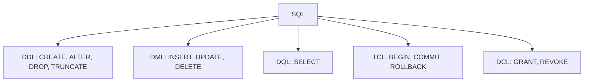
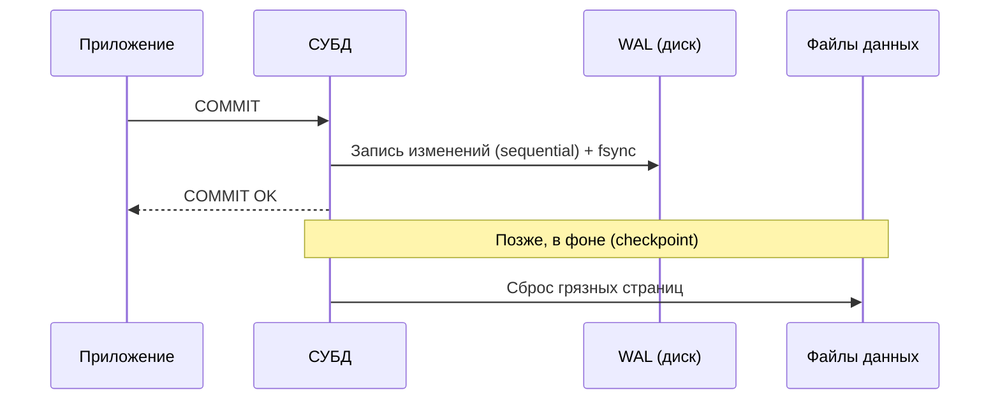
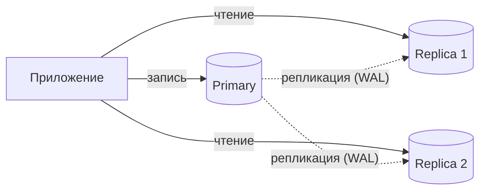

# Базы данных — конспект для собеседования

> [!info] Как пользоваться конспектом
> Структура каждого раздела: **Коротко** → **Теория (RU)** → **🇬🇧 English** → **Код / схема** → **Вопросы и ответы**. Если не указано иное, примеры даны для **PostgreSQL**; различия с **MySQL (InnoDB)** выделены отдельно.

## Оглавление

1. [[#1. Типы баз данных: Реляционные vs NoSQL]]
2. [[#2. Классификация команд SQL: DDL, DML, DQL, DCL, TCL]]
3. [[#3. Базовые команды и операции: JOIN, UNION, DELETE vs TRUNCATE vs DROP]]
4. [[#4. ACID и жизненный цикл транзакции (WAL)]]
5. [[#5. Параллельный доступ: MVCC, аномалии и уровни изоляции]]
6. [[#6. Индексы: B-Tree, Hash, GIN, составные и покрывающие]]
7. [[#7. Оптимизация запросов и чтение EXPLAIN]]
8. [[#8. Проектирование схемы: Нормализация, Денормализация, Ключи]]
9. [[#9. Блокировки (Pessimistic vs Optimistic) и Deadlocks]]
10. [[#10. Продвинутый SQL: GROUP BY/HAVING, Оконные функции, CTE]]
11. [[#11. Масштабирование БД: Репликация, Партиционирование, Шардирование]]
12. [[#12. Шпаргалка перед собеседованием]]

---

## 1. Типы баз данных: Реляционные vs NoSQL

> [!abstract] Коротко
> Реляционные БД (PostgreSQL, MySQL) хранят структурированные данные в таблицах со связями и гарантиями **ACID**. NoSQL выбирают под конкретные задачи: скорость записи, гибкая схема, кэш, поиск, аналитика.

### Теория (🇷🇺 Русский)

- **Реляционные СУБД (RDBMS: PostgreSQL, MySQL/InnoDB)**:
  - Таблицы со строгой схемой (**Schema-on-Write**), внешние ключи, связи.
  - Декларативный язык SQL, `JOIN`-ы, агрегации, полноценные **ACID-транзакции**.
  - **Когда использовать**: большинство бизнес-задач (финансы, заказы, пользователи, каталоги, CRM), где важна целостность.
- **NoSQL**:

| Тип | Примеры | Для чего | Ограничения |
| :--- | :--- | :--- | :--- |
| **Key-Value** | Redis, Memcached | Кэш, сессии, счётчики, rate limiting, очереди; доступ по ключу за $O(1)$ | Нет сложных запросов по значению |
| **Document** | MongoDB | JSON/BSON-документы с гибкой схемой, профили с разным набором полей | Слабее связи и `JOIN`, транзакции ограниченнее |
| **Column-family / Columnar** | Cassandra, ClickHouse | Колоночное хранение: огромные объёмы, быстрая аналитика (OLAP) | Не для частых точечных обновлений |
| **Search engine** | Elasticsearch, OpenSearch | Полнотекстовый поиск на инвертированных индексах, агрегация логов | Не основное хранилище; согласованность «в итоге» |
| **Graph** | Neo4j | Связи между объектами (соцсети, рекомендации) | Узкая специализация |

- **OLTP vs OLAP**: OLTP — много коротких транзакций (заказы, платежи), строчные БД (PostgreSQL, MySQL). OLAP — сложная аналитика по огромным данным, колоночные БД (ClickHouse).
- **Polyglot Persistence**: в одной системе используют разные хранилища под разные задачи (PostgreSQL — основные данные, Redis — кэш, Elasticsearch — поиск).
- **CAP и BASE**: у большинства NoSQL-систем мягче согласованность (**BASE**: Basically Available, Soft state, Eventually consistent) в обмен на доступность и масштабирование.

### 🇬🇧 English

| Term | Meaning |
| :--- | :--- |
| **Relational DBMS** | Stores data in tables with a strict schema, relations and full ACID support. |
| **Schema-on-Write** | The structure is enforced when data is written. |
| **Key-Value store** | Fast in-memory lookups by key (Redis). |
| **Document store** | Flexible JSON-like documents (MongoDB). |
| **Columnar database** | Stores data by columns; very fast analytical queries (ClickHouse). |
| **OLTP / OLAP** | Many small transactions / heavy analytical queries. |
| **Polyglot persistence** | Using different databases for different jobs in one system. |

> [!quote] Say it in English
> «For core business data like orders and payments, I'd use a relational database like PostgreSQL because we need transactions and consistency. I'd add Redis for caching and Elasticsearch if we need full-text search.»

### Вопросы и ответы

> [!question] Почему не хранить всё в MongoDB «потому что гибко»?
>
> Гибкая схема переносит ответственность за целостность в код приложения. Для связанных данных (заказ → позиции → платежи) нужны транзакции, ограничения и `JOIN`-ы. Реляционная БД даёт их «из коробки».

> [!question] Когда Redis, а когда PostgreSQL?
>
> Redis — для быстрых временных данных (кэш, сессии, счётчики, блокировки). PostgreSQL — для данных, которые нельзя потерять и по которым нужны запросы. Redis не заменяет основную БД.

---

## 2. Классификация команд SQL: DDL, DML, DQL, DCL, TCL

> [!abstract] Коротко
> SQL делится на 5 групп по тому, с чем работает команда: со структурой, с данными, с выборкой, с правами или с транзакциями.

### Теория (🇷🇺 Русский & 🇬🇧 English)

| Группа | Расшифровка | Назначение (🇷🇺 / 🇬🇧) | Команды |
| :--- | :--- | :--- | :--- |
| **DDL** | *Data Definition Language* | Определяет и меняет **структуру** объектов (таблицы, индексы, схемы) / *Defines and alters schema* | `CREATE`, `ALTER`, `DROP`, `TRUNCATE`, `RENAME` |
| **DML** | *Data Manipulation Language* | Меняет **данные** в таблицах / *Modifies row data* | `INSERT`, `UPDATE`, `DELETE`, `MERGE` |
| **DQL** | *Data Query Language* | Читает данные / *Queries data* | `SELECT` |
| **DCL** | *Data Control Language* | Права доступа / *Manages permissions* | `GRANT`, `REVOKE` |
| **TCL** | *Transaction Control Language* | Управление транзакциями / *Controls transactions* | `BEGIN` / `START TRANSACTION`, `COMMIT`, `ROLLBACK`, `SAVEPOINT` |

> [!note]
> Некоторые источники относят `SELECT` к DML и не выделяют DQL. На собеседовании полезно сказать об этом, если спросят.

> [!warning] DDL и транзакции
> В **MySQL** DDL (`ALTER TABLE`, `DROP`, `TRUNCATE`) вызывает **неявный `COMMIT`** текущей транзакции и сам откатить нельзя.
> В **PostgreSQL** DDL **транзакционный**: `BEGIN; ALTER TABLE ...; DROP TABLE ...; ROLLBACK;` вернёт структуру в исходное состояние.



> [!quote] Say it in English
> «DDL changes the structure of the database, DML changes the data, and DQL reads it. One important difference: in MySQL, DDL causes an implicit commit, but in PostgreSQL, DDL is transactional and can be rolled back.»

### Вопросы и ответы

> [!question] К какой группе относится `TRUNCATE` и почему это важно?
>
> К **DDL** (хотя удаляет данные). Поэтому в MySQL он делает неявный `COMMIT` и не откатывается; в PostgreSQL откатывается внутри транзакции.

> [!question] Чем `GRANT` отличается от `ROLE`?
>
> `GRANT` выдаёт права; **роль** — именованный набор прав, который выдают пользователям. Так проще управлять доступом (принцип наименьших привилегий).

---

## 3. Базовые команды и операции: JOIN, UNION, DELETE vs TRUNCATE vs DROP

> [!abstract] Коротко
> Различай удаление **строк** с логированием (`DELETE`), быструю очистку **таблицы** (`TRUNCATE`) и удаление **самой таблицы** (`DROP`). `JOIN` соединяет таблицы по горизонтали, `UNION` — по вертикали.

### Теория (🇷🇺 Русский)

#### 3.1. `DELETE` vs `TRUNCATE` vs `DROP`

| Критерий | `DELETE` | `TRUNCATE` | `DROP` |
| :--- | :--- | :--- | :--- |
| **Категория** | DML | DDL | DDL |
| **Что удаляет** | Строки по `WHERE` или все | **Все** строки (без `WHERE`) | Всю таблицу: данные, структуру, индексы, триггеры |
| **Скорость** | Медленно (построчно, обновляет индексы) | Очень быстро (освобождает страницы) | Мгновенно |
| **Журнал (WAL / Undo)** | Пишет каждую строку | Минимально | Минимально |
| **`ROLLBACK`** | Да | PostgreSQL: да; MySQL: **нет** | PostgreSQL: да; MySQL: **нет** |
| **Счётчик `AUTO_INCREMENT` / `SERIAL`** | **Не сбрасывает** | MySQL: сбрасывает; PostgreSQL: только с `RESTART IDENTITY` | Таблицы больше нет |
| **Триггеры `ON DELETE`** | Срабатывают для каждой строки | Не срабатывают (в PostgreSQL есть `ON TRUNCATE`) | Не срабатывают |
| **Таблицы с внешними ключами** | Работает (с учётом `ON DELETE`) | Нельзя, если на таблицу ссылаются FK (в PostgreSQL — `TRUNCATE ... CASCADE`) | Нужен `CASCADE` или предварительное удаление зависимостей |

#### 3.2. Все виды `JOIN`

`JOIN` соединяет таблицы **по горизонтали** (добавляет столбцы из второй таблицы) по условию `ON`.

| Вид                           | Что возвращает                                                                      |
| :---------------------------- | :---------------------------------------------------------------------------------- |
| **`INNER JOIN`** (или `JOIN`) | Только строки с совпадением **в обеих** таблицах                                    |
| **`LEFT JOIN`**               | **Все** строки левой + совпавшие правой; если пары нет — `NULL`                     |
| **`RIGHT JOIN`**              | Зеркально `LEFT JOIN`. На практике заменяют на `LEFT JOIN` ради читаемости          |
| **`FULL OUTER JOIN`**         | Все строки обеих таблиц; где пары нет — `NULL`. В MySQL нет, эмулируется (см. ниже) |
| **`CROSS JOIN`**              | Декартово произведение: $N \times M$ строк, без `ON`                                |
| **`SELF JOIN`**               | Таблица соединяется сама с собой (`employees.manager_id → employees.id`)            |

- Классический приём **анти-джойна**: `LEFT JOIN ... WHERE right.id IS NULL` находит записи **без связей** (пользователи без заказов). Альтернатива: `NOT EXISTS`.
- Эмуляция `FULL OUTER JOIN` в MySQL: `LEFT JOIN` **`UNION`** `RIGHT JOIN` (именно `UNION`, чтобы убрать дубликаты совпавших строк).

#### 3.3. `UNION` vs `UNION ALL`

Склеивают результаты `SELECT` **по вертикали** (число и типы колонок совпадают).

- **`UNION`**: убирает дубликаты (сортировка/хэширование), поэтому медленнее.
- **`UNION ALL`**: склеивает как есть, **быстрее**. Используй его, если дубликаты невозможны или не мешают.

#### 3.4. DML и `UPSERT`

- **`INSERT INTO ... VALUES (...)`**: одна или несколько строк (batch insert быстрее множества одиночных).
- **`UPDATE ... SET ... WHERE ...`**: **никогда не запускай `UPDATE`/`DELETE` без `WHERE`**. Привычка: сначала `SELECT` с тем же `WHERE`, и выполнять в транзакции.
- **`UPSERT`** (вставить или обновить при конфликте уникального ключа):
  - PostgreSQL: `INSERT ... ON CONFLICT (email) DO UPDATE SET name = EXCLUDED.name;`
  - MySQL: `INSERT ... ON DUPLICATE KEY UPDATE name = VALUES(name);` (в MySQL 8.0.20+ `VALUES()` считается устаревшим, предпочтительнее синтаксис с алиасом: `INSERT ... VALUES (...) AS new ON DUPLICATE KEY UPDATE name = new.name;`)
- **`NULL`**: это «неизвестно», а не ноль и не пустая строка. `NULL = NULL` даёт `NULL` (не `TRUE`), проверять нужно через `IS NULL` / `IS NOT NULL`.

### 🇬🇧 English

| Term | Meaning |
| :--- | :--- |
| **`DELETE`** | Removes rows one by one; supports `WHERE`; fires triggers; keeps the auto-increment counter. |
| **`TRUNCATE`** | Quickly removes all rows by deallocating data pages; no `WHERE`; DDL. |
| **`DROP`** | Removes the whole table (data, structure, indexes). |
| **`INNER JOIN`** | Returns only rows that match in both tables. |
| **`LEFT JOIN`** | Returns all rows from the left table; unmatched right columns are `NULL`. |
| **`UNION` / `UNION ALL`** | Combine result sets; `UNION` removes duplicates (slower), `UNION ALL` keeps them (faster). |
| **`UPSERT`** | Insert a row, or update it if a unique key already exists. |

> [!quote] Say it in English
> «`DELETE` removes rows and can be filtered with `WHERE`; `TRUNCATE` removes all rows very fast and is DDL; `DROP` removes the table itself. I prefer `UNION ALL` when duplicates don't matter, because it doesn't need to deduplicate.»

### Код

```sql
-- DDL: таблица с ограничениями и внешним ключом
CREATE TABLE orders (
    id         BIGINT GENERATED ALWAYS AS IDENTITY PRIMARY KEY,
    user_id    BIGINT        NOT NULL REFERENCES users(id) ON DELETE CASCADE,
    total      NUMERIC(10,2) NOT NULL CHECK (total >= 0),
    status     VARCHAR(20)   NOT NULL DEFAULT 'new',
    created_at TIMESTAMPTZ   NOT NULL DEFAULT NOW()
);

-- DDL: изменение структуры
ALTER TABLE orders ADD COLUMN comment TEXT;

-- DML: UPSERT в PostgreSQL
INSERT INTO user_stats (user_id, logins_count)
VALUES (42, 1)
ON CONFLICT (user_id)
DO UPDATE SET logins_count = user_stats.logins_count + 1;

-- LEFT JOIN: пользователи БЕЗ заказов
SELECT u.id, u.email
FROM users u
LEFT JOIN orders o ON o.user_id = u.id
WHERE o.id IS NULL;

-- Тот же результат через NOT EXISTS (часто так же быстро)
SELECT u.id, u.email
FROM users u
WHERE NOT EXISTS (SELECT 1 FROM orders o WHERE o.user_id = u.id);

-- SELF JOIN: сотрудник и его руководитель
SELECT e.name AS employee, m.name AS manager
FROM employees e
LEFT JOIN employees m ON e.manager_id = m.id;

-- Эмуляция FULL OUTER JOIN в MySQL
SELECT * FROM a LEFT JOIN b ON a.id = b.a_id
UNION
SELECT * FROM a RIGHT JOIN b ON a.id = b.a_id;
```

### Вопросы и ответы

> [!question] В чём ловушка фильтрации правой таблицы при `LEFT JOIN`?
>
> Условие по правой таблице в `WHERE` неявно превращает `LEFT JOIN` в `INNER JOIN`: у строк без пары `o.status` равен `NULL`, и они отбрасываются.
>
> ```sql
> -- ПЛОХО: пользователи без заказов исчезнут
> SELECT u.id, o.total FROM users u
> LEFT JOIN orders o ON o.user_id = u.id
> WHERE o.status = 'paid';
>
> -- ХОРОШО: условие в ON сохраняет всех пользователей
> SELECT u.id, o.total FROM users u
> LEFT JOIN orders o ON o.user_id = u.id AND o.status = 'paid';
> ```

> [!question] Почему `TRUNCATE` быстрее `DELETE` без `WHERE`?
>
> `DELETE` обрабатывает и логирует каждую строку, обновляет индексы и вызывает триггеры. `TRUNCATE` освобождает/пересоздаёт страницы данных целиком, почти без построчного логирования.

> [!question] Что вернёт `SELECT 1 WHERE NULL = NULL`?
>
> Ничего: результат сравнения с `NULL` — `NULL` (неизвестно), а `WHERE` пропускает только `TRUE`. Для проверки используют `IS NULL` или `IS NOT DISTINCT FROM`.

---

## 4. ACID и жизненный цикл транзакции (WAL)

> [!abstract] Коротко
> Транзакция — неделимая единица работы. Атомарность и долговечность обеспечиваются через **WAL (Write-Ahead Log)** — журнал упреждающей записи.

### Теория (🇷🇺 Русский)

- **Atomicity (атомарность)**: «всё или ничего». Если из 5 запросов упал 4-й, первые 3 откатываются.
- **Consistency (согласованность)**: транзакция переводит БД из одного корректного состояния в другое, не нарушая ограничения (`NOT NULL`, `UNIQUE`, `FOREIGN KEY`, `CHECK`).
- **Isolation (изолированность)**: параллельные транзакции не видят чужих незафиксированных изменений (в степени, заданной уровнем изоляции).
- **Durability (долговечность)**: если СУБД вернула `COMMIT OK`, данные не пропадут даже при отключении питания.
- **Как работает WAL**:
  - Писать изменения сразу в случайные места файлов таблиц (Random I/O) медленно.
  - Поэтому СУБД при `COMMIT` сначала **последовательно** (Sequential I/O, быстро) дописывает изменения в журнал WAL и сбрасывает его на диск (`fsync`). Изменённые страницы в памяти (Buffer Pool) помечаются «грязными» (dirty pages) и сбрасываются на диск в фоне (checkpoint).
  - При сбое БД при старте **проигрывает WAL** (crash recovery) и восстанавливает все зафиксированные транзакции.
  - В MySQL InnoDB аналог — **Redo Log**; для отката (и MVCC) используется **Undo Log**.
- WAL также используется для **репликации** (реплики применяют поток WAL) и point-in-time recovery.



### 🇬🇧 English

| Term | Meaning |
| :--- | :--- |
| **Atomicity** | All operations succeed, or none are applied. |
| **Consistency** | A transaction keeps all constraints and invariants valid. |
| **Isolation** | Concurrent transactions don't see each other's uncommitted changes. |
| **Durability** | Committed data survives crashes and power loss. |
| **WAL (Write-Ahead Log)** | Changes are written to a sequential log on disk *before* data files, so the DB can recover after a crash. |
| **Checkpoint** | A point where dirty pages are flushed from memory to data files. |

> [!quote] Say it in English
> «Durability is guaranteed by the write-ahead log. On commit, the database first writes the change to the log sequentially and flushes it to disk. The data pages are written later in the background. After a crash, the database replays the log to restore committed transactions.»

### Вопросы и ответы

> [!question] Зачем WAL, если можно сразу писать в файлы таблиц?
>
> Запись в разные места файлов — случайный I/O, медленный. Журнал пишется последовательно (быстро) и гарантирует, что после сбоя зафиксированные изменения можно восстановить. Данные в таблицах можно сбрасывать лениво.

> [!question] Что такое «грязная страница» (dirty page)?
>
> Страница в буферном пуле, изменённая в памяти, но ещё не записанная в файл данных. Её сброс происходит в фоне; безопасность обеспечивает уже записанный WAL.

> [!question] Какой уровень «C» в ACID и CAP — это одно и то же?
>
> Нет. **C в ACID** — соблюдение ограничений целостности. **C в CAP** — согласованность копий данных в распределённой системе (все узлы видят одно и то же).

---

## 5. Параллельный доступ: MVCC, аномалии и уровни изоляции

> [!abstract] Коротко
> **MVCC** позволяет читателям не блокировать писателей и наоборот. **Уровень изоляции** — баланс между корректностью и производительностью.

### Теория (🇷🇺 Русский)

- **MVCC (Multi-Version Concurrency Control)**: при обновлении БД не перезаписывает строку, а создаёт **новую версию** (в PostgreSQL — поля `xmin`/`xmax`; в InnoDB — цепочка версий в Undo Log). Каждая транзакция видит **снимок (snapshot)** данных. Старые версии убирает **VACUUM** (PostgreSQL) или purge (InnoDB).
- **Аномалии параллельных транзакций**:
  1. **Dirty Read (грязное чтение)**: читаем изменения другой транзакции, которая ещё не сделала `COMMIT` (и может откатиться).
  2. **Non-Repeatable Read (неповторяющееся чтение)**: одна и та же строка при повторном чтении имеет другое значение (другая транзакция успела `UPDATE` + `COMMIT`).
  3. **Phantom Read (фантомное чтение)**: повторный запрос по условию (`WHERE amount > 100`) возвращает новые строки, добавленные другой транзакцией.
  4. **Lost Update (потерянное обновление)**: две транзакции прочитали `balance = 100`, обе прибавили 50 и записали 150 вместо 200.
  5. **Write Skew**: две транзакции читают пересекающиеся данные и пишут в разные строки, нарушая общий инвариант (например, «в смене должен остаться хотя бы один дежурный врач»). Лечится только `Serializable` или явными блокировками.

| Уровень изоляции | Dirty Read | Non-Repeatable Read | Phantom Read | Примечание |
| :--- | :--- | :--- | :--- | :--- |
| **Read Uncommitted** | Возможен | Возможен | Возможен | В PostgreSQL ведёт себя как Read Committed |
| **Read Committed** | Нет | Возможен | Возможен | **По умолчанию в PostgreSQL** (новый снимок на каждый запрос) |
| **Repeatable Read** | Нет | Нет | По стандарту возможен* | **По умолчанию в MySQL InnoDB** (снимок на всю транзакцию) |
| **Serializable** | Нет | Нет | Нет | Полная изоляция; возможны ошибки сериализации → нужен **retry** |

\* По стандарту SQL. На практике см. ниже.

> [!tip] Нюанс для собеседования
> - В **PostgreSQL** `Repeatable Read` — это Snapshot Isolation: фантомы **не возникают**, но возможен **Write Skew**. Lost Update тут приводит к ошибке сериализации (`could not serialize access`), которую нужно повторить.
> - В **MySQL InnoDB** обычный `SELECT` читает из снимка (без фантомов), а блокирующие чтения (`SELECT ... FOR UPDATE`) используют **Next-Key Locks** (запись + промежуток), тоже защищая от фантомов.

### 🇬🇧 English

| Term | Meaning |
| :--- | :--- |
| **MVCC** | Keeps multiple row versions so readers and writers don't block each other. |
| **Snapshot** | The consistent view of data a transaction sees. |
| **Dirty read** | Reading uncommitted changes from another transaction. |
| **Non-repeatable read** | Re-reading a row gives a different value because another transaction committed a change. |
| **Phantom read** | Re-running a range query returns new rows inserted by another transaction. |
| **Lost update** | Two concurrent updates overwrite each other's result. |
| **Write skew** | Two transactions each write different rows based on data that the other changes, breaking an invariant. |
| **Serializable** | The strictest level: results are as if transactions ran one after another. |

> [!quote] Say it in English
> «PostgreSQL uses Read Committed by default, and MySQL InnoDB uses Repeatable Read. Thanks to MVCC, readers don't block writers. If I need the strongest guarantees, I use Serializable, but I have to retry transactions on serialization errors.»

### Вопросы и ответы

> [!question] Как MVCC позволяет читателям не блокировать писателей?
>
> Писатель создаёт новую версию строки, а читатель продолжает видеть старую версию из своего снимка. Блокировок на чтение не нужно.

> [!question] Какой уровень изоляции выбрать для денежных операций?
>
> Обычно хватает Read Committed/Repeatable Read **плюс** явные блокировки (`SELECT ... FOR UPDATE`) или атомарные `UPDATE ... SET balance = balance - X WHERE balance >= X`. Для сложных инвариантов используют `Serializable` с ретраями.

> [!question] Что такое VACUUM и зачем он нужен?
>
> В PostgreSQL старые версии строк после `UPDATE`/`DELETE` остаются (dead tuples). `VACUUM` освобождает это место для повторного использования; **autovacuum** делает это автоматически. Без него таблицы и индексы «пухнут» (bloat).

---

## 6. Индексы: B-Tree, Hash, GIN, составные и покрывающие

> [!abstract] Коротко
> Индекс — отдельная структура, ускоряющая поиск с $O(N)$ до $O(\log N)$, но замедляющая запись (`INSERT/UPDATE/DELETE`) и занимающая место. Индексов должно быть ровно столько, сколько нужно запросам.

### Теория (🇷🇺 Русский)

- **B-Tree (сбалансированное дерево)**: индекс по умолчанию. Ключи отсортированы в листьях (связанных между собой).
  - *Поддерживает*: `=`, диапазоны (`>`, `<`, `BETWEEN`), `ORDER BY`, префиксный поиск (`LIKE 'ivan%'`).
  - *Не помогает*: при ведущем wildcard (`LIKE '%ivan%'`) и при функции над колонкой (`WHERE LOWER(email) = ...`; для этого есть **функциональный индекс** на `LOWER(email)`).
- **Hash-индекс**: поиск за $O(1)$, **только** `=`; без диапазонов и сортировки.
- **GIN (Generalized Inverted Index, PostgreSQL)**: инвертированный индекс для массивов, `JSONB`, полнотекстового поиска. **GiST** — для геоданных и «похожести».
- **Clustered vs Non-Clustered**:
  - **MySQL InnoDB**: первичный ключ **кластерный**: таблица физически хранится в листьях B-Tree по `PRIMARY KEY`. Вторичные индексы хранят значение PK, поэтому поиск по ним — два прохода по дереву (*double lookup*).
  - **PostgreSQL**: все индексы некластерные: таблица — куча (**Heap**), индексы хранят физический адрес строки (`ctid`).
- **Составной индекс `(a, b, c)`**: работает по **правилу левого префикса (Leftmost Prefix Rule)**. Используется для `a`, `a AND b`, `a AND b AND c`, `a = 1 AND b > 5`. **Бесполезен** для `WHERE b = 2` или `WHERE c = 3`. Порядок колонок: сначала равенство, затем диапазон; обычно сначала более селективные.
- **Покрывающий индекс (Covering Index)**: содержит все колонки запроса; ответ берётся из индекса без обращения к таблице (`Index Only Scan` / `Using index`). В PostgreSQL дополнительные колонки добавляют через `INCLUDE (...)`.
- **Частичный индекс (Partial Index)**: индекс только по части строк (`WHERE status = 'new'`): меньше и быстрее.
- **Селективность**: доля уникальных значений. Индекс по колонке с двумя значениями (`is_active`) обычно бесполезен: планировщик выберет `Seq Scan`.
- **Цена индексов**: каждый индекс нужно обновлять при записи, он занимает место и память. Лишние индексы удаляют.

### 🇬🇧 English

| Term | Meaning |
| :--- | :--- |
| **B-Tree index** | Default sorted tree; supports `=`, ranges, `ORDER BY`, prefix `LIKE`. |
| **Hash index** | Exact-match lookups only. |
| **GIN** | Inverted index for `JSONB`, arrays and full-text search (PostgreSQL). |
| **Clustered index** | The table data is stored in the index order (InnoDB primary key). |
| **Composite index** | An index on several columns; follows the leftmost-prefix rule. |
| **Covering index** | Contains every column the query needs, so the table isn't read. |
| **Partial index** | Indexes only rows matching a condition. |
| **Selectivity** | How well a condition narrows down the rows. |

> [!quote] Say it in English
> «An index speeds up reads but slows down writes. For a composite index on `(a, b)`, the leftmost prefix rule applies: it helps queries that filter by `a`, or by `a` and `b`, but not by `b` alone.»

### Код

```sql
-- Составной индекс: порядок колонок важен
CREATE INDEX idx_orders_user_status ON orders (user_id, status);

-- Покрывающий индекс (PostgreSQL): запрос читается только из индекса
CREATE INDEX idx_orders_user_status_include
ON orders (user_id, status) INCLUDE (total, created_at);

-- Функциональный индекс: для WHERE LOWER(email) = ...
CREATE INDEX idx_users_email_lower ON users (LOWER(email));

-- Частичный индекс: только «живые» заказы
CREATE INDEX idx_orders_new ON orders (created_at) WHERE status = 'new';

-- GIN для JSONB
CREATE INDEX idx_events_payload ON events USING GIN (payload);
```

### Вопросы и ответы

> [!question] Почему индекс может не использоваться, хотя он есть?
>
> Частые причины: функция над колонкой в `WHERE`; ведущий `%` в `LIKE`; несовпадение типов (неявное приведение); нарушено правило левого префикса; запрос возвращает большую долю таблицы (выгоднее `Seq Scan`); устаревшая статистика.

> [!question] Почему много индексов — плохо?
>
> Каждый `INSERT/UPDATE/DELETE` обновляет все затронутые индексы, растёт объём на диске и в памяти. Индексы стоит создавать под реальные запросы и периодически удалять неиспользуемые.

> [!question] Чем отличаются кластерный и обычный индекс?
>
> В кластерном (PK в InnoDB) сами строки лежат в порядке индекса; он один на таблицу. Некластерный хранит ссылку на строку (в InnoDB — значение PK, в PostgreSQL — `ctid`).

---

## 7. Оптимизация запросов и чтение EXPLAIN

> [!abstract] Коротко
> Диагностика медленных запросов: `EXPLAIN ANALYZE`, устранение `Seq Scan` на больших таблицах, избегание больших `OFFSET`, борьба с **N+1**.

### Теория (🇷🇺 Русский)

- **`EXPLAIN` vs `EXPLAIN ANALYZE`**:
  - `EXPLAIN` показывает **план** по статистике, запрос **не выполняется**.
  - `EXPLAIN ANALYZE` **реально выполняет** запрос и показывает фактическое время и число строк. Для `UPDATE`/`DELETE` оборачивай в транзакцию с `ROLLBACK`!
- **На что смотреть в плане**:
  - **Тип сканирования**: `Seq Scan` (полное чтение таблицы; MySQL: `type = ALL`) → `Index Scan` → `Index Only Scan`. Для маленьких таблиц `Seq Scan` нормален.
  - **Расхождение `rows` (оценка) и `actual rows`**: большая разница значит устаревшую статистику, нужно `ANALYZE table_name`.
  - **Сортировка**: `Sort Method: external merge Disk` (PostgreSQL), `Using filesort` / `Using temporary` (MySQL) — не хватило индекса или памяти (`work_mem`, `sort_buffer_size`).
  - **Тип join**: `Nested Loop`, `Hash Join`, `Merge Join`. Nested Loop по большим таблицам без индекса — красный флаг.
- **Проблема `OFFSET`**: `ORDER BY id LIMIT 20 OFFSET 1000000` читает и отбрасывает миллион строк. **Решение — Keyset (Cursor) Pagination**: `WHERE id < :last_id ORDER BY id DESC LIMIT 20` использует индекс и работает за $O(\log N)$.
- **Проблема N+1**: 1 запрос за списком + N запросов за связанными данными в цикле. Лечится `JOIN` или eager loading (`with()` в Eloquent), `WHERE id IN (...)`.
- **Другие приёмы**: выбирать только нужные колонки (не `SELECT *`), `EXISTS` вместо `COUNT(*) > 0`, батчинг вставок, кэшировать тяжёлые результаты, смотреть slow query log (`pg_stat_statements`).

### 🇬🇧 English

| Term | Meaning |
| :--- | :--- |
| **Execution plan** | The steps the database chooses to run a query. |
| **Sequential scan** | Reading the entire table. |
| **Index scan / Index only scan** | Reading via an index / without touching the table. |
| **Statistics** | Data about table contents that the planner uses for estimates. |
| **Keyset pagination** | Paging by the last seen key instead of `OFFSET`. |
| **N+1 problem** | One query for a list plus one extra query per item. |

> [!quote] Say it in English
> «When a query is slow, I run `EXPLAIN ANALYZE` and check whether it uses an index scan or a sequential scan, and whether the estimated rows match the actual rows. For deep pagination, I use keyset pagination instead of `OFFSET`.»

### Код

```sql
-- ПЛОХО: функция над колонкой, индекс по created_at не используется
SELECT * FROM orders WHERE DATE(created_at) = '2026-11-13';

-- ХОРОШО: диапазон использует B-Tree
SELECT id, total FROM orders
WHERE created_at >= '2026-11-13 00:00:00'
  AND created_at <  '2026-11-14 00:00:00';

-- Безопасно проверить UPDATE/DELETE
BEGIN;
EXPLAIN ANALYZE UPDATE orders SET status = 'old' WHERE created_at < '2025-01-01';
ROLLBACK;

-- Keyset-пагинация вместо OFFSET
SELECT id, total FROM orders
WHERE id < :last_id
ORDER BY id DESC
LIMIT 20;
```

### Вопросы и ответы

> [!question] Почему большой `OFFSET` медленный и чем его заменить?
>
> БД должна прочитать и отбросить все пропущенные строки. Замена: keyset-пагинация по индексированному полю (последний полученный `id` или пара `(created_at, id)`).

> [!question] Что делать, если `estimated rows` сильно отличается от `actual rows`?
>
> Обновить статистику (`ANALYZE`), проверить корреляцию колонок, при необходимости увеличить детализацию статистики или переписать запрос.

> [!question] Что такое проблема N+1 и как её найти?
>
> Запросы в цикле. Находят по логам запросов, `pg_stat_statements`, инструментам вроде Laravel Debugbar/Telescope. Решение — eager loading или единый запрос с `JOIN`/`IN`.

---

## 8. Проектирование схемы: Нормализация, Денормализация, Ключи

> [!abstract] Коротко
> Нормализация убирает избыточность и аномалии обновления; денормализация сознательно возвращает дублирование ради скорости чтения.

### Теория (🇷🇺 Русский)

- **Нормальные формы**:
  - **1НФ (1NF)**: значения атомарны, нет повторяющихся групп колонок (`phone1`, `phone2`), есть первичный ключ.
  - **2НФ (2NF)**: 1НФ + каждый неключевой столбец зависит от **всего** составного ключа, а не от его части.
  - **3НФ (3NF)**: 2НФ + нет **транзитивных зависимостей** (неключевые столбцы не зависят друг от друга; `city_name` не хранится в `orders` рядом с `city_id`).
  - **BCNF** — усиленная 3НФ: каждая функциональная зависимость определяется суперключом (встречается реже).
- **Аномалии ненормализованных таблиц**: вставки, обновления и удаления приводят к рассинхронизации или потере данных.
- **Денормализация**: осознанное нарушение 3НФ (`comments_count` в `posts`, копия цены в `order_items` на момент покупки). Нужна, когда `JOIN`/`COUNT(*)` становятся узким местом. Цена — усложнение записи и риск рассинхронизации.
- **Типы связей**: один-к-одному, один-ко-многим (FK на стороне «многих»), многие-ко-многим (**промежуточная таблица** с двумя FK).
- **Ограничения целостности**: `PRIMARY KEY`, `FOREIGN KEY` (`ON DELETE CASCADE / SET NULL / RESTRICT`), `UNIQUE`, `NOT NULL`, `CHECK`. Держи инварианты в БД, а не только в коде.
- **Первичный ключ: `BIGINT` vs UUID**:
  - **`BIGINT` (autoincrement)**: 8 байт, вставка в конец B-Tree (нет фрагментации). Минусы: предсказуемость (риск IDOR, раскрывает объём данных), сложнее с шардами/мультимастером.
  - **`UUID v4`**: 16 байт, можно генерировать вне БД. Минус: случайные значения → вставки в случайные места B-Tree → **page splits**, фрагментация, промахи кэша.
  - **`UUID v7` / `ULID`**: время в начале → монотонно возрастают → удобны для B-Tree и при этом глобально уникальны.
- **Деньги**: хранить в `NUMERIC/DECIMAL` или в минимальных единицах (`BIGINT` копейки), **не** во `FLOAT`.
- **Soft delete** (`deleted_at`): удобно для восстановления, но усложняет запросы и уникальные индексы (нужны частичные индексы).

### 🇬🇧 English

| Term | Meaning |
| :--- | :--- |
| **1NF** | Atomic values, no repeating groups, has a primary key. |
| **2NF** | 1NF + no partial dependency on part of a composite key. |
| **3NF** | 2NF + no transitive dependencies between non-key columns. |
| **Denormalization** | Deliberately storing redundant data to speed up reads. |
| **Foreign key** | A column that references the primary key of another table. |
| **Surrogate key** | An artificial key (`id`) with no business meaning. |
| **Page split** | A full index page divides in two on a random insert, causing fragmentation. |

> [!quote] Say it in English
> «I normalize the schema to avoid duplication and update anomalies. If a query becomes a bottleneck, I may denormalize on purpose, for example by storing a counter in the parent table. For primary keys, I prefer `BIGINT` or UUID v7, because random UUID v4 values fragment the index.»

### Вопросы и ответы

> [!question] Зачем копировать цену товара в `order_items`?
>
> Цена товара со временем меняется, а заказ должен хранить цену **на момент покупки**. Это осознанная денормализация ради корректности истории.

> [!question] UUID или autoincrement?
>
> Autoincrement проще и компактнее. UUID удобен для распределённой генерации и скрывает порядок/объём. Если нужен UUID, выбирай time-ordered (v7/ULID), а не v4.

> [!question] Как смоделировать связь «многие-ко-многим»?
>
> Промежуточная таблица (`user_roles`) с FK на обе таблицы и составным уникальным ключом `(user_id, role_id)`.

---

## 9. Блокировки (Pessimistic vs Optimistic) и Deadlocks

> [!abstract] Коротко
> Чтобы избежать гонок (race conditions) при изменении общих данных, используют **пессимистические блокировки** (`FOR UPDATE`) или **оптимистические** (колонка `version`). Взаимные блокировки (**deadlocks**) предотвращают единым порядком захвата.

### Теория (🇷🇺 Русский)

- **Пессимистическая блокировка**: предполагаем частые конфликты, блокируем строку при чтении: `SELECT balance FROM wallets WHERE id = 1 FOR UPDATE;`. Остальные транзакции ждут `COMMIT`/`ROLLBACK`.
  - *Плюс*: нет конфликтов. *Минус*: меньше параллелизма, риск deadlock.
  - Полезные варианты: `FOR UPDATE NOWAIT` (сразу ошибка, если занято), `FOR UPDATE SKIP LOCKED` (пропустить занятые строки; для очередей задач).
- **Оптимистическая блокировка**: предполагаем редкие конфликты. Без блокировок в БД, колонка `version`: `UPDATE products SET stock = stock - 1, version = version + 1 WHERE id = 10 AND version = 5;`. Если `affected_rows = 0`, строку успели изменить: перечитать и повторить.
- **Атомарное обновление**: часто блокировки не нужны: `UPDATE wallets SET balance = balance - 100 WHERE id = 1 AND balance >= 100;`.
- **Deadlock (взаимная блокировка)**: транзакция 1 держит строку A и ждёт B, транзакция 2 держит B и ждёт A. СУБД находит цикл в графе ожиданий и откатывает одну из транзакций (ошибка `Deadlock found`).
  - **Как избежать**: 1) всегда блокировать ресурсы в одном порядке (например, по возрастанию `id`); 2) делать транзакции короткими (не вызывать внешние HTTP API внутри!); 3) при ошибке deadlock делать **retry**.
- **Advisory locks (PostgreSQL)**: прикладные блокировки по произвольному ключу (`pg_advisory_lock`), например, чтобы один cron-процесс работал в единственном экземпляре.

### 🇬🇧 English

| Term | Meaning |
| :--- | :--- |
| **Pessimistic locking** | Lock the row when reading, so nobody else can change it until you finish. |
| **Optimistic locking** | Don't lock; check a version number when updating and retry on conflict. |
| **Deadlock** | Two transactions wait for each other's locks forever. |
| **Race condition** | The result depends on the timing of concurrent operations. |
| **`SKIP LOCKED`** | Skip rows that other transactions have locked. |

> [!quote] Say it in English
> «If conflicts are frequent, I use pessimistic locking with `SELECT ... FOR UPDATE`. If they are rare, I use optimistic locking with a version column and retry on failure. To avoid deadlocks, I always lock rows in the same order and keep transactions short.»

### Код

```sql
-- Пессимистическая блокировка: безопасный перевод денег
BEGIN;
SELECT id, balance FROM wallets
WHERE id IN (1, 2)
ORDER BY id            -- единый порядок = защита от deadlock
FOR UPDATE;

UPDATE wallets SET balance = balance - 100 WHERE id = 1;
UPDATE wallets SET balance = balance + 100 WHERE id = 2;
COMMIT;

-- Оптимистическая блокировка
UPDATE products
SET stock = stock - 1, version = version + 1
WHERE id = 10 AND version = 5;   -- affected_rows = 0 → конфликт, повторить

-- Очередь задач: несколько воркеров без ожидания друг друга
SELECT id FROM jobs
WHERE status = 'new'
ORDER BY id
LIMIT 10
FOR UPDATE SKIP LOCKED;
```

### Вопросы и ответы

> [!question] Как предотвратить двойное списание при параллельных запросах?
>
> Атомарный `UPDATE ... WHERE balance >= X`, либо `SELECT ... FOR UPDATE` внутри транзакции, либо оптимистический `version`. Плюс идемпотентность запроса (`Idempotency-Key`), чтобы повтор не списал деньги второй раз.

> [!question] Что делает приложение при получении ошибки deadlock?
>
> Повторяет всю транзакцию (1–3 раза) с небольшой задержкой. Deadlock — штатная ситуация, СУБД специально откатывает «жертву».

---

## 10. Продвинутый SQL: GROUP BY/HAVING, Оконные функции, CTE

> [!abstract] Коротко
> Минимум для собеседований: порядок выполнения запроса, разница `WHERE` и `HAVING`, оконные функции и CTE.

### Теория (🇷🇺 Русский)

- **Логический порядок выполнения** (поэтому в `WHERE` нельзя использовать алиас из `SELECT`):
  1. `FROM` + `JOIN`
  2. `WHERE` (фильтрует **строки** до группировки)
  3. `GROUP BY`
  4. `HAVING` (фильтрует **группы** по агрегатам)
  5. `SELECT` (выражения, оконные функции, алиасы)
  6. `DISTINCT`
  7. `ORDER BY`
  8. `LIMIT / OFFSET`

  *Примечание: в PostgreSQL и MySQL алиас из `SELECT` можно использовать в `ORDER BY` (и в MySQL — в `GROUP BY`/`HAVING`), но не в `WHERE`.*
- **Агрегатные функции**: `COUNT`, `SUM`, `AVG`, `MIN`, `MAX`. `COUNT(*)` считает все строки, `COUNT(col)` — только не-`NULL`.
- **Оконные функции**: считают по «окну» строк, **не схлопывая** строки (в отличие от `GROUP BY`).
  - Синтаксис: `ФУНКЦИЯ() OVER (PARTITION BY отдел ORDER BY зарплата DESC)`.
  - `ROW_NUMBER()` (1, 2, 3), `RANK()` (1, 1, 3, с пропусками), `DENSE_RANK()` (1, 1, 2), `LAG()` / `LEAD()` (предыдущая/следующая строка), `SUM() OVER (...)` (нарастающий итог).
- **CTE (Common Table Expressions, `WITH`)**: именованные временные наборы: читаемость сложных запросов и **рекурсивные запросы** (деревья категорий, иерархии).
- **Подзапросы**: скалярные, коррелированные (зависят от внешнего запроса и могут быть медленными), `EXISTS` / `IN`.

### 🇬🇧 English

| Term | Meaning |
| :--- | :--- |
| **`WHERE` vs `HAVING`** | `WHERE` filters rows before grouping; `HAVING` filters groups after aggregation. |
| **Window function** | Calculates over a set of related rows without collapsing them into one. |
| **`ROW_NUMBER` / `RANK` / `DENSE_RANK`** | Numbering rows / with gaps for ties / without gaps for ties. |
| **CTE** | A named temporary result set defined with `WITH`. |
| **Recursive CTE** | A CTE that refers to itself, used for hierarchies. |

> [!quote] Say it in English
> «`WHERE` filters rows before grouping, and `HAVING` filters groups after aggregation. For "top N per group" tasks, I use a window function like `DENSE_RANK()` with `PARTITION BY` inside a CTE.»

### Код

```sql
-- 1. Топ-2 по зарплате в каждом отделе (оконная функция + CTE)
WITH ranked AS (
    SELECT name, department_id, salary,
           DENSE_RANK() OVER (PARTITION BY department_id ORDER BY salary DESC) AS rnk
    FROM employees
)
SELECT name, department_id, salary
FROM ranked
WHERE rnk <= 2;

-- 2. Пользователи с > 3 оплаченными заказами на сумму > 10 000
SELECT user_id, COUNT(*) AS orders_cnt, SUM(total) AS total_spent
FROM orders
WHERE status = 'paid'          -- фильтр СТРОК до группировки
GROUP BY user_id
HAVING COUNT(*) > 3            -- фильтр ГРУПП после группировки
   AND SUM(total) > 10000;

-- 3. Удалить дубликаты email, оставив наименьший id (PostgreSQL)
DELETE FROM users a
USING users b
WHERE a.id > b.id
  AND a.email = b.email;

-- То же в MySQL
DELETE a FROM users a
JOIN users b ON a.email = b.email AND a.id > b.id;

-- 4. Нарастающий итог и изменение к предыдущему дню
SELECT day, revenue,
       SUM(revenue) OVER (ORDER BY day) AS running_total,
       revenue - LAG(revenue) OVER (ORDER BY day) AS diff_prev
FROM daily_revenue;

-- 5. Рекурсивный CTE: дерево категорий
WITH RECURSIVE tree AS (
    SELECT id, parent_id, name, 1 AS depth
    FROM categories WHERE parent_id IS NULL
    UNION ALL
    SELECT c.id, c.parent_id, c.name, t.depth + 1
    FROM categories c
    JOIN tree t ON c.parent_id = t.id
)
SELECT * FROM tree;
```

### Вопросы и ответы

> [!question] Чем оконная функция отличается от `GROUP BY`?
>
> `GROUP BY` схлопывает строки группы в одну. Оконная функция считает по группе, но **сохраняет все строки** и добавляет результат в каждую.

> [!question] Чем `RANK` отличается от `DENSE_RANK`?
>
> При равных значениях `RANK` оставляет пропуски в нумерации (1, 1, 3), `DENSE_RANK` — нет (1, 1, 2).

> [!question] Чем `COUNT(*)` отличается от `COUNT(column)`?
>
> `COUNT(*)` считает все строки; `COUNT(column)` не считает строки, где `column IS NULL`.

---

## 11. Масштабирование БД: Репликация, Партиционирование, Шардирование

> [!abstract] Коротко
> Порядок действий: **1)** оптимизировать запросы и индексы, **2)** добавить кэш, **3)** вынести чтение на реплики, **4)** партиционировать большие таблицы, **5)** шардировать только в крайнем случае.

### Теория (🇷🇺 Русский)

- **Вертикальное масштабирование (Scale Up)**: больше CPU, RAM, быстрые диски (NVMe). Просто и дёшево до предела.
- **Репликация (Primary-Replica / Master-Slave)**: записи идут на **Primary**, чтение распределяется по **Replica**.
  - *Синхронная*: Primary ждёт подтверждения реплики (нет потери данных, но выше задержка записи).
  - *Асинхронная*: Primary отвечает сразу, изменения приходят с задержкой (**replication lag**). Проблема: пользователь обновил профиль, а `SELECT` ушёл на отстающую реплику и показал старые данные («read-your-writes»). Решение: читать критичное с Primary или временно «липнуть» к Primary после записи.
  - **Failover**: автоматическое повышение реплики до Primary при падении (Patroni, managed-сервисы).
  - Реплики помогают с **чтением и доступностью**, но **не масштабируют запись**.
- **Партиционирование (Partitioning)**: разделение огромной таблицы на физические части **внутри одного сервера** (по диапазону дат, списку, хэшу): `logs_2026_01`, `logs_2026_02`. Плюсы: быстрый поиск по ключу партиционирования (**partition pruning**), мгновенное удаление старых данных через `DROP`/`DETACH PARTITION` без нагрузки на `VACUUM`.
- **Шардирование (Sharding)**: горизонтальное разделение данных **между независимыми серверами** по ключу (`tenant_id`, хэш `user_id % N`).
  - *Плюсы*: масштабирование записи и объёма.
  - *Минусы*: нет `JOIN` между шардами, сложные распределённые транзакции (2PC), ребалансировка при добавлении узлов (помогает **Consistent Hashing**), «горячие» шарды при неудачном ключе.
- **Connection pooling** (PgBouncer, ProxySQL): ограничивает число соединений к БД; частая причина проблем в PHP-FPM, где каждый воркер открывает своё соединение.
- **Резервное копирование**: логические (`pg_dump`) и физические бэкапы + **PITR** (восстановление на момент времени через WAL). Бэкап, который не проверяли восстановлением, не бэкап.



### 🇬🇧 English

| Term | Meaning |
| :--- | :--- |
| **Replication** | Copying data from a primary server to replicas. |
| **Replication lag** | The delay before changes appear on a replica. |
| **Partitioning** | Splitting one large table into smaller parts on the same server. |
| **Sharding** | Splitting data across multiple independent servers by a shard key. |
| **Failover** | Automatically promoting a replica when the primary fails. |
| **Connection pooling** | Reusing a limited set of database connections. |

> [!quote] Say it in English
> «First, I'd optimize queries and add caching. Then I'd add read replicas to offload reads, keeping in mind replication lag. Partitioning helps manage huge tables on one server. Sharding is the last resort, because it makes joins and transactions much harder.»

### Вопросы и ответы

> [!question] Партиционирование и шардирование: в чём разница?
>
> Партиционирование делит таблицу **внутри одного сервера**. Шардирование раскладывает данные **по разным серверам**. Партиционирование помогает с обслуживанием и скоростью поиска; шардирование — с масштабированием записи и объёма.

> [!question] Как бороться с replication lag?
>
> Читать критичные данные с Primary, закреплять пользователя за Primary на пару секунд после записи, мониторить задержку и исключать отстающие реплики из пула.

> [!question] Какой ключ шардирования выбрать?
>
> Тот, который равномерно распределяет нагрузку и чаще всего присутствует в запросах (`tenant_id`, `user_id`). Плохой ключ даёт «горячие» шарды и кросс-шардовые запросы.

---

## 12. Шпаргалка перед собеседованием

> [!important] Ключевые тезисы по базам данных
> 1. **Команды**: `DELETE` (DML, построчно, с `WHERE`, не сбрасывает ID), `TRUNCATE` (DDL, быстро очищает таблицу), `DROP` (DDL, удаляет таблицу). В MySQL DDL = неявный `COMMIT`, в PostgreSQL DDL транзакционный.
> 2. **JOIN / UNION**: `WHERE` по правой таблице превращает `LEFT JOIN` в `INNER JOIN`; `UNION ALL` быстрее `UNION`; анти-джойн = `LEFT JOIN ... IS NULL` или `NOT EXISTS`.
> 3. **ACID и WAL**: Durability = запись в журнал (sequential) до сброса страниц данных; при сбое журнал проигрывается.
> 4. **MVCC и изоляция**: читатели не блокируют писателей; PostgreSQL по умолчанию `Read Committed`, MySQL InnoDB — `Repeatable Read`; для строгих гарантий `Serializable` + retry.
> 5. **Индексы**: B-Tree — `=`, диапазоны, `ORDER BY`, `LIKE 'abc%'`; составной `(a, b)` по левому префиксу; покрывающий = `Index Only Scan`; функция над колонкой «ломает» индекс.
> 6. **EXPLAIN**: `Seq Scan` vs `Index Scan`, оценка vs факт строк (`ANALYZE`), keyset вместо `OFFSET`, борьба с N+1.
> 7. **Схема**: 1НФ–3НФ; денормализация осознанно; UUID v7/ULID вместо v4; деньги в `NUMERIC`/целых.
> 8. **Конкурентность**: `FOR UPDATE` (много конфликтов), `version` (редкие конфликты), атомарный `UPDATE`; единый порядок блокировок против deadlock; ретраи.
> 9. **SQL**: порядок выполнения (`WHERE` до `GROUP BY`, `HAVING` после), оконные функции, CTE.
> 10. **Масштабирование**: оптимизация → кэш → реплики → партиции → шарды.

### 🇬🇧 Фразы-заготовки для ответов

| Ситуация | Фраза |
| :--- | :--- |
| Объяснить разницу | «The main difference between A and B is…» |
| Назвать компромисс | «The trade-off is that… in exchange for…» |
| Описать диагностику | «First, I would check the execution plan with `EXPLAIN ANALYZE`.» |
| Привести пример | «For example, in an e-commerce system, …» |
| Уточнить вопрос | «Do you mean PostgreSQL or MySQL? The behavior is a bit different.» |

> [!tip] Вопросы, которые часто задают
> - `DELETE` vs `TRUNCATE` vs `DROP`; что откатывается, что нет?
> - Виды `JOIN`; как найти записи без связей?
> - Что такое ACID? Как работает WAL?
> - Уровни изоляции и аномалии; что по умолчанию в PostgreSQL и MySQL?
> - Как устроен B-Tree-индекс? Правило левого префикса? Покрывающий индекс?
> - Как читать `EXPLAIN`? Почему медленный `OFFSET`?
> - Пессимистическая vs оптимистическая блокировка; как избежать deadlock?
> - Репликация, партиционирование, шардирование: когда что?
