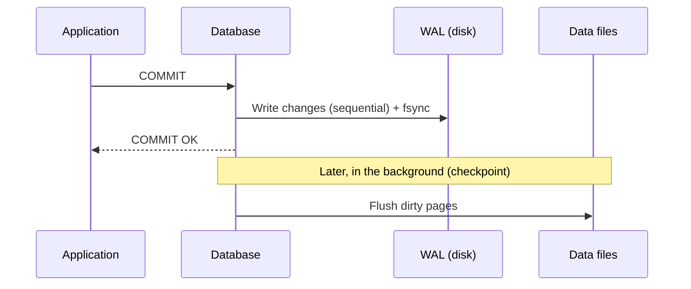
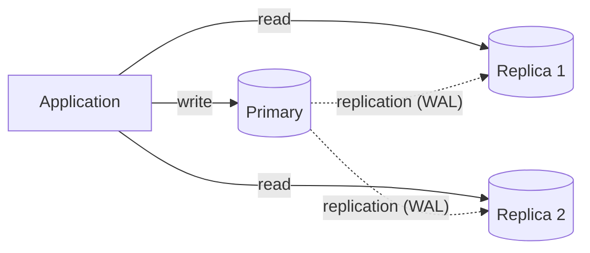

---
## Contents

**Part 1. Foundations (start here)**

- [[#1. What is a database and a DBMS]]
- [[#2. Relational databases vs NoSQL]]
- [[#3. SQL command groups, DDL, DML, DQL, DCL, TCL]]
- [[#4. Basic SQL queries, filtering, grouping, NULL]]
- [[#5. JOIN, UNION and subqueries]]
- [[#6. DELETE vs TRUNCATE vs DROP]]
- [[#7. Keys, constraints, relations and views]]
- [[#8. Normalization and denormalization]]

**Part 2. Core interview topics**

- [[#9. Transactions and ACID]]
- [[#10. Indexes, B-Tree, composite and covering]]
- [[#11. Concurrent access, isolation levels and MVCC]]
- [[#12. Query optimization and reading EXPLAIN]]
- [[#13. SQL injection and prepared statements]]
- [[#14. Window functions and CTE]]

**Part 3. Advanced topics**

- [[#15. Locks, optimistic vs pessimistic, and deadlocks]]
- [[#16. WAL and crash recovery]]
- [[#17. Scaling a database, replication, partitioning, sharding, CAP]]
- [[#18. Cheat sheet before the interview]]

---
# Part 1. Foundations (start here)

---

# 1. What is a database and a DBMS

## Main idea

A database is an organized collection of data. A DBMS (Database Management System) is the program that stores this data, protects it and answers our queries. PostgreSQL and MySQL are DBMSs. In everyday speech, people often say "database" for both things.

## Why do we not just use files?

We could save data in a text file, but this quickly becomes a problem. A DBMS gives us things that a simple file does not give:

- Fast search in millions of rows, because it uses indexes.
- Safe work for many users at the same time, because it controls concurrent access.
- Protection of data integrity, because it checks rules (constraints).
- Protection after a crash, because it keeps a log of changes.
- A standard language to ask questions, which is SQL.

## Basic words

- A **table** is a set of data about one kind of object, for example `users` or `orders`.
- A **column** (field) is one property of the object, for example `email`. Every column has a type, such as integer, text or date.
- A **row** (record) is one concrete object in the table, for example one user.
- A **primary key** is a column (or columns) that identifies every row in a unique way. It cannot be NULL and cannot repeat.
- A **foreign key** is a column that points to the primary key of another table. It creates a relation between tables.
- A **schema** is the description of the structure: tables, columns, types and rules.
- A **query** is a request to the database. In relational databases we write queries in **SQL** (Structured Query Language).

## How an application talks to a database

The database usually runs as a separate server. The application opens a connection over the network (the default port is 5432 for PostgreSQL and 3306 for MySQL), sends an SQL query and receives the result. Opening a connection is expensive, so real applications reuse connections with a connection pool (see section 17).

## A first example

```sql
-- Create a table
CREATE TABLE users (
    id    BIGINT       PRIMARY KEY,
    name  VARCHAR(100) NOT NULL,
    email VARCHAR(255) NOT NULL UNIQUE
);

-- Add a row
INSERT INTO users (id, name, email)
VALUES (1, 'Anna', 'anna@example.com');

-- Read data
SELECT name, email FROM users WHERE id = 1;
```

> [!question] What is the difference between a database and a DBMS?
> 
> A database is the data itself, organized in tables. A DBMS is the software that manages this data: it stores it, checks rules, handles many users and runs queries. PostgreSQL is a DBMS, and one PostgreSQL server can contain many databases.

> [!question] What is a primary key?
> 
> A primary key is a column or a group of columns that identifies each row in a unique way. It must be unique and NOT NULL. A table can have only one primary key, and the database automatically creates an index for it.

---

# 2. Relational databases vs NoSQL

## Main idea

Relational databases (PostgreSQL, MySQL) store structured data in tables with relations, and they give ACID guarantees. We choose NoSQL databases for specific tasks, for example fast writes, a flexible schema, caching, search or analytics.

## Relational databases

A relational database stores data in tables with a strict schema (Schema-on-Write), which means that the structure is checked when the data is written. It has foreign keys, the SQL language, JOINs, aggregations and full ACID transactions. We use it for most business tasks, such as finance, orders, users, catalogs and CRM, where data integrity is important.

## NoSQL databases

"NoSQL" means "not only SQL". It is a group of databases with different models. The main types are these:

- **Key-Value stores** (Redis, Memcached) keep data by key, and access takes O(1). They are used for caching, sessions, counters, rate limiting and queues. They do not support complex queries by value.
- **Document stores** (MongoDB) keep JSON documents with a flexible schema, for example user profiles with different sets of fields. They have weaker relations and JOINs, and their transactions are more limited.
- **Columnar databases** (Cassandra, ClickHouse) store data by columns. They are good for huge volumes and fast analytics, but not for frequent point updates.
- **Search engines** (Elasticsearch, OpenSearch) provide full-text search on inverted indexes and analyze logs. We do not use them as the main storage, because their consistency is only eventual.
- **Graph databases** (Neo4j) store relations between objects, for example in social networks and recommendations. This is a narrow specialization.

## OLTP, OLAP and polyglot persistence

- **OLTP** means many short transactions, for example orders and payments. Row-based databases like PostgreSQL and MySQL are good for this.
- **OLAP** means complex analytics over huge data, for example a report for the last five years. We use columnar databases like ClickHouse for it.
- **Polyglot persistence** means that one system uses different storages for different jobs: PostgreSQL for the main data, Redis for the cache and Elasticsearch for search.
- Many NoSQL systems follow the **BASE** model (Basically Available, Soft state, Eventually consistent). They trade strict consistency for availability and scalability.

> [!question] Why not store everything in MongoDB just because it is flexible?
> 
> A flexible schema moves the responsibility for data integrity into the application code. For related data, such as an order, its items and its payments, we need transactions, constraints and JOINs, and a relational database gives them out of the box.

> [!question] When do you use Redis and when PostgreSQL?
> 
> Redis is good for fast temporary data, such as cache, sessions, counters and locks. PostgreSQL is for data that we cannot lose and that we need to query. Redis does not replace the main database.

---

# 3. SQL command groups, DDL, DML, DQL, DCL, TCL

## Main idea

SQL commands are divided into five groups, depending on what the command works with: structure, data, queries, permissions or transactions.

## The five groups

- **DDL** (Data Definition Language) defines and changes the structure of objects, such as tables, indexes and schemas. Commands: `CREATE`, `ALTER`, `DROP`, `TRUNCATE`, `RENAME`.
- **DML** (Data Manipulation Language) changes the data in tables. Commands: `INSERT`, `UPDATE`, `DELETE`, `MERGE`.
- **DQL** (Data Query Language) reads data. This is the `SELECT` command.
- **DCL** (Data Control Language) manages access permissions. Commands: `GRANT`, `REVOKE`.
- **TCL** (Transaction Control Language) controls transactions. Commands: `BEGIN` (or `START TRANSACTION`), `COMMIT`, `ROLLBACK`, `SAVEPOINT`.

Some sources put `SELECT` into DML and do not use the term DQL. It is useful to mention this if the interviewer asks.

## DDL and transactions

In MySQL, a DDL command (`ALTER TABLE`, `DROP`, `TRUNCATE`) causes an implicit `COMMIT` of the current transaction, and it cannot be rolled back. In PostgreSQL, DDL is transactional: the sequence `BEGIN`, `ALTER TABLE`, `DROP TABLE`, `ROLLBACK` returns the structure to its original state.

> [!question] Which group does TRUNCATE belong to, and why does it matter?
> 
> `TRUNCATE` belongs to DDL, even though it removes data. This is why in MySQL it makes an implicit `COMMIT` and cannot be rolled back, while in PostgreSQL it can be rolled back inside a transaction.

> [!question] What is the difference between GRANT and a role?
> 
> `GRANT` gives permissions. A role is a named set of permissions that we can give to users. This makes access management easier, and it follows the principle of least privilege (a user gets only the rights that they really need).

---

# 4. Basic SQL queries, filtering, grouping, NULL

## Main idea

Almost every interview starts with simple queries. You must be able to read data with `SELECT`, filter it with `WHERE`, sort it, group it and understand `NULL`. You must also remember the logical order in which the database executes a query.

## SELECT, WHERE, ORDER BY, LIMIT

`SELECT` chooses the columns, `FROM` chooses the table, `WHERE` filters rows, `ORDER BY` sorts the result, and `LIMIT` limits the number of rows. `DISTINCT` removes duplicates. We can give a column a new name with `AS` (an alias).

Useful conditions in `WHERE`: comparison operators (`=`, `<>`, `<`, `>`), logical operators (`AND`, `OR`, `NOT`), `IN (...)` for a list of values, `BETWEEN a AND b` for a range (both ends are included), `LIKE` for patterns (`%` means any number of characters, `_` means exactly one) and `IS NULL` for missing values.

```sql
SELECT DISTINCT city
FROM customers
WHERE country = 'PL' AND age BETWEEN 18 AND 30
ORDER BY city ASC
LIMIT 10;
```

## NULL

`NULL` means "unknown" or "no value". It is not zero and not an empty string. The comparison `NULL = NULL` gives `NULL`, not `TRUE`, so we must check with `IS NULL` and `IS NOT NULL`. Any arithmetic with `NULL` gives `NULL`. Aggregate functions ignore `NULL` values (except `COUNT(*)`).

## Aggregate functions and GROUP BY

Aggregate functions calculate one value from many rows: `COUNT`, `SUM`, `AVG`, `MIN` and `MAX`. `COUNT(*)` counts all rows, and `COUNT(col)` counts only the rows where the value is not `NULL`.

`GROUP BY` puts rows into groups, and then an aggregate function works for each group. Every column in `SELECT` must be either in `GROUP BY` or inside an aggregate function.

`WHERE` filters rows **before** grouping. `HAVING` filters groups **after** grouping, so it can use aggregate functions.

```sql
-- Customers with more than 3 paid orders and a total over 10,000
SELECT user_id, COUNT(*) AS orders_cnt, SUM(total) AS total_spent
FROM orders
WHERE status = 'paid'          -- filters ROWS before grouping
GROUP BY user_id
HAVING COUNT(*) > 3            -- filters GROUPS after grouping
   AND SUM(total) > 10000;
```

## Logical order of execution

The database does not run the query in the order in which we write it. The logical order is this:

1. `FROM` and `JOIN` (find the tables and connect them)
2. `WHERE` (filter rows)
3. `GROUP BY` (make groups)
4. `HAVING` (filter groups)
5. `SELECT` (calculate expressions, window functions and aliases)
6. `DISTINCT`
7. `ORDER BY`
8. `LIMIT` and `OFFSET`

This is why we cannot use an alias from `SELECT` in `WHERE`: the alias does not exist yet at that step. In PostgreSQL and MySQL, we can use an alias in `ORDER BY`, and in MySQL also in `GROUP BY` and `HAVING`.

## Changing data

`INSERT` adds rows. A batch insert (many rows in one command) is faster than many single inserts. `UPDATE` changes rows, and `DELETE` removes rows. We must never run `UPDATE` or `DELETE` without `WHERE`. A good habit is to run a `SELECT` with the same `WHERE` first, and to run the change inside a transaction.

`UPSERT` inserts a row, or updates it if the unique key already exists. In PostgreSQL it is `INSERT ... ON CONFLICT (email) DO UPDATE SET name = EXCLUDED.name`. In MySQL it is `INSERT ... ON DUPLICATE KEY UPDATE`. In MySQL 8.0.20 and newer, the `VALUES()` function in this syntax is deprecated, and it is better to use the alias syntax: `INSERT ... VALUES (...) AS new ON DUPLICATE KEY UPDATE name = new.name`.

```sql
-- UPSERT in PostgreSQL
INSERT INTO user_stats (user_id, logins_count)
VALUES (42, 1)
ON CONFLICT (user_id)
DO UPDATE SET logins_count = user_stats.logins_count + 1;
```

> [!question] What is the difference between WHERE and HAVING?
> 
> `WHERE` filters single rows before grouping, so it cannot use aggregate functions. `HAVING` filters groups after `GROUP BY`, so it can use aggregates like `COUNT(*)` or `SUM(total)`.

> [!question] What is the difference between COUNT(*) and COUNT(column)?
> 
> `COUNT(*)` counts all rows. `COUNT(column)` does not count the rows where `column` is `NULL`.

> [!question] What does SELECT 1 WHERE NULL = NULL return?
> 
> It returns nothing. A comparison with `NULL` gives `NULL` (unknown), and `WHERE` lets only `TRUE` through. To check for `NULL`, we use `IS NULL` or `IS NOT DISTINCT FROM`.

> [!question] Why can we not use a SELECT alias in WHERE?
> 
> Because of the logical order of execution. `WHERE` is executed before `SELECT`, so the alias does not exist yet when `WHERE` is evaluated.

---

# 5. JOIN, UNION and subqueries

## Main idea

`JOIN` connects tables horizontally: it adds columns from another table. `UNION` connects results vertically: it adds rows. A subquery is a query inside another query.

## All kinds of JOIN

`JOIN` adds columns from the second table by the `ON` condition. Imagine two tables: `users` and `orders`, where `orders.user_id` points to `users.id`.

- `INNER JOIN` (or just `JOIN`) returns only the rows that match in both tables.
- `LEFT JOIN` returns all rows from the left table and the matching rows from the right table. If there is no pair, the values on the right are `NULL`.
- `RIGHT JOIN` works as a mirror of `LEFT JOIN`. In practice, we replace it with `LEFT JOIN` for readability.
- `FULL OUTER JOIN` returns all rows from both tables, and `NULL` where there is no pair. MySQL does not have it, so we emulate it.
- `CROSS JOIN` gives the Cartesian product, which means N × M rows, and it has no `ON` condition.
- `SELF JOIN` joins a table with itself, for example `employees.manager_id` with `employees.id`.

An **anti-join** is a technique to find records without relations, for example users without orders: `LEFT JOIN ... WHERE right.id IS NULL`. The alternative is `NOT EXISTS`. To emulate `FULL OUTER JOIN` in MySQL, we combine `LEFT JOIN` and `RIGHT JOIN` with `UNION` (exactly `UNION`, so that duplicates of matched rows are removed).

```sql
-- LEFT JOIN: users WITHOUT orders
SELECT u.id, u.email
FROM users u
LEFT JOIN orders o ON o.user_id = u.id
WHERE o.id IS NULL;

-- The same result with NOT EXISTS (often just as fast)
SELECT u.id, u.email
FROM users u
WHERE NOT EXISTS (SELECT 1 FROM orders o WHERE o.user_id = u.id);

-- SELF JOIN: an employee and their manager
SELECT e.name AS employee, m.name AS manager
FROM employees e
LEFT JOIN employees m ON e.manager_id = m.id;

-- Emulating FULL OUTER JOIN in MySQL
SELECT * FROM a LEFT JOIN b ON a.id = b.a_id
UNION
SELECT * FROM a RIGHT JOIN b ON a.id = b.a_id;
```

## UNION vs UNION ALL

Both commands combine the results of `SELECT` queries vertically, and the number and types of columns must match. `UNION` removes duplicates (by sorting or hashing), so it is slower. `UNION ALL` combines the results as they are, so it is faster. We use `UNION ALL` when duplicates are impossible or do not matter.

## Subqueries

A subquery is a `SELECT` inside another query. A **scalar** subquery returns one value. A **correlated** subquery uses columns from the outer query, so it runs again for each outer row and can be slow. We can also use `IN` and `EXISTS` with subqueries. `EXISTS` stops as soon as it finds one row, so it is often good for large tables. `NOT IN` is dangerous when the subquery can return `NULL`, because the result may be empty. `NOT EXISTS` does not have this problem.

> [!question] What is the trap when we filter the right table in a LEFT JOIN?
> 
> A condition on the right table in `WHERE` silently turns a `LEFT JOIN` into an `INNER JOIN`. For rows without a pair, `o.status` is `NULL`, so they are dropped. If we put the condition into `ON`, all users are kept.
> 
> ```sql
> -- BAD: users without orders disappear
> SELECT u.id, o.total FROM users u
> LEFT JOIN orders o ON o.user_id = u.id
> WHERE o.status = 'paid';
> 
> -- GOOD: the condition in ON keeps all users
> SELECT u.id, o.total FROM users u
> LEFT JOIN orders o ON o.user_id = u.id AND o.status = 'paid';
> ```

> [!question] How do we find rows that have no related rows?
> 
> We use an anti-join: `LEFT JOIN ... WHERE right.id IS NULL`, or `NOT EXISTS`. Both give the same result.

> [!question] What is the difference between UNION and UNION ALL?
> 
> `UNION` removes duplicate rows, so it needs extra work and is slower. `UNION ALL` keeps everything and is faster.

---
# 6. DELETE vs TRUNCATE vs DROP

## Main idea

We need to distinguish three commands. `DELETE` removes rows with logging, `TRUNCATE` quickly clears the whole table, and `DROP` removes the table itself.

## The three commands

**DELETE** is DML. It removes rows by a `WHERE` condition, or all rows. It works row by row, updates the indexes and writes every row to the log, so it is slow. It can be rolled back. It does not reset the `AUTO_INCREMENT` (`SERIAL`) counter, and it fires the `ON DELETE` triggers for each row.

**TRUNCATE** is DDL. It removes all rows at once (there is no `WHERE`) by freeing the data pages, so it is very fast and writes almost nothing to the log. In PostgreSQL it can be rolled back, but in MySQL it cannot. In MySQL it resets the counter, but in PostgreSQL it does this only with the `RESTART IDENTITY` option. Normal `ON DELETE` triggers do not fire (PostgreSQL has an `ON TRUNCATE` trigger). If foreign keys reference the table, `TRUNCATE` does not work (PostgreSQL needs `TRUNCATE ... CASCADE`).

**DROP** is also DDL. It removes the whole table with its data, structure, indexes and triggers. It works instantly. In PostgreSQL it can be rolled back, but in MySQL it cannot. If other objects depend on the table, we need `CASCADE` or we must remove the dependencies first.

|Feature|DELETE|TRUNCATE|DROP|
|---|---|---|---|
|Group|DML|DDL|DDL|
|Removes|Chosen rows or all rows|All rows|The whole table|
|`WHERE`|Yes|No|No|
|Speed|Slow (row by row)|Very fast|Instant|
|Rollback|Yes|PostgreSQL yes, MySQL no|PostgreSQL yes, MySQL no|
|Resets counter|No|MySQL yes, PostgreSQL only with `RESTART IDENTITY`|Not applicable|

> [!question] Why is TRUNCATE faster than DELETE without WHERE?
> 
> `DELETE` processes and logs every row, updates the indexes and fires triggers. `TRUNCATE` frees or recreates the data pages as a whole and almost does not log single rows.

> [!question] Which of the three commands can be rolled back?
> 
> `DELETE` can always be rolled back. `TRUNCATE` and `DROP` can be rolled back in PostgreSQL, but not in MySQL, because MySQL makes an implicit `COMMIT` for DDL commands.

---

# 7. Keys, constraints, relations and views

## Main idea

Constraints are rules that the database checks for us. They keep the data correct even if the application has a bug. We should keep important rules in the database, and not only in the application code.

## Constraints

- `PRIMARY KEY` identifies each row in a unique way (it is `UNIQUE` and `NOT NULL` together).
- `FOREIGN KEY` makes a column point to a row in another table, so we cannot save an order for a user who does not exist. We can choose what happens when the parent row is deleted: `ON DELETE CASCADE` (delete the children too), `SET NULL` or `RESTRICT` (forbid the deletion).
- `UNIQUE` forbids repeated values in a column (for example, an email).
- `NOT NULL` forbids missing values.
- `CHECK` checks a condition, for example `total >= 0`.
- `DEFAULT` gives a value when we do not give one.

```sql
CREATE TABLE orders (
    id         BIGINT GENERATED ALWAYS AS IDENTITY PRIMARY KEY,
    user_id    BIGINT        NOT NULL REFERENCES users(id) ON DELETE CASCADE,
    total      NUMERIC(10,2) NOT NULL CHECK (total >= 0),
    status     VARCHAR(20)   NOT NULL DEFAULT 'new',
    created_at TIMESTAMPTZ   NOT NULL DEFAULT NOW()
);

-- Change the structure later
ALTER TABLE orders ADD COLUMN comment TEXT;
```

## Types of relations

- **One-to-one**: one user has one profile.
- **One-to-many**: one user has many orders. The foreign key is on the "many" side (`orders.user_id`).
- **Many-to-many**: a user can have many roles, and a role can belong to many users. We need a **junction table** (for example `user_roles`) with two foreign keys and a composite unique key `(user_id, role_id)`.

## Views

A **view** is a saved `SELECT` query that we can use like a table. It does not store data, and it runs the query each time. We use views to hide complex joins and to limit access to some columns. A **materialized view** stores the result of the query on disk, so it is fast to read, but we must refresh it (`REFRESH MATERIALIZED VIEW` in PostgreSQL), and the data can be old.

> [!question] How do we model a many-to-many relation?
> 
> We need a junction table (for example `user_roles`) with foreign keys to both tables and a composite unique key `(user_id, role_id)`.

> [!question] What is the difference between PRIMARY KEY and UNIQUE?
> 
> A table can have only one primary key, and it cannot contain `NULL`. A table can have many `UNIQUE` constraints, and they usually allow `NULL` values (the exact rules depend on the database).

> [!question] What is the difference between a view and a materialized view?
> 
> A normal view stores only the query and runs it every time, so the data is always fresh. A materialized view stores the result, so it is faster, but the data can be old until we refresh it.

---

# 8. Normalization and denormalization

## Main idea

Normalization removes redundancy (repeated data) and update anomalies. Denormalization deliberately brings duplication back to make reads faster.

## The problem that normalization solves

Look at this bad table. The customer data is repeated in every order.

|order_id|customer_name|customer_city|product|
|---|---|---|---|
|1|Anna|Warsaw|Book|
|2|Anna|Warsaw|Pen|
|3|Piotr|Krakow|Book|

This design causes three kinds of anomalies:

- **Update anomaly**: if Anna moves to Gdansk, we must change many rows, and if we forget one, the data is out of sync.
- **Insert anomaly**: we cannot save a new customer who has no orders yet.
- **Delete anomaly**: if we delete the last order of Piotr, we lose all information about Piotr.

The solution is to split the data into `customers` and `orders`, and to connect them with a foreign key.

## Normal forms

- **1NF** requires atomic values (one value in one cell), no repeating groups of columns (`phone1`, `phone2`) and a primary key.
- **2NF** is 1NF plus the condition that every non-key column depends on the whole composite key, not on a part of it.
- **3NF** is 2NF plus no transitive dependencies: non-key columns do not depend on each other. For example, `city_name` is not stored in `orders` next to `city_id`.
- **BCNF** is a stronger 3NF, where every functional dependency is determined by a superkey. It is less common.

For interviews, the practical goal is 3NF.

## Denormalization

Denormalization is a deliberate break of 3NF. Examples are `comments_count` in the `posts` table, or a copy of the price in `order_items` at the moment of purchase. We need it when `JOIN` or `COUNT(*)` becomes the bottleneck. The price is that writes become more complex and there is a risk of getting out of sync.

## Choosing a primary key

- A `BIGINT` with auto-increment takes 8 bytes, and new values go to the end of the B-Tree, so there is no fragmentation. The downsides are that the key is predictable (IDOR risk, and it reveals the data volume) and that it is harder to use with shards and multi-master.
- **UUID v4** takes 16 bytes and can be generated outside the database. Its downside is that the values are random, so inserts go to random places in the B-Tree, which causes page splits, fragmentation and cache misses.
- **UUID v7** and **ULID** have the time at the beginning, so the values grow monotonically. They are good for B-Tree and are still globally unique.

## Money and soft delete

We should store money in `NUMERIC` (`DECIMAL`) or in the smallest units in a `BIGINT` (for example in cents), but not in `FLOAT`, because floating-point numbers have rounding errors.

Soft delete (a `deleted_at` column) is convenient for restoring data, but it makes queries and unique indexes more complex, and we need partial indexes for them.

> [!question] Why do we copy the product price into order_items?
> 
> The price of a product changes over time, but an order must keep the price at the moment of purchase. This is deliberate denormalization to keep the history correct.

> [!question] UUID or auto-increment?
> 
> Auto-increment is simpler and more compact. UUID is good for distributed generation and hides the order and the volume of data. If we need a UUID, it is better to choose a time-ordered one (v7 or ULID) and not v4.

> [!question] When should we denormalize?
> 
> Only when we have measured a real performance problem, for example a slow `JOIN` or `COUNT(*)` on a hot page. We should know the price: writes are harder and the copies can go out of sync.

---
# Part 2. Core interview topics

---

# 9. Transactions and ACID

## Main idea

A transaction is a group of operations that the database treats as one indivisible unit of work. Either all the operations succeed, or none of them is applied. The classic example is a bank transfer: we take money from account A and add it to account B. We never want to do only one of the two steps.

## Transaction commands

```sql
BEGIN;                                              -- start
UPDATE accounts SET balance = balance - 100 WHERE id = 1;
UPDATE accounts SET balance = balance + 100 WHERE id = 2;
COMMIT;                                             -- save both changes
-- or ROLLBACK;                                     -- cancel both changes
```

`SAVEPOINT` creates a point inside a transaction, and we can roll back only to this point.

## The four ACID properties

- **Atomicity** means "all or nothing". If the fourth of five queries fails, the first three are rolled back.
- **Consistency** means that a transaction moves the database from one correct state to another and does not break constraints (`NOT NULL`, `UNIQUE`, `FOREIGN KEY`, `CHECK`).
- **Isolation** means that concurrent transactions do not see each other's uncommitted changes, to the degree that the isolation level defines (see section 11).
- **Durability** means that if the database answered "COMMIT OK", the data will not be lost, even if the power goes off. The database does this with the WAL (see section 16).

## Autocommit

By default, many databases work in autocommit mode: every single statement is its own small transaction. To group several statements, we must open a transaction explicitly with `BEGIN`.

> [!question] What is ACID? Explain every letter.
> 
> ACID is a set of guarantees of a transaction. Atomicity means all or nothing. Consistency means that the rules and constraints are not broken. Isolation means that parallel transactions do not disturb each other. Durability means that committed data survives a crash.

> [!question] Is the "C" in ACID the same as the "C" in CAP?
> 
> No. The C in ACID means that integrity constraints are respected. The C in CAP means the consistency of data copies in a distributed system, so that all nodes see the same data.

> [!question] Why should transactions be short?
> 
> A long transaction holds locks and old row versions for a long time. This blocks other transactions, can cause deadlocks and makes tables grow (bloat). We should never call an external API inside a transaction.

---

# 10. Indexes, B-Tree, composite and covering

## Main idea

An index is a separate structure that speeds up search from O(N) to O(log N), but it slows down writes (`INSERT`, `UPDATE`, `DELETE`) and takes space. We should have exactly as many indexes as the real queries need.

## The idea in simple words

Think about a book. If we want to find the word "transaction", we can read all pages (this is a full table scan, or **Seq Scan**), or we can open the index at the end of the book and jump to the right page. A database index works in the same way.

## Index types

- **B-Tree** (a balanced tree) is the default index. Its keys are sorted in the leaves, and the leaves are linked to each other. It supports equality, ranges (`>`, `<`, `BETWEEN`), `ORDER BY` and prefix search (`LIKE 'ivan%'`). It does not help with a leading wildcard (`LIKE '%ivan%'`) or when a function is applied to the column (`WHERE LOWER(email) = ...`). For that case, we need a functional index on `LOWER(email)`.
- **Hash** index searches in O(1), but only by equality. It cannot do ranges or sorting.
- **GIN** (Generalized Inverted Index, PostgreSQL) is an inverted index for arrays, JSONB and full-text search.
- **GiST** is used for geodata and similarity search.

## Clustered vs non-clustered

In MySQL InnoDB, the primary key is **clustered**: the table itself is physically stored in the B-Tree leaves ordered by the primary key. Secondary indexes store the primary key value, so a search through them needs two passes through the tree (double lookup). In PostgreSQL, all indexes are non-clustered: the table is a heap, and the indexes store the physical address of the row (`ctid`).

## Composite, covering and partial indexes

A **composite index** `(a, b, c)` works by the **Leftmost Prefix Rule**. It is used for conditions on `a`, on `a` and `b`, on `a`, `b` and `c`, and also for `a = 1 AND b > 5`. It is useless for `WHERE b = 2` or `WHERE c = 3`. The column order is this: first the columns with equality, then the column with a range, and usually the more selective columns first.

A **covering index** contains all the columns of the query, so the answer comes from the index without reading the table (in the plan this is `Index Only Scan` in PostgreSQL or `Using index` in MySQL). In PostgreSQL, we add extra columns with `INCLUDE (...)`.

A **partial index** is built only on a part of the rows, for example `WHERE status = 'new'`. It is smaller and faster.

**Selectivity** is the share of unique values. An index on a column with two values (for example `is_active`) is usually useless, because the planner will choose Seq Scan.

## The cost of indexes

Indexes have a cost: every index must be updated on writes, and it takes space on disk and in memory. We should delete unnecessary indexes.

```sql
-- Composite index: column order matters
CREATE INDEX idx_orders_user_status ON orders (user_id, status);

-- Covering index (PostgreSQL): the query is answered from the index only
CREATE INDEX idx_orders_user_status_include
ON orders (user_id, status) INCLUDE (total, created_at);

-- Functional index: for WHERE LOWER(email) = ...
CREATE INDEX idx_users_email_lower ON users (LOWER(email));

-- Partial index: only "live" orders
CREATE INDEX idx_orders_new ON orders (created_at) WHERE status = 'new';

-- GIN for JSONB
CREATE INDEX idx_events_payload ON events USING GIN (payload);
```

> [!question] Why might an index not be used even though it exists?
> 
> The common reasons are these: a function is applied to the column in `WHERE`, `LIKE` has a leading `%`, the types do not match (implicit cast), the leftmost prefix rule is broken, the query returns a large part of the table (then Seq Scan is cheaper), or the statistics are outdated.

> [!question] Why are many indexes bad?
> 
> Every `INSERT`, `UPDATE` and `DELETE` updates all affected indexes, and the size on disk and in memory grows. We should create indexes for real queries and remove unused ones from time to time.

> [!question] What is the difference between a clustered and a normal index?
> 
> In a clustered index (the primary key in InnoDB), the rows themselves are stored in the index order, and there can be only one such index per table. A non-clustered index stores a reference to the row: in InnoDB it is the primary key value, and in PostgreSQL it is the `ctid`.

> [!question] We have an index on (a, b). Will it help for WHERE b = 5?
> 
> No, usually it will not. The index is sorted by `a` first, so without a condition on `a` the database cannot jump to the right place. This is the leftmost prefix rule.

---
# 11. Concurrent access, isolation levels and MVCC

## Main idea

Many users work with the same data at the same time. The isolation level is a balance between correctness and performance. MVCC lets readers and writers work without blocking each other.

## Concurrency anomalies

These are the problems that can happen when transactions run in parallel:

1. **Dirty Read**: we read changes from another transaction that has not committed yet and may roll back.
2. **Non-Repeatable Read**: when we read the same row again, we see a different value, because another transaction managed to run `UPDATE` and `COMMIT`.
3. **Phantom Read**: when we repeat a query with a condition (for example `WHERE amount > 100`), it returns new rows that another transaction added.
4. **Lost Update**: two transactions read `balance = 100`, both add 50, and both write 150 instead of 200.
5. **Write Skew**: two transactions read overlapping data and write to different rows, which breaks a shared invariant, for example "at least one doctor must stay on duty". This can be solved only by the Serializable level or by explicit locks.

## Isolation levels

There are four standard levels. A higher level gives more safety, but it is usually slower.

|Level|Dirty Read|Non-Repeatable Read|Phantom Read|
|---|---|---|---|
|Read Uncommitted|possible|possible|possible|
|Read Committed|no|possible|possible|
|Repeatable Read|no|no|possible by the standard|
|Serializable|no|no|no|

- **Read Uncommitted** allows all anomalies, but in PostgreSQL it behaves like Read Committed.
- **Read Committed** protects from dirty reads. It is the default level in PostgreSQL, because every query gets a new snapshot.
- **Repeatable Read** also protects from non-repeatable reads. It is the default level in MySQL InnoDB, because the snapshot is created for the whole transaction.
- **Serializable** gives full isolation, as if the transactions ran one by one. It can produce serialization errors, so the application has to retry the transaction.

There is one nuance for the interview. In PostgreSQL, Repeatable Read is Snapshot Isolation: phantoms do not appear, but Write Skew is possible, and a Lost Update causes the error "could not serialize access", which we must retry. In MySQL InnoDB, a normal `SELECT` reads from a snapshot and sees no phantoms, and locking reads (`SELECT ... FOR UPDATE`) use Next-Key Locks (a record plus the gap), which also protect from phantoms.

```sql
BEGIN ISOLATION LEVEL REPEATABLE READ;
-- ... queries ...
COMMIT;
```

## MVCC

MVCC (Multi-Version Concurrency Control) works like this: when we update a row, the database does not overwrite it, but creates a new version of it. In PostgreSQL there are the `xmin` and `xmax` fields for this, and in InnoDB it is a chain of versions in the Undo Log. Every transaction sees a snapshot of the data. The writer creates a new version, and the reader continues to see the old version from its own snapshot, so readers do not block writers and writers do not block readers.

Old versions are removed by `VACUUM` in PostgreSQL or by purge in InnoDB. In PostgreSQL, old row versions stay in the table after `UPDATE` and `DELETE` (dead tuples). `VACUUM` frees this space for reuse, and autovacuum does it automatically. Without it, tables and indexes grow too big (bloat).

> [!question] How does MVCC let readers not block writers?
> 
> The writer creates a new version of the row, and the reader continues to see the old version from its own snapshot. This is why we do not need read locks.

> [!question] Which isolation level should we choose for money operations?
> 
> Usually Read Committed or Repeatable Read is enough, together with explicit locks (`SELECT ... FOR UPDATE`) or atomic updates like `UPDATE ... SET balance = balance - X WHERE balance >= X`. For complex invariants, we use Serializable with retries.

> [!question] What are the default isolation levels in PostgreSQL and MySQL?
> 
> PostgreSQL uses Read Committed. MySQL InnoDB uses Repeatable Read.

> [!question] What is VACUUM and why do we need it?
> 
> In PostgreSQL, old row versions stay in the table after `UPDATE` and `DELETE` (dead tuples). `VACUUM` frees this space for reuse, and autovacuum does it automatically. Without it, tables and indexes grow too big (bloat).

---

# 12. Query optimization and reading EXPLAIN

## Main idea

To find the reason for a slow query, we use `EXPLAIN ANALYZE`, remove Seq Scan on big tables, avoid a big `OFFSET` and fight the N+1 problem.

## EXPLAIN vs EXPLAIN ANALYZE

`EXPLAIN` shows the query plan based on statistics, but it does not run the query. `EXPLAIN ANALYZE` really runs the query and shows the actual time and number of rows. For `UPDATE` and `DELETE`, we must wrap it in a transaction with `ROLLBACK`, otherwise the data will change.

## What to look at in the plan

1. **The scan type.** `Seq Scan` means a full read of the table (in MySQL it is `type = ALL`). `Index Scan` is better, and `Index Only Scan` is even better. For small tables, Seq Scan is normal.
2. **Estimated rows vs actual rows.** A big difference means that the statistics are outdated, and we need to run `ANALYZE table_name`.
3. **Sorting.** The message `Sort Method: external merge Disk` in PostgreSQL, or `Using filesort` and `Using temporary` in MySQL, means that there was not enough index or memory (`work_mem`, `sort_buffer_size`).
4. **The JOIN type.** `Nested Loop`, `Hash Join` or `Merge Join`. A Nested Loop on big tables without an index is a red flag.

## The OFFSET problem and keyset pagination

The query `ORDER BY id LIMIT 20 OFFSET 1000000` reads and throws away a million rows. The solution is **keyset (cursor) pagination**: `WHERE id < :last_id ORDER BY id DESC LIMIT 20`. This query uses an index and works in O(log N).

## The N+1 problem and other tricks

The **N+1 problem** happens when we make one query for a list and then N more queries for related data in a loop. We fix it with a `JOIN`, eager loading (for example `with()` in Eloquent) or `WHERE id IN (...)`.

There are other tricks too:

- Select only the columns we need, and do not write `SELECT *`.
- Use `EXISTS` instead of `COUNT(*) > 0`.
- Insert data in batches.
- Cache heavy results.
- Look at the slow query log (in PostgreSQL it is `pg_stat_statements`).

```sql
-- BAD: a function on the column, the index on created_at is not used
SELECT * FROM orders WHERE DATE(created_at) = '2026-11-13';

-- GOOD: a range can use the B-Tree
SELECT id, total FROM orders
WHERE created_at >= '2026-11-13 00:00:00'
  AND created_at <  '2026-11-14 00:00:00';

-- Safely check UPDATE/DELETE
BEGIN;
EXPLAIN ANALYZE UPDATE orders SET status = 'old' WHERE created_at < '2025-01-01';
ROLLBACK;

-- Keyset pagination instead of OFFSET
SELECT id, total FROM orders
WHERE id < :last_id
ORDER BY id DESC
LIMIT 20;
```

> [!question] A query is slow. What do you do first?
> 
> First, I would check the execution plan with `EXPLAIN ANALYZE`. I look for Seq Scan on big tables, a big difference between estimated and actual rows, and slow sorting. Then I check whether a suitable index exists, and whether the query prevents the index from being used.

> [!question] Why is a big OFFSET slow and what can replace it?
> 
> The database has to read and throw away all the skipped rows. The replacement is keyset pagination by an indexed field: the last received id, or the pair `(created_at, id)`.

> [!question] What should we do if estimated rows is very different from actual rows?
> 
> We should update the statistics with `ANALYZE` and check the correlation of columns. If this does not help, we can increase the statistics detail or rewrite the query.

> [!question] What is the N+1 problem and how do you find it?
> 
> It is queries inside a loop. We find it by query logs, by `pg_stat_statements` and with tools like Laravel Debugbar or Telescope. The solution is eager loading, or one query with `JOIN` or `IN`.

---

# 13. SQL injection and prepared statements

## Main idea

SQL injection happens when user input becomes a part of the SQL code. The attacker can then read, change or delete data. The main protection is to use prepared statements (parameterized queries), so that data and code are always separate.

## How the attack works

Imagine that the application builds a query by joining strings:

```php
// DANGEROUS: never do this
$sql = "SELECT * FROM users WHERE email = '" . $_GET['email'] . "'";
```

If the attacker sends `' OR '1'='1`, the query becomes `... WHERE email = '' OR '1'='1'`, and it returns all users. A worse input can even delete a table.

## Protection

- Use **prepared statements**: the database receives the SQL text with placeholders first, and the values separately. The values are never executed as code.
- Use an ORM or a query builder, but be careful with raw queries.
- Give the application user only the rights that it needs (least privilege).
- Validate input, but remember that validation alone is not enough.

```php
// SAFE: a prepared statement with PDO
$stmt = $pdo->prepare('SELECT * FROM users WHERE email = :email');
$stmt->execute(['email' => $email]);
$user = $stmt->fetch();
```

Placeholders work only for values. We cannot use them for table or column names, so for dynamic names we must use a strict whitelist of allowed values.

> [!question] How do we protect an application from SQL injection?
> 
> We use prepared statements with bound parameters, so user input is never a part of the SQL code. We also use least privilege for the database user, and a whitelist for dynamic identifiers like column names.

---

# 14. Window functions and CTE

## Main idea

Window functions and CTEs are common in SQL tasks at interviews. A window function calculates a value over a group of rows, but it does not collapse the rows. A CTE gives a name to a temporary result and makes a complex query readable.

## Window functions

Window functions calculate a value over a "window" of rows, but they do not collapse the rows, unlike `GROUP BY`. The syntax is: `FUNCTION() OVER (PARTITION BY department ORDER BY salary DESC)`. `PARTITION BY` splits the rows into groups, and `ORDER BY` sets the order inside each group.

- `ROW_NUMBER()` gives the numbering 1, 2, 3.
- `RANK()` leaves gaps for ties (1, 1, 3).
- `DENSE_RANK()` leaves no gaps (1, 1, 2).
- `LAG()` and `LEAD()` return the previous and the next row.
- `SUM() OVER (...)` gives a running total.

## CTE

A CTE (Common Table Expression, the `WITH` clause) is a named temporary result set. It makes complex queries readable and allows **recursive** queries, for example for category trees and hierarchies.

```sql
-- 1. Top 2 salaries in each department (window function + CTE)
WITH ranked AS (
    SELECT name, department_id, salary,
           DENSE_RANK() OVER (PARTITION BY department_id ORDER BY salary DESC) AS rnk
    FROM employees
)
SELECT name, department_id, salary
FROM ranked
WHERE rnk <= 2;

-- 2. Running total and change from the previous day
SELECT day, revenue,
       SUM(revenue) OVER (ORDER BY day) AS running_total,
       revenue - LAG(revenue) OVER (ORDER BY day) AS diff_prev
FROM daily_revenue;

-- 3. Recursive CTE: a category tree
WITH RECURSIVE tree AS (
    SELECT id, parent_id, name, 1 AS depth
    FROM categories WHERE parent_id IS NULL
    UNION ALL
    SELECT c.id, c.parent_id, c.name, t.depth + 1
    FROM categories c
    JOIN tree t ON c.parent_id = t.id
)
SELECT * FROM tree;

-- 4. Delete duplicate emails, keep the smallest id (PostgreSQL)
DELETE FROM users a
USING users b
WHERE a.id > b.id
  AND a.email = b.email;

-- The same in MySQL
DELETE a FROM users a
JOIN users b ON a.email = b.email AND a.id > b.id;
```

> [!question] What is the difference between a window function and GROUP BY?
> 
> `GROUP BY` collapses the rows of a group into one. A window function calculates a value over the group, but it keeps all the rows and adds the result to each of them.

> [!question] What is the difference between RANK and DENSE_RANK?
> 
> For equal values, `RANK` leaves gaps in the numbering (1, 1, 3), and `DENSE_RANK` does not (1, 1, 2).

> [!question] How do we find the second highest salary?
> 
> We can use `DENSE_RANK() OVER (ORDER BY salary DESC)` in a CTE and select the rows where the rank is 2. A simple alternative is `SELECT MAX(salary) FROM employees WHERE salary < (SELECT MAX(salary) FROM employees)`.

---
# Part 3. Advanced topics

---

# 15. Locks, optimistic vs pessimistic, and deadlocks

## Main idea

To avoid race conditions when we change shared data, we use pessimistic locks (`FOR UPDATE`) or optimistic locks (a `version` column). We prevent deadlocks by acquiring resources in one common order.

## Pessimistic locking

We assume that conflicts are frequent, and we lock the row right when we read it: `SELECT balance FROM wallets WHERE id = 1 FOR UPDATE`. Other transactions wait for `COMMIT` or `ROLLBACK`. The advantage is that there are no conflicts. The disadvantage is lower concurrency and the risk of deadlock.

There are useful variants: `FOR UPDATE NOWAIT` returns an error at once if the row is busy, and `FOR UPDATE SKIP LOCKED` skips busy rows, which is good for task queues.

## Optimistic locking

We assume that conflicts are rare. There are no locks in the database, and the table has a `version` column. If `affected_rows = 0`, somebody has already changed the row, so we read the data again and repeat the operation.

Often we do not need locks at all, and an atomic update is enough: `UPDATE wallets SET balance = balance - 100 WHERE id = 1 AND balance >= 100`.

## Deadlock

A deadlock happens when transaction 1 holds row A and waits for row B, while transaction 2 holds B and waits for A. The database finds a cycle in the wait graph and rolls back one of the transactions (the error "Deadlock found"). To avoid this, we should:

- always lock resources in one order (for example by ascending `id`),
- keep transactions short, and never call an external HTTP API inside a transaction,
- retry on a deadlock error.

PostgreSQL also has **advisory locks**. They are application-level locks by an arbitrary key (`pg_advisory_lock`). We use them, for example, so that a cron process runs in only one instance.

```sql
-- Pessimistic lock: a safe money transfer
BEGIN;
SELECT id, balance FROM wallets
WHERE id IN (1, 2)
ORDER BY id            -- one common order protects from deadlock
FOR UPDATE;

UPDATE wallets SET balance = balance - 100 WHERE id = 1;
UPDATE wallets SET balance = balance + 100 WHERE id = 2;
COMMIT;

-- Optimistic lock
UPDATE products
SET stock = stock - 1, version = version + 1
WHERE id = 10 AND version = 5;   -- affected_rows = 0 means a conflict, so retry

-- Task queue: several workers without waiting for each other
SELECT id FROM jobs
WHERE status = 'new'
ORDER BY id
LIMIT 10
FOR UPDATE SKIP LOCKED;
```

> [!question] How do we prevent a double charge with parallel requests?
> 
> We can use an atomic `UPDATE ... WHERE balance >= X`, or `SELECT ... FOR UPDATE` inside a transaction, or an optimistic `version` column. We also need idempotency of the request (an `Idempotency-Key`), so that a retry does not charge the money a second time.

> [!question] What does the application do when it gets a deadlock error?
> 
> It repeats the whole transaction (one to three times) with a small delay. A deadlock is a normal situation: the database rolls back one "victim" on purpose.

> [!question] When do you choose pessimistic and when optimistic locking?
> 
> Pessimistic locking is better when conflicts are frequent and a retry is expensive. Optimistic locking is better when conflicts are rare, because it does not hold locks and gives higher concurrency.

---

# 16. WAL and crash recovery

## Main idea

Atomicity and durability are provided by the WAL (Write-Ahead Log), the journal of changes. The database writes the change to the log first, and to the data files later.

## How WAL works

Writing changes directly to random places in the table files (random I/O) is slow. So, on `COMMIT`, the database first appends the changes to the WAL sequentially (sequential I/O, which is fast) and flushes it to disk with `fsync`. The changed pages in memory (the **buffer pool**) are marked as "dirty pages", and a **checkpoint** writes them to disk later in the background.

If a crash happens, the database replays the WAL at startup (**crash recovery**) and restores all committed transactions.

In MySQL InnoDB, the equivalent of WAL is called the **Redo Log**, and the **Undo Log** is used for rollback and MVCC.

WAL is also used for replication (replicas apply the WAL stream) and for point-in-time recovery.



> [!question] Why do we need WAL if we can write directly to the table files?
> 
> Writing to different places in files is random I/O, and it is slow. The log is written sequentially, which is fast, and it guarantees that committed changes can be restored after a crash. The data in the tables can then be flushed lazily.

> [!question] What is a dirty page?
> 
> It is a page in the buffer pool that was changed in memory but is not yet written to the data file. It is flushed in the background, and safety is provided by the WAL that is already written.

---

# 17. Scaling a database, replication, partitioning, sharding, CAP

## Main idea

The order of actions is this: first optimize queries and indexes, then add a cache, then move reads to replicas, then partition big tables, and shard only as a last resort.

## Vertical scaling and replication

**Vertical scaling** (Scale Up) means more CPU, more RAM and fast disks (NVMe). It is simple and cheap until we reach the limit.

**Replication** (Primary-Replica, formerly Master-Slave) works like this: writes go to the Primary, and reads are distributed across the Replicas.

- **Synchronous** replication means that the Primary waits for confirmation from the replica. Data is not lost, but writes are slower.
- **Asynchronous** replication means that the Primary answers immediately, and the changes reach the replica with a delay (**replication lag**). This causes a problem: a user updates a profile, but the `SELECT` goes to a lagging replica and shows old data (a read-your-writes violation). The solution is to read critical data from the Primary, or to temporarily "stick" the user to the Primary after a write.

**Failover** is the automatic promotion of a replica to Primary when the Primary fails (we use Patroni or managed services for this). Replicas help with reads and availability, but they do not scale writes.



## Partitioning and sharding

**Partitioning** divides a huge table into physical parts inside one server, for example by a date range, by a list or by a hash (`logs_2026_01`, `logs_2026_02`). The advantages are fast search by the partition key (partition pruning) and instant removal of old data with `DROP` or `DETACH PARTITION`, without load on `VACUUM`.

**Sharding** divides data horizontally between independent servers by a key, for example `tenant_id` or the hash `user_id % N`. The advantages are that both writes and data volume scale. The disadvantages are that there are no JOINs between shards, distributed transactions are complex (2PC), adding nodes needs rebalancing (Consistent Hashing helps), and a bad key creates "hot" shards.

## Connection pooling and backups

**Connection pooling** (PgBouncer, ProxySQL) limits the number of connections to the database. This is a common source of problems in PHP-FPM, where every worker opens its own connection.

For backups, we have logical backups (`pg_dump`) and physical backups together with PITR (point-in-time recovery through WAL). A backup that was never checked by a restore is not a real backup.

## CAP theorem

In a distributed system, when the network breaks (a **P**artition), we must choose between **C**onsistency (all nodes show the same data) and **A**vailability (every request gets an answer). We cannot have both during a network failure. Traditional relational databases usually choose consistency, and many NoSQL databases choose availability (see BASE in section 2).

> [!question] What is the difference between partitioning and sharding?
> 
> Partitioning divides a table inside one server, and sharding spreads data across different servers. Partitioning helps with maintenance and search speed, and sharding helps to scale writes and data volume.

> [!question] How do we deal with replication lag?
> 
> We should read critical data from the Primary and stick the user to the Primary for a couple of seconds after a write. We should also monitor the lag and remove lagging replicas from the pool.

> [!question] Which shard key should we choose?
> 
> We need a key that distributes the load evenly and is present in most queries (`tenant_id`, `user_id`). A bad key gives "hot" shards and queries across several shards.

> [!question] Explain the CAP theorem in simple words.
> 
> When a network failure splits a distributed system, we can keep only one of two things: all nodes show the same data (consistency) or all nodes keep answering (availability). We cannot have both at the same time.

---

# 18. Cheat sheet before the interview

## Key points

1. **Basics.** A DBMS stores and protects data. A table has rows and columns, a primary key identifies a row, and a foreign key links tables.
2. **SQL order.** `FROM`, `WHERE`, `GROUP BY`, `HAVING`, `SELECT`, `ORDER BY`, `LIMIT`. `WHERE` filters rows, `HAVING` filters groups. `NULL` needs `IS NULL`.
3. **JOIN and UNION.** A `WHERE` condition on the right table turns a `LEFT JOIN` into an `INNER JOIN`. `UNION ALL` is faster than `UNION`. An anti-join is done with `LEFT JOIN ... IS NULL` or `NOT EXISTS`.
4. **Commands.** `DELETE` (DML) works row by row, supports `WHERE` and does not reset the ID counter. `TRUNCATE` (DDL) quickly clears the table. `DROP` (DDL) removes the table. In MySQL, DDL makes an implicit `COMMIT`, and in PostgreSQL, DDL is transactional.
5. **Schema.** Know 1NF to 3NF, denormalize on purpose, choose UUID v7 or ULID instead of v4, and store money in `NUMERIC` or in integers.
6. **ACID.** Atomicity, Consistency, Isolation, Durability. A transaction is all or nothing.
7. **Indexes.** B-Tree is good for equality, ranges, `ORDER BY` and `LIKE 'abc%'`. A composite index `(a, b)` follows the leftmost prefix. A covering index gives an Index Only Scan. A function on a column breaks the index.
8. **Isolation and MVCC.** Readers do not block writers. PostgreSQL uses Read Committed by default, and MySQL InnoDB uses Repeatable Read. For strict guarantees, we need Serializable and retries.
9. **EXPLAIN.** Compare Seq Scan and Index Scan, compare estimated and actual rows (`ANALYZE`), use keyset pagination instead of `OFFSET` and fight N+1.
10. **Security.** Use prepared statements against SQL injection.
11. **Window functions and CTE.** `ROW_NUMBER`, `RANK`, `DENSE_RANK`, `LAG`, running totals, and `WITH RECURSIVE` for trees.
12. **Concurrency.** `FOR UPDATE` when conflicts are frequent, a `version` column when they are rare, and often an atomic `UPDATE` is the best. A common lock order and retries help against deadlocks.
13. **WAL.** Durability comes from writing to the log (sequentially) before the data pages are flushed. After a crash, the log is replayed.
14. **Scaling.** First optimization, then cache, then replicas, then partitions, and shards at the end. Remember CAP.

## Useful phrases for answers

These English phrases help to structure an answer in the interview.

- To explain a difference: "The main difference between A and B is..."
- To name a trade-off: "The trade-off is that... in exchange for..."
- To describe diagnostics: "First, I would check the execution plan with EXPLAIN ANALYZE."
- To give an example: "For example, in an e-commerce system, ..."
- To clarify the question: "Do you mean PostgreSQL or MySQL? The behavior is a bit different."
- To admit that you do not know: "I'm not sure about the exact details, but as far as I know..."

## Questions that are often asked

- What is the difference between SQL and NoSQL, and when do we choose which?
- What is the difference between `WHERE` and `HAVING`?
- What kinds of JOIN exist, and how do we find records without relations?
- `DELETE` vs `TRUNCATE` vs `DROP`. Which one can be rolled back and which cannot?
- What is normalization, and when do we denormalize?
- What is ACID, and how does WAL work?
- How does a B-Tree index work, and what are the leftmost prefix rule and a covering index?
- What are the isolation levels and anomalies, and what are the defaults in PostgreSQL and MySQL?
- How do we read `EXPLAIN`, and why is `OFFSET` slow?
- What is SQL injection, and how do we prevent it?
- What are pessimistic and optimistic locking, and how do we avoid deadlocks?
- Replication, partitioning, sharding: when do we use which?