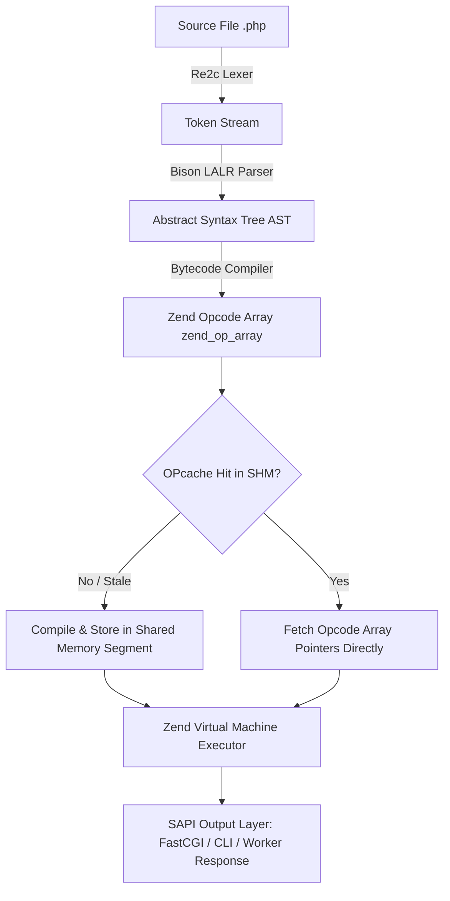
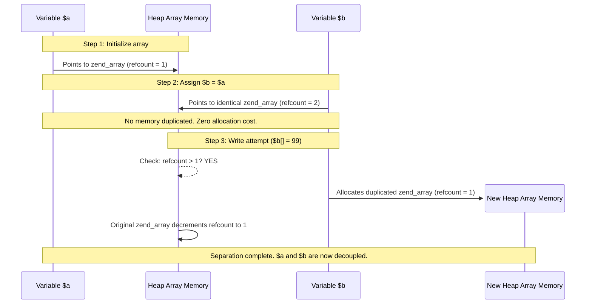

# PHP 8.4+ Senior Technical Handbook & Systems Architecture Manual

---

## Table of Contents

1. [[#1. PHP Runtime Internals & Lifecycle (Zend Engine, OPcache, SAPI)]]
2. [[#2. Memory Model: zval, Copy-on-Write, References & Garbage Collection]]
3. [[#3. Type System & Engine Evolution (PHP 8.0 – 8.4+)]]
4. [[#4. Functional Constructs: Closures, First-Class Callables & Scope Manipulation]]
5. [[#5. Streaming & Concurrency: Generators, Coroutines & Fibers]]
6. [[#6. Advanced OOP Architecture, Property Hooks & Metaprogramming]]
7. [[#7. SOLID Principles & Robust Design Patterns]]
8. [[#8. Error Architecture: Engine Errors, Exceptions & Control Flow]]
9. [[#9. Storage & Transactions: PDO, Concurrency, Isolation & Locks]]
10. [[#10. Enterprise Security & Attack Vectors (OWASP Top 10)]]
11. [[#11. HTTP Ecosystem, Output Buffering & PSR Standards]]
12. [[#12. Performance Diagnostics, Profiling & PHP-FPM Orchestration]]
13. [[#13. Technical Interview Edge-Case Matrix]]

---

## 1. PHP Runtime Internals & Lifecycle (Zend Engine, OPcache, SAPI)

> [!abstract] Architectural Summary
> PHP is not an interpreted language in the classical line-by-line sense. It is a bytecode-compiled language executed on an abstract stack-and-register virtual machine (Zend VM). In traditional HTTP configurations, PHP executes under a **shared-nothing** process architecture: memory allocations, global states, and class definitions are provisioned and dismantled per-request.

### 1.1 The Complete Compilation & Execution Pipeline



#### Step 1: Lexical Analysis (Scanning)
* **Engine Tool:** Custom Re2c scanner.
* **Mechanism:** Converts raw UTF-8/ASCII bytes into discrete lexical units called **tokens** (e.g., `T_VARIABLE`, `T_WHITESPACE`, `T_OBJECT_OPERATOR`). Each token contains an integer ID, string payload, and file line number.
* **Diagnostic Utility:** `token_get_all($sourceCode)` or PHP 8.0+ `PhpToken::tokenize($sourceCode)`.

#### Step 2: Syntax Parsing & AST Generation
* **Engine Tool:** Bison-derived LALR(1) parser.
* **Mechanism:** Verifies syntax validity against the formal grammar of PHP and builds a recursive hierarchical graph called the **Abstract Syntax Tree (AST)**.
* **Purpose:** Separates syntax validation from code generation. Optimizers like constant-folding (evaluating `60 * 60 * 24` into `86400` at compile time) operate directly on this AST before generating bytecode.

#### Step 3: Bytecode Compilation
* **Output:** An array of VM instructions known as `zend_op_array`.
* **Opcode Structure (`zend_op`):**
  * `opcode`: The numeric instruction to execute (e.g., `ZEND_ADD`, `ZEND_RECV`, `ZEND_INIT_METHOD_CALL`).
  * `op1`, `op2`: Operands (can be compiled variables `CV`, temporary variables `TMPVAR`, internal variables `VAR`, or constants `CONST`).
  * `result`: Storage destination for the operation.
  * `handler`: A direct C function pointer pointing to the VM routine executing this specific opcode.

#### Step 4: Zend VM Execution Engine (The Executor)
* The VM employs a direct-threaded code dispatch loop. Instead of an overhead-heavy `switch($opcode)` loop, execution jumps directly from the tail of one C handler function to the memory pointer of the next opcode's C handler via inline assembly or compiler extensions (`goto *handler`).

---

### 1.2 OPcache Architecture, Shared Memory (SHM) & Preloading

Without OPcache, every HTTP request repeats Steps 1 through 3, consuming substantial CPU cycles on string parsing and memory allocations.

```
┌──────────────────────────────────────────────────────────────┐
│                    Shared Memory (SHM)                       │
│  ┌────────────────────────────────────────────────────────┐  │
│  │ Immutable Interned Strings Table ("stdClass", "id", …) │  │
│  └────────────────────────────────────────────────────────┘  │
│  ┌────────────────────────────────────────────────────────┐  │
│  │ Compiled `zend_op_array` Store                         │  │
│  │   ├── Controller::index()                              │  │
│  │   └── UserRepository::findById()                       │  │
│  └────────────────────────────────────────────────────────┘  │
└──────────────────────────────────────────────────────────────┘
       ▲                                 ▲
       │ Read (Lock-Free)                │ Read (Lock-Free)
┌──────────────┐                  ┌──────────────┐
│ FPM Worker 1 │                  │ FPM Worker 2 │
└──────────────┘                  └──────────────┘
```

#### Interned Strings
OPcache maintains a specialized memory buffer for deduplicating repeated string literals (class names, function names, property names, and string constants). Instead of allocating duplicate copies of `'status'` across 200 files, every zval points to the identical C pointer in shared memory, with reference counting disabled (`IS_STR_INTERNED`).

#### Preloading (`opcache.preload`)
* Introduced in PHP 7.4. Runs a designated bootstrap script inside CLI mode **before** PHP-FPM opens its socket and accepts traffic.
* Preloaded classes, interfaces, traits, and functions are linked directly into the Zend core table (`CG(class_table)`, `CG(function_table)`).
* **Architectural Trade-Off:** Preloaded code is globally available to all worker processes without needing `include`, `require`, or Composer's PSR-4 autoloader. However, altering any preloaded file requires a complete restart of the parent PHP-FPM master process (`SIGUSR2` / `kill -USR2`).

---

### 1.3 SAPI Implementations & The Shared-Nothing Model

The **Server API (SAPI)** abstract layer decouples the Zend Engine from the underlying communication protocol.

| SAPI Mode | Concurrency Model | Lifecycle Duration | Process State Sharing |
| :--- | :--- | :--- | :--- |
| **PHP-FPM** | Multi-process worker pool (`pm = static/dynamic`) | Ephemeral per HTTP request (10–300 ms) | Shared-Nothing. State resets completely on request termination. |
| **CLI** | Single process; synchronous or async event loop | Script duration (milliseconds to months for daemons) | Persistent state within single OS process space. |
| **FrankenPHP / RoadRunner** | Long-lived worker pool (Worker Mode) | Long-lived across tens of thousands of requests | State persists across requests. High danger of state leakage. |

> [!danger] Architectural Hazard: Long-Lived Engine State
> Under modern high-performance runtimes (FrankenPHP, RoadRunner, Swoole), your application remains resident in memory. Static properties, Singleton service containers, and open database connections **do not reset** between client hits. Failing to reset state leads to cross-tenant memory leakage (User A seeing User B's cart or authorization tokens).

---

## 2. Memory Model: zval, Copy-on-Write, References & Garbage Collection

### 2.1 The Internal Structure of `zval` (Zend Value)

In PHP 8.x, variables are represented by a 16-byte C structure (`zval`) carefully aligned to 64-bit CPU cache boundaries:

```c
struct _zval_struct {
    zend_value value;            // 8 bytes: scalar literal or pointer to heap structure
    union {
        struct {
            zend_uchar type;         // Data type identifier (IS_STRING, IS_ARRAY, IS_OBJECT...)
            zend_uchar type_flags;   // Reference-counted, interned, immutable flags
            union {
                uint16_t extra;      // Call-frame & scope flags
            } u;
        } v;
        uint32_t type_info;
    } u1;
    union {
        uint32_t next;               // Hash collision chaining within HashTables
        uint32_t cache_slot;         // JIT runtime inline caching slots
    } u2;                            // 4 bytes
};
```

#### Pure Stack Values vs. Heap References
* **Stack Values (Zero-Allocation Primitives):** `int`, `float`, `bool`, and `null` store their data directly within the 8-byte `zend_value` payload. They trigger zero heap allocations and do not maintain a reference counter (`refcount`).
* **Heap References:** `string`, `array`, `object`, `resource`, and `reference` allocate separate memory blocks inside Zend MM (Zend Memory Manager) and embed a `zend_refcounted_h` header containing `refcount` and garbage collector flags.

---

### 2.2 Copy-on-Write (CoW) Theoretical Proof

Copy-on-Write is a memory optimization strategy that avoids allocating duplicate physical RAM when assigning or passing complex structures until an explicit write/mutation occurs.



```php
<?php

declare(strict_types=1);

// Step 1: Heap allocation for array; refcount = 1
$original = range(1, 100_000); 

// Step 2: No memory duplicated. Both variables point to the identical zend_array.
// refcount increments to 2.
$copy = $original; 

// Step 3: Read-only operations do not duplicate data. refcount increments to 3.
function inspectMemory(array $data): void
{
    echo $data[0]; 
}
inspectMemory($copy);

// Step 4: Write attempt detected!
// Engine checks: refcount > 1.
// zend_array is physically duplicated in memory.
// $original remains unchanged; $copy points to the newly allocated array.
$copy[] = 100_001;
```

---

### 2.3 The Dangers of Explicit References (`&`)

When `$b = &$a;` is executed, PHP wraps the value in a `zend_reference` structure. Both variables become `IS_REFERENCE` types pointing to this intermediary container.

```php
<?php

declare(strict_types=1);

$source = [1, 2, 3];

// Classical Bug: Array Mutation Post-Loop
foreach ($source as &$item) {
    $item *= 10;
}
// Crucial: $item remains an active reference pointing directly to $source[2]!

foreach ($source as $item) {
    // Each iteration overwrites $source[2] with the current element!
}

print_r($source);
// Output: [10, 20, 20] instead of [10, 20, 30]
// Remediation: unset($item) MUST immediately follow reference loops.
unset($item);
```

---

### 2.4 The Garbage Collection & Cycle Collection Algorithm

* **Reference Counting Limitations:** Normal refcounting frees memory instantly when `refcount == 0`. However, cyclic references (Object A referencing Object B, which references Object A) prevent `refcount` from reaching zero, even after all user-space variable identifiers have been unset.
* **Bacon-Rajan Synchronous Cycle Detection:**
  1. **Buffer Collection:** When any composite zval's `refcount` decrements but remains $> 0$, it is flagged as suspect (color **Purple**) and pushed into the GC Root Buffer (10,000 slots).
  2. **Trial Deletion (Mark Grey):** Once the buffer reaches capacity, the collector traverses the reference graph, speculatively decrementing refcounts by 1 for internal connections.
  3. **Live Reversion (Mark Black):** If an object's simulated refcount remains $> 0$, it has active external roots. The collector traverses back, restoring its counts and marking it Black.
  4. **Purge Allocation (Mark White):** Any subgraph whose simulated refcounts reach 0 has no external roots. The collector marks these nodes White and frees them in a sweep phase.

---

## 3. Type System & Engine Evolution (PHP 8.0 – 8.4+)

### 3.1 Type System Evolution Breakdown

```
        PHP 7.0 ──► Scalar Types & Return Types
           │
        PHP 7.1 ──► Nullable Types (?T), void, iterable
           │
        PHP 8.0 ──► Union Types (A|B), mixed, static return
           │
        PHP 8.1 ──► Intersection Types (A&B), never, Enums
           │
        PHP 8.2 ──► DNF Types ((A&B)|null), standalone true/false/null
           │
        PHP 8.3 ──► Typed Class Constants
           │
        PHP 8.4 ──► Asymmetric Visibility, Property Hooks, new without parens
```

### 3.2 Strict Types vs. Coercive Types Implementation

* **Coercive Mode (Default):** PHP implicitly converts scalar inputs where feasible (e.g., passing `"123"` to an `int` parameter silently casts it to integer `123`).
* **Strict Mode (`declare(strict_types=1);`):**
  * Placed as the very first execution statement of a file.
  * **Critical Engine Rule:** `strict_types` applies to the **caller file**, not the callee declaration file. If File A (without strict types) invokes a function located in File B (with strict types), PHP executes coercively.
  * Only one single conversion is permitted under strict typing: widening `int` to `float`. Passing `float` to `int` or `string` to `int` throws a `TypeError`.

```php
<?php

declare(strict_types=1);

namespace App\Core\Types;

use Stringable;
use Countable;

interface Renderable
{
    public function render(): string;
}

interface Loggable
{
    public function getLogPayload(): array;
}

// Disjunctive Normal Form (DNF) Type Definition
final readonly class ComponentManager
{
    /**
     * Accepts an object fulfilling both Renderable AND Loggable,
     * OR a clean scalar string, OR null.
     */
    public function processComponent((Renderable&Loggable)|string|null $target): string
    {
        return match (true) {
            is_string($target) => $target,
            $target instanceof Renderable => $target->render(),
            default => 'EMPTY_COMPONENT',
        };
    }
}
```

---

## 4. Functional Constructs: Closures, First-Class Callables & Scope Manipulation

### 4.1 Theoretical Divergence: `callable` vs. `Closure`

* **`callable`:** A runtime type alias satisfying the engine's invocation checks. It accepts strings (`'trim'`), arrays (`[$instance, 'action']`), invocable objects, and closures. Because its validity depends on state resolution, **it cannot be used as a typed class property** (`public callable $fn;` causes a fatal compilation error).
* **`\Closure`:** A concrete, final internal class. It encapsulates lexical scope, bound parameters, and bound object contexts (`$this`). It can be typed as class properties and parameters.

### 4.2 First-Class Callable Mechanics (`...`)

Introduced in PHP 8.1, `fn(...)` converts functions or methods into a first-class `\Closure` at compile time via the `ZEND_CALLABLE_CONVERT` opcode:
* Validates method visibility (`public`, `protected`, `private`) **at the point of reference**, not at invocation.
* Replaces legacy string/array syntax (`[$this, 'action']`) with syntax that IDEs and static analyzers (PHPStan, Psalm) can trace.

```php
<?php

declare(strict_types=1);

namespace App\Infrastructure\Conversion;

use Closure;

final class Normalizer
{
    public function trimAndLower(string $value): string
    {
        return mb_strtolower(trim($value));
    }
}

$normalizer = new Normalizer();

// Ellipsis syntax directly builds a Closure bound to $normalizer
$pipelineStage = $normalizer->trimAndLower(...);

$collection = ['  DATA_ONE ', ' Data_Two   '];
$cleaned = array_map($pipelineStage, $collection);
// Output: ['data_one', 'data_two']
```

### 4.3 Scope Manipulation: `Closure::bind` and `Closure::call`

The Zend Engine allows anonymous functions to break encapsulation boundaries through closure rebinding. This enables ORM hydrators (e.g., Doctrine) to populate private properties without running constructors:

```php
<?php

declare(strict_types=1);

namespace App\Domain\Model;

use Closure;

final class UserAccount
{
    private string $passwordHash;

    public function __construct(string $initialHash)
    {
        $this->passwordHash = $initialHash;
    }
}

$account = new UserAccount('$2y$12$securehashvalue');

// Reading encapsulated state via Closure::call (Scope rebinding)
$hashExtractor = function (): string {
    return $this->passwordHash;
};

// Temporarily rebinds $this and sets the lexical scope to UserAccount
$extractedHash = $hashExtractor->call($account);
echo $extractedHash; // Outputs: $2y$12$securehashvalue
```

---

## 5. Streaming & Concurrency: Generators, Coroutines & Fibers

### 5.1 Generator State Machine Architecture

When a function contains the `yield` keyword, the compiler replaces its return mechanism with a `\Generator` object implementing `\Iterator`.
* **State Machine:** Generators act as stackless coroutines. When `yield` executes, the local CPU registers, instruction pointer, and stack frame variables are saved inside an internal heap buffer (`zend_generator_context`), and execution control returns to the caller.
* **Memory Complexity:** Consumes $\mathcal{O}(1)$ constant memory regardless of whether it emits 10 or 10,000,000 records.
* **Limitation:** Generators are forward-only and **cannot be rewound** after iteration begins.

```php
<?php

declare(strict_types=1);

namespace App\Core\Streaming;

use Generator;
use InvalidArgumentException;

final class BatchStreamer
{
    /**
     * Splits an infinite or huge stream into fixed-size chunks while maintaining O(1) memory.
     *
     * @template TKey
     * @template TValue
     * @param iterable<TKey, TValue> $source
     * @param int $chunkSize
     * @return Generator<int, array<TKey, TValue>>
     */
    public static function chunkStream(iterable $source, int $chunkSize): Generator
    {
        if ($chunkSize <= 0) {
            throw new InvalidArgumentException("Chunk size must be greater than zero.");
        }

        $bucket = [];

        foreach ($source as $key => $item) {
            $bucket[$key] = $item;

            if (count($bucket) === $chunkSize) {
                yield $bucket;
                $bucket = [];
            }
        }

        if ($bucket !== []) {
            yield $bucket;
        }
    }
}
```

### 5.2 Coroutines via Generator API: `send()`, `throw()`, `getReturn()`

* `$generator->send($val)`: Resumes generator execution, injecting `$val` as the return value of the paused `yield` expression.
* `$generator->throw($exception)`: Injects an exception directly into the generator's pause point, allowing `try/catch` recovery.
* `$generator->getReturn()`: Retrieves the value passed to `return` inside the generator. Calling this while `$generator->valid() === true` throws an uncaught `Exception`.

```php
<?php

declare(strict_types=1);

namespace App\Core\Pipeline;

use Generator;

function consumerCoroutine(): Generator
{
    $processedCount = 0;

    while (true) {
        // Pauses execution and waits for a value from ->send()
        $payload = yield;

        if ($payload === null) {
            break; // Termination signal
        }

        $processedCount++;
    }

    return $processedCount;
}

$consumer = consumerCoroutine();

// Priming: Run until the first yield expression
$consumer->current();

$consumer->send('Payload Alpha');
$consumer->send('Payload Beta');

// Terminate coroutine
$consumer->send(null);

// Extract the return value after exhaustion
echo $consumer->getReturn(); // Outputs: 2
```

### 5.3 Fibers (PHP 8.1+): True Cooperative Stackful Coroutines

Unlike Generators (which are stackless and can only pause themselves at the top level), **Fibers** possess an isolated execution stack allocated directly on the OS heap:
* Execution can be suspended via `Fiber::suspend()` deeply nested within arbitrary sub-function calls without modifying intermediate method signatures.
* Fibers form the foundation of non-blocking frameworks (Amp v3, Revolt PHP) to write asynchronous I/O with standard synchronous syntax.

```php
<?php

declare(strict_types=1);

namespace App\Core\Async;

use Fiber;

$fiber = new Fiber(function (string $fiberName): void {
    echo "Fiber [{$fiberName}]: Step 1 Initialized\n";
    
    // Suspend execution and yield control deep within the call stack
    $injectedData = Fiber::suspend("Suspension Payload");
    
    echo "Fiber [{$fiberName}]: Resumed with payload: {$injectedData}\n";
});

// Start the fiber
$initialReturn = $fiber->start("Worker-01");
echo "Main Context: Received -> {$initialReturn}\n";

// Resume the fiber
$fiber->resume("Main Execution Token");
```

---

## 6. Advanced OOP Architecture, Property Hooks & Metaprogramming

### 6.1 Property Hooks & Asymmetric Visibility (PHP 8.4)

PHP 8.4 introduces **Property Hooks** and **Asymmetric Visibility**, removing traditional getter/setter boilerplate while keeping properties fully encapsulated.

```php
<?php

declare(strict_types=1);

namespace App\Domain\Commerce;

use InvalidArgumentException;

final class LedgerEntry
{
    // Asymmetric visibility: readable globally, writable only by the declaring class
    public private(set) string $transactionStatus = 'pending';

    // Backed property with hook validation
    public int $amountInCents {
        get => $this->amountInCents;
        set {
            if ($value <= 0) {
                throw new InvalidArgumentException("Monetary value must be positive.");
            }
            $this->amountInCents = $value;
        }
    }

    // Virtual property: consumes zero physical memory; calculated on-demand
    public string $formattedAmount {
        get => sprintf('$%.2f', $this->amountInCents / 100);
    }

    public function __construct(int $initialAmount)
    {
        $this->amountInCents = $initialAmount;
    }

    public function markAsSettled(): void
    {
        $this->transactionStatus = 'settled';
    }
}
```

### 6.2 Late Static Binding (LSB) Mechanics: `self` vs. `static`

* `self::`: Resolved at **compile time** to the exact class where the keyword was written.
* `static::`: Resolved at **runtime** using the class name through which the static method was called (the dynamic call target).

```php
<?php

declare(strict_types=1);

namespace App\Core\Patterns;

abstract class EntityModel
{
    public static function createViaSelf(): self
    {
        // Fatal Error if called on child: Cannot instantiate abstract class EntityModel
        return new self(); 
    }

    public static function create(): static
    {
        // LSB: Resolves to the specific child class invoked at runtime
        return new static();
    }
}

final class CustomerUser extends EntityModel {}

$customer = CustomerUser::create();
echo get_class($customer); // Outputs: App\Core\Patterns\CustomerUser
```

---

## 7. SOLID Principles & Robust Design Patterns

### 7.1 SOLID Deep-Dive for Backend Engineering

```
┌─────────────────────────────────────────────────────────────┐
│                       SOLID PRINCIPLES                      │
├─────────────────────────┬───────────────────────────────────┤
│ S - Single Resp.        │ One actor / reason to change      │
│ O - Open/Closed         │ Open for extension, closed for mod│
│ L - Liskov Substitution │ Child honors parent contracts     │
│ I - Interface Segreg.   │ Fine-grained, role-based contracts│
│ D - Dependency Invers.  │ Depend on abstractions, not detail│
└─────────────────────────┴───────────────────────────────────┘
```

1. **S (Single Responsibility Principle):** A class should serve one single actor or business domain. Splitting computation, data access, and transport encoding into separate classes prevents changes to one layer (like a database migration) from breaking others (like PDF generation).
2. **O (Open/Closed Principle):** Avoid giant `match` or `switch` statements when adding new business rules. Define an interface strategy; add new behaviors by introducing new classes rather than modifying existing code.
3. **L (Liskov Substitution Principle):** Subtypes must remain substitutable for their base types without breaking application behavior.
   * *Covariance:* Return types can be narrowed in subclasses.
   * *Contravariance:* Parameter types can be widened in subclasses.
   * *Subtyping Contracts:* Subclasses must not tighten preconditions (e.g., throwing new validation errors) or weaken postconditions.
4. **I (Interface Segregation Principle):** Favor multiple small, focused interfaces (`Stringable`, `Countable`) over broad, bloated ones. Clients should not be forced to implement methods they do not need.
5. **D (Dependency Inversion Principle):** High-level policy modules should not depend on low-level infrastructure details. Both must depend on abstractions (interfaces).

```php
<?php

declare(strict_types=1);

namespace App\Domain\Identity;

// High-Level Domain Contract (DIP compliant)
interface UserRepositoryInterface
{
    public function findById(int $id): ?UserEntity;
}

final readonly class UserEntity
{
    public function __construct(
        public int $id,
        public string $email
    ) {}
}

// Domain Layer / Use Case relies solely on abstractions
final readonly class FetchUserProfileUseCase
{
    public function __construct(
        private UserRepositoryInterface $userRepository
    ) {}

    public function execute(int $userId): UserEntity
    {
        $user = $this->userRepository->findById($userId);
        
        if ($user === null) {
            throw new UserNotFoundException("User {$userId} does not exist.");
        }

        return $user;
    }
}
```

---

## 8. Error Architecture: Engine Errors, Exceptions & Control Flow

### 8.1 Converting Warnings to Exceptions

Legacy procedural warnings (like undefined array keys) are converted to `ErrorException` instances using a custom handler. This provides unified, modern error handling across the application:

```php
<?php

declare(strict_types=1);

namespace App\Core\Bootstrap;

use ErrorException;

final class ErrorBridge
{
    public static function register(): void
    {
        set_error_handler(
            static function (int $severity, string $message, string $file, int $line): bool {
                if (!(error_reporting() & $severity)) {
                    return false;
                }

                // Elevate procedural warning/notice into a structural exception
                throw new ErrorException($message, 0, $severity, $file, $line);
            }
        );
    }
}
```

### 8.2 The Control Flow Hazard of `finally`

A `finally` block executes unconditionally: when an exception is thrown, when `catch` runs, and even after an explicit `return` in `try`.

> [!warning] Architecture Hazard: `return` inside `finally`
> Putting a `return` inside a `finally` block **discards any unhandled exceptions** thrown in `try` and overrides previous returns. Static analysis tools (PHPStan Level 6+) flag this as a critical issue.

```php
<?php

declare(strict_types=1);

namespace App\Core\Diagnostics;

use Exception;
use RuntimeException;

function verifyExecutionFlow(): string
{
    try {
        throw new RuntimeException("Initial failure");
    } catch (Exception $e) {
        return "catch_return"; // Step 1: Return value is computed and staged
    } finally {
        // Anti-Pattern Alert: An explicit return inside finally 
        // wipes out previous returns AND discards active exceptions!
        return "finally_override"; 
    }
}

echo verifyExecutionFlow(); // Outputs: "finally_override"
```

---

## 9. Storage & Transactions: PDO, Concurrency, Isolation & Locks

### 9.1 ACID & The Isolation-Level Spectrum

```
Isolation Level     Dirty Read?   Non-Repeatable Read?   Phantom Read?
──────────────────────────────────────────────────────────────────────
READ UNCOMMITTED        YES               YES                YES
READ COMMITTED          NO                YES                YES
REPEATABLE READ         NO                NO                 YES (In standard; protected in InnoDB)
SERIALIZABLE            NO                NO                 NO
```

* **Dirty Read:** Transaction A reads uncommitted modifications made by Transaction B. If B rolls back, A holds corrupt data.
* **Non-Repeatable Read:** Transaction A reads a row value. Transaction B updates and commits that row. Transaction A reads it again and sees different data.
* **Phantom Read:** Transaction A executes a ranged query (`WHERE count > 5`). Transaction B inserts a new row matching the condition and commits. Transaction A re-executes and sees an unexpected new row.
* **InnoDB Multi-Version Concurrency Control (MVCC):** InnoDB implements `REPEATABLE READ` without phantom reads during non-locking reads by querying historical snapshots via Undo Logs.

---

### 9.2 Race Conditions & Pessimistic Row Locking

When multiple concurrent requests process updates to the same balance or inventory item, standard `SELECT` followed by `UPDATE` causes critical race conditions. Use pessimistic locking (`SELECT ... FOR UPDATE`) along with deterministic lock ordering to prevent deadlocks:

```php
<?php

declare(strict_types=1);

namespace App\Infrastructure\Storage;

use PDO;
use Throwable;
use DomainException;
use InvalidArgumentException;

final readonly class SafeFundTransfer
{
    public function __construct(private PDO $pdo) {}

    public function transfer(int $senderId, int $receiverId, int $amountInCents): void
    {
        if ($amountInCents <= 0) {
            throw new InvalidArgumentException("Amount must be positive.");
        }
        if ($senderId === $receiverId) {
            throw new InvalidArgumentException("Self-transfers are not permitted.");
        }

        $this->pdo->beginTransaction();

        try {
            // Deadlock Prevention: Always acquire row locks in consistent numerical order
            $lockOrder = [$senderId, $receiverId];
            sort($lockOrder);

            // Pessimistic Locking: SELECT ... FOR UPDATE
            $stmt = $this->pdo->prepare('
                SELECT id, balance 
                FROM accounts 
                WHERE id IN (?, ?) 
                ORDER BY id ASC 
                FOR UPDATE
            ');
            $stmt->execute($lockOrder);

            $accounts = [];
            while ($row = $stmt->fetch(PDO::FETCH_ASSOC)) {
                $accounts[(int)$row['id']] = (int)$row['balance'];
            }

            if (!isset($accounts[$senderId], $accounts[$receiverId])) {
                throw new DomainException("One or both accounts do not exist.");
            }

            if ($accounts[$senderId] < $amountInCents) {
                throw new DomainException("Insufficient sender account funds.");
            }

            // Execute atomic mutations
            $update = $this->pdo->prepare('
                UPDATE accounts 
                SET balance = balance + :delta 
                WHERE id = :id
            ');

            $update->execute(['delta' => -$amountInCents, 'id' => $senderId]);
            $update->execute(['delta' => $amountInCents, 'id' => $receiverId]);

            $this->pdo->commit();
        } catch (Throwable $e) {
            if ($this->pdo->inTransaction()) {
                $this->pdo->rollBack();
            }
            throw $e;
        }
    }
}
```

---

## 10. Enterprise Security & Attack Vectors (OWASP Top 10)

### 10.1 Security Defense Matrix

| Threat | Vulnerability Vector | Modern PHP Defense Architecture |
| :--- | :--- | :--- |
| **SQLi** | Dynamic query string interpolation | Real Prepared Statements (`PDO::ATTR_EMULATE_PREPARES => false`). Whitelists for column names/order directions. |
| **XSS** | Rendering untrusted user input directly into HTML/JS | Output context encoding via `htmlspecialchars(..., ENT_QUOTES \| ENT_SUBSTITUTE, 'UTF-8')`. Content Security Policy (CSP). |
| **CSRF** | State-changing actions triggered via third-party cross-site requests | Cryptographic tokens validated via `hash_equals()`. Session cookies configured with `SameSite=Lax` or `Strict`. |
| **IDOR** | Unprotected resource identifiers in URLs/payloads | Domain-driven ACL validation: `WHERE id = :id AND user_id = :authenticatedUserId`. |
| **Object Injection**| Deserialization of untrusted data through `unserialize()` | Use `json_encode()` / `json_decode()` exclusively. Disable class instantiation if `unserialize()` is required: `['allowed_classes' => false]`. |
| **Timing Attacks** | Leaking secrets via character-by-character string comparisons (`===`) | Constant-time evaluations using `hash_equals()`. |

### 10.2 Timing-Safe Evaluation & CSRF Architecture

```php
<?php

declare(strict_types=1);

namespace App\Core\Security;

use RuntimeException;

final class CsrfProtection
{
    public static function generateToken(): string
    {
        // Cryptographically secure pseudorandom token generation
        return bin2hex(random_bytes(32));
    }

    public static function validateToken(#[\SensitiveParameter] string $knownToken, #[\SensitiveParameter] ?string $submittedToken): bool
    {
        if ($submittedToken === null) {
            return false;
        }

        // Constant-time string evaluation to prevent character-by-character timing leak attacks
        return hash_equals($knownToken, $submittedToken);
    }
}
```

---

## 11. HTTP Ecosystem, Output Buffering & PSR Standards

### 11.1 Parsing JSON Payloads via `php://input`

The `$_POST` superglobal is only populated by PHP for `application/x-www-form-urlencoded` or `multipart/form-data` requests. Raw JSON API payloads must be read directly from the read-only input stream:

```php
<?php

declare(strict_types=1);

namespace App\Core\Http;

use JsonException;
use RuntimeException;

final class RawJsonReader
{
    /**
     * Reads directly from the internal input stream to avoid memory spikes.
     *
     * @return array<string, mixed>
     */
    public static function parseJsonBody(): array
    {
        $rawStream = file_get_contents('php://input');

        if ($rawStream === false || $rawStream === '') {
            return [];
        }

        try {
            return json_decode($rawStream, true, 512, JSON_THROW_ON_ERROR);
        } catch (JsonException $e) {
            throw new RuntimeException("Malformed JSON request payload: " . $e->getMessage(), 400, $e);
        }
    }
}
```

### 11.2 PSR-15 Middleware Onion Pattern

PSR-15 defines the standard request handling pipeline using the Onion Architecture pattern:

```php
<?php

declare(strict_types=1);

namespace App\Http\Middleware;

use Psr\Http\Message\ResponseInterface;
use Psr\Http\Message\ServerRequestInterface;
use Psr\Http\Server\MiddlewareInterface;
use Psr\Http\Server\RequestHandlerInterface;

final readonly class ResponseTimingMiddleware implements MiddlewareInterface
{
    public function process(ServerRequestInterface $request, RequestHandlerInterface $handler): ResponseInterface
    {
        $startTime = microtime(true);

        // Dispatch request deeper into the onion architecture pipeline
        $response = $handler->handle($request);

        $executionTime = microtime(true) - $startTime;

        // Immutably enrich the outgoing PSR-7 Response object
        return $response->withHeader('X-Execution-Duration', sprintf('%.4f s', $executionTime));
    }
}
```

---

## 12. Performance Diagnostics, Profiling & PHP-FPM Orchestration

### 12.1 PHP-FPM Process Pool Architecture

In high-throughput environments, set `pm = static` to avoid the overhead of dynamically spawning worker processes during traffic spikes:

```ini
; Production Pool Configuration (/etc/php/8.4/fpm/pool.d/www.conf)

[www]
user = www-data
group = www-data

listen = /run/php/php8.4-fpm.sock
listen.owner = www-data
listen.group = www-data
listen.mode = 0660

; Use static process pooling on dedicated application servers
pm = static
; Formula: (Total RAM - OS/DB Reserved) / Average Memory Usage per Worker
pm.max_children = 120

; Recycle worker processes periodically to neutralize internal C-level memory leaks
pm.max_requests = 1000

; Diagnostic slow query logging
request_slowlog_timeout = 3s
slowlog = /var/log/php-fpm/slow.log

; Hard execution timeout termination
request_terminate_timeout = 30s
```

### 12.2 Handling Out-of-Memory (OOM) Errors Gracefully

Standard `try/catch` blocks cannot intercept memory limit exhaustion (`Allowed memory size exhausted`). You can reserve an emergency memory buffer during startup, freeing it within a shutdown handler to complete logging before process exit:

```php
<?php

declare(strict_types=1);

namespace App\Core\Diagnostics;

final class EmergencyShutdownHandler
{
    private static ?string $emergencyBuffer = null;

    public static function register(): void
    {
        // Pre-allocate 5MB of heap memory
        self::$emergencyBuffer = str_repeat('*', 1024 * 1024 * 5);

        register_shutdown_function(static function (): void {
            // Free the reserved buffer immediately so the process can complete error logging
            self::$emergencyBuffer = null;

            $error = error_get_last();
            if ($error !== null && in_array($error['type'], [E_ERROR, E_CORE_ERROR], true)) {
                error_log(sprintf(
                    "FATAL PROCESS TERMINATION: %s in %s on line %d",
                    $error['message'],
                    $error['file'],
                    $error['line']
                ));
            }
        });
    }
}
```

---

## 13. Technical Interview Edge-Case Matrix

| # | Code Construct | Result | Architectural Explanation |
| :---: | :--- | :--- | :--- |
| **1** | `var_dump(0.1 + 0.2 == 0.3);` | `bool(false)` | Binary floating-point representation discrepancy (IEEE 754). Always compare floats using an epsilon: `abs($a - $b) < PHP_FLOAT_EPSILON` or use BCMath for monetary values. |
| **2** | `var_dump("0" == false);` | `bool(true)` | In loose comparisons, `"0"` evaluates to a falsy string. In PHP 8.0+, string comparisons with numbers treat non-numeric strings as strings, but numeric `"0"` still evaluates to `false`. |
| **3** | `var_dump("0e123" == "0e456");` | `bool(true)` | **Magic Hash vulnerability**: Both strings match scientific notation for zero ($0 \times 10^{123} = 0$). Evaluates to `0 == 0`. Always compare hashes and secrets using `hash_equals()`. |
| **4** | `var_dump(in_array("1e1", ["10"]));` | `bool(true)` | Default `in_array` performs loose checking (`$strict = false`). "1e1" parses as numeric $10$. Always pass the third parameter: `in_array($val, $arr, true)`. |
| **5** | `$a = [1]; $b = &$a; $b[] = 2; echo count($a);` | `2` | Explicit reference creation converts `$a` and `$b` into a shared `zend_reference`. |
| **6** | `empty("0.0")` vs `empty("0")` | `false` vs `true` | The string `"0"` is explicitly designated as falsy in PHP. The string `"0.0"` is considered truthy. |
| **7** | `[1, 2] + [3, 4, 5]` | `[1, 2, 5]` | The union operator (`+`) keeps left-hand keys. Keys `0` and `1` from the left array win; only missing key `2` is appended. Unlike `array_merge()`, numeric keys are not re-indexed. |
| **8** | `array_filter([0, 1, false, '', 2])` | `[1 => 1, 4 => 2]` | Without a callback, `array_filter()` removes all falsy values. Crucially, original array keys are preserved, which can break client lists unless re-indexed with `array_values()`. |