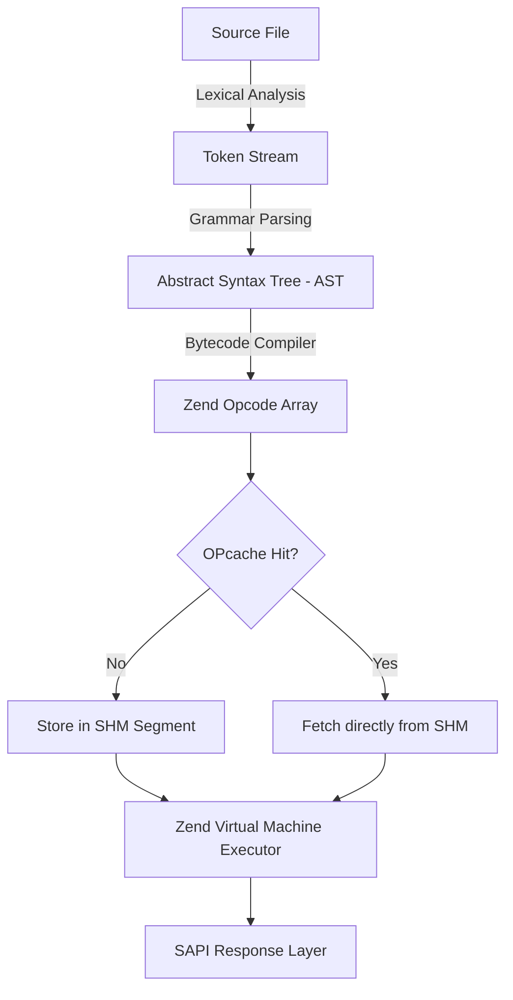

# PHP 8.4+ Senior Technical Handbook & Systems Architecture Manual

---

## Table of Contents

1. [[#1. PHP Runtime Internals & Lifecycle (Zend Engine, OPcache, SAPI)]]
2. [[#2. Memory Model: zval, Copy-on-Write, References & Garbage Collection]]
3. [[#3. Type System & Engine Evolution (PHP 8.0 – 8.4+)]]
4. [[#4. Functional Constructs: Closures, First-Class Callables & Scope Manipulation]]
5. [[#5. Streaming & Concurrency: Generators, Coroutines & Fibers]]
6. [[#6. Advanced OOP Architecture, Property Hooks & Metaprogramming]]
7. [[#7. SOLID Principles & Robust Design Patterns]]
8. [[#8. Error Architecture: Engine Errors, Exceptions & Control Flow]]
9. [[#9. Storage & Transactions: PDO, Concurrency, Isolation & Locks]]
10. [[#10. Enterprise Security & Attack Vectors (OWASP Top 10)]]
11. [[#11. HTTP Ecosystem, Output Buffering & PSR Standards]]
12. [[#12. Performance Diagnostics, Profiling & PHP-FPM Orchestration]]
13. [[#13. Technical Interview Edge-Case Matrix]]

---

## 1. PHP Runtime Internals & Lifecycle (Zend Engine, OPcache, SAPI)

> [!abstract] Architectural Overview
> PHP is a compiled bytecode execution engine. Code is parsed into an Abstract Syntax Tree (AST), compiled into opcode vectors, and executed by the Zend Virtual Machine (VM). Under traditional web configurations, PHP uses a **shared-nothing** process model.

```
Source Code (.php)
       │
       ▼
 1. Lexer (Tokens) ──► 2. Parser (AST) ──► 3. Compiler (Opcodes)
                                                    │
 ┌──────────────────────────────────────────────────┘
 │
 ▼
[ OPcache Shared Memory Storage ] (SHM)
 │
 ▼
4. Zend VM Execution Engine (Executor)
 │
 ▼
SAPI Output Buffer (FastCGI / HTTP Response / CLI Output)
```

### The Compilation & Execution Pipeline



1. **Lexical Analysis (Re2c Lexer):** Reads the raw stream of characters and breaks it into recognizable tokens (e.g., `T_VARIABLE`, `T_OBJECT_OPERATOR`).
2. **Grammar Parsing (Bison LALR Parser):** Generates an Abstract Syntax Tree (AST) representing abstract syntactic relations.
3. **Bytecode Compilation:** The AST traverses down to generate opcode arrays (`zend_op_array`). Each opcode (`zend_op`) consists of an instruction handler, operands, and return types.
4. **Zend VM Executor:** A virtual machine that executes instructions via function-pointer-based direct threaded loops or switch-dispatch mechanisms.

### OPcache Architecture & Preloading

OPcache eliminates steps 1–3 by caching `zend_op_array` structures directly within an allocated segment of Shared Memory (SHM):

* **SHM Segments:** Master processes allocate memory once via `mmap()` or IPC shared memory blocks. Forked PHP-FPM workers read pre-compiled opcodes without cross-process locking overhead.
* **Timestamp Validation (`opcache.validate_timestamps=0`):** In production environments, file modification checks (`stat()` system calls) are completely disabled. File modifications on disk have zero effect until a graceful FPM reload signals an SHM rebuild.
* **Preloading (`opcache.preload`):** Introduced in PHP 7.4. Before any worker processes handle requests, a bootstrap PHP script compiles specified vendor libraries and framework classes into persistent engine memory. These classes and functions become globally immutable across all worker requests, eliminating autoloading overhead entirely.

```ini
; Production OPcache Configuration (/etc/php/8.4/fpm/conf.d/10-opcache.ini)
opcache.enable=1
opcache.enable_cli=0
opcache.memory_consumption=256
opcache.interned_strings_buffer=16
opcache.max_accelerated_files=20000
opcache.validate_timestamps=0
opcache.save_comments=1
opcache.preload=/var/www/app/config/preload.php
opcache.preload_user=www-data
```

### SAPI Implementations & The Shared-Nothing Model

The **Server API (SAPI)** defines the communication bridge between the Zend engine and the environment:

* **PHP-FPM (FastCGI Process Manager):** Uses a pre-forked worker pool receiving binary FastCGI packets through Unix domain sockets or loopback TCP.
* **CLI:** Ephemeral single-execution execution mode.
* **Async Application Engines (FrankenPHP, RoadRunner, Swoole):** Break the classical shared-nothing paradigm. The application bootstrap is performed once, and workers process thousands of successive HTTP requests in memory via a long-lived worker loop.

> [!danger] Architectural Hazard: Long-Lived Engine State
> Under FrankenPHP, RoadRunner, or Swoole, static class variables, dependency injection containers, and database connections persist across subsequent client requests. Leaking request-specific data into static properties creates critical security exploits and cross-tenant memory corruption.

---

## 2. Memory Model: zval, Copy-on-Write, References & Garbage Collection

### The Anatomy of `zval` (Zend Value)

In PHP 8.x, a `zval` is a 16-byte C structure designed to maximize CPU cache-line alignment.

```c
struct _zval_struct {
    zend_value value; // 8 bytes: raw scalar or pointer to heap structure
    union {
        struct {
            zend_uchar type;         // Data type identifier (IS_STRING, IS_ARRAY, etc.)
            zend_uchar type_flags;   // Constant, Reference Counted, Immutable flags
            union {
                uint16_t extra;      // Call-frame & structural flags
            } u;
        } v;
        uint32_t type_info;
    } u1;
    union {
        uint32_t next;               // Hash collisions (HashTable buckets)
        uint32_t cache_slot;         // JIT runtime caching slots
    } u2; // 4 bytes
};
```

#### Primitives Stored Directly in the Stack
Scalar types (`IS_LONG`, `IS_DOUBLE`, `IS_TRUE`, `IS_FALSE`, `IS_NULL`) do **not** perform heap allocations. Their values reside directly inside the 8-byte `zend_value` payload. They do not maintain a reference counter (`refcount`).

### Copy-on-Write (CoW) Mechanics

Complex types (`zend_string`, `zend_array`, `zend_reference`) reside on the heap and track references through an embedded `zend_refcounted_h` header.

```php
<?php

declare(strict_types=1);

// Step 1: Heap allocation for array; refcount = 1
$original = range(1, 100_000); 

// Step 2: No memory duplicated! Both variables point to the identical zend_array.
// refcount increments to 2.
$copy = $original; 

// Step 3: Read-only operations do not duplicate data. refcount increments to 3.
function inspectMemory(array $data): void
{
    echo $data[0]; 
}
inspectMemory($copy);

// Step 4: Write attempt detected!
// Engine checks: refcount > 1.
// zend_array is physically duplicated in memory.
// $original remains unchanged; $copy points to the newly allocated array.
$copy[] = 100_001; 
```

### The Hazard of References (`&`)

Assigning an explicit reference (`$b = &$a;`) wraps the underlying value in a `zend_reference` structure. This forces both `zval` containers to switch to `IS_REFERENCE`, circumventing standard Copy-on-Write optimizations.

```php
<?php

declare(strict_types=1);

$source = [1, 2, 3];

// Classical Bug: Array Mutation Post-Loop
foreach ($source as &$item) {
    $item *= 10;
}
// Crucial: $item remains an active reference pointing directly to $source[2]!

foreach ($source as $item) {
    // Each iteration overwrites $source[2] with the current element!
}

print_r($source);
// Output: [10, 20, 20] instead of [10, 20, 30]
// Remediation: unset($item) MUST immediately follow reference loops.
```

### Garbage Collection & Cycle Collection Algorithm

PHP utilizes immediate reference-counting supplemented by the **Bacon-Rajan Cycle Detection Algorithm**:

```
[ Variable Destroyed / Decremented ]
                 │
          refcount == 0?
             /        \
          Yes          No
          /              \
[ Memory Freed ]      [ Mark Object Purple ]
                      [ Add to GC Root Buffer ]
                                 │
                     Root Buffer Full (10,000)?
                                 │
                     [ Run Cycle Collector ]
                     ├── Step 1: Decrement simulated refcounts (Grey)
                     ├── Step 2: Live objects restored (Black)
                     └── Step 3: Zero-refcount loops purged (White)
```

```php
<?php

declare(strict_types=1);

class GraphNode
{
    public ?GraphNode $linkedNode = null;
}

$a = new GraphNode(); // Refcount = 1
$b = new GraphNode(); // Refcount = 1

$a->linkedNode = $b;  // $b refcount = 2
$b->linkedNode = $a;  // $a refcount = 2

unset($a, $b); 
// Variables severed, but both objects maintain an internal refcount of 1!
// The standard refcounter CANNOT free this memory.
// Objects are marked PURPLE and queued into the Garbage Collection Root Buffer.
// Manual trigger for CLI daemons/workers:
gc_collect_cycles();
```

---

## 3. Type System & Engine Evolution (PHP 8.0 – 8.4+)

### Evolution Matrix

| Feature | PHP Version | Architectural Impact |
| :--- | :---: | :--- |
| **Union Types (`A\|B`)** | 8.0 | Formalizes multi-type parameters without verbose DocBlock contracts. |
| **Constructor Promotion** | 8.0 | Eliminates boilerplate assignment within class constructors. |
| **`match` Expressions** | 8.0 | Enforces strict comparison (`===`), functional returns, and exhaustive matches. |
| **Intersection Types (`A&B`)**| 8.1 | Enforces multiple interface contracts on incoming arguments. |
| **First-Class Callables (`fn(...)`)**| 8.1 | Direct, syntax-checked compilation of methods to `Closure` objects. |
| **Disjunctive Normal Form (DNF)**| 8.2 | Enables complex intersection-union hierarchies: `(A&B)|null`. |
| **Typed Class Constants** | 8.3 | Eliminates polymorphic type drift within derived class constants. |
| **Asymmetric Visibility** | 8.4 | Separate access control for reading (`public`) vs writing (`private(set)`). |
| **Property Hooks** | 8.4 | Native computed and validated property interception without custom accessors. |

### Modern Type System Implementation

```php
<?php

declare(strict_types=1);

namespace App\Core\Types;

use Stringable;
use Countable;

interface Renderable
{
    public function render(): string;
}

interface Loggable
{
    public function getLogPayload(): array;
}

// Complex DNF (Disjunctive Normal Form) Type Definition
final readonly class ComponentManager
{
    /**
     * Accepts an object fulfilling both Renderable AND Loggable,
     * OR a clean scalar string, OR null.
     */
    public function processComponent((Renderable&Loggable)|string|null $target): string
    {
        return match (true) {
            is_string($target) => $target,
            $target instanceof Renderable => $target->render(),
            default => 'EMPTY_COMPONENT',
        };
    }
}
```

---

## 4. Functional Constructs: Closures, First-Class Callables & Scope Manipulation

### The Architectural Divide: `callable` vs `Closure`

* `callable`: A loose type alias encompassing strings (`'strlen'`), arrays (`[$obj, 'method']`), invocable objects, and closures. It cannot be used as a typed class property: `public callable $handler;` triggers a fatal compilation error.
* `Closure`: A concrete, final internal class representing an anonymous function or a converted callable. It is fully valid as a strongly-typed class property: `public \Closure $handler;`.

### First-Class Callable Mechanics (`...`)

First-class callables convert any function or method into a standard `\Closure` object.

```php
<?php

declare(strict_types=1);

namespace App\Infrastructure\Conversion;

use Closure;

final class Normalizer
{
    public function trimAndLower(string $value): string
    {
        return mb_strtolower(trim($value));
    }
}

$normalizer = new Normalizer();

// The ellipsis creates a Closure bound to the $normalizer instance
$pipelineStage = $normalizer->trimAndLower(...);

$collection = ['  DATA_ONE ', ' Data_Two   '];
$cleaned = array_map($pipelineStage, $collection);
// Output: ['data_one', 'data_two']
```

### Scope Hijacking: `Closure::bind` and `Closure::call`

The Zend Engine allows anonymous functions to break through `private` and `protected` encapsulation boundaries using closure binding. This mechanism is central to ORM hydrators (e.g., Doctrine) to hydrate private properties without invoking constructor logic.

```php
<?php

declare(strict_types=1);

namespace App\Domain\Model;

use Closure;

final class UserAccount
{
    private string $passwordHash;

    public function __construct(string $initialHash)
    {
        $this->passwordHash = $initialHash;
    }
}

$account = new UserAccount('$2y$12$securehashvalue');

// Reading encapsulated state via Closure::call (Scope rebinding)
$hashExtractor = function (): string {
    return $this->passwordHash;
};

// Temporarily rebinds $this and sets the lexical scope to UserAccount
$extractedHash = $hashExtractor->call($account);
echo $extractedHash; // Outputs: $2y$12$securehashvalue
```

---

## 5. Streaming & Concurrency: Generators, Coroutines & Fibers

### Generator State Machine & Memory Constraints

A generator function does not return an array; it returns an instance of the built-in `\Generator` class, which implements `\Iterator`.

```
Function Entry ──► zend_create_generator() ──► Suspended State
                          │
                   $generator->next()
                          │
                          ▼
            Resume VM Execution Context
                          │
                     yield $value;
                          │
                          ▼
            Freeze Frame (Registers, Stack, VM State)
                          │
                          ▼
                 Suspend to Caller
```

```php
<?php

declare(strict_types=1);

namespace App\Core\Streaming;

use Generator;
use InvalidArgumentException;

final class BatchStreamer
{
    /**
     * Splits an infinite or huge stream into fixed-size chunks while maintaining O(1) memory.
     *
     * @template TKey
     * @template TValue
     * @param iterable<TKey, TValue> $source
     * @param int $chunkSize
     * @return Generator<int, array<TKey, TValue>>
     */
    public static function chunkStream(iterable $source, int $chunkSize): Generator
    {
        if ($chunkSize <= 0) {
            throw new InvalidArgumentException("Chunk size must be greater than zero.");
        }

        $bucket = [];

        foreach ($source as $key => $item) {
            $bucket[$key] = $item;

            if (count($bucket) === $chunkSize) {
                yield $bucket;
                $bucket = [];
            }
        }

        if ($bucket !== []) {
            yield $bucket;
        }
    }
}
```

### Bidirectional Coroutines: `send()` & `throw()`

Generators can act as bidirectional data pipelines (coroutines), receiving values via `send()` and exceptions via `throw()`.

```php
<?php

declare(strict_types=1);

namespace App\Core\Pipeline;

use Generator;

function consumerCoroutine(): Generator
{
    $processedCount = 0;

    while (true) {
        // Pauses execution and waits for a value from ->send()
        $payload = yield;

        if ($payload === null) {
            break; // Termination signal
        }

        $processedCount++;
    }

    return $processedCount;
}

$consumer = consumerCoroutine();

// Priming: Run until the first yield expression
$consumer->current();

$consumer->send('Payload Alpha');
$consumer->send('Payload Beta');

// Terminate coroutine
$consumer->send(null);

// Extract the return value after exhaustion
echo $consumer->getReturn(); // Outputs: 2
```

### True Cooperative Multitasking: Fibers (PHP 8.1+)

Unlike generators, which can only yield control to their immediate caller, **Fibers** represent full-fledged cooperative coroutines with their own dedicated, stackable execution frames.

```php
<?php

declare(strict_types=1);

namespace App\Core\Async;

use Fiber;

$fiber = new Fiber(function (string $fiberName): void {
    echo "Fiber [{$fiberName}]: Step 1 Initialized\n";
    
    // Suspend execution and yield control deep within the call stack
    $injectedData = Fiber::suspend("Suspension Payload");
    
    echo "Fiber [{$fiberName}]: Resumed with payload: {$injectedData}\n";
});

// Start the fiber
$initialReturn = $fiber->start("Worker-01");
echo "Main Context: Received -> {$initialReturn}\n";

// Resume the fiber
$fiber->resume("Main Execution Token");
```

---

## 6. Advanced OOP Architecture, Property Hooks & Metaprogramming

### Asymmetric Visibility & Property Hooks (PHP 8.4)

PHP 8.4 removes standard accessor boilerplate by allowing direct hook declarations on class properties.

```php
<?php

declare(strict_types=1);

namespace App\Domain\Commerce;

use InvalidArgumentException;

final class LedgerEntry
{
    // Asymmetric visibility: readable globally, writable only by the declaring class
    public private(set) string $transactionStatus = 'pending';

    // Backed property with hook validation
    public int $amountInCents {
        get => $this->amountInCents;
        set {
            if ($value <= 0) {
                throw new InvalidArgumentException("Monetary value must be positive.");
            }
            $this->amountInCents = $value;
        }
    }

    // Virtual property: consumes zero physical memory; calculated on-demand
    public string $formattedAmount {
        get => sprintf('$%.2f', $this->amountInCents / 100);
    }

    public function __construct(int $initialAmount)
    {
        $this->amountInCents = $initialAmount;
    }

    public function markAsSettled(): void
    {
        $this->transactionStatus = 'settled';
    }
}
```

### Late Static Binding (LSB) Mechanics: `self` vs `static`

```php
<?php

declare(strict_types=1);

namespace App\Core\Patterns;

abstract class EntityModel
{
    public static function createViaSelf(): self
    {
        // Fatal Error if called on child: Cannot instantiate abstract class EntityModel
        return new self(); 
    }

    public static function create(): static
    {
        // LSB: Resolves to the specific child class invoked at runtime
        return new static();
    }
}

final class CustomerUser extends EntityModel {}

$customer = CustomerUser::create();
echo get_class($customer); // Outputs: App\Core\Patterns\CustomerUser
```

---

## 7. SOLID Principles & Robust Design Patterns

### The Inversion of Control & Dependency Inversion Pattern (DIP)

```php
<?php

declare(strict_types=1);

namespace App\Domain\Identity;

// High-Level Domain Contract (DIP compliant)
interface UserRepositoryInterface
{
    public function findById(int $id): ?UserEntity;
}

final readonly class UserEntity
{
    public function __construct(
        public int $id,
        public string $email
    ) {}
}

// Domain Layer / Use Case relies solely on abstractions
final readonly class FetchUserProfileUseCase
{
    public function __construct(
        private UserRepositoryInterface $userRepository
    ) {}

    public function execute(int $userId): UserEntity
    {
        $user = $this->userRepository->findById($userId);
        
        if ($user === null) {
            throw new UserNotFoundException("User {$userId} does not exist.");
        }

        return $user;
    }
}
```

### Dynamic Strategy Pattern via First-Class Callables

```php
<?php

declare(strict_types=1);

namespace App\Domain\Billing;

use Closure;

final class InvoiceSettlement
{
    /**
     * @param Closure(int): int $discountStrategy
     */
    public function __construct(
        private Closure $discountStrategy
    ) {}

    public function calculateFinalTotal(int $subtotal): int
    {
        return ($this->discountStrategy)($subtotal);
    }
}

// Concrete Strategy Implementations defined as pure, decoupled functions
function calculateVipDiscount(int $subtotal): int {
    return (int) round($subtotal * 0.80);
}

function calculateStandardDiscount(int $subtotal): int {
    return (int) round($subtotal * 0.95);
}

// Composing strategies cleanly via first-class callables
$vipSettlement = new InvoiceSettlement(calculateVipDiscount(...));
echo $vipSettlement->calculateFinalTotal(10000); // 8000
```

---

## 8. Error Architecture: Engine Errors, Exceptions & Control Flow

### Strict Handling: Error-to-Exception Conversion

Modern PHP applications treat warnings and notices as fatal deviations by mapping them into `ErrorException` instances.

```php
<?php

declare(strict_types=1);

namespace App\Core\Bootstrap;

use ErrorException;

final class ErrorBridge
{
    public static function register(): void
    {
        set_error_handler(
            static function (int $severity, string $message, string $file, int $line): bool {
                // Respect error_reporting settings
                if (!(error_reporting() & $severity)) {
                    return false;
                }

                // Elevate procedural warning/notice into a structural exception
                throw new ErrorException($message, 0, $severity, $file, $line);
            }
        );
    }
}
```

### `finally` Block Control Flow Dynamics

```php
<?php

declare(strict_types=1);

namespace App\Core\Diagnostics;

use Exception;
use RuntimeException;

function verifyExecutionFlow(): string
{
    try {
        throw new RuntimeException("Initial failure");
    } catch (Exception $e) {
        return "catch_return"; // Step 1: Return value is computed and staged
    } finally {
        // Anti-Pattern Alert: An explicit return inside finally 
        // wipes out previous returns AND discards active exceptions!
        return "finally_override"; 
    }
}

echo verifyExecutionFlow(); // Outputs: "finally_override"
```

---

## 9. Storage & Transactions: PDO, Concurrency, Isolation & Locks

### Concurrency Hazards & Database Locks

```
Transaction A (Balance: $1000)               Transaction B (Balance: $1000)
       │                                            │
1. SELECT balance (Reads 1000)               1. SELECT balance (Reads 1000)
2. Verify: 1000 >= 800 (OK)                  2. Verify: 1000 >= 800 (OK)
3. UPDATE balance = 200                      │ [Waiting / Interleaving]
4. COMMIT                                    3. UPDATE balance = 200
                                             4. COMMIT
       ▼                                            ▼
[ RACE CONDITION: Account lost $1600; balance reads $200! ]
```

### Pessimistic Locking with Deadlock Prevention

```php
<?php

declare(strict_types=1);

namespace App\Infrastructure\Storage;

use PDO;
use Throwable;
use DomainException;
use InvalidArgumentException;

final readonly class SafeFundTransfer
{
    public function __construct(private PDO $pdo) {}

    public function transfer(int $senderId, int $receiverId, int $amountInCents): void
    {
        if ($amountInCents <= 0) {
            throw new InvalidArgumentException("Amount must be positive.");
        }
        if ($senderId === $receiverId) {
            throw new InvalidArgumentException("Self-transfers are not permitted.");
        }

        $this->pdo->beginTransaction();

        try {
            // Deadlock Prevention: Always acquire row locks in consistent numerical order
            $lockOrder = [$senderId, $receiverId];
            sort($lockOrder);

            // Pessimistic Locking: SELECT ... FOR UPDATE
            $stmt = $this->pdo->prepare('
                SELECT id, balance 
                FROM accounts 
                WHERE id IN (?, ?) 
                ORDER BY id ASC 
                FOR UPDATE
            ');
            $stmt->execute($lockOrder);

            $accounts = [];
            while ($row = $stmt->fetch(PDO::FETCH_ASSOC)) {
                $accounts[(int)$row['id']] = (int)$row['balance'];
            }

            if (!isset($accounts[$senderId], $accounts[$receiverId])) {
                throw new DomainException("One or both accounts do not exist.");
            }

            if ($accounts[$senderId] < $amountInCents) {
                throw new DomainException("Insufficient sender account funds.");
            }

            // Execute atomic mutations
            $update = $this->pdo->prepare('
                UPDATE accounts 
                SET balance = balance + :delta 
                WHERE id = :id
            ');

            $update->execute(['delta' => -$amountInCents, 'id' => $senderId]);
            $update->execute(['delta' => $amountInCents, 'id' => $receiverId]);

            $this->pdo->commit();
        } catch (Throwable $e) {
            if ($this->pdo->inTransaction()) {
                $this->pdo->rollBack();
            }
            throw $e;
        }
    }
}
```

---

## 10. Enterprise Security & Attack Vectors (OWASP Top 10)

### Security Defense Cheat Sheet

| Threat Vector | Root Cause | Primary Enterprise Defense |
| :--- | :--- | :--- |
| **SQLi** | Dynamic input embedded into SQL text | Native Prepared Statements (`ATTR_EMULATE_PREPARES = false`). |
| **XSS** | Unescaped context reflection in browser | Contextual output encoding (`htmlspecialchars(..., ENT_QUOTES)`), CSP. |
| **CSRF** | Implicit browser cookie dispatch | Cryptographic session tokens (`hash_equals()`), `SameSite=Lax/Strict`. |
| **IDOR** | Direct database keys exposed without ACL checks | Domain-level subject-to-resource ownership validation. |
| **Object Injection** | `unserialize()` execution of arbitrary POP chains | Use structured JSON (`json_decode`) exclusively for data interchange. |
| **Timing Attack** | Variable-time string comparison (`===`) | Constant-time comparison using `hash_equals()`. |

### Timing-Safe Evaluation & CSRF Pipeline

```php
<?php

declare(strict_types=1);

namespace App\Core\Security;

use RuntimeException;

final class CsrfProtection
{
    public static function generateToken(): string
    {
        // Cryptographically secure pseudorandom token generation
        return bin2hex(random_bytes(32));
    }

    public static function validateToken(#[\SensitiveParameter] string $knownToken, #[\SensitiveParameter] ?string $submittedToken): bool
    {
        if ($submittedToken === null) {
            return false;
        }

        // Constant-time string evaluation to prevent character-by-character timing leak attacks
        return hash_equals($knownToken, $submittedToken);
    }
}
```

---

## 11. HTTP Ecosystem, Output Buffering & PSR Standards

### Streaming Raw HTTP Input

```php
<?php

declare(strict_types=1);

namespace App\Core\Http;

use JsonException;
use RuntimeException;

final class RawJsonReader
{
    /**
     * Reads directly from the internal input stream to avoid memory spikes.
     *
     * @return array<string, mixed>
     */
    public static function parseJsonBody(): array
    {
        $rawStream = file_get_contents('php://input');

        if ($rawStream === false || $rawStream === '') {
            return [];
        }

        try {
            return json_decode($rawStream, true, 512, JSON_THROW_ON_ERROR);
        } catch (JsonException $e) {
            throw new RuntimeException("Malformed JSON request payload: " . $e->getMessage(), 400, $e);
        }
    }
}
```

### PSR-15 Middleware Architecture

```php
<?php

declare(strict_types=1);

namespace App\Http\Middleware;

use Psr\Http\Message\ResponseInterface;
use Psr\Http\Message\ServerRequestInterface;
use Psr\Http\Server\MiddlewareInterface;
use Psr\Http\Server\RequestHandlerInterface;

final readonly class ResponseTimingMiddleware implements MiddlewareInterface
{
    public function process(ServerRequestInterface $request, RequestHandlerInterface $handler): ResponseInterface
    {
        $startTime = microtime(true);

        // Dispatch request deeper into the onion architecture pipeline
        $response = $handler->handle($request);

        $executionTime = microtime(true) - $startTime;

        // Immutably enrich the outgoing PSR-7 Response object
        return $response->withHeader('X-Execution-Duration', sprintf('%.4f s', $executionTime));
    }
}
```

---

## 12. Performance Diagnostics, Profiling & PHP-FPM Orchestration

### PHP-FPM Process Pool Architecture

```ini
; Production Pool Configuration (/etc/php/8.4/fpm/pool.d/www.conf)

[www]
user = www-data
group = www-data

listen = /run/php/php8.4-fpm.sock
listen.owner = www-data
listen.group = www-data
listen.mode = 0660

; Use static process pooling on dedicated application servers
pm = static
pm.max_children = 120

; Recycle worker processes periodically to neutralize internal C-level memory leaks
pm.max_requests = 1000

; Diagnostic slow query logging
request_slowlog_timeout = 3s
slowlog = /var/log/php-fpm/slow.log

; Hard execution timeout termination
request_terminate_timeout = 30s
```

### Memory Exhaustion Safety Net

When a script hits the memory limit (`Allowed memory size exhausted`), execution terminates abruptly without standard catch handling. You can reserve emergency memory on startup to allow logging and alerting before process exit:

```php
<?php

declare(strict_types=1);

namespace App\Core\Diagnostics;

final class EmergencyShutdownHandler
{
    private static ?string $emergencyBuffer = null;

    public static function register(): void
    {
        // Pre-allocate 5MB of heap memory
        self::$emergencyBuffer = str_repeat('*', 1024 * 1024 * 5);

        register_shutdown_function(static function (): void {
            // Free the reserved buffer immediately so the process can complete error logging
            self::$emergencyBuffer = null;

            $error = error_get_last();
            if ($error !== null && in_array($error['type'], [E_ERROR, E_CORE_ERROR], true)) {
                error_log(sprintf(
                    "FATAL PROCESS TERMINATION: %s in %s on line %d",
                    $error['message'],
                    $error['file'],
                    $error['line']
                ));
            }
        });
    }
}
```

---

## 13. Technical Interview Edge-Case Matrix

| # | Code Construct | Evaluated Result | Internal Architecture Explanation |
| :---: | :--- | :--- | :--- |
| **1** | `0.1 + 0.2 == 0.3` | `false` | IEEE 754 binary floating-point representation discrepancy. Precision must be verified with epsilon tolerances (`PHP_FLOAT_EPSILON`). |
| **2** | `"0" == false` | `true` | The string `"0"` is explicitly categorized as falsy within the Zend engine truth table. |
| **3** | `"abc" == 0` | PHP 8+: `false`<br>PHP 7: `true` | Modern PHP casts the integer to a string and evaluates `"abc" === "0"`. PHP 7 converted the string into an integer (`0 == 0`). |
| **4** | `[] + [1, 2]` vs `array_merge([], [1, 2])` | Both produce `[1, 2]` | The union operator (`+`) keeps keys from the left operand. `array_merge()` renumbers numeric keys and overwrites matching string keys. |
| **5** | `$a = [1]; $b = &$a[0]; $c = $a;` | CoW disabled for index 0 | Referencing an array element marks it with `IS_REFERENCE`, preventing standard Copy-on-Write optimizations on that index. |
| **6** | `empty("0.0")` | `false` | Only `""` and `"0"` evaluate to true for empty string checks. `"0.0"` has length > 0 and is not equal to `"0"`. |
| **7** | `strlen("тест")` | `8` | Standard string functions count raw bytes. UTF-8 multi-byte characters take 2 bytes per Cyrillic character. Use `mb_strlen()` for character counts. |
| **8** | `$o2 = $o1;` | Copy of Object Handle | Both variables reference the same `zend_object` in the global heap. `clone` is required to instantiate a distinct object. |