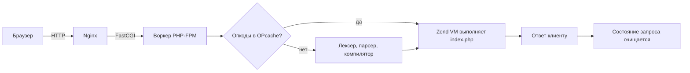
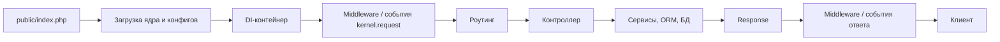

---
## Оглавление

1. [[#1. Что такое PHP и как исполняется код]]
2. [[#2. Типы данных, переменные и константы]]
3. [[#3. Операторы, сравнение и приведение типов]]
4. [[#4. Строки]]
5. [[#5. Массивы]]
6. [[#6. Функции, замыкания и генераторы]]
7. [[#7. Строгая типизация и современная система типов]]
8. [[#8. ООП основы]]
9. [[#9. ООП продвинутые возможности]]
10. [[#10. Пространства имён, автозагрузка, Composer и PSR]]
11. [[#11. Ошибки и исключения]]
12. [[#12. Память: ссылки, copy-on-write, сборщик мусора]]
13. [[#13. HTTP, суперглобальные массивы, сессии и cookies]]
14. [[#14. HTTP, REST и API]]
15. [[#15. Файлы, потоки, include и require]]
16. [[#16. Базы данных: PDO и транзакции]]
17. [[#17. SQL и индексы для PHP-разработчика]]
18. [[#18. Безопасность]]
19. [[#19. Дата и время, регулярные выражения, JSON]]
20. [[#20. Паттерны проектирования, SOLID и DI]]
21. [[#21. SPL, итераторы и асинхронность]]
22. [[#22. Производительность и PHP-FPM]]
23. [[#23. Кэширование, Redis и очереди]]
24. [[#24. Тестирование и качество кода]]
25. [[#25. Эволюция PHP: что нового в 7.x и 8.x]]
26. [[#26. Фреймворки: Laravel и Symfony]]
27. [[#27. Инструменты: Git, Docker, Xdebug, CI/CD]]
28. [[#28. PHP в Drupal и Moodle]]
29. [[#29. Типовые задачи с кодом]]
30. [[#30. Задачи на вывод: что выведет код]]
31. [[#31. Сценарные вопросы]]
32. [[#32. Как отвечать, если опыта мало, и что спросить у интервьюера]]
33. [[#33. Шпаргалка перед собеседованием]]

---

## 1. Что такое PHP и как исполняется код

> [!abstract] Коротко 
> PHP компилируется в опкоды (Zend Engine), OPcache их кэширует, каждый запрос живёт отдельно (shared nothing). Знать: SAPI, FPM, OPcache, жизненный цикл запроса.

### Теория

- **Что такое PHP**: интерпретируемый язык общего назначения с динамической, слабой (по умолчанию) типизацией. Основная ниша — серверная веб-разработка, но PHP также используется в CLI-скриптах, воркерах очередей и демонах.
- **Zend Engine**: ядро языка. Исходный код → **лексер** (токены) → **парсер** (AST) → **компилятор** (опкоды) → **виртуальная машина Zend** исполняет опкоды.
- **OPcache**: расширение, которое хранит скомпилированные опкоды в разделяемой памяти. Без него PHP парсил бы и компилировал каждый файл на каждый запрос.
- **SAPI (Server API)**: интерфейс между PHP и внешним миром. Основные: **CLI** (консоль), **FPM** (FastCGI Process Manager для Nginx/Apache), **mod_php** (модуль Apache, устарел как подход), **embed**.
- **Модель «shared nothing»**: каждый HTTP-запрос стартует с чистого состояния, в конце всё уничтожается.
    - **Не сохраняется между запросами**: переменные, объекты, статические свойства, соединения с БД.
    - **Переживает запросы**: OPcache, APCu, persistent-соединения, внешние хранилища (БД, Redis, файлы).
    - **Плюс**: просто масштабировать горизонтально. **Минус**: бутстрап приложения (роутинг, контейнер, конфиги) выполняется заново на каждый запрос.
- **Долгоживущие рантаймы**: Swoole, RoadRunner, FrankenPHP (worker mode) держат приложение в памяти между запросами. Там появляются риски утечек памяти и «протекания» состояния между запросами.
- **Жизненный цикл запроса (FPM)**: Nginx принимает запрос → передаёт по FastCGI в пул FPM → воркер выполняет `index.php` → результат возвращается клиенту → состояние скрипта очищается, воркер ждёт следующий запрос.
- **Файл `php.ini`**: глобальная конфигурация (`memory_limit`, `max_execution_time`, `error_reporting`, `display_errors`, `upload_max_filesize`, `opcache.*`). Проверка: `php --ini`, `php -i`, `phpinfo()`, `php -m` (модули).

### Схема обработки запроса (Nginx + PHP-FPM)



### Код и команды

```bash
php -v                     # версия
php -m                     # установленные расширения
php --ini                  # какие php.ini загружены
php -S localhost:8000      # встроенный dev-сервер (только для разработки)
php -r 'echo PHP_VERSION;' # выполнить код из командной строки
php -l file.php            # проверка синтаксиса (lint)
```

### Вопросы и ответы

> [!question] Как PHP исполняет код и почему он «медленный на старте, но быстрый после прогрева»?
> 
> **Коротко**: PHP компилируется в опкоды и исполняется виртуальной машиной; OPcache убирает повторную компиляцию.
> 
> |Сценарий|Что происходит на каждый запрос|
> |---|---|
> |Без OPcache|исходник → лексер (токены) → парсер (AST) → компилятор (опкоды) → VM|
> |С OPcache|опкоды берутся из разделяемой памяти воркеров FPM, первые три шага пропускаются|
> 
> **Прод-настройка**: OPcache обязателен; `opcache.validate_timestamps=0` (с перезапуском FPM при деплое) даёт максимальный выигрыш.
> 
> **Подвох на собеседовании**: не говорите «PHP интерпретируется построчно». Это устаревшее представление. Корректно: PHP компилируется в опкоды и исполняется виртуальной машиной; OPcache убирает повторную компиляцию.

---

> [!question] Что означает «shared nothing» и какие у этого последствия?
> 
> **Коротко**: каждый запрос получает чистое окружение: глобальные переменные, объекты и статические свойства создаются заново.
> 
> |Плюсы|Минусы|
> |---|---|
> |нет утечек состояния между пользователями|контейнер, роутинг, конфиги поднимаются заново|
> |легко масштабировать горизонтально|общее состояние надо выносить во внешние хранилища (БД, Redis, Memcached, APCu, файлы)|
> |падение одного запроса не ломает другие||
> 
> **В долгоживущих рантаймах** (Swoole, RoadRunner) модель другая: статические свойства и синглтоны **живут между запросами**, поэтому не храните данные пользователя в статике.
> 
> В долгоживущих рантаймах (Swoole, RoadRunner) модель другая: статические свойства и синглтоны **живут между запросами**, и это нужно учитывать (не хранить данные пользователя в статике).

---

> [!question] Чем отличаются mod_php, CGI и PHP-FPM?
> 
> - **mod_php**: PHP встроен в процесс Apache. Просто, но каждый процесс Apache тянет PHP, даже когда отдаёт статику; плохо масштабируется и привязан к prefork-MPM.
> - **CGI**: новый процесс PHP на каждый запрос — очень медленно.
> - **PHP-FPM**: отдельный менеджер пула воркеров; веб-сервер (Nginx/Apache) общается с ним по FastCGI. Гибкая настройка пулов (`pm = static/dynamic/ondemand`), изоляция пользователей, graceful reload. Де-факто стандарт.

---

## 2. Типы данных, переменные и константы

> [!abstract] Коротко Типы и их приведение к `bool`, разница `isset`/`empty`/`array_key_exists`, константы, область видимости, точность `float`.

### Теория

- **Скалярные типы**: `int`, `float`, `string`, `bool`.
- **Составные**: `array`, `object`, `callable`, `iterable`.
- **Специальные**: `null`, `resource` (ресурс: файл, соединение; в PHP 8 многие ресурсы заменены объектами).
- **Размер `int`**: 64 бита на 64-битных платформах, `PHP_INT_MAX = 9223372036854775807`. При переполнении значение становится `float`.
- **Точность `float`**: IEEE 754, поэтому `0.1 + 0.2 != 0.3`. Для денег — хранить в целых копейках, использовать `bcmath` или `gmp`, либо библиотеки вроде `moneyphp/money`.
- **Переменные**: начинаются с `$`, регистрозависимы, типизируются динамически. Переменные-переменные (`$$name`) существуют, но использовать их не рекомендуется.
- **Константы**:
    - `define('NAME', value)` — на этапе выполнения, можно в условиях.
    - `const NAME = value;` — на этапе компиляции, на верхнем уровне и в классах.
    - Константы класса: `const X = 1;` (с PHP 8.3 можно типизировать: `const string X = 'a';`).
    - Магические константы: `__LINE__`, `__FILE__`, `__DIR__`, `__FUNCTION__`, `__CLASS__`, `__METHOD__`, `__NAMESPACE__`, `__TRAIT__`.
- **Область видимости**: переменные внутри функции локальные. Доступ к глобальным: `global $x;` или `$GLOBALS['x']` (оба подхода — плохая практика). `static` внутри функции сохраняет значение между вызовами.
- **Falsy-значения** (при приведении к `bool` дают `false`): `false`, `0`, `0.0`, `-0.0`, `""`, `"0"`, `[]`, `null`. Всё остальное `true`, включая `"0.0"`, `" "`, `"false"` и пустой объект.
- **Проверки**:
    - `isset($x)` — переменная существует и **не** `null`.
    - `empty($x)` — не существует или falsy.
    - `is_null($x)` — строго `null` (на несуществующей переменной даст предупреждение).
    - `array_key_exists('k', $arr)` — ключ есть, **даже если значение `null`** (в отличие от `isset`).

### Код

```php
<?php
declare(strict_types=1);

const APP_NAME = 'Demo';
define('DEBUG', true);

function counter(): int
{
    static $n = 0;   // сохраняется между вызовами
    return ++$n;
}

counter(); counter();
echo counter();      // 3

var_dump(0.1 + 0.2 == 0.3);                 // false
var_dump(abs((0.1 + 0.2) - 0.3) < PHP_FLOAT_EPSILON); // true
var_dump(PHP_INT_MAX + 1);                  // float(9.2233720368547758E+18)

$a = ['k' => null];
var_dump(isset($a['k']));                   // false
var_dump(array_key_exists('k', $a));        // true
```

### Вопросы и ответы

> [!question] В чём разница между `isset`, `empty` и `is_null`?
> 
> - `isset($x)`: `true`, если переменная определена и значение не `null`. Не бросает предупреждений на несуществующих переменных. Принимает несколько аргументов (все должны быть заданы).
> - `empty($x)`: эквивалент `!isset($x) || !$x`. Значения `0`, `"0"`, `""`, `[]`, `false`, `null` считаются пустыми.
> - `is_null($x)`: только проверка на `null`; на неопределённой переменной вызовет Warning.
> 
> **Подвох на собеседовании**: `empty("0")` возвращает `true`. Если пользователь введёт в поле «0», проверка `empty($_POST['qty'])` ошибочно решит, что поле пустое. Для строк надёжнее `$value === ''` или `strlen($value) === 0`.

---

> [!question] Чем `define()` отличается от `const`?
> 
> **Коротко**: `const` разрешается на этапе компиляции, `define()` выполняется в рантайме.
> 
> ||`const`|`define()`|
> |---|---|---|
> |Когда вычисляется|компиляция|выполнение|
> |Внутри `if`|нельзя|можно|
> |Имя динамически|нельзя|можно|
> |В классе и namespace|можно, учитывает namespace|нет, это обычный вызов функции|
> |Значение|константное выражение|любое выражение|
> 
> В современном коде предпочтителен `const`.

---

> [!question] Почему `0.1 + 0.2 !== 0.3` и как работать с деньгами?
> 
> **Причина**: `float` хранится в двоичном виде, десятичные дроби вроде 0.1 не имеют точного представления.
> 
> **Как работать с деньгами**:
> 
> - хранить в **минимальных единицах** (копейки, центы) как `int`;
> - считать через `bcmath` (`bcadd`, `bcmul`) или `gmp`;
> - использовать библиотеки `brick/money`, `moneyphp/money`;
> - float сравнивать с допуском (epsilon), а не через `==`.

---

## 3. Операторы, сравнение и приведение типов

> [!abstract] Коротко Главное правило: `===` вместо `==`. Помнить таблицу сравнений PHP 8, `??`, `?:`, `<=>`, приоритет операторов.

### Теория

- **`==` (нестрогое)** сравнивает значения после приведения типов; **`===` (строгое)** сравнивает и тип, и значение. В коде по умолчанию использовать `===`.
- **Изменения в PHP 8** для сравнения числа и строки: если строка не является числовой, то **число приводится к строке** и сравниваются строки. Поэтому `0 == "abc"` теперь `false` (в PHP 7 было `true`).
- **Оператор космического корабля** `<=>` возвращает `-1`, `0` или `1`. Удобен в `usort`.
- **Null coalescing** `??`: левый операнд, если он существует и не `null`, иначе правый. `??=` — присваивание по условию.
- **Тернарный** `?:` («элвис») — левый операнд, если он truthy. С PHP 8 вложенные тернарные без скобок запрещены.
- **Null-safe** `?->`: если слева `null`, вся цепочка вернёт `null`, а не выбросит ошибку.
- **`match`** (PHP 8.0): выражение, использует **строгое** сравнение, не требует `break`, при отсутствии совпадения бросает `UnhandledMatchError`.
- **Spread** `...`: распаковка массивов и `Traversable` (со строковыми ключами с PHP 8.1) и аргументов функций.
- **Приоритеты**: `&&` и `||` выше, чем `and` и `or`; `and`/`or` ниже присваивания. Поэтому `$x = true and false;` присвоит `true`.
- **Деление и остаток**: `/` возвращает `int` или `float`; `intdiv(7, 2)` — целочисленное деление (3); `%` — остаток, знак берётся от **делимого** (`-7 % 3 === -1`); `**` — возведение в степень.
- **Инкремент строк**: `$s = 'a'; $s++;` даёт `'b'`; `'z'++` даёт `'aa'`.

### Таблица популярных сравнений (PHP 8)

|Выражение|Результат|
|---|---|
|`0 == "abc"`|`false`|
|`"1" == "01"`|`true`|
|`"10" == "1e1"`|`true`|
|`100 == "1e2"`|`true`|
|`null == false`|`true`|
|`null == 0`|`true`|
|`[] == false`|`true`|
|`"abc" == 0`|`false`|
|`"0" == false`|`true`|
|`null === false`|`false`|
|`"abc" <=> "abd"`|`-1`|

### Код

```php
$user = null;
echo $user?->profile?->name ?? 'Гость';   // Гость

$config['debug'] ??= false;               // присвоит false, если ключа нет

$status = 200;
$text = match (true) {
    $status >= 500 => 'Server error',
    $status >= 400 => 'Client error',
    $status >= 200 => 'OK',
    default        => 'Unknown',
};

usort($users, fn($a, $b) => [$a['age'], $a['name']] <=> [$b['age'], $b['name']]);
```

### Вопросы и ответы

> [!question] Чем `==` отличается от `===` и какие «ловушки» у нестрогого сравнения?
> 
> **Коротко**: `==` приводит типы, `===` требует одинаковых типа и значения.
> 
> **Ловушки `==`**: `"0" == false`, `null == []`, `"1e3" == "1000"` (числовые строки сравниваются как числа).
> 
> > [!bug] Реальная уязвимость: «magic hashes» Хэши `"0e12345"` и `"0e67890"` оба интерпретируются как `0` и оказываются «равны».
> 
> **Правило**: общее сравнение через `===`, секреты и хэши через `hash_equals()`.
> 
> **Подвох на собеседовании**: спросят про `"abc" == 0`. Правильный ответ зависит от версии: в PHP 7 — `true`, в PHP 8 — `false`.

---

> [!question] Чем `match` лучше `switch`?
> 
> - `match` — **выражение** (возвращает значение), `switch` — оператор.
> - Использует **строгое** сравнение (`===`), `switch` — нестрогое (`==`).
> - Не нужен `break`, нет «провала» (fall-through).
> - Если ни одна ветка не подошла и нет `default` — бросает `UnhandledMatchError`, а не молча продолжает.
> - Несколько условий в ветке через запятую: `1, 2 => 'low'`.

---

> [!question] Что такое `??` и чем он отличается от `?:`?
> 
> ||`??`|`?:`|
> |---|---|---|
> |Что проверяет|существует и не `null` (как `isset`)|истинно ли левое значение|
> |Отсутствующий ключ|без notice|предупреждение|
> |`0`, `''`, `'0'`|остаются как есть|уходят в правую часть|
> 
> **Пример**: `$_GET['page'] ?? 1` безопасен; `$_GET['page'] ?: 1` при отсутствии ключа даёт предупреждение, а при `page=0` вернёт `1`.

---

## 4. Строки

> [!abstract] Коротко Строки в PHP — байты. Для символов `mb_*`. Знать heredoc/nowdoc, форматирование, основные функции поиска и замены.

### Теория

- **Кавычки**: в одинарных нет интерполяции и почти нет escape-последовательностей (`\'` и `\\`); в двойных работает интерполяция `"Hello $name"`, `"{$user['name']}"`, escape `\n \t \"`.
- **Heredoc** `<<<EOT` — как двойные кавычки; **Nowdoc** `<<<'EOT'` — как одинарные. С PHP 7.3 закрывающий маркер можно отступать.
- **Строки — последовательности байтов.** `strlen('привет')` вернёт 12 (UTF-8, 2 байта на символ). Для Unicode использовать `mb_*`: `mb_strlen`, `mb_substr`, `mb_strtoupper`, `mb_str_split`. Кодировку задавать явно: `mb_internal_encoding('UTF-8')`.
- **Поиск**: `strpos` возвращает позицию или `false` (позиция `0` — валидный результат, поэтому проверять `=== false`). С PHP 8.0 есть `str_contains`, `str_starts_with`, `str_ends_with`.
- **Форматирование**: `sprintf`, `printf`, `number_format`, `vsprintf`.
- **Часто используемые**: `trim/ltrim/rtrim`, `explode/implode`, `str_replace`, `substr`, `str_pad`, `ucfirst`, `ucwords`, `wordwrap`, `nl2br`, `strcmp`, `similar_text`, `levenshtein`, `str_word_count`, `strrev`, `strtr`, `substr_count`.
- **Экранирование**: `htmlspecialchars` (для HTML), `addslashes` (почти не нужен), `escapeshellarg`, `urlencode`/`rawurlencode`, `http_build_query`.
- **Конкатенация**: оператор `.`; в циклах для больших объёмов эффективнее копить в массив и делать `implode`.
- **Строка как массив символов**: `$s[0]`, `$s[-1]` (отрицательные индексы с PHP 7.1).
- **Сравнение строк**: безопасное для времени — `hash_equals`; «естественная» сортировка — `strnatcmp`, `natsort`.

### Код

```php
$name = 'Анна';
echo strlen($name);          // 8 (байты)
echo mb_strlen($name);       // 4 (символы)

if (strpos('abc', 'a') === false) { /* не найдено */ }  // 0 !== false
var_dump(str_contains('Hello', 'ell'));                  // true

printf("%05.1f|%-6s|%'*8d\n", 3.14159, 'ab', 42);

$text = <<<TXT
  Привет, {$name}!
  Сегодня {$_SERVER['REQUEST_METHOD']}
  TXT;
```

### Вопросы и ответы

> [!question] Почему `strlen('привет')` не равно 6 и как правильно работать с UTF-8?
> 
> **Коротко**: функции без `mb_` считают **байты**, а не символы.
> 
> - В UTF-8 кириллица занимает 2 байта на символ, поэтому `strlen` вернёт 12 для шести букв.
> - `strtoupper('привет')` кириллицу не изменит (зависит от локали), `mb_strtoupper` изменит.
> - Для регулярок по Unicode нужен модификатор `/u`.
> - Для символов используйте расширение `mbstring`.
> 
> **Подвох на собеседовании**: `substr` на многобайтной строке может разрезать символ пополам и вернуть «битую» строку.

---

> [!question] Как проверить, что строка содержит подстроку, и в чём ловушка со `strpos`?
> 
> Современный вариант: `str_contains($haystack, $needle)`. Для PHP < 8: `strpos($h, $n) !== false`. Ловушка: `strpos` возвращает `0`, если подстрока в начале, а `0 == false` — `true`; поэтому `if (strpos(...))` даёт ошибку. Всегда `=== false` / `!== false`.

---

## 5. Массивы

> [!abstract] Коротко 
> Массив — упорядоченная хэш-таблица. Знать функции `array_*`, сортировки, ловушки (`array_merge` против `+`, `array_filter` и ключи).

### Теория

- **Массив в PHP — упорядоченная хеш-таблица** (ordered map). Один и тот же тип работает как список, словарь, стек, очередь, множество.
- **Ключи**: только `int` или `string`. Приведения ключей:
    - строка `"5"` → `int 5`; `"05"` и `"5.0"` остаются строками;
    - `float` усекается до `int` (с 8.1 — deprecated при потере дробной части);
    - `bool` → `0/1`, `null` → `""`.
- **Порядок элементов** сохраняется по порядку вставки.
- **Copy-on-write**: при присваивании `$b = $a` данные не копируются физически до первой записи в один из массивов.
- **Деструктуризация**: `[$a, $b] = [1, 2];`, `['id' => $id] = $row;`, вложенная и в `foreach`.
- **Оператор `+`** объединяет массивы, **сохраняя левые ключи** (правые значения с существующими ключами игнорируются). `array_merge` перенумеровывает числовые ключи и перезаписывает строковые. `array_replace` перезаписывает по ключам.
- **Сортировка**: `sort/rsort` (значения, ключи сбрасываются), `asort/arsort` (значения, ключи сохраняются), `ksort/krsort` (по ключам), `usort/uasort/uksort` (своя функция). С PHP 8.0 сортировка **стабильна**.
- **Поиск**: `in_array($v, $arr, true)` (строгий режим обязателен), `array_search`, `array_key_exists`, `array_key_first`, `array_key_last`, `array_is_list` (8.1).
- **Функциональные**: `array_map` (применить к каждому), `array_filter` (отфильтровать; **ключи сохраняются**, для перенумерации — `array_values`), `array_reduce`, `array_walk` (по ссылке), `array_sum`, `array_product`.
- **Манипуляции**: `array_slice` (не меняет оригинал), `array_splice` (меняет), `array_push/pop/shift/unshift`, `array_unique`, `array_flip`, `array_combine`, `array_column`, `array_chunk`, `array_fill`, `array_pad`, `range`, `compact/extract`, `array_diff/array_intersect` (и варианты `_key`, `_assoc`).
- **Новые в 8.4/8.5**: `array_find`, `array_find_key`, `array_any`, `array_all` (8.4); `array_first`, `array_last` (8.5).
- **Сложность**: доступ по ключу и вставка — O(1) в среднем; `in_array` и `array_search` — O(n); `array_shift` — O(n) (перенумерация); `unset` в середине — O(1), но дыры в индексах остаются.

### Код

```php
$users = [
    ['id' => 1, 'name' => 'Анна', 'age' => 30],
    ['id' => 2, 'name' => 'Борис', 'age' => 25],
];

$names  = array_column($users, 'name', 'id');          // [1 => 'Анна', 2 => 'Борис']
$adults = array_filter($users, fn($u) => $u['age'] > 26);
$adults = array_values($adults);                       // перенумеровать
$total  = array_reduce($users, fn($c, $u) => $c + $u['age'], 0);

usort($users, fn($a, $b) => $b['age'] <=> $a['age']);  // по убыванию возраста

['id' => $id, 'name' => $name] = $users[0];

$a = [1, 2]; $b = [3, 4];
var_dump([...$a, ...$b]);                              // [1,2,3,4]

$map = ['a' => 1] + ['a' => 2, 'b' => 3];              // ['a'=>1,'b'=>3]
```

### Вопросы и ответы

> [!question] Чем отличаются `array_merge` и оператор `+`?
> 
> - `array_merge($a, $b)`: числовые ключи **перенумеровываются**, у строковых ключей побеждает **правый** массив.
> - `$a + $b`: ключи сохраняются, при совпадении ключей побеждает **левый** массив; добавляются только отсутствующие ключи.
> 
> Пример: `[1, 2] + [3, 4, 5]` → `[1, 2, 5]`, а `array_merge([1,2],[3,4,5])` → `[1,2,3,4,5]`.

---

> [!question] Как удалить дубликаты из массива, сохранив порядок?
> 
> - Сохраняет **первое вхождение** и порядок, но **сохраняет ключи** (при необходимости `array_values`).
> - Сравнение нестрогое (через приведение к строке): для объектов и вложенных массивов не подходит.
> - Быстрый вариант для скаляров: `array_keys(array_flip($arr))`, это O(n), так как поиск по ключу хэш-таблицы.

---

> [!question] Почему `in_array` с нестрогим сравнением опасен?
> 
> - PHP 7: `in_array('abc', [0])` давал `true` (из-за `'abc' == 0`). PHP 8 это исправил, но `in_array('1e1', ['10'])` всё ещё `true`.
> - **Всегда** передавайте третий аргумент `true`.
> - Поиск O(n). Если проверок много: `array_flip` и `isset($flipped[$v])` (O(1)).

---

## 6. Функции, замыкания и генераторы

> [!abstract] Коротко 
> Функции, замыкания (`use` против `fn`), передача по значению и ссылке, генераторы для больших данных.

### Теория

- **Передача аргументов**: по умолчанию **по значению**. Объекты передаются «по значению идентификатора» (копируется хэндл, оба указывают на один объект). Передача по ссылке: `function f(array &$a)`.
- **Значения по умолчанию**, **nullable** (`?int`), **variadic** (`...$args`), **именованные аргументы** (PHP 8.0): `f(limit: 10, offset: 0)`, пропуск необязательных параметров.
- **Анонимные функции (Closure)**: `function() use ($x) { ... }` — захват по значению (`use ($x)`) или по ссылке (`use (&$x)`).
- **Стрелочные функции** (7.4): `fn($x) => $x * $factor` — автоматически захватывают внешние переменные **по значению**, одно выражение.
- **Callable-форматы**: строка с именем функции, массив `[$obj, 'method']`, `'Class::method'`, `Closure`, объект с `__invoke`. **First-class callable** (8.1): `strlen(...)`, `$obj->method(...)`, `Foo::bar(...)`.
- **`static` в функции** — переменная сохраняется между вызовами; **`static fn`/`static function`** — замыкание без привязки `$this`.
- **Привязка**: `Closure::bind`, `bindTo`, `call`, `fromCallable`.
- **Рекурсия**: ограничена `memory_limit` и стеком; оптимизации хвостовой рекурсии нет.
- **Генераторы** (`yield`): функции, возвращающие `Generator` (итератор), вычисляют значения лениво и не держат всю коллекцию в памяти. Есть `yield $key => $value`, `yield from`, `send()`, `getReturn()`.
- **Возвращаемые значения**: `void`, `never` (функция не возвращается: `exit`/`throw`), `static`, `self`, `?Type`, `Type1|Type2`.

### Код

```php
function createCounter(): Closure
{
    $count = 0;
    return function () use (&$count): int {
        return ++$count;
    };
}
$c = createCounter();
$c(); $c();
echo $c();                     // 3

function sum(int ...$nums): int { return array_sum($nums); }
echo sum(...[1, 2, 3]);        // 6

function connect(string $host, int $port = 3306, bool $ssl = false) {}
connect('db', ssl: true);      // именованные аргументы

$lengths = array_map(strlen(...), ['a', 'bb', 'ccc']);

function readLines(string $file): Generator
{
    $h = fopen($file, 'r');
    try {
        while (($line = fgets($h)) !== false) {
            yield rtrim($line, "\r\n");
        }
    } finally {
        fclose($h);
    }
}
foreach (readLines('big.log') as $n => $line) { /* O(1) память */ }
```

### Вопросы и ответы

> [!question] Чем замыкание `function() use ($x)` отличается от стрелочной функции `fn`?
> 
> - `fn` — одно выражение, возвращает его значение, **автоматически захватывает** переменные из внешней области **по значению** (на момент создания).
> - `function` — полноценное тело, явные `use`, возможен захват **по ссылке** (`&$x`), несколько операторов.
> - Изменение внешней переменной внутри `fn` на внешнюю область **не влияет**.
> 
> **Подвох на собеседовании**: стрелочная функция не может изменять захваченную переменную снаружи. Если нужен счётчик — используйте обычное замыкание с `use (&$n)`.

---

> [!question] Как передаются аргументы в PHP: по значению или по ссылке, и что с объектами?
> 
> **Коротко**: по умолчанию по значению (copy-on-write, поэтому дёшево).
> 
> **Для объектов** копируется **идентификатор** (handle):
> 
> - изменения свойств внутри функции **видны снаружи**;
> - присваивание `$obj = new Other()` внутри функции внешнюю переменную **не изменит**;
> - чтобы подменить саму переменную, нужна ссылка `&$obj`.

---

> [!question] Зачем нужны генераторы?
> 
> **Зачем**: большие или бесконечные последовательности с постоянным расходом памяти.
> 
> - Типичные задачи: чтение файла построчно, выборка из БД порциями, конвейеры преобразований.
> - `yield from` делегирует другому итератору.
> - `send()` превращает генератор в простую корутину.
> - **Ограничение**: после начала итерации перемотать нельзя (повторный `foreach` даст исключение).

---

## 7. Строгая типизация и современная система типов

> [!abstract] Коротко 
> `declare(strict_types=1)`, nullable/union/intersection типы, `void`/`never`, enum. Типы — основа безопасного кода.

### Теория

- **`declare(strict_types=1);`** — первая инструкция файла. Включает строгую проверку типов **для вызовов, совершаемых из этого файла** (не для вызываемого). Исключение: `int` → `float` разрешено всегда.
- **Режим по умолчанию (coercive)**: `"5"` для параметра `int` будет молча приведён к `5`; нечисловая строка бросит `TypeError`.
- **Типы параметров, возвращаемых значений и свойств**: скаляры, `array`, `callable`, `iterable`, имена классов, `self`, `static` (только возврат), `object`, `mixed`.
- **Nullable**: `?string` ≡ `string|null`.
- **Union types** (8.0): `int|string`. **Intersection types** (8.1): `Countable&Traversable`. **DNF types** (8.2): `(A&B)|null`.
- **Особые типы**: `void` (ничего не возвращает), `never` (8.1; не возвращает управления), `null`, `false`, `true` (standalone, 8.2), `mixed` (любой тип, включая `null`).
- **Типизированные свойства** (7.4) — обязаны быть инициализированы до чтения, иначе `Error: must not be accessed before initialization`.
- **Ковариантность и контравариантность** (7.4): тип возврата можно сужать в наследниках (ковариантность), типы параметров — расширять (контравариантность). Это формализует принцип подстановки Лисков.
- **Enum** (8.1): перечисления как отдельный тип.
- **Атрибуты** (8.0): `#[Route('/')]` — машиночитаемые метаданные (замена аннотаций в докблоках).

### Код

```php
<?php
declare(strict_types=1);

function area(int|float $w, int|float $h): float
{
    return $w * $h;
}

// area("3", 4);   // TypeError в strict_types

enum Status: string
{
    case Draft     = 'draft';
    case Published = 'published';

    public function label(): string
    {
        return match ($this) {
            self::Draft     => 'Черновик',
            self::Published => 'Опубликовано',
        };
    }
}

$s = Status::from('draft');        // ValueError, если значения нет
$t = Status::tryFrom('xxx');       // null
Status::cases();                   // массив всех кейсов
```

### Вопросы и ответы

> [!question] Что делает `declare(strict_types=1)` и на что именно он влияет?
> 
> **Коротко**: включает строгую проверку скалярных типов в вызовах функций из **текущего файла** и для `return` внутри него.
> 
> - Решает **вызывающая** сторона: файл A со `strict_types` вызывает функцию из B без него, проверка строгая.
> - Работает и для встроенных функций: `strlen(123)` бросит `TypeError`.
> - Единственное разрешённое приведение: `int` в `float`.
> 
> **Подвох на собеседовании**: `strict_types` не включает «строгость» для операций вроде `"5" + 3` — арифметика остаётся по-прежнему гибкой; режим касается только типов параметров и возвращаемых значений.

---

> [!question] Чем `never` отличается от `void`?
> 
> `void` — функция **завершается**, но ничего не возвращает. `never` — функция **не завершается нормально**: всегда бросает исключение или вызывает `exit`. Так статические анализаторы понимают, что код после вызова недостижим.

---

> [!question] Чем enum лучше набора констант?
> 
> **Коротко**: enum — самостоятельный тип, параметр `Status $s` нельзя нарушить произвольной строкой.
> 
> - Могут быть методы, интерфейсы, константы.
> - **Backed enum** имеет скалярное значение: `from()`, `tryFrom()`.
> - Нельзя: `new`, наследование, изменяемое состояние.
> - Хорошо работает в `match`.

---

## 8. ООП основы

> [!abstract] Коротко 
> Четыре столпа ООП, видимость, интерфейсы, абстрактные классы, трейты, `static`, константы класса.

### Теория

- **Класс** — шаблон; **объект** — его экземпляр (`new`). Объекты передаются по идентификатору (handle).
- **Модификаторы видимости**: `public` (везде), `protected` (класс и наследники), `private` (только этот класс). Для свойств и методов; константы также поддерживают видимость.
- **Конструктор** `__construct`; с PHP 8.0 доступно **продвижение свойств** (constructor promotion): `public function __construct(private string $name) {}`.
- **`readonly`** (8.1) — свойство инициализируется один раз (из области класса) и далее неизменяемо; (8.2) — `readonly class`.
- **Статика**: `static` свойства и методы принадлежат классу; доступ `self::`, `static::`, `ClassName::`. Нет доступа к `$this` в статическом методе.
- **Наследование**: `extends` (одно родительское), `parent::method()`, `final` запрещает переопределение/наследование.
- **Абстрактные классы** (`abstract`): нельзя инстанцировать, могут содержать абстрактные методы и реализацию, состояние.
- **Интерфейсы** (`interface`): контракт без состояния; класс реализует несколько (`implements A, B`); интерфейсы могут наследоваться друг от друга и иметь константы.
- **Трейты** (`trait`): горизонтальное повторное использование кода («подмешивание»).
    - Конфликты имён решаются через `insteadof` и `as`.
    - Могут содержать абстрактные и статические методы, свойства.
    - Статические свойства трейта **у каждого использующего класса свои**.
- **Константы класса**: `const`, с PHP 8.1 — `final const`; с 8.3 — типизированные.
- **Сравнение объектов**: `==` — одинаковый класс и равные свойства; `===` — один и тот же экземпляр.
- **Клонирование**: `clone $obj` — **поверхностная копия**; вложенные объекты остаются общими, для глубокой копии реализуется `__clone()`.
- **`instanceof`**, `get_class`, `static::class`, `$obj::class`.
- **Динамические свойства**: создание свойства, не объявленного в классе, в PHP 8.2 — deprecated (в 9.0 станет ошибкой). Разрешить: `#[\AllowDynamicProperties]`.

### Код

```php
<?php
declare(strict_types=1);

interface Shape
{
    public function area(): float;
}

abstract class BaseShape implements Shape
{
    public function __construct(protected readonly string $name) {}

    public function describe(): string
    {
        return sprintf('%s: %.2f', $this->name, $this->area());
    }
}

final class Circle extends BaseShape
{
    public function __construct(private float $r)
    {
        parent::__construct('Circle');
    }

    public function area(): float
    {
        return M_PI * $this->r ** 2;
    }
}

trait Loggable
{
    public function log(string $msg): void
    {
        echo '[' . static::class . '] ' . $msg . PHP_EOL;
    }
}
```

### Вопросы и ответы

> [!question] Чем абстрактный класс отличается от интерфейса и когда что использовать?
> 
> - **Интерфейс** описывает контракт (набор методов), не хранит состояние, класс может реализовывать много интерфейсов. Нужен, когда важно «что умеет» (зависимости, DI, тестирование через подмену).
> - **Абстрактный класс** задаёт общую реализацию и состояние для семейства классов; наследовать можно только один.
> - **Трейт** — переиспользование кода без наследования, но не создаёт тип (нельзя `instanceof Trait`).
> 
> Практика: зависимости объявлять через интерфейсы; абстрактный класс — когда есть общая база; трейты — для небольших повторяющихся кусков (логирование, timestamps), без бизнес-логики.

---

> [!question] Чем `self` отличается от `static`?
> 
> ||`self`|`static`|
> |---|---|---|
> |Ссылается на|класс, **в котором написан код**|класс, **от имени которого вызван метод**|
> |Разрешается|при компиляции|в рантайме (late static binding)|
> |`new …`|всегда создаст базовый класс|создаст класс, на котором вызвали|
> 
> Для фабричных методов в иерархии нужен `new static()`.

---

> [!question] Что такое `readonly` и чем он отличается от константы?
> 
> ||`readonly`-свойство|Константа класса|
> |---|---|---|
> |Принадлежит|каждому экземпляру|классу (общая для всех)|
> |Значение|задаётся один раз, обычно в конструкторе|известно на этапе компиляции|
> 
> > [!warning] Нюанс `readonly` защищает от **переприсваивания**, но не от изменения вложенного изменяемого объекта: `$this->items[] = 1` для массива запрещено, а `$this->obj->x = 1` разрешено.

---

> [!question] Что такое «конфликт трейтов» и как его решить?
> 
> Если два трейта определяют метод с одним именем, PHP выбросит фатальную ошибку. Решение:
> 
> php
> 
> ```php
> class A {
>     use T1, T2 {
>         T1::hello insteadof T2;   // использовать T1::hello
>         T2::hello as helloFromT2; // и дать T2::hello другое имя
>     }
> }
> ```

---

## 9. ООП продвинутые возможности

> [!abstract] Коротко 
> Магические методы, позднее статическое связывание, клонирование, `readonly`, атрибуты и рефлексия.

### Теория

- **Магические методы**:
    - `__construct`, `__destruct` (вызывается при уничтожении объекта или в конце скрипта; порядок нестабилен);
    - `__get`, `__set`, `__isset`, `__unset` — доступ к недоступным/несуществующим свойствам;
    - `__call`, `__callStatic` — вызов несуществующего метода;
    - `__toString` — приведение к строке (класс автоматически реализует `Stringable`);
    - `__invoke` — объект как функция;
    - `__clone`; `__serialize`/`__unserialize` (предпочтительнее `__sleep`/`__wakeup`); `__set_state`; `__debugInfo`.
- **Late Static Binding** — `static::` ссылается на вызываемый класс, а не на тот, где написан код.
- **Fluent interface** — методы возвращают `$this` (или `static`) для цепочки вызовов.
- **Иммутабельные объекты и value object** — «изменяющие» методы возвращают новый экземпляр (`withX()`).
- **Свойства-хуки и асимметричная видимость (PHP 8.4)**:
    - `public private(set) string $name;` — читать можно всем, писать только изнутри;
    - `public string $full { get => $this->first . ' ' . $this->last; }` — вычисляемые свойства.
- **Новое в 8.4**: `new Foo()->method()` без обёртки в скобки; ленивые объекты (lazy objects) через рефлексию.
- **Рефлексия** (`ReflectionClass`, `ReflectionMethod`, `ReflectionProperty`, `ReflectionNamedType`) — основа DI-контейнеров, ORM, сериализаторов, атрибутов.
- **Атрибуты** читаются через `getAttributes()`.
- **Анонимные классы**: `new class(...) implements I { ... }` — для заглушек и разовых объектов.
- **Принцип LSP на уровне языка**: подтип должен принимать не более узкие аргументы и возвращать не более широкие значения.

### Код

```php
final class Money
{
    public function __construct(
        public readonly int $amount,        // в копейках
        public readonly string $currency,
    ) {}

    public function add(Money $other): static
    {
        if ($other->currency !== $this->currency) {
            throw new InvalidArgumentException('Currency mismatch');
        }
        return new static($this->amount + $other->amount, $this->currency);
    }

    public function withAmount(int $amount): static
    {
        return new static($amount, $this->currency);
    }
}

class Collection implements ArrayAccess, Countable, IteratorAggregate
{
    public function __construct(private array $items = []) {}
    public function offsetExists(mixed $o): bool { return isset($this->items[$o]); }
    public function offsetGet(mixed $o): mixed { return $this->items[$o] ?? null; }
    public function offsetSet(mixed $o, mixed $v): void { $o === null ? $this->items[] = $v : $this->items[$o] = $v; }
    public function offsetUnset(mixed $o): void { unset($this->items[$o]); }
    public function count(): int { return count($this->items); }
    public function getIterator(): Iterator { return new ArrayIterator($this->items); }
}

class Proxy
{
    public function __call(string $name, array $args): mixed
    {
        echo "Вызван $name\n";
        return null;
    }
}
```

### Вопросы и ответы

> [!question] Когда вызываются `__get` и `__set`, и почему их не стоит злоупотреблять?
> 
> **Когда срабатывают**: только если свойство **недоступно** (не объявлено или `private`/`protected` вне класса).
> 
> **Минусы**: скрывают реальный интерфейс класса, ломают автодополнение и статический анализ, медленнее прямого доступа, усложняют отладку.
> 
> **Уместно**: прокси, ленивые загрузчики, ORM-сущности. В прикладной логике лучше явные геттеры/сеттеры или публичные `readonly`-свойства.

---

> [!question] Как объекты копируются и в чём разница между присваиванием и `clone`?
> 
> `$b = $a` копирует **идентификатор**: обе переменные указывают на один объект. `clone` создаёт новый объект и копирует значения свойств **поверхностно**: вложенные объекты остаются общими. Для глубокой копии в `__clone()` клонируйте вложенные объекты вручную.
> 
> **Подвох на собеседовании**: у `readonly`-свойств до PHP 8.3 внутри `__clone` нельзя присвоить новое значение; с 8.3 это разрешено именно внутри `__clone`.

---

> [!question] Что такое Late Static Binding?
> 
> Это механизм, при котором `static::` разрешается в момент вызова в класс, **через который** был вызван метод, а не в класс, где метод объявлен. Пример: `Parent::create()` с `return new static()`, вызванный как `Child::create()`, вернёт `Child`. `self::` всегда вернул бы `Parent`.

---

> [!question] Что такое асимметричная видимость и property hooks (PHP 8.4)?
> 
> - **Асимметричная видимость**: `public private(set) int $id;` — читают все, меняет только сам класс (удобная альтернатива геттер+приватное поле).
> - **Property hooks**: код `get`/`set` прямо в объявлении свойства, позволяет делать вычисляемые и валидируемые свойства без отдельных методов. Hooks работают в интерфейсах и абстрактных классах.
> 
> Версию уточняйте на собеседовании: на проектах с PHP 8.1–8.3 эти возможности недоступны.

---

## 10. Пространства имён, автозагрузка, Composer и PSR

> [!abstract] Коротко 
> Namespaces, автозагрузка PSR-4, Composer (`install` против `update`, lock-файл), стандарты PSR.

### Теория

- **Namespace** — логическая группировка классов, функций, констант; предотвращает конфликты имён. Объявляется в начале файла: `namespace App\Service;`.
- **`use`**: импорт имени; `use App\Foo as Bar;`; групповой `use App\{A, B};`; `use function` и `use const`.
- **Полное имя** (FQN): `\App\Service\Mailer`. Ведущий `\` — абсолютный путь от корня.
- **Автозагрузка**: `spl_autoload_register()` вызывает загрузчик, когда класс не найден. Вручную почти не пишут — делает Composer.
- **PSR-4**: стандарт отображения namespace на каталоги: префикс `App\` → `src/`, класс `App\Service\Mailer` → файл `src/Service/Mailer.php`. Одно имя класса на файл.
- **Composer** — менеджер зависимостей:
    - `composer.json` — объявленные зависимости и автозагрузка;
    - `composer.lock` — зафиксированные версии (для воспроизводимых сборок, в VCS коммитится для приложений);
    - `composer install` — ставит **по lock**; `composer update` — обновляет в рамках ограничений и перезаписывает lock;
    - `composer require vendor/pkg`, `composer require --dev`, `composer remove`, `composer dump-autoload -o` (оптимизация), `composer audit` (известные уязвимости), `composer outdated`.
- **Версионные ограничения (SemVer)**: `^1.2.3` = `>=1.2.3 <2.0.0`; `~1.2.3` = `>=1.2.3 <1.3.0`; `1.*`; `dev-main`.
- **Секции автозагрузки**: `psr-4`, `classmap`, `files` (подключаются всегда), `exclude-from-classmap`.
- **Основные PSR**:
    - **PSR-1** и **PSR-12** (стиль кода; PSR-12 заменён PER Coding Style);
    - **PSR-3** — логгер; **PSR-4** — автозагрузка;
    - **PSR-7** — HTTP-сообщения; **PSR-15** — HTTP-middleware и обработчики; **PSR-17** — фабрики HTTP; **PSR-18** — HTTP-клиент;
    - **PSR-11** — контейнер (`get`, `has`); **PSR-14** — диспетчер событий; **PSR-16** — Simple Cache.

### Код

```json
{
  "name": "acme/app",
  "require": {
    "php": ">=8.2",
    "monolog/monolog": "^3.0"
  },
  "require-dev": {
    "phpunit/phpunit": "^11.0"
  },
  "autoload": {
    "psr-4": { "App\\": "src/" }
  },
  "autoload-dev": {
    "psr-4": { "App\\Tests\\": "tests/" }
  }
}
```

```php
<?php
declare(strict_types=1);

namespace App\Service;

use App\Repository\UserRepository;
use Psr\Log\LoggerInterface;
use function strlen;        // импорт глобальной функции
use const PHP_EOL;          // и константы

final class Mailer
{
    public function __construct(private LoggerInterface $logger) {}
}
```

### Вопросы и ответы

> [!question] Чем `composer install` отличается от `composer update`?
> 
> ||`composer install`|`composer update`|
> |---|---|---|
> |Откуда версии|точные версии из `composer.lock`|ограничения из `composer.json`|
> |Lock-файл|не меняет|**перезаписывает**|
> |Результат|воспроизводим у всех и на проде|новые версии в рамках ограничений|
> 
> На проде и в CI: `composer install --no-dev --optimize-autoloader`.
> 
> **Подвох на собеседовании**: `composer.lock` для приложения обязательно коммитится; для библиотеки — по ситуации (чаще игнорируется, чтобы проверять совместимость с разными версиями зависимостей).

---

> [!question] Как работает автозагрузка по PSR-4?
> 
> **Как работает**:
> 
> 1. Composer генерирует `vendor/autoload.php` и регистрирует загрузчик через `spl_autoload_register`.
>     
> 2. Встретился неизвестный класс: берётся самая длинная подходящая запись `psr-4`.
>     
> 3. Префикс namespace заменяется на каталог, `\` на `/`, добавляется `.php`.
>     
> 
> > [!warning] Регистр Имя файла должно совпадать с именем класса с учётом регистра (важно на Linux).

---

> [!question] Что означает `^1.2.3` и `~1.2.3`?
> 
> `^1.2.3` разрешает обновления, не ломающие совместимость по SemVer: `>=1.2.3 <2.0.0`. `~1.2.3` — более узкий: `>=1.2.3 <1.3.0`. Для `0.x` версий `^0.3` означает `>=0.3.0 <0.4.0` (минорная в нуле считается «мажорной»).

---

## 11. Ошибки и исключения

> [!abstract] Коротко `Throwable` = `Error` + `Exception`, `try/catch/finally`, пользовательские исключения, преобразование ошибок в исключения.

### Теория

- **Иерархия**: интерфейс `Throwable` → `Error` (внутренние ошибки движка: `TypeError`, `ValueError`, `ArgumentCountError`, `ArithmeticError`, `DivisionByZeroError`, `UnhandledMatchError`) и `Exception` (`RuntimeException`, `LogicException`, `InvalidArgumentException`, `DomainException`, `LengthException`, `OutOfBoundsException`, `JsonException` и т. д.).
- **Старые «ошибки» (notice/warning/deprecated)** — это не исключения; управляются `error_reporting` и обработчиком `set_error_handler`. Фатальные ошибки (E_ERROR) в PHP 7+ в большинстве случаев превращены в `Error`.
- **`try / catch / finally`**: `finally` выполняется всегда (даже при `return` в `try`); `return` в `finally` **переопределяет** результат `try`. Можно ловить несколько типов: `catch (A | B $e)`; переменную можно не указывать: `catch (Exception)` (8.0).
- **Цепочка исключений**: `new RuntimeException('msg', 0, $previous)`; `getPrevious()`.
- **Глобальные обработчики**: `set_error_handler`, `set_exception_handler`, `register_shutdown_function` (можно получить последнюю фатальную ошибку через `error_get_last`).
- **Конфигурация**:
    - Разработка: `display_errors=On`, `error_reporting=E_ALL`.
    - Продакшен: `display_errors=Off`, `log_errors=On`, `error_log=/path`.
- **Оператор `@`** подавляет сообщения об ошибках — анти-паттерн (скрывает проблемы, замедляет).
- **Свои исключения**: наследуйте от подходящего базового (`DomainException`, `RuntimeException`) и добавляйте контекст.
- **Выбор: исключение или возврат кода**: исключения — для **исключительных** ситуаций (нарушение контракта, недоступность ресурса), а не для обычной логики (например, «пользователь не найден» часто лучше `null`/Result).

### Код

```php
final class InsufficientFundsException extends DomainException
{
    public function __construct(public readonly int $needed, ?Throwable $prev = null)
    {
        parent::__construct("Не хватает $needed", 0, $prev);
    }
}

try {
    $result = intdiv(1, 0);
} catch (DivisionByZeroError $e) {
    error_log($e->getMessage());
} catch (TypeError | ValueError $e) {
    throw new RuntimeException('Некорректные данные', previous: $e);
} finally {
    // освобождение ресурсов
}

set_error_handler(function (int $no, string $str, string $file, int $line): bool {
    throw new ErrorException($str, 0, $no, $file, $line);   // warnings → исключения
});
```

### Вопросы и ответы

> [!question] В чём разница между `Error` и `Exception`?
> 
> ||`Error`|`Exception`|
> |---|---|---|
> |Что это|ошибки уровня движка: неверный тип, несуществующий метод, деление на ноль через `intdiv`/`%`|прикладные исключения|
> |О чём говорит|как правило, о баге программиста|об ожидаемых сбоях|
> 
> - Оба реализуют `Throwable`.
> - `catch (Exception $e)` **не поймает** `Error`.
> - `catch (Throwable $e)` оставляйте для верхнего уровня (глобальный обработчик), не «глушите» им бизнес-код.

---

> [!question] Что вернёт функция, если в `try` есть `return`, а в `finally` тоже?
> > 
> ```php
> function f() {
>     try { return 'try'; }
>     finally { return 'finally'; }
> }
> echo f(); // finally
> ```
> 
> `finally` выполняется перед выходом и его `return` перекрывает возврат из `try` (и также «проглатывает» неперехваченное исключение). Поэтому `return` внутри `finally` — плохая практика.

---

> [!question] Как превратить warnings и notices в исключения?
> 
> - Через `set_error_handler`, который бросает `ErrorException` (пример выше). Многие фреймворки делают это по умолчанию.
> - Плюс: единообразная обработка, предупреждения не пропускаются (например, `Warning: Undefined array key` в PHP 8).

---

## 12. Память: ссылки, copy-on-write, сборщик мусора

> [!abstract] Коротко 
> Копирование по значению (copy-on-write), объекты по handle, ссылки и их ловушки, подсчёт ссылок и GC.

### Теория

- **Подсчёт ссылок (refcount)**: каждое значение (zval) имеет счётчик; при нулевом значении память освобождается немедленно (поэтому деструктор вызывается сразу после последнего `unset`).
- **Циклические ссылки** (A → B → A) refcount не освобождает; их ловит **сборщик циклов** (`gc_collect_cycles()`, включён по умолчанию; срабатывает при накоплении возможных корней, обычно 10 000).
- **Copy-on-write**: присваивание массива или строки не копирует данные, пока одна из «копий» не будет изменена.
- **Ссылки (`&`)**: «псевдоним» переменной на то же значение. `$b = &$a;` делает обе переменные одним значением. Ссылки в массивах и `foreach` — источник неочевидных багов.
- **Ловушка foreach по ссылке**: после `foreach ($arr as &$v)` переменная `$v` остаётся ссылкой на **последний элемент** массива. Следующий `foreach ($arr as $v)` перезапишет последний элемент. Лечится `unset($v)` после цикла.
- **Объекты и ссылки**: объект — это handle; `&` нужен только для подмены самой переменной.
- **WeakReference / WeakMap** (7.4 / 8.0): ссылка, не удерживающая объект от удаления (кэши, привязка метаданных).
- **Контроль памяти**: `memory_limit`, `memory_get_usage()`, `memory_get_peak_usage()`, генераторы, обработка порциями, `unset` больших структур, отключение логов запросов (`DB logging`) в долгоживущих скриптах.

### Код

```php
$arr = [1, 2, 3];
foreach ($arr as &$v) { $v *= 2; }
// без unset($v):
foreach ($arr as $v) { }
print_r($arr);                  // [2, 4, 4]  ← баг: последний элемент перезаписан

$a = 1;
$b = &$a;
$b++;
echo $a;                        // 2

class Node { public ?Node $other = null; }
$x = new Node; $y = new Node;
$x->other = $y; $y->other = $x;   // цикл
unset($x, $y);                    // refcount не 0 → ждёт GC
gc_collect_cycles();
```

### Вопросы и ответы

> [!question] Как PHP управляет памятью и что такое циклические ссылки?
> 
> **Основной механизм**: подсчёт ссылок. При `unset` последней ссылки память освобождается сразу.
> 
> **Проблема циклов**: родитель ↔ дочерний ссылаются друг на друга, refcount не падает до нуля.
> 
> **Решение**: **cycle collector**, запускается периодически или вручную (`gc_collect_cycles()`).
> 
> - Короткие веб-запросы: редко важно.
> - Долгие воркеры: критично.

---

> [!question] Почему после `foreach` по ссылке массив «портится» и как избежать?
> 
> **Что происходит**: после цикла `$v` остаётся ссылкой на последний элемент. Следующий `foreach ($arr as $v)` на каждой итерации пишет в `$v`, то есть в последний элемент.
> 
> **Решения**:
> 
> - `unset($v)` после цикла;
> - не использовать ссылки: `array_map` или `foreach ($arr as $k => $v) { $arr[$k] = ...; }`.

---

## 13. HTTP, суперглобальные массивы, сессии и cookies

> [!abstract] Коротко 
> Суперглобальные массивы, жизненный цикл сессии, cookies и их флаги, заголовки и «headers already sent».

### Теория

- **Суперглобальные массивы**: `$_GET` (query string), `$_POST` (тело формы), `$_REQUEST` (GET+POST+COOKIE, **не использовать**), `$_COOKIE`, `$_SESSION`, `$_FILES`, `$_SERVER` (заголовки, метод, путь, IP), `$_ENV`, `$GLOBALS`.
- **Сырое тело запроса**: `file_get_contents('php://input')` — для JSON API (в `$_POST` JSON не попадает).
- **Заголовки**: `header('Location: /x', true, 302)` отправляются **до** любого вывода (иначе `headers already sent`; помогает буферизация `ob_start()`). После редиректа — `exit`.
- **Коды ответа**: `http_response_code(404)`. Основные: 200, 201, 204, 301, 302, 304, 400, 401, 403, 404, 405, 409, 422, 429, 500, 502, 503.
- **Cookies**: `setcookie($name, $value, ['expires'=>..., 'path'=>'/', 'secure'=>true, 'httponly'=>true, 'samesite'=>'Lax'])`.
- **Сессии**:
    1. `session_start()` — читает cookie `PHPSESSID`, загружает данные из хранилища (по умолчанию файлы; можно Redis/БД через `session.save_handler`).
    2. Данные лежат на сервере, на клиенте — только идентификатор.
    3. `session_regenerate_id(true)` — после логина (защита от **session fixation**).
    4. `session_destroy()` + очистка cookie — выход.
- **Настройки безопасности сессии**: `session.cookie_httponly=1`, `session.cookie_secure=1`, `session.cookie_samesite=Lax`, `session.use_strict_mode=1`, `session.use_only_cookies=1`.
- **Блокировка сессии**: файловые сессии блокируют файл на время запроса — параллельные запросы одного пользователя выстраиваются в очередь; лечится `session_write_close()` сразу после чтения данных.
- **Паттерн PRG (Post/Redirect/Get)**: после POST делать редирект, чтобы обновление страницы не отправляло форму повторно.
- **Идемпотентность**: GET, PUT, DELETE — идемпотентны; POST — нет. GET не должен менять состояние.
- **Валидация входных данных**: `filter_var($v, FILTER_VALIDATE_EMAIL)`, `FILTER_VALIDATE_INT` (с `options`), `filter_input`.

### Код

php

```php
<?php
declare(strict_types=1);

session_set_cookie_params([
    'lifetime' => 0,
    'path'     => '/',
    'secure'   => true,
    'httponly' => true,
    'samesite' => 'Lax',
]);
session_start();

if ($_SERVER['REQUEST_METHOD'] === 'POST') {
    $email = filter_var($_POST['email'] ?? '', FILTER_VALIDATE_EMAIL);
    if ($email === false) {
        http_response_code(422);
        exit('Некорректный email');
    }
    session_regenerate_id(true);
    $_SESSION['user_email'] = $email;
    header('Location: /profile', true, 303);
    exit;
}

// JSON API
$data = json_decode(file_get_contents('php://input'), true, 512, JSON_THROW_ON_ERROR);
header('Content-Type: application/json; charset=utf-8');
echo json_encode(['ok' => true], JSON_UNESCAPED_UNICODE);
```

### Вопросы и ответы

> [!question] Где хранятся данные сессии и как PHP связывает сессию с пользователем?
> 
> **Как работает**:
> 
> 1. Данные хранятся на **сервере** (файлы в `session.save_path`, чаще Redis/Memcached/БД).
>     
> 2. Клиенту выдаётся только идентификатор в cookie `PHPSESSID`.
>     
> 3. На каждый запрос `session_start()` читает cookie и подгружает массив в `$_SESSION`.
>     
> 
> > [!tip] Кластер Нужно общее хранилище сессий, иначе пользователь «разлогинится» при попадании на другой сервер.

---

> [!question] Что такое session fixation и как защититься?
> 
> **Суть атаки**: атакующий подсовывает жертве известный ему идентификатор сессии; после логина жертва «авторизует» этот идентификатор.
> 
> **Защита**:
> 
> - `session_regenerate_id(true)` сразу после аутентификации и смены привилегий;
> - `session.use_strict_mode=1` (сервер не принимает неинициализированные идентификаторы);
> - только cookie (`use_only_cookies`), флаги `HttpOnly`, `Secure`, `SameSite`.

---

> [!question] Почему возникает ошибка «Cannot modify header information — headers already sent»?
> 
> **Причина**: заголовки HTTP отправляются перед телом. Любой вывод (пробел или BOM перед `<?php`, `echo`, предупреждение) отправляет заголовки, после чего `header()` и `setcookie()` невозможны.
> 
> **Решения**:
> 
> - не выводить ничего до заголовков;
> - не ставить закрывающий `?>` в чисто PHP-файлах;
> - использовать буферизацию вывода (`ob_start`);
> - в фреймворках формировать объект Response.

---

## 14. HTTP, REST и API

> [!abstract] Коротко API на PHP: знать семантику методов и статус-кодов, идемпотентность, различие аутентификации и авторизации, CORS и базовые схемы токенов.

### Теория

#### Методы HTTP

|Метод|Назначение|Безопасный (не меняет данные)|Идемпотентный|
|---|---|---|---|
|`GET`|получить ресурс|да|да|
|`POST`|создать / выполнить действие|нет|**нет**|
|`PUT`|заменить ресурс целиком|нет|да|
|`PATCH`|частично изменить|нет|зависит от реализации|
|`DELETE`|удалить|нет|да|

> [!info] Идемпотентность Повторный вызов даёт то же состояние системы, что и один. Важно для безопасных повторов при сбоях сети. Для `POST` вводят **ключ идемпотентности** (заголовок `Idempotency-Key`).

#### Коды ответов

|Группа|Примеры|
|---|---|
|**2xx** успех|`200 OK`, `201 Created`, `204 No Content`|
|**3xx** перенаправление|`301` (навсегда), `302/307` (временно), `304 Not Modified`|
|**4xx** ошибка клиента|`400` (плохой запрос), `401` (не аутентифицирован), `403` (нет прав), `404`, `409` (конфликт), `422` (ошибка валидации), `429` (слишком много запросов)|
|**5xx** ошибка сервера|`500`, `502/504` (проблемы за прокси / таймаут), `503`|

#### REST: основные идеи

- **Ресурсы** определяются URL (`/orders/42`), действие определяется методом, а не глаголом в пути.
- **Stateless**: сервер не хранит состояние клиента между запросами, всё нужное приходит в запросе.
- **Представления**: чаще всего JSON, тип указывается в `Content-Type` и `Accept`.
- **Версионирование**: `/api/v1/...` или заголовок.
- **Пагинация**: `limit/offset` (просто, но медленно на больших смещениях) или **курсорная** (keyset).
- **Единый формат ошибок**: код, сообщение, поля валидации (например, RFC 7807 `application/problem+json`).

#### Аутентификация и авторизация

- **Аутентификация**: «кто вы» (логин, токен). **Авторизация**: «что вам можно».
- **Сессия + cookie**: состояние на сервере, удобно для браузера, отзыв мгновенный.
- **Токен (JWT)**: подписанные данные, сервер не хранит состояние; сложнее отозвать до истечения срока, нельзя класть секреты внутрь (payload только закодирован, не зашифрован). Хранить предпочтительно в `HttpOnly` cookie.
- **OAuth 2.0**: протокол делегирования доступа (Authorization Code + PKCE для веб и мобильных клиентов). **OpenID Connect** добавляет аутентификацию.
- **CORS**: браузерный механизм. Для «непростых» запросов браузер шлёт `OPTIONS` (preflight), сервер отвечает `Access-Control-Allow-*`. CORS не защищает сервер, он защищает пользователя браузера.

#### PSR для HTTP

- **PSR-7**: интерфейсы `Request`/`Response` (неизменяемые объекты).
- **PSR-15**: middleware и request handlers (цепочка «луковица»: аутентификация, CORS, логирование, роутинг).
- **PSR-18**: HTTP-клиент. **PSR-17**: фабрики сообщений.

### Код

```php
<?php
declare(strict_types=1);

// Минимальный JSON-эндпоинт без фреймворка
header('Content-Type: application/json; charset=utf-8');

$method = $_SERVER['REQUEST_METHOD'];
if ($method !== 'POST') {
    http_response_code(405);
    header('Allow: POST');
    echo json_encode(['error' => 'Method Not Allowed']);
    exit;
}

try {
    $data = json_decode(file_get_contents('php://input'), true, 512, JSON_THROW_ON_ERROR);
} catch (JsonException) {
    http_response_code(400);
    echo json_encode(['error' => 'Invalid JSON']);
    exit;
}

if (!filter_var($data['email'] ?? '', FILTER_VALIDATE_EMAIL)) {
    http_response_code(422);
    echo json_encode(['error' => 'Validation failed', 'fields' => ['email' => 'invalid']]);
    exit;
}

http_response_code(201);
echo json_encode(['id' => 123], JSON_UNESCAPED_UNICODE);
```

```php
<?php
// PSR-15 middleware (идея): замеряет время обработки
use Psr\Http\Message\ResponseInterface;
use Psr\Http\Message\ServerRequestInterface;
use Psr\Http\Server\MiddlewareInterface;
use Psr\Http\Server\RequestHandlerInterface;

final class TimingMiddleware implements MiddlewareInterface
{
    public function process(ServerRequestInterface $request, RequestHandlerInterface $handler): ResponseInterface
    {
        $start = microtime(true);
        $response = $handler->handle($request);   // передаём дальше по цепочке
        return $response->withHeader('X-Time', (string) round(microtime(true) - $start, 4));
    }
}
```

### Вопросы и ответы

> [!question] Чем `PUT` отличается от `PATCH`?
> 
> - **`PUT`**: заменяет ресурс целиком; повтор даёт тот же результат (идемпотентен). Недостающие поля обычно обнуляются.
> - **`PATCH`**: меняет только переданные поля; идемпотентность зависит от того, как описана операция (`{"balance": 100}` идемпотентно, `{"add": 10}` нет).

---

> [!question] Чем `401` отличается от `403`?
> 
> - **`401 Unauthorized`**: клиент не аутентифицирован (нет или неверный токен/сессия).
> - **`403 Forbidden`**: клиент известен, но прав недостаточно.
> - Иногда вместо `403` возвращают `404`, чтобы не раскрывать существование ресурса.

---

> [!question] Что такое preflight-запрос CORS?
> 
> Перед «непростым» кросс-доменным запросом (метод не `GET/POST`, нестандартные заголовки, `application/json`) браузер отправляет `OPTIONS` с `Origin` и `Access-Control-Request-*`. Сервер отвечает разрешёнными источниками, методами и заголовками (`Access-Control-Allow-Origin`, `-Methods`, `-Headers`), результат кэшируется (`Access-Control-Max-Age`).
> 
> > [!warning] Типичная ошибка `Access-Control-Allow-Origin: *` вместе с cookie не работает; для запросов с учётными данными нужен конкретный origin и `Allow-Credentials: true`.

---

> [!question] JWT или серверные сессии: что выбрать?
> 
> ||Сессия|JWT|
> |---|---|---|
> |Состояние|на сервере|в токене|
> |Отзыв|мгновенный|сложный (чёрные списки, короткий срок жизни + refresh-токен)|
> |Масштабирование|нужно общее хранилище|проще между сервисами|
> |Подходит|классические веб-приложения|API, микросервисы, мобильные клиенты|
> 
> Для обычного сайта сессия с `HttpOnly`, `Secure`, `SameSite` cookie проще и безопаснее.

---

> [!question] Как защитить API от перебора и перегрузки?
> 
> - **Rate limiting** (по IP, пользователю, токену), ответ `429` с `Retry-After`; счётчики в Redis (алгоритмы token bucket / sliding window).
> - Ограничение размера тела и пагинации, таймауты.
> - Аутентификация, валидация входных данных, логирование и мониторинг аномалий.

## 15. Файлы, потоки, include и require

> [!abstract] Коротко `include`/`require`, работа с файлами и потоками, загрузка файлов и связанные риски.

### Теория

- **Чтение и запись**: `file_get_contents`, `file_put_contents($f, $data, FILE_APPEND | LOCK_EX)`, `file()`, `fopen/fgets/fread/fwrite/fclose`, `fgetcsv/fputcsv`, `SplFileObject` (объектный и итерируемый).
- **Блокировка**: `flock($h, LOCK_EX)` — защита от гонок при параллельной записи.
- **Файловая система**: `file_exists`, `is_file`, `is_dir`, `mkdir($d, 0755, true)`, `rename`, `copy`, `unlink`, `scandir`, `glob`, `RecursiveDirectoryIterator`, `realpath`, `basename`, `dirname`, `pathinfo`, `tempnam`, `sys_get_temp_dir`.
- **Потоки (streams)**: обёртки `file://`, `http://`, `php://stdin`, `php://stdout`, `php://input`, `php://memory`, `php://temp`, `data://`, `phar://`. Фильтры потоков (`php_user_filter`, `string.toupper`).
- **include / require**:
    - `require` — при ошибке фатальная ошибка; `include` — предупреждение и продолжение;
    - `_once` — подключить один раз;
    - относительные пути зависят от `include_path` и текущего каталога: надёжно использовать `__DIR__ . '/file.php'`;
    - **никогда** не подставляйте пользовательский ввод в путь (LFI/RFI).
- **Загрузка файлов** (`$_FILES`): проверка `$_FILES['f']['error'] === UPLOAD_ERR_OK`, `is_uploaded_file`, `move_uploaded_file`; лимиты `upload_max_filesize`, `post_max_size`, `max_file_uploads`.
- **Права и безопасность**: `chmod`, не выставлять `0777`; загруженные файлы хранить вне webroot или запрещать исполнение в каталоге загрузок.

### Код

php

```php
// безопасная запись с блокировкой
file_put_contents(__DIR__ . '/log.txt', date('c') . " start\n", FILE_APPEND | LOCK_EX);

// чтение больших файлов построчно
$f = new SplFileObject(__DIR__ . '/big.csv');
$f->setFlags(SplFileObject::READ_CSV | SplFileObject::SKIP_EMPTY | SplFileObject::READ_AHEAD);
foreach ($f as $row) { /* ... */ }

// загрузка файла
if (($_FILES['avatar']['error'] ?? UPLOAD_ERR_NO_FILE) === UPLOAD_ERR_OK) {
    $finfo = new finfo(FILEINFO_MIME_TYPE);
    $mime  = $finfo->file($_FILES['avatar']['tmp_name']);
    $allowed = ['image/jpeg' => 'jpg', 'image/png' => 'png'];
    if (!isset($allowed[$mime])) { exit('Недопустимый тип'); }
    $name = bin2hex(random_bytes(16)) . '.' . $allowed[$mime];   // свой случайный путь
    move_uploaded_file($_FILES['avatar']['tmp_name'], __DIR__ . "/../storage/$name");
}
```

### Вопросы и ответы

> [!question] Чем отличаются `include`, `require`, `include_once`, `require_once`?
> 
> ||`require`|`include`|
> |---|---|---|
> |Файла нет|фатальная ошибка, скрипт останавливается|`Warning`, скрипт продолжается|
> 
> - Суффикс `_once` предотвращает повторное подключение (проверка по реальному пути, чуть дороже).
> - С автозагрузкой Composer `require` остаётся для точки входа и конфигов.

---

> [!question] Как безопасно принимать загруженные файлы?
> 
> 1. Проверить код ошибки `UPLOAD_ERR_OK` и размер.
> 2. Определять тип по **содержимому** (`finfo`), а не по расширению или присланному клиентом MIME.
> 3. Разрешать только белый список расширений/типов.
> 4. Генерировать **собственное** имя файла (случайное), не доверять оригинальному.
> 5. Хранить вне публичного каталога или запретить исполнение скриптов в каталоге загрузок (Nginx/Apache).
> 6. Для изображений — повторно перекодировать (GD/Imagick), чтобы убрать вредоносные вставки.
> 7. Отдавать через контроллер с проверкой прав, если файлы приватные.

---

## 16. Базы данных: PDO и транзакции

> [!abstract] Коротко PDO, prepared statements, режимы выборки, транзакции, N+1 и как его избежать.

### Теория

- **PDO (PHP Data Objects)** — единый интерфейс доступа к разным СУБД (MySQL, PostgreSQL, SQLite, SQL Server). Альтернатива — `mysqli` (только MySQL/MariaDB, есть процедурный и объектный стиль).
- **Подготовленные выражения (prepared statements)**: SQL и данные передаются раздельно. Это **основная защита от SQL-инъекций** и бонус к производительности при повторных запросах.
- **Плейсхолдеры**: именованные (`:id`) и позиционные (`?`). Нельзя параметризовать **имена таблиц и колонок**, ключевые слова, направление сортировки — для них используется **белый список**.
- **Важные опции PDO**:
    - `PDO::ATTR_ERRMODE => PDO::ERRMODE_EXCEPTION` — ошибки как исключения;
    - `PDO::ATTR_DEFAULT_FETCH_MODE => PDO::FETCH_ASSOC`;
    - `PDO::ATTR_EMULATE_PREPARES => false` — настоящие серверные prepared-запросы, правильные типы;
    - в DSN `charset=utf8mb4`.
- **Методы выборки**: `fetch`, `fetchAll`, `fetchColumn`, `fetchObject`, `FETCH_KEY_PAIR`, `FETCH_GROUP`, `FETCH_CLASS`.
- **`bindValue` vs `bindParam`**: `bindValue` привязывает значение сразу, `bindParam` — переменную по ссылке (значение читается в момент `execute`).
- **Транзакции**: `beginTransaction()`, `commit()`, `rollBack()`. Атомарность нескольких операций (ACID: Atomicity, Consistency, Isolation, Durability). DDL-операции в MySQL приводят к неявному commit.
- **`lastInsertId()`** — последний автоинкрементный ID соединения.
- **Уровни изоляции**: READ UNCOMMITTED, READ COMMITTED, REPEATABLE READ (по умолчанию в InnoDB), SERIALIZABLE; аномалии: dirty read, non-repeatable read, phantom read.
- **Производительность БД**: индексы (B-tree), `EXPLAIN`, избегать `SELECT *`, **проблема N+1** (запрос в цикле → один запрос с `JOIN` или `WHERE id IN (...)`), пагинация через keyset вместо больших `OFFSET`, батчинг вставок.
- **ORM**: Doctrine (Data Mapper), Eloquent (Active Record). Минус любой ORM — «скрытые» запросы и N+1; плюс — скорость разработки и абстракция.

### Код

php

```php
<?php
declare(strict_types=1);

$pdo = new PDO(
    'mysql:host=localhost;dbname=app;charset=utf8mb4',
    'user',
    'pass',
    [
        PDO::ATTR_ERRMODE            => PDO::ERRMODE_EXCEPTION,
        PDO::ATTR_DEFAULT_FETCH_MODE => PDO::FETCH_ASSOC,
        PDO::ATTR_EMULATE_PREPARES   => false,
    ]
);

// безопасный запрос
$stmt = $pdo->prepare('SELECT id, name FROM users WHERE email = :email AND active = :active');
$stmt->execute(['email' => $email, 'active' => 1]);
$user = $stmt->fetch();               // false, если не найдено

// IN (...) с динамическим числом значений
$ids = [1, 2, 3];
$in  = implode(',', array_fill(0, count($ids), '?'));
$stmt = $pdo->prepare("SELECT * FROM users WHERE id IN ($in)");
$stmt->execute($ids);

// ORDER BY — только из белого списка
$allowed = ['name', 'created_at'];
$col = in_array($_GET['sort'] ?? '', $allowed, true) ? $_GET['sort'] : 'name';
$sql = "SELECT * FROM users ORDER BY `$col`";

// транзакция
try {
    $pdo->beginTransaction();
    $pdo->prepare('UPDATE accounts SET balance = balance - ? WHERE id = ?')->execute([100, 1]);
    $pdo->prepare('UPDATE accounts SET balance = balance + ? WHERE id = ?')->execute([100, 2]);
    $pdo->commit();
} catch (Throwable $e) {
    if ($pdo->inTransaction()) { $pdo->rollBack(); }
    throw $e;
}
```

### Вопросы и ответы

> [!question] Как prepared statements защищают от SQL-инъекций?
> 
> **Как работает**: СУБД получает **структуру** SQL с плейсхолдерами, а затем отдельно данные. Данные никогда не интерпретируются как код, поэтому `' OR '1'='1` остаётся обычным значением.
> 
> > [!warning] Ограничение Защита работает только для **значений**. Имена таблиц, колонок и `ORDER BY` должны проходить белый список.
> 
> `mysqli_real_escape_string` и `addslashes` — слабая замена, подвержены ошибкам кодировки.
> 
> > [!warning] Подвох на собеседовании При `ATTR_EMULATE_PREPARES=true` (по умолчанию в PDO MySQL) подстановка выполняется на стороне PHP. При правильной кодировке соединения это тоже безопасно, но эмуляцию рекомендуют отключать: вы получите нативные prepared statements и корректные типы.

---

> [!question] Что такое проблема N+1 и как её решать?
> 
> **Что это**: для списка из N сущностей выполняется 1 запрос на список + N запросов на связанные данные.
> 
> **Пример**: цикл по статьям и `SELECT * FROM users WHERE id = ?` для каждого автора.
> 
> **Решения**:
> 
> - `JOIN`;
> - один запрос `WHERE id IN (...)` и сборка в PHP;
> - eager loading в ORM (`with()` в Eloquent, `JOIN FETCH` в Doctrine);
> - кэширование.
> 
> **Как найти**: логирование запросов, профайлеры (Debugbar, Symfony Profiler).

---

> [!question] Для чего нужны транзакции и что такое ACID?
> 
> **Транзакция** объединяет несколько операций в одну атомарную: применяются все или ни одна. Пример: перевод денег между счетами.
> 
> |Буква|Свойство|Смысл|
> |---|---|---|
> |**A**|Atomicity|всё или ничего|
> |**C**|Consistency|переход между корректными состояниями|
> |**I**|Isolation|параллельные транзакции не видят промежуточных состояний друг друга (по уровню изоляции)|
> |**D**|Durability|после commit данные сохранены|

---

## 17. SQL и индексы для PHP-разработчика

> [!abstract] Коротко На собеседованиях по PHP почти всегда спрашивают SQL: типы JOIN, индексы и `EXPLAIN`, транзакции и уровни изоляции. Главная идея: большинство «медленных PHP» на деле медленный SQL.

### Теория

#### Типы JOIN

|JOIN|Что вернёт|
|---|---|
|`INNER JOIN`|только строки, у которых есть пара в обеих таблицах|
|`LEFT JOIN`|все строки левой таблицы; если пары нет, справа `NULL`|
|`RIGHT JOIN`|зеркально `LEFT` (на практике используют редко)|
|`CROSS JOIN`|декартово произведение|
|`FULL JOIN`|все строки обеих таблиц (нет в MySQL, есть в PostgreSQL)|

#### Индексы

- **Что это**: дополнительная структура (чаще B-tree), ускоряющая поиск, сортировку и соединения; цена: место и замедление `INSERT/UPDATE/DELETE`.
- **Составной индекс** `(a, b, c)` работает по принципу **левого префикса**: подходит для условий по `a`; `a, b`; `a, b, c`; но **не** для одного `b`.
- **Покрывающий индекс**: все нужные колонки есть в индексе, обращение к таблице не требуется.
- **Уникальный индекс**: гарантирует уникальность на уровне БД (единственная надёжная защита от гонок при вставке).
- **Селективность**: индекс по колонке с двумя значениями (`is_active`) почти бесполезен.

> [!warning] Когда индекс не используется
> 
> - функция над колонкой: `WHERE DATE(created_at) = ...`, `LOWER(email) = ...`;
> - `LIKE '%text'` (ведущий wildcard);
> - несовпадение типов (`WHERE varchar_col = 123`);
> - нарушен левый префикс составного индекса;
> - оптимизатор решил, что полный скан дешевле (мало строк или низкая селективность).

#### Диагностика

- **`EXPLAIN`** показывает план: тип доступа (`ALL` — полный скан, `ref`, `range`, `const`), используемый ключ, оценку строк, `Using filesort`, `Using temporary`.
- **Slow query log**, профайлеры, `EXPLAIN ANALYZE` (реальное время выполнения).

#### Транзакции и изоляция

|Уровень|Грязное чтение|Неповторяемое чтение|Фантомы|
|---|---|---|---|
|`READ UNCOMMITTED`|возможно|возможно|возможно|
|`READ COMMITTED`|нет|возможно|возможно|
|`REPEATABLE READ` (по умолчанию в MySQL InnoDB)|нет|нет|в InnoDB в основном защищено|
|`SERIALIZABLE`|нет|нет|нет|

- **Блокировки**: `SELECT ... FOR UPDATE` блокирует строки до конца транзакции.
- **Deadlock**: две транзакции ждут друг друга. Решения: единый порядок обращения к строкам, короткие транзакции, повтор транзакции при ошибке дедлока.
- **Оптимистичная блокировка**: поле `version`; `UPDATE ... WHERE id=? AND version=?`; если затронуто 0 строк, данные успели изменить.

#### Прочее

- **Нормализация**: убрать дублирование данных (1НФ, 2НФ, 3НФ); **денормализация** осознанно ради скорости чтения.
- **`GROUP BY` / `HAVING`**: `WHERE` фильтрует строки до группировки, `HAVING` после.
- **`UNION` и `UNION ALL`**: `UNION` убирает дубликаты (медленнее), `UNION ALL` нет.
- **Внешние ключи**: целостность связей; **миграции**: версионирование схемы.

### Код

```sql
-- Составной индекс под фильтр + сортировку
CREATE INDEX idx_orders_user_created ON orders (user_id, created_at);

SELECT id, total
FROM orders
WHERE user_id = 42
ORDER BY created_at DESC
LIMIT 50;                         -- использует индекс (user_id, created_at)

-- Keyset-пагинация вместо большого OFFSET
SELECT id, total FROM orders
WHERE user_id = 42 AND id < :last_id
ORDER BY id DESC
LIMIT 50;

-- Пользователи без заказов
SELECT u.id
FROM users u
LEFT JOIN orders o ON o.user_id = u.id
WHERE o.id IS NULL;

-- Пересчёт баланса с блокировкой строки
START TRANSACTION;
SELECT balance FROM accounts WHERE id = 1 FOR UPDATE;
UPDATE accounts SET balance = balance - 100 WHERE id = 1;
COMMIT;
```

### Вопросы и ответы

> [!question] Чем `INNER JOIN` отличается от `LEFT JOIN`?
> 
> - **`INNER`**: только пересечение; строки без пары отбрасываются.
> - **`LEFT`**: все строки левой таблицы, для отсутствующих пар справа `NULL`.
> - Частая ловушка: условие по правой таблице в `WHERE` превращает `LEFT JOIN` фактически в `INNER`; такое условие нужно ставить в `ON`.

---

> [!question] Как работает индекс и почему он не бесплатен?
> 
> B-tree хранит отсортированные ключи со ссылками на строки, поэтому поиск и сортировка идут за O(log n) вместо полного скана. Цена: дополнительное место и замедление записи, так как индекс нужно обновлять при каждом `INSERT/UPDATE/DELETE`. Поэтому индексируют то, что используется в `WHERE`, `JOIN`, `ORDER BY`, а не всё подряд.

---

> [!question] Почему запрос не использует индекс?
> 
> Проверка по шагам: `EXPLAIN`; есть ли функция над колонкой; не ведущий ли `%` в `LIKE`; совпадают ли типы; соблюдён ли левый префикс составного индекса; достаточно ли селективна колонка; актуальна ли статистика (`ANALYZE TABLE`).

---

> [!question] Что такое дедлок и как с ним бороться?
> 
> Две транзакции держат блокировки и ждут блокировки друг друга; СУБД откатывает одну из них. Меры: обращаться к строкам в одном порядке, делать транзакции короткими, не держать транзакцию во время внешних вызовов, ловить ошибку дедлока и **повторять** транзакцию.

---

> [!question] Чем `WHERE` отличается от `HAVING`?
> 
> `WHERE` фильтрует строки **до** группировки и не видит агрегатов; `HAVING` фильтрует группы **после** `GROUP BY` и работает с агрегатами (`HAVING COUNT(*) > 5`).

## 18. Безопасность

> [!abstract] Коротко Основные уязвимости (OWASP): SQLi, XSS, CSRF, IDOR, небезопасная десериализация, хранение паролей, загрузка файлов.

### Теория

- **SQL-инъекции** — prepared statements, белые списки для идентификаторов, минимальные права пользователя БД.
- **XSS (Cross-Site Scripting)** — экранировать **на выводе** с учётом контекста:
    - HTML-текст/атрибуты: `htmlspecialchars($s, ENT_QUOTES | ENT_SUBSTITUTE, 'UTF-8')`;
    - JS-контекст: `json_encode` с флагами `JSON_HEX_TAG | JSON_HEX_AMP | JSON_HEX_APOS | JSON_HEX_QUOT`;
    - URL: `rawurlencode`;
    - шаблонизаторы (Twig, Blade `{{ }}`) экранируют автоматически.
    - Дополнительно: заголовок `Content-Security-Policy`, флаг `HttpOnly` на cookie.
- **CSRF (Cross-Site Request Forgery)** — токен, привязанный к сессии, в каждой изменяющей форме (`random_bytes`, сравнение `hash_equals`), cookie `SameSite=Lax/Strict`, проверка метода и заголовков `Origin/Referer`.
- **Пароли**: `password_hash($pw, PASSWORD_DEFAULT)` (сейчас bcrypt; можно `PASSWORD_ARGON2ID`), `password_verify`, `password_needs_rehash`. **Не** использовать `md5`, `sha1`, голый `sha256` и самописные «соль + хэш».
- **Случайность**: `random_bytes()`, `random_int()` (криптографически стойкие) вместо `rand()`, `mt_rand()`, `uniqid()`.
- **Сравнение секретов**: `hash_equals($known, $user)` — защита от timing-атак.
- **Сессии**: регенерация ID, флаги cookie, строгий режим (см. раздел 13).
- **Загрузка файлов**, **LFI/RFI** (см. раздел 15): не подставлять ввод в `include`; `allow_url_include=Off`, `allow_url_fopen` по необходимости.
- **Десериализация**: `unserialize()` от недоверенных данных ведёт к **PHP Object Injection** (через магические методы `__destruct`, `__wakeup`). Использовать JSON или `unserialize($d, ['allowed_classes' => false])`.
- **Командная инъекция**: `escapeshellarg/escapeshellcmd`, лучше не вызывать `exec/shell_exec/system`; использовать массив аргументов `proc_open([...])`.
- **SSRF** — при запросах по пользовательскому URL проверять схему, хост, блокировать внутренние адреса.
- **Open redirect** — редиректить только на белый список/относительные пути.
- **Mass assignment** — не передавать `$_POST` целиком в модель, перечислять разрешённые поля.
- **Type juggling** — нестрогие сравнения в проверках доступа и токенов (см. раздел 3).
- **Прочее**: HTTPS и HSTS, секреты в переменных окружения, а не в репозитории; `expose_php=Off`; `display_errors=Off`; обновление зависимостей и `composer audit`; принцип минимальных привилегий; журналирование без записи паролей.

### Код

php

```php
// вывод
echo htmlspecialchars($comment, ENT_QUOTES | ENT_SUBSTITUTE, 'UTF-8');

// CSRF
session_start();
$_SESSION['csrf'] ??= bin2hex(random_bytes(32));
// в форме: <input type="hidden" name="csrf" value="<?= htmlspecialchars($_SESSION['csrf']) ?>">
if (!hash_equals($_SESSION['csrf'] ?? '', $_POST['csrf'] ?? '')) {
    http_response_code(403);
    exit('CSRF');
}

// пароли
$hash = password_hash($plain, PASSWORD_DEFAULT);
if (password_verify($input, $hash)) {
    if (password_needs_rehash($hash, PASSWORD_DEFAULT)) {
        $hash = password_hash($input, PASSWORD_DEFAULT);   // обновить в БД
    }
}

$token = bin2hex(random_bytes(32));      // случайный токен
$pin   = random_int(100000, 999999);
```

### Вопросы и ответы

> [!question] Как правильно хранить пароли?
> 
> **Как правильно**:
> 
> - хэшировать через `password_hash()` (bcrypt или Argon2id): соль генерируется сама, параметры лежат в результате (`$2y$10$...`);
> - проверять через `password_verify()`;
> - при смене параметров перехэшировать (`password_needs_rehash`).
> 
> **Нельзя**:
> 
> - `md5`/`sha1`: они быстрые, перебор идёт миллиарды в секунду;
> - «шифровать» пароли обратимо;
> - логировать пароли.

---

> [!question] Чем XSS отличается от CSRF и как защищаться от каждой?
> 
> - **XSS**: атакующий внедряет JavaScript через непроэкранированный вывод, скрипт выполняется в браузере жертвы с правами сайта.
>     - **Защита**: экранирование на выводе по контексту, CSP, `HttpOnly` cookie, валидация и санитизация HTML (HTMLPurifier), если HTML допустим.
> - **CSRF**: чужой сайт заставляет браузер жертвы отправить запрос на ваш сайт, используя её cookie. Защита: CSRF-токены, `SameSite` cookie, проверка `Origin`, GET без побочных эффектов.
> 
> **Подвох на собеседовании**: экранирование нужно на **выводе**, а не при сохранении в БД; в базе должны лежать исходные данные.

---

> [!question] Почему `unserialize` небезопасен?
> 
> **Проблема**: при десериализации PHP создаёт объекты нужных классов и вызывает магические методы (`__wakeup`, `__destruct`). Атакующий строит цепочку («POP chain») из классов приложения и библиотек, что приводит к записи файла, SQL-запросу или выполнению кода.
> 
> **Защита**:
> 
> - для обмена данными использовать JSON;
> - если `unserialize` необходим: `allowed_classes` или подпись данных (HMAC).

---

> [!question] Чем `rand()`/`mt_rand()` отличается от `random_int()`?
> 
> `rand`/`mt_rand` — псевдослучайные (предсказуемые, если известно состояние), подходят для игр и тестовых данных. `random_int`/`random_bytes` берут энтропию из криптографического источника ОС и подходят для токенов, сброса пароля, ключей, CSRF.

---

## 19. Дата и время, регулярные выражения, JSON

> [!abstract] Коротко `DateTimeImmutable` и UTC, регулярные выражения PCRE, `json_encode/json_decode` с исключениями.

### Теория

- **Дата и время**:
    - Предпочитать **`DateTimeImmutable`** (не мутируется, безопаснее) вместо `DateTime`; `DateTimeZone`, `DateInterval`, `DatePeriod`.
    - Хранить в БД и передавать в API в **UTC** (формат ISO 8601 / `DATE_ATOM`), конвертировать в локальную зону при выводе.
    - `date()`, `time()`, `strtotime()` работают с `date.timezone` из конфигурации — лучше явно задавать зону.
    - Сложение месяцев: `modify('+1 month')` от 31 января даёт март (переполнение) — осторожно с «последним днём месяца» (`last day of next month`).
    - PSR-20 `ClockInterface` — подмена времени в тестах.
- **Регулярные выражения (PCRE)**:
    - Функции: `preg_match`, `preg_match_all`, `preg_replace`, `preg_replace_callback`, `preg_split`, `preg_quote`, `preg_last_error`.
    - Разделители (`/…/`, `#…#`), модификаторы: `i` (регистр), `m` (многострочный), `s` (точка = перевод строки), `x` (пробелы/комментарии), `u` (Unicode), `U` (ленивые по умолчанию).
    - Именованные группы: `(?<year>\d{4})`; жадные и ленивые квантификаторы: `.*` / `.*?`; lookahead `(?=...)`, lookbehind `(?<=...)`.
    - **ReDoS**: «катастрофический» откат (вложенные квантификаторы `(a+)+$`) — следить за `pcre.backtrack_limit`.
- **JSON**:
    - `json_encode($data, JSON_UNESCAPED_UNICODE | JSON_UNESCAPED_SLASHES | JSON_THROW_ON_ERROR)`, `json_decode($s, true, 512, JSON_THROW_ON_ERROR)`.
    - Без флага `JSON_THROW_ON_ERROR` ошибки нужно проверять через `json_last_error()`.
    - `JsonSerializable::jsonSerialize()` управляет представлением объекта.
    - `json_validate()` (8.3) проверяет строку без декодирования.
    - Большие числа и десятичные дроби: `JSON_BIGINT_AS_STRING`, `JSON_PRESERVE_ZERO_FRACTION`.

### Код

php

```php
$now  = new DateTimeImmutable('now', new DateTimeZone('UTC'));
$next = $now->modify('+7 days')->setTime(9, 0);
echo $next->setTimezone(new DateTimeZone('Europe/Minsk'))->format('Y-m-d H:i');

$diff = (new DateTimeImmutable('2024-01-01'))->diff(new DateTimeImmutable('2024-03-15'));
echo $diff->days;      // 74

if (preg_match('/^(?<year>\d{4})-(?<month>\d{2})$/', '2024-05', $m)) {
    echo $m['year'], '/', $m['month'];
}
$clean = preg_replace('/\s+/u', ' ', $text);
$parts = preg_split('/[\s,]+/', 'a, b  c', -1, PREG_SPLIT_NO_EMPTY);

try {
    $data = json_decode($raw, true, 512, JSON_THROW_ON_ERROR);
} catch (JsonException $e) {
    http_response_code(400);
}
```

### Вопросы и ответы

> [!question] Чем `DateTime` отличается от `DateTimeImmutable`?
> 
> ||`DateTime`|`DateTimeImmutable`|
> |---|---|---|
> |`modify()`|меняет объект на месте|возвращает **новый** объект|
> |Риск|баги, если объект передан в несколько мест|побочных эффектов нет|
> 
> Используйте `DateTimeImmutable` по умолчанию, особенно в value-объектах и сущностях.

---

> [!question] Как правильно работать с часовыми поясами?
> 
> **Правила**:
> 
> - хранить и вычислять в **UTC**;
> - указывать зону явно при создании объектов;
> - конвертировать в зону пользователя только при выводе;
> - не хранить «смещение» вместо зоны (оно не учитывает переход на летнее время);
> - для событий в локальном времени пользователя хранить и зону (`Europe/Minsk`), и локальное время.

---

## 20. Паттерны проектирования, SOLID и DI

> [!abstract] Коротко SOLID, внедрение зависимостей (DI/IoC), популярные паттерны (фабрика, стратегия, наблюдатель, репозиторий), Active Record против Data Mapper.

### Теория

- **SOLID**:
    - **S** (Single Responsibility) — у класса одна причина для изменения;
    - **O** (Open/Closed) — открыт для расширения, закрыт для модификации (стратегии, полиморфизм);
    - **L** (Liskov Substitution) — наследник должен заменять родителя без поломки поведения;
    - **I** (Interface Segregation) — много маленьких интерфейсов лучше одного большого;
    - **D** (Dependency Inversion) — зависеть от абстракций (интерфейсов), а не от конкретных классов.
- **DI (внедрение зависимостей)**: зависимости передаются снаружи (в конструктор), а не создаются внутри (`new`) и не берутся из глобального состояния.
    - **DI-контейнер** (PSR-11) создаёт и связывает объекты (autowiring по типам конструктора через рефлексию).
    - **Service Locator** (получение зависимостей из контейнера внутри класса) считается антипаттерном.
- **Порождающие**: **Factory / Factory Method / Abstract Factory**, **Builder**, **Singleton** (проблемы: скрытая глобальная зависимость, сложность тестирования; в PHP с shared-nothing обычно избыточен), **Prototype**.
- **Структурные**: **Adapter**, **Decorator**, **Facade**, **Proxy**, **Composite**.
- **Поведенческие**: **Strategy**, **Observer** (в SPL — `SplSubject`/`SplObserver`; в современном коде — события PSR-14), **Command**, **Chain of Responsibility** (middleware), **Template Method**, **State**, **Iterator**.
- **Архитектурные**: **MVC**, **Repository**, **Active Record** (модель знает про БД: Eloquent) vs **Data Mapper** (сущность не знает про БД: Doctrine), **Unit of Work**, **DTO**, **Value Object**, **Service Layer**, **CQRS**, **Event Sourcing**, **Hexagonal/Clean Architecture**.
- **DRY, KISS, YAGNI**; композиция вместо наследования.
- **Закон Деметры**: объект общается только с «ближайшими друзьями» (избегать `$a->getB()->getC()->do()`).

### Код

php

```php
interface PaymentGateway
{
    public function charge(int $amount): bool;
}

final class StripeGateway implements PaymentGateway
{
    public function charge(int $amount): bool { /* ... */ return true; }
}

// DIP + DI: зависим от интерфейса, а не от реализации
final class CheckoutService
{
    public function __construct(
        private PaymentGateway $gateway,
        private LoggerInterface $logger,
    ) {}

    public function pay(int $amount): void
    {
        if (!$this->gateway->charge($amount)) {
            $this->logger->error('Payment failed');
        }
    }
}

// Strategy
interface DiscountStrategy { public function apply(int $price): int; }
final class PercentDiscount implements DiscountStrategy
{
    public function __construct(private int $percent) {}
    public function apply(int $price): int { return (int) round($price * (100 - $this->percent) / 100); }
}

// Decorator
final class LoggingGateway implements PaymentGateway
{
    public function __construct(private PaymentGateway $inner, private LoggerInterface $log) {}
    public function charge(int $amount): bool
    {
        $this->log->info("charge $amount");
        return $this->inner->charge($amount);
    }
}
```

### Вопросы и ответы

> [!question] Что такое внедрение зависимостей (DI) и зачем оно нужно?
> 
> **Суть**: класс не создаёт зависимости сам (`new Mailer()`), а получает их через конструктор.
> 
> **Выгоды**:
> 
> - слабая связанность;
> - подмена реализации (в тестах mock/stub);
> - единое место конфигурации;
> - соблюдение принципа DIP.
> 
> **DI-контейнер** автоматизирует сборку графа объектов. **IoC** (Inversion of Control) — более широкий принцип: управление созданием и вызовом отдаётся фреймворку/контейнеру. DI — одна из его реализаций.

---

> [!question] Почему Singleton считается антипаттерном?
> 
> **Почему антипаттерн**:
> 
> - скрытая глобальная зависимость;
> - нарушает SRP: класс управляет и своей логикой, и жизненным циклом;
> - затрудняет тестирование: состояние переживает тесты, нельзя подменить;
> - мешает параллельности в долгоживущих рантаймах.
> 
> **Что вместо**: DI-контейнер (shared service).

---

> [!question] Active Record или Data Mapper?
> 
> ||Active Record (Eloquent, Yii AR)|Data Mapper (Doctrine)|
> |---|---|---|
> |Сущность|сама умеет `save()`/`find()`|чистый PHP-объект, сохраняет маппер|
> |Плюс|проще и быстрее разрабатывать|богатая доменная модель, удобнее тестировать|
> |Минус|доменная логика смешивается с доступом к БД|сложнее|
> 
> Выбор зависит от сложности домена.

---

## 21. SPL, итераторы и асинхронность

> [!abstract] Коротко SPL-структуры и интерфейсы итераторов, фоновые задачи, очереди, Fibers.

### Теория

- **SPL (Standard PHP Library)**: стандартные структуры данных и интерфейсы.
    - Структуры: `SplStack`, `SplQueue`, `SplDoublyLinkedList`, `SplObjectStorage`, `SplFixedArray` (экономия памяти для массивов фиксированной длины), `SplPriorityQueue`, `SplMinHeap`/`SplMaxHeap`.
    - Интерфейсы: `Iterator`, `IteratorAggregate`, `Traversable`, `ArrayAccess`, `Countable`, `Stringable`, `JsonSerializable`, `Serializable`.
    - Итераторы: `ArrayIterator`, `LimitIterator`, `FilterIterator`, `CallbackFilterIterator`, `RecursiveIteratorIterator`, `RecursiveArrayIterator`, `InfiniteIterator`, `CachingIterator`, `AppendIterator`, `MultipleIterator`.
    - Исключения: `LogicException`, `RuntimeException` и их потомки.
    - Прочее: `spl_autoload_register`, `iterator_to_array`, `iterator_count`, `iterator_apply`.
- **Интерфейс `Iterator`**: `current()`, `key()`, `next()`, `rewind()`, `valid()`.
- **Конкурентность в PHP**:
    - Стандартный PHP **однопоточный** внутри запроса. Параллельность достигается **многопроцессностью** (несколько воркеров FPM, `pcntl_fork`, `proc_open`) и очередями.
    - **Fibers** (8.1) — кооперативная многозадачность (основа для async-библиотек, не параллельность).
    - **Асинхронные библиотеки/рантаймы**: ReactPHP, Amp, Swoole/OpenSwoole (корутины), RoadRunner (воркеры на Go), FrankenPHP.
    - **Очереди и фоновые задачи**: RabbitMQ, Redis (Laravel Queue, Symfony Messenger), Kafka, Gearman; процессы под **Supervisor**/systemd.
    - Расширение `parallel` (потоки) требует ZTS-сборки и применяется редко.

### Код

php

```php
$stack = new SplStack();
$stack->push(1); $stack->push(2);
echo $stack->pop();            // 2

$heap = new SplMinHeap();
foreach ([5, 1, 3] as $n) { $heap->insert($n); }
echo $heap->extract();         // 1

$pq = new SplPriorityQueue();
$pq->insert('low', 1);
$pq->insert('high', 10);
echo $pq->extract();           // high

$fiber = new Fiber(function (string $x): string {
    $y = Fiber::suspend($x . '1');
    return $y . '3';
});
echo $fiber->start('a');       // a1
$fiber->resume('b2');
echo $fiber->getReturn();      // b23
```

### Вопросы и ответы

> [!question] Как в PHP делают параллельные и фоновые задачи?
> 
> **В рамках запроса** PHP выполняет код последовательно. Тяжёлую работу выносят:
> 
> - **очередь** (Redis/RabbitMQ/SQS) и **воркеры** (CLI-процессы под Supervisor);
> - **параллельные HTTP-запросы в скрипте**: `curl_multi`, Guzzle Promises, Amp/ReactPHP, Swoole-корутины;
> - **долгоживущие серверы**: RoadRunner/Swoole/FrankenPHP.

---

> [!question] Что такое Fibers и чем они отличаются от потоков?
> 
> **Что это**: лёгкая корутина с собственным стеком вызовов, которую можно приостановить (`Fiber::suspend`) и возобновить (`resume`).
> 
> ||Fiber|Поток|
> |---|---|---|
> |Многозадачность|**кооперативная**|вытесняющая|
> |Параллельность|нет, один поток|есть|
> |Гонки данных в памяти|нет|возможны|
> 
> Чаще всего Fibers используют библиотеки (Amp, ReactPHP); прикладной код пишет их напрямую редко.

---

## 22. Производительность и PHP-FPM

> [!abstract] Коротко Где теряется время: БД, память, внешние вызовы. OPcache, настройка PHP-FPM, профилирование.

### Теория

- **Сначала измерять**, потом оптимизировать. Инструменты: **Xdebug** (профайлер, трассировка, отладка), **Blackfire**, **XHProf/Tideways**, **Symfony Profiler**, **Laravel Debugbar/Telescope**, логи медленных запросов БД, `EXPLAIN`.
- **OPcache**: ключевые настройки `opcache.enable=1`, `opcache.memory_consumption`, `opcache.max_accelerated_files`, `opcache.validate_timestamps` (на проде `0` + перезапуск FPM при релизе), **preloading** (`opcache.preload`) для загрузки классов фреймворка в память.
- **JIT** (8.0+): `opcache.jit`. Заметно ускоряет **CPU-bound** вычисления (математика, обработка изображений), для типичных I/O-ограниченных веб-приложений выигрыш небольшой.
- **Кэширование**: APCu (в памяти процесса/сервера, не между серверами), Redis/Memcached (общий), HTTP-кэш (`Cache-Control`, `ETag`, `Last-Modified`), кэш на уровне reverse proxy (Nginx, Varnish, CDN), кэш запросов/результатов, кэш конфигурации и маршрутов фреймворка, шаблонов.
- **Типичные узкие места**:
    - **БД**: N+1, отсутствие индексов, `SELECT *`, большие `OFFSET`.
    - **Память**: загрузка всего набора вместо потоковой обработки (генераторы, `chunk`), сериализация больших массивов.
    - **Тяжёлое в запросе**: отправка почты, генерация PDF, внешние HTTP-вызовы.
    - **Прочее**: регулярки с катастрофическим откатом, автозагрузка без `composer dump-autoload -o`.
- **Оптимизация Composer**: `composer install --no-dev -o` (или `--classmap-authoritative`).
- **PHP-FPM**:
    - `pm = static` (фиксированное число воркеров, предсказуемо), `dynamic` (между `min_spare_servers` и `max_children`), `ondemand` (создаёт по запросу, экономит память).
    - `pm.max_children` ≈ (доступная память под PHP) / (средняя память на воркер).
    - `pm.max_requests` — перезапуск воркера после N запросов (борьба с утечками).
    - `request_terminate_timeout`, `slowlog` — диагностика долгих запросов.
- **Микрооптимизации** (`'` вместо `"`, `++$i` вместо `$i++`, `count()` в условии цикла) дают ничтожный эффект — не приоритет.
- **Масштабирование**: stateless-приложение (сессии и файлы вне сервера), горизонтальное масштабирование за балансировщиком, разделение чтения/записи БД (реплики), очереди, CDN.

### Вопросы и ответы

> [!question] С чего начать оптимизацию медленного PHP-приложения?
> 
> 1. **Измерить**: профайлер (Xdebug/Blackfire/XHProf), APM, логи. Найти реальный узкий участок, а не угадывать.
> 2. **БД**: медленные запросы, `EXPLAIN`, индексы, N+1, лишние выборки.
> 3. **Кэш**: результаты тяжёлых вычислений, HTTP-кэш, OPcache.
> 4. **Вынести** тяжёлое в очередь.
> 5. **Инфраструктура**: PHP-FPM, версии PHP (8.x заметно быстрее 7.x), память, сеть, CDN.
> 6. Микрооптимизации — в самом конце.

---

> [!question] Что такое OPcache и preloading?
> 
> - **OPcache**: опкоды в разделяемой памяти, файлы не перекомпилируются на каждый запрос.
>     
> - **Preloading** (`opcache.preload`): при старте FPM указанные файлы и классы загружаются в память **один раз** и доступны всем запросам без проверки и автозагрузки.
>     
> 
> > [!warning] Цена preloading Быстрее, но любое изменение этих файлов требует перезапуска FPM.

---

> [!question] Как понять, что приложение упирается в `pm.max_children`?
> 
> **Симптомы**: в логах FPM `server reached pm.max_children setting`, растёт очередь запросов, Nginx отдаёт 502/504.
> 
> **Решения**:
> 
> - увеличить `max_children` (в пределах памяти);
> - сократить время запросов (профилирование, кэш);
> - вынести долгие операции в очередь;
> - добавить серверы.

---

## 23. Кэширование, Redis и очереди

> [!abstract] Коротко Кэш ускоряет чтение, очередь разгружает запрос. Для обоих нужно думать об инвалидации, повторах и идемпотентности.

### Теория

#### Уровни кэша

|Уровень|Примеры|
|---|---|
|Браузер / HTTP|`Cache-Control`, `ETag`, `Last-Modified`, `304`|
|CDN / reverse proxy|Cloudflare, Varnish, Nginx `fastcgi_cache`|
|Приложение|Redis, Memcached, APCu, PSR-6/PSR-16|
|Код|OPcache (опкоды), кэш контейнера и роутов фреймворка|
|БД|буферный пул, query cache (в современных MySQL удалён), materialized views|

#### Стратегии

- **Cache-aside** (самая частая): читаем из кэша; при промахе берём из БД и кладём в кэш.
- **Write-through**: пишем сразу и в кэш, и в БД.
- **Write-back**: пишем в кэш, в БД позже (риск потери).
- **TTL**: время жизни записи; **инвалидация**: удаление/обновление при изменении данных (самая сложная часть).

> [!bug] Cache stampede Когда популярная запись истекла, десятки запросов одновременно идут в БД. Решения: блокировка пересчёта (mutex), «раннее» обновление, случайный разброс TTL (jitter), отдача устаревшего значения, пока идёт пересчёт.

#### Redis

- **Структуры**: строки, хэши, списки, множества, sorted sets, потоки (streams), HyperLogLog.
- **Применение**: кэш, сессии, счётчики и rate limit (`INCR` + `EXPIRE`), блокировки, очереди, рейтинги (sorted set), pub/sub.
- **Атомарность**: команды атомарны; несколько команд объединяют через `MULTI/EXEC` или Lua-скрипт.
- **Память**: политика вытеснения (`allkeys-lru` и др.), `maxmemory`.

#### Очереди

- **Схема**: продюсер кладёт сообщение, **воркер** (CLI-процесс под Supervisor/systemd) забирает и выполняет.
- **Брокеры**: Redis, RabbitMQ, Amazon SQS, Kafka (для потоков событий).
- **Гарантии**: чаще «**минимум один раз**» (at-least-once), значит сообщение может прийти повторно: обработчик должен быть **идемпотентным**.
- **Надёжность**: повторные попытки с задержкой (backoff), **dead-letter / failed-очередь**, таймауты, мониторинг длины очереди.

### Код

```php
<?php
declare(strict_types=1);

// Cache-aside с Redis (расширение phpredis)
function getUser(Redis $redis, PDO $pdo, int $id): array
{
    $key = "user:$id";
    $cached = $redis->get($key);
    if ($cached !== false) {
        return json_decode($cached, true, 512, JSON_THROW_ON_ERROR);
    }

    $stmt = $pdo->prepare('SELECT id, name FROM users WHERE id = :id');
    $stmt->execute(['id' => $id]);
    $user = $stmt->fetch(PDO::FETCH_ASSOC) ?: [];

    // TTL с небольшим разбросом против одновременного истечения
    $redis->setex($key, 300 + random_int(0, 60), json_encode($user, JSON_THROW_ON_ERROR));
    return $user;
}

// Простой rate limit: не более 100 запросов в минуту
function allow(Redis $redis, string $ip): bool
{
    $key = 'rl:' . $ip . ':' . intdiv(time(), 60);
    $count = $redis->incr($key);
    if ($count === 1) {
        $redis->expire($key, 60);
    }
    return $count <= 100;
}
```

### Вопросы и ответы

> [!question] Как инвалидировать кэш?
> 
> - **По времени** (TTL): просто, но данные могут быть устаревшими.
> - **По событию**: при изменении сущности удалять/обновлять ключ (или ключи, связанные **тегами**).
> - **По версии ключа**: `user:42:v7`, при изменении увеличить версию.
> - Золотое правило: лучше удалить ключ, чем пытаться обновить его значение вручную в нескольких местах.

---

> [!question] Что такое идемпотентный обработчик очереди и зачем он нужен?
> 
> Очередь с гарантией at-least-once может доставить сообщение дважды (сбой воркера до подтверждения). Идемпотентный обработчик даёт тот же результат при повторе: например, хранит ID обработанных сообщений или использует уникальный ключ в БД. Иначе возможны двойные списания и дубли писем.

---

> [!question] Чем Redis отличается от Memcached?
> 
> Memcached — простой in-memory key-value кэш со строками. Redis поддерживает богатые структуры данных, персистентность (RDB/AOF), репликацию, кластер, pub/sub, Lua-скрипты. Поэтому Redis применяют не только как кэш, но и для очередей, счётчиков и блокировок.

---

> [!question] Что такое APCu и когда он уместен?
> 
> Кэш в разделяемой памяти **одного сервера** PHP-FPM (не общий между серверами). Подходит для данных, которые можно безопасно потерять и пересчитать (конфиги, результаты тяжёлых вычислений). Для общего кэша кластера нужен Redis/Memcached.

## 24. Тестирование и качество кода

> [!abstract] Коротко PHPUnit, виды тестовых двойников, статический анализ (PHPStan/Psalm), стандарты кода (PSR-12).

### Теория

- **Виды тестов**: **unit** (изолированный класс, быстро, без БД/сети), **integration** (взаимодействие компонентов, БД), **functional / E2E** (HTTP-уровень, браузер: Behat, Codeception, Playwright, Panther), **contract**, **mutation** (Infection).
- **PHPUnit**: классы наследуют `TestCase`, методы `test*` или атрибут `#[Test]`; `setUp`/`tearDown`; утверждения `assertSame`, `assertEquals`, `assertTrue`, `assertCount`, `expectException`; **data providers** (`#[DataProvider('cases')]`); тестовые двойники (stub, mock, spy, fake): `createMock()`, `createStub()`, а также Mockery/Prophecy.
- **Принципы хороших тестов**: быстрые, независимые, детерминированные (не зависят от времени/случайности — подмена `ClockInterface`), читаемые (Arrange-Act-Assert / Given-When-Then), тестируют поведение, а не реализацию.
- **TDD**: красный → зелёный → рефакторинг.
- **Покрытие кода** (Xdebug/PCOV): метрика, а не цель; 100% покрытия не гарантирует отсутствие багов.
- **Статический анализ**: **PHPStan**, **Psalm** (уровни строгости, шаблоны/generics в докблоках), **Rector** (автоматический рефакторинг/апгрейд версий).
- **Стиль кода**: **PHP_CodeSniffer (phpcs)**, **PHP-CS-Fixer**, стандарты PSR-12 / PER Coding Style.
- **CI/CD**: прогон линтеров, статанализа и тестов на каждый push (GitHub Actions, GitLab CI); `composer validate`, `composer audit`.
- **Отладка**: `var_dump`, `print_r`, `error_log`, `dd()`/`dump()` (Symfony VarDumper), **Xdebug** (пошаговая отладка в IDE), логи (Monolog, PSR-3), `debug_backtrace`, `assert()`.

### Код

php

```php
<?php
declare(strict_types=1);

namespace App\Tests;

use App\Money;
use PHPUnit\Framework\Attributes\DataProvider;
use PHPUnit\Framework\TestCase;

final class MoneyTest extends TestCase
{
    #[DataProvider('additions')]
    public function testAdd(int $a, int $b, int $expected): void
    {
        $result = (new Money($a, 'USD'))->add(new Money($b, 'USD'));
        self::assertSame($expected, $result->amount);
    }

    public static function additions(): iterable
    {
        yield 'простое сложение' => [100, 50, 150];
        yield 'с нулём'          => [100, 0, 100];
    }

    public function testDifferentCurrenciesThrow(): void
    {
        $this->expectException(\InvalidArgumentException::class);
        (new Money(1, 'USD'))->add(new Money(1, 'EUR'));
    }
}
```

### Вопросы и ответы

> [!question] В чём разница между mock, stub и fake?
> 
> - **Stub** возвращает заранее заданные значения (подмена источника данных), не проверяет вызовы.
> - **Mock** дополнительно **проверяет ожидания** (вызван ли метод, сколько раз, с какими аргументами).
> - **Fake** — упрощённая рабочая реализация (in-memory репозиторий, SQLite вместо MySQL).
> - **Spy** записывает вызовы для последующей проверки.
> 
> Совет: не мокать всё подряд — тесты, привязанные к внутренней реализации, ломаются при рефакторинге. Для простых зависимостей хороши fake-классы.

---

> [!question] Что проверяет PHPStan и чем он полезен, если есть тесты?
> 
> **Что делает**: анализирует код без запуска и находит то, что тесты могут не покрыть:
> 
> - несуществующие методы и свойства;
> - неверные типы аргументов;
> - возможный `null`;
> - недостижимый код, неиспользуемые переменные.
> 
> Уровни от 0 до 9 (и выше в новых версиях); **baseline** позволяет внедрять постепенно в legacy.

---

## 25. Эволюция PHP: что нового в 7.x и 8.x

> [!abstract] Коротко Что появилось в 7.x и 8.x. Для практики: 8.0 (match, union, атрибуты), 8.1 (enum, readonly), 8.3-8.4 (типизированные константы, property hooks).

### Теория

|Версия|Ключевые новшества|
|---|---|
|**7.0**|Рост производительности (PHP NG, ~2× быстрее 5.6), скалярные типы параметров, типы возврата, `??`, `<=>`, анонимные классы, `Throwable` и `Error`, `intdiv`, групповой `use`|
|**7.1**|`?Type` nullable, `void`, `iterable`, `list()` с ключами, константы с видимостью, `catch (A \| B)`, отрицательные строковые индексы|
|**7.2**|`object` тип, `password_hash` с Argon2, `mb_*` улучшения, sodium в ядре|
|**7.3**|Гибкий heredoc/nowdoc, `array_key_first/last`, `JSON_THROW_ON_ERROR`, trailing comma в вызовах|
|**7.4**|Типизированные свойства, стрелочные функции `fn`, оператор `??=`, spread в массивах, `WeakReference`, preloading, ковариантность|
|**8.0**|**Named arguments**, **атрибуты**, **constructor promotion**, **union types**, **match**, **nullsafe `?->`**, `mixed`, `static` возврат, `Stringable`, `str_contains/starts_with/ends_with`, `WeakMap`, **JIT**, исключения вместо многих warnings, строгое сравнение числа и строки, стабильная сортировка|
|**8.1**|**Enum**, **readonly**-свойства, **first-class callable** `f(...)`, **Fibers**, `never`, `new` в инициализаторах, intersection types, `array_is_list`, spread со строковыми ключами, `final const`|
|**8.2**|**readonly классы**, DNF types, `null`/`false`/`true` как отдельные типы, константы в трейтах, deprecation динамических свойств, `#[SensitiveParameter]`|
|**8.3**|Типизированные константы класса, `#[\Override]`, `json_validate()`, динамический доступ к константам `Foo::{$name}`, `readonly` с клонированием, `Randomizer::getBytesFromString`|
|**8.4**|**Property hooks**, **асимметричная видимость**, `new Foo()->bar()` без скобок, `array_find/array_any/array_all`, ленивые объекты, `#[\Deprecated]`, HTML5-парсер `Dom\HTMLDocument`, неявный nullable-тип deprecated|
|**8.5**|**Pipe-оператор** `\|>`, расширение URI (RFC 3986/WHATWG), `array_first/array_last`, `#[\NoDiscard]`, `clone` с переопределением свойств|

> [!warning] Проверяйте актуальность Список новшеств 8.4 и особенно 8.5 стоит сверить с официальным changelog на php.net перед собеседованием: детали и набор возможностей могут уточняться. Поддерживаемые ветки смотрите на `php.net/supported-versions.php`.

### Вопросы и ответы

> [!question] Какие самые важные изменения принёс PHP 8.0?
> 
> **Главное для практики**:
> 
> - **синтаксис**: union types, constructor promotion, named arguments, `match`, nullsafe `?->`, атрибуты;
> - **поведение**: `TypeError` вместо тихих warnings, строгие правила сравнения числа и строки;
> - **производительность**: JIT.
> 
> Итог: меньше шаблонного кода, поведение предсказуемее.

---

> [!question] Какие возможности обычно спрашивают про 8.1–8.4?
> 
> |Версия|Что обычно спрашивают|
> |---|---|
> |8.1|enum, readonly|
> |8.2|readonly-классы, DNF types|
> |8.3|типизированные константы, `#[\Override]`|
> |8.4|property hooks, асимметричная видимость|
> 
> Если проект на устаревшей версии, покажите знание **плана миграции**: Rector, PHPStan на повышенном уровне, `composer why-not php 8.x`, чтение UPGRADING.

---

## 26. Фреймворки: Laravel и Symfony

> [!abstract] Коротко Понимать общую архитектуру фреймворков (роутинг, контейнер, middleware, ORM, события, очереди) важнее, чем знать API наизусть. Drupal и Moodle строятся на тех же идеях, см. раздел про них.

### Теория

#### Жизненный цикл запроса



#### Сравнение Laravel и Symfony

||Laravel|Symfony|
|---|---|---|
|Подход|«батарейки включены», быстрый старт, выразительный API|набор переиспользуемых компонентов, гибкость и строгость|
|ORM|**Eloquent** (Active Record)|**Doctrine** (Data Mapper)|
|Шаблоны|Blade|Twig|
|Контейнер|сервис-контейнер, **service providers**, фасады|DI-контейнер, autowiring, **bundles**, конфиг в YAML/PHP|
|Очереди|Queues (Redis, SQS, БД), Horizon|Messenger|
|CLI|Artisan|Console|
|Где встречается|стартапы, быстрая разработка|enterprise, Drupal использует его компоненты|

#### Общие понятия

- **Роутинг**: соответствие URL и метода контроллеру.
- **Middleware**: слои до/после контроллера (аутентификация, CSRF, логирование).
- **Сервис-контейнер и DI**: автоматическое создание объектов по типам конструктора.
- **ORM**: отображение таблиц на объекты; следить за N+1 (`with()` / `JOIN FETCH`).
- **Миграции и сидеры**: версионирование схемы и тестовые данные.
- **События и слушатели**: слабая связанность частей приложения.
- **Валидация, формы, шаблонизатор** с автоэкранированием.
- **Фасады Laravel**: статический синтаксис (`Cache::get()`), на деле прокси к сервису из контейнера; удобно, но скрывает зависимости, в сервисном коде лучше внедрять через конструктор.

### Код

```php
<?php
// Laravel: маршрут, контроллер, eager loading
Route::get('/articles', [ArticleController::class, 'index'])->middleware('auth');

class ArticleController extends Controller
{
    public function index()
    {
        // with() решает N+1: один запрос для авторов вместо N
        return Article::with('author')->latest()->paginate(20);
    }
}
```

```php
<?php
// Symfony: атрибуты маршрутов, autowiring сервиса в конструктор
use Symfony\Component\HttpFoundation\JsonResponse;
use Symfony\Component\Routing\Attribute\Route;

final class ArticleController
{
    public function __construct(private ArticleRepository $articles) {}

    #[Route('/articles', methods: ['GET'])]
    public function index(): JsonResponse
    {
        return new JsonResponse($this->articles->findLatest(20));
    }
}
```

### Вопросы и ответы

> [!question] Зачем нужен фреймворк, если можно писать на чистом PHP?
> 
> Фреймворк даёт проверенное решение типовых задач: роутинг, DI, безопасность (CSRF, экранирование, хэширование паролей), миграции, очереди, тесты, единые соглашения для команды. Минусы: порог входа, «магия», зависимость от версий. Для маленьких скриптов он избыточен, для командной разработки — почти обязателен.

---

> [!question] Что такое middleware?
> 
> Слой обработки запроса вокруг контроллера: получает запрос, может изменить/отклонить его, передаёт дальше и затем обрабатывает ответ. Применяется для аутентификации, CORS, rate limiting, логирования, локализации. Образует цепочку («луковицу»), порядок слоёв важен.

---

> [!question] Active Record или Data Mapper: что выбрать?
> 
> Active Record (Eloquent) быстрее в разработке для CRUD-приложений. Data Mapper (Doctrine) лучше для сложной доменной логики и тестирования, так как сущности не знают о БД. См. сравнение в разделе про паттерны.

---

> [!question] Как найти и устранить N+1 в ORM?
> 
> Включить лог запросов или профайлер (Laravel Debugbar, Symfony Profiler), увидеть повторяющиеся однотипные запросы. Исправить: eager loading (`with()` / `JOIN FETCH` / `addSelect`), выборка по `IN (...)`, загрузка только нужных колонок.

## 27. Инструменты: Git, Docker, Xdebug, CI/CD

> [!abstract] Коротко Кроме языка, на собеседовании проверяют рабочий процесс: Git, окружение (Docker), отладка и конвейер проверок перед деплоем.

### Теория

- **Git**
    - **merge** сохраняет историю с merge-коммитом; **rebase** переписывает коммиты поверх новой базы (линейная история, не делать на общих ветках).
    - **cherry-pick** переносит отдельный коммит; **stash** временно откладывает изменения; **reset** двигает ветку (`--soft`, `--mixed`, `--hard`); **revert** создаёт коммит, отменяющий изменения (безопасно для общей истории).
    - Конфликты: открыть файл, выбрать нужное, `git add`, продолжить `merge`/`rebase`.
    - Ветвление: feature-ветки, pull request, code review, Conventional Commits.
- **Docker**
    - **Образ** — шаблон, **контейнер** — запущенный экземпляр; **Dockerfile** описывает сборку, **docker compose** поднимает связку сервисов (nginx + php-fpm + БД + Redis).
    - **Volumes** хранят данные вне контейнера; **multi-stage build** уменьшает прод-образ.
    - В образе для продакшена: `composer install --no-dev -o`, включён OPcache, нет Xdebug.
- **Xdebug**: пошаговая отладка (breakpoints из IDE по протоколу DBGp), профилирование, трассировка. На проде отключён из-за накладных расходов.
- **Профилирование**: Blackfire, Xhprof/Tideways, Symfony Profiler; смотреть «горячие» функции и время запросов к БД.
- **CI/CD** (GitHub Actions, GitLab CI): типичный конвейер
    1. `composer install` (с кэшем) и `composer validate`/`composer audit`;
    2. проверка стиля (`phpcs`, `php-cs-fixer`);
    3. статический анализ (`phpstan`/`psalm`);
    4. тесты (`phpunit` / `pest`) с отчётом покрытия;
    5. сборка образа и деплой (blue-green, canary, откат).
- **Логи и мониторинг**: структурированные логи (PSR-3, Monolog) с контекстом, уровни (`debug` ... `critical`), централизованный сбор (ELK, Loki), метрики и алерты, трассировка запросов (correlation id).
- **Конфигурация**: секреты в переменных окружения / secret-хранилищах, **не** в репозитории; `.env` в `.gitignore`.

### Код

```yaml
# docker-compose.yml (минимальный пример)
services:
  nginx:
    image: nginx:stable
    ports: ["8080:80"]
    volumes:
      - ./:/var/www/html
      - ./docker/nginx.conf:/etc/nginx/conf.d/default.conf
    depends_on: [php]
  php:
    build: ./docker/php          # php:8.x-fpm + расширения (pdo_mysql, opcache)
    volumes: ["./:/var/www/html"]
    depends_on: [db]
  db:
    image: mysql:8
    environment:
      MYSQL_DATABASE: app
      MYSQL_ROOT_PASSWORD: secret
    volumes: ["dbdata:/var/lib/mysql"]
volumes:
  dbdata:
```

```yaml
# .github/workflows/ci.yml (фрагмент)
jobs:
  test:
    runs-on: ubuntu-latest
    steps:
      - uses: actions/checkout@v4
      - uses: shivammathur/setup-php@v2
        with: { php-version: '8.3', coverage: none }
      - run: composer install --no-interaction --prefer-dist
      - run: vendor/bin/phpstan analyse
      - run: vendor/bin/phpunit
```

```bash
git switch -c feature/login          # новая ветка
git add -p && git commit -m "feat: add login"
git rebase main                      # подтянуть изменения main
git push -u origin feature/login
git revert <hash>                    # безопасная отмена коммита
```

### Вопросы и ответы

> [!question] Чем `git merge` отличается от `git rebase`?
> 
> ||`merge`|`rebase`|
> |---|---|---|
> |История|сохраняется как есть, появляется merge-коммит|переписывается, получается линейной|
> |Безопасность|безопасен для общих веток|**не** применять к уже опубликованным общим веткам|
> |Когда|влить готовую фичу|обновить свою ветку свежим `main`|

---

> [!question] Как отладить проблему, которая воспроизводится только на проде?
> 
> 1. Посмотреть логи приложения, веб-сервера и PHP-FPM, метрики и алерты.
> 2. Найти запрос по correlation id, воспроизвести локально с теми же данными (обезличенными).
> 3. Включить профилирование точечно (Blackfire/Tideways), не включая Xdebug на проде.
> 4. Проверить различия окружений: версия PHP, расширения, конфиг, переменные окружения, права на файлы.
> 5. Исправить, добавить регрессионный тест, задеплоить по процессу.

---

> [!question] Зачем контейнеризация PHP-приложения?
> 
> Одинаковое окружение у всех разработчиков, в CI и на проде (версия PHP, расширения, конфиги), быстрый старт проекта (`docker compose up`), изоляция сервисов и воспроизводимые деплои. Цена: нужно понимать сети, тома и отличия dev- и prod-образов.

---

> [!question] Как не допустить попадания секретов в репозиторий?
> 
> Хранить их в переменных окружения или менеджере секретов, `.env` добавить в `.gitignore`, в репозитории держать `.env.example`; включить сканеры секретов (pre-commit, GitHub secret scanning); при утечке секрет **ротировать**, а не просто удалить коммит.

## 28. PHP в Drupal и Moodle

> [!abstract] Коротко Как базовый PHP проявляется в Drupal и Moodle: DI, плагины, хуки, безопасность, API БД.

### Теория

- **Зачем этот раздел**: на собеседованиях по Drupal и Moodle сначала проверяют базовый PHP, а затем то, как вы применяете его внутри фреймворка. Ниже — соответствие понятий.
- **Drupal** (на Symfony-компонентах):
    - **Namespaces и PSR-4**: код модуля лежит в `modules/custom/mymodule/src/`, namespace `Drupal\mymodule\...`.
    - **DI-контейнер и сервисы**: сервисы объявляются в `mymodule.services.yml`, зависимости передаются в конструктор (`arguments: ['@database', '@current_user']`). Статический вызов `\Drupal::service()` допустим в процедурном коде, но в классах предпочтительно внедрять зависимости.
    - **Плагины**: блоки, поля, виджеты и т. д. описываются классами с **атрибутами** (в новых версиях) или **аннотациями** в докблоках (в старых); обнаруживаются через рефлексию и кэш.
    - **События**: `EventSubscriberInterface` (Symfony EventDispatcher).
    - **Хуки**: функции `mymodule_*()` в `.module`; в современных версиях Drupal доступны **OOP-хуки** через атрибут `#[Hook]`.
    - **Entity API, Form API, Render Arrays** — массивы PHP как основной формат описания форм и вывода; Twig для шаблонов.
    - **БД**: слой Database API поверх PDO (`$connection->select()`, плейсхолдеры, транзакции).
- **Moodle**:
    - **Глобальные объекты**: `$DB`, `$CFG`, `$USER`, `$PAGE`, `$OUTPUT`; проверка `defined('MOODLE_INTERNAL') || die();`.
    - **Frankenstyle и автозагрузка**: классы в каталоге `classes/` с namespace `local_plugin\...` загружаются автоматически.
    - **Безопасность** через `required_param()`/`optional_param()` с типами `PARAM_*`, `require_login()`, `require_capability()`, `sesskey`.
    - **DML**: `$DB->get_record()`, плейсхолдеры, `$DB->start_delegated_transaction()`.
    - Hooks API, события, adhoc-задачи, Mustache-шаблоны.
- **Общее**: оба проекта используют Composer (Drupal — полноценно, Moodle — для части зависимостей), PHPUnit, PHPCS-стандарты, механизмы кэширования и очереди.

### Вопросы и ответы

> [!question] Как PHP-концепции проявляются в Drupal?
> 
> - **ООП и интерфейсы**: сервисы и плагины реализуют интерфейсы, подмена реализации через контейнер.
> - **DI**: контейнер Symfony создаёт сервисы по `services.yml`.
> - **Атрибуты/аннотации**: метаданные плагинов (id, label) читаются рефлексией.
> - **Namespaces и PSR-4**: структура `src/` и `Drupal\module\`.
> - **Замыкания и массивы**: render arrays, form arrays, колбэки `#ajax`, `#submit`.
> - **Исключения**: `EntityStorageException`, `PluginNotFoundException` и т. д.
> - **Безопасность**: Twig автоматически экранирует вывод, `Html::escape()`, Database API с плейсхолдерами, CSRF-токены в ссылках/формах.

---

> [!question] Как в Moodle проявляются те же базовые вещи?
> 
> - **Защита входа**: `required_param('id', PARAM_INT)` — проверка и приведение типа вместо прямого `$_GET`.
> - **БД**: `$DB->get_records_sql($sql, ['courseid' => $id])` — именованные плейсхолдеры (аналог prepared statements).
> - **Права**: `require_login()` и `require_capability()` — аналог проверки авторизации в middleware.
> - **ООП**: классы в `classes/`, namespace по компоненту, автозагрузка.
> - **Фоновые задачи**: adhoc/scheduled tasks — аналог очередей.

---

## 29. Типовые задачи с кодом

### Теория

На собеседованиях часто просят решить небольшие задачи у доски. Что оценивают: понимание встроенных функций, корректность граничных случаев (пустой ввод, регистр, Unicode), сложность алгоритма и читаемость.

### Код

#### 1. FizzBuzz

php

```php
for ($i = 1; $i <= 100; $i++) {
    echo match (true) {
        $i % 15 === 0 => 'FizzBuzz',
        $i % 3 === 0  => 'Fizz',
        $i % 5 === 0  => 'Buzz',
        default       => $i,
    }, PHP_EOL;
}
```

#### 2. Палиндром (с учётом Unicode и регистра)

php

```php
function isPalindrome(string $s): bool
{
    $clean = preg_replace('/[^\p{L}\p{N}]+/u', '', mb_strtolower($s));
    return $clean === implode('', array_reverse(mb_str_split($clean)));
}
var_dump(isPalindrome('А роза упала на лапу Азора'));   // true
```

#### 3. Анаграммы

php

```php
function isAnagram(string $a, string $b): bool
{
    $norm = static function (string $s): array {
        $chars = mb_str_split(mb_strtolower($s));
        sort($chars);
        return $chars;
    };
    return $norm($a) === $norm($b);
}
```

#### 4. Two Sum — за O(n)

php

```php
function twoSum(array $nums, int $target): ?array
{
    $seen = [];                            // значение → индекс
    foreach ($nums as $i => $n) {
        $need = $target - $n;
        if (isset($seen[$need])) {
            return [$seen[$need], $i];
        }
        $seen[$n] = $i;
    }
    return null;
}
```

#### 5. Числа Фибоначчи (генератор) и факториал

php

```php
function fib(): Generator
{
    [$a, $b] = [0, 1];
    while (true) {
        yield $a;
        [$a, $b] = [$b, $a + $b];
    }
}
foreach (fib() as $i => $n) {
    if ($i >= 10) break;
    echo $n, ' ';                  // 0 1 1 2 3 5 8 13 21 34
}

function factorial(int $n): int
{
    return $n <= 1 ? 1 : $n * factorial($n - 1);
}
```

#### 6. Плоский массив из вложенного

php

```php
function flatten(array $a): array
{
    $out = [];
    array_walk_recursive($a, function ($v) use (&$out) { $out[] = $v; });
    return $out;
}
```

#### 7. Подсчёт слов и самых частых

php

```php
$text = 'the cat and the hat and the bat';
$counts = array_count_values(str_word_count(mb_strtolower($text), 1));
arsort($counts);
print_r(array_slice($counts, 0, 2, true));   // the => 3, and => 2
```

#### 8. Группировка по ключу

php

```php
function groupBy(array $rows, string $key): array
{
    $result = [];
    foreach ($rows as $row) {
        $result[$row[$key]][] = $row;
    }
    return $result;
}
```

#### 9. Проверка скобок (стек)

php

```php
function validBrackets(string $s): bool
{
    $pairs = [')' => '(', ']' => '[', '}' => '{'];
    $stack = [];
    foreach (str_split($s) as $ch) {
        if (in_array($ch, $pairs, true)) {
            $stack[] = $ch;
        } elseif (isset($pairs[$ch])) {
            if (array_pop($stack) !== $pairs[$ch]) return false;
        }
    }
    return $stack === [];
}
```

#### 10. Разворот строки без `strrev` (учитывая UTF-8)

php

```php
function reverse(string $s): string
{
    return implode('', array_reverse(mb_str_split($s)));
}
```

#### 11. Уникальные значения с сохранением порядка

php

```php
$unique = array_values(array_unique($arr));
```

#### 12. Простое число

php

```php
function isPrime(int $n): bool
{
    if ($n < 2) return false;
    for ($i = 2; $i * $i <= $n; $i++) {
        if ($n % $i === 0) return false;
    }
    return true;
}
```

#### 13. Сортировка по нескольким полям

php

```php
usort($users, fn($a, $b) => [$b['age'], $a['name']] <=> [$a['age'], $b['name']]);
// возраст по убыванию, затем имя по возрастанию
```

#### 14. Бинарный поиск

php

```php
function binarySearch(array $a, int $x): int
{
    [$lo, $hi] = [0, count($a) - 1];
    while ($lo <= $hi) {
        $mid = intdiv($lo + $hi, 2);
        if ($a[$mid] === $x) return $mid;
        $a[$mid] < $x ? $lo = $mid + 1 : $hi = $mid - 1;
    }
    return -1;
}
```

### Вопросы и ответы

> [!question] Как найти дубликаты в массиве за линейное время?
> 
> php
> 
> ```php
> function duplicates(array $a): array
> {
>     $seen = $dups = [];
>     foreach ($a as $v) {
>         if (isset($seen[$v])) { $dups[$v] = true; }
>         $seen[$v] = true;
>     }
>     return array_keys($dups);
> }
> ```
> 
> Хэш-таблица (массив с ключами) даёт O(n) по времени и O(n) по памяти вместо O(n²) при вложенных циклах или `in_array` внутри цикла. Альтернатива: `array_unique(array_diff_assoc($a, array_unique($a)))`.

---

## 30. Задачи на вывод: что выведет код

> [!question] 1. `var_dump(0.1 + 0.2 == 0.3);`
> 
> `bool(false)` — погрешность двоичного представления float. Правильно сравнивать с допуском: `abs($a - $b) < PHP_FLOAT_EPSILON` (или через `round`).

---

> [!question] 2. Что выведет код?
> 
> php
> 
> ```php
> $a = [1, 2, 3];
> foreach ($a as &$v) {}
> foreach ($a as $v) {}
> print_r($a);
> ```
> 
> `[1, 2, 2]`. После первого цикла `$v` — ссылка на последний элемент; во втором цикле каждое значение записывается в него.

---

> [!question] 3. `var_dump("abc" == 0);`
> 
> PHP 8: `false`. PHP 7: `true`. В PHP 8 число сравнивается со строкой как со строкой, если строка не числовая.

---

> [!question] 4. `var_dump("10" == "1e1");`
> 
> `true`. Обе строки числовые, сравниваются как числа 10 и 10.

---

> [!question] 5. `$i = 5; echo $i++ + ++$i;`
> 
> `12`. `$i++` возвращает 5 (затем `$i = 6`), `++$i` делает 7 и возвращает 7; 5 + 7 = 12. Порядок вычисления операндов в подобных выражениях не стоит использовать в реальном коде.

---

> [!question] 6. `var_dump(null ?? 'a' ?? 'b');` и `var_dump(false ?: 'x');`
> 
> `string(1) "a"` — `??` ассоциативен справа и пропускает только `null`. `string(1) "x"` — `?:` пропускает falsy-значения.

---

> [!question] 7. `var_dump((bool)"0.0", (bool)"0", (bool)[]);`
> 
> `true, false, false`. Строка `"0.0"` не считается falsy (falsy только `"0"` и `""`).

---

> [!question] 8. Что вернёт функция?
> 
> php
> 
> ```php
> function f() {
>     try { throw new Exception('a'); }
>     catch (Exception $e) { return 'catch'; }
>     finally { echo 'finally '; }
> }
> echo f();
> ```
> 
> Выведет `finally catch`. `finally` выполняется до фактического возврата значения.

---

> [!question] 9. `$a = ['x' => 1]; $b = $a; $b['x'] = 2; echo $a['x'];`
> 
> `1`. Массивы копируются по значению (copy-on-write); изменение `$b` создаёт отдельную копию.

---

> [!question] 10. Что выведет код?
> 
> php
> 
> ```php
> $o1 = new stdClass; $o1->v = 1;
> $o2 = $o1;
> $o2->v = 2;
> $o3 = clone $o1;
> $o3->v = 3;
> echo $o1->v;
> ```
> 
> `2`. `$o2` указывает на тот же объект, что и `$o1`; `$o3` — независимая копия.

---

> [!question] 11. `var_dump(-7 % 3, 7 % -3, intdiv(-7, 2), 7 <=> 3);`
> 
> `-1, 1, -3, 1`. Знак `%` берётся от делимого; `intdiv` усекает к нулю (−3,5 → −3).

---

> [!question] 12. Что выведет код и почему?
> 
> php
> 
> ```php
> class A { public static function create() { return new static; } }
> class B extends A {}
> echo get_class(B::create());
> ```
> 
> `B` (позднее статическое связывание). Если заменить `new static` на `new self`, будет `A`.

---

## 31. Сценарные вопросы

> [!question] Задача: нужно принять от пользователя форму регистрации (email, пароль) и сохранить в БД. Как сделать безопасно?
> 
> **Решение по шагам**:
> 
> 1. **Транспорт**: HTTPS, метод POST, PRG-редирект после успеха.
> 2. **CSRF**: токен в форме, проверка через `hash_equals`.
> 3. **Валидация**: `filter_var($email, FILTER_VALIDATE_EMAIL)`, минимальная длина пароля, проверка уникальности email (с уникальным индексом в БД — единственная надёжная защита от гонки).
> 4. **Пароль**: `password_hash($password, PASSWORD_DEFAULT)`.
> 5. **БД**: `INSERT` через prepared statement; ловить исключение нарушения уникальности (SQLSTATE 23000), а не только проверять заранее.
> 6. **Сессия**: `session_regenerate_id(true)` при входе.
> 7. **Вывод**: экранировать данные пользователя через `htmlspecialchars` при отображении.
> 8. **Подтверждение email**: случайный токен (`random_bytes`), срок жизни, письмо в фоне через очередь.
> 9. **Защита от перебора**: rate limiting, капча, блокировка по IP/аккаунту.

---

> [!question] Задача: страница списка заказов отвечает 8 секунд. Что делать?
> 
> 1. Включить профилирование (Xdebug/Blackfire/Symfony Profiler) и логирование SQL.
> 2. Скорее всего — **N+1**: заменить запросы в цикле на `JOIN`/`IN`.
> 3. Проверить `EXPLAIN` основного запроса: индексы по `user_id`, `created_at`, составные индексы под фильтры и сортировку.
> 4. Заменить `OFFSET` на keyset-пагинацию (`WHERE id < :last ORDER BY id DESC LIMIT 50`).
> 5. Не грузить всё в память: выбирать только нужные колонки, ограничивать выборку.
> 6. Кэшировать агрегаты (Redis), использовать HTTP-кэш там, где возможно.
> 7. Тяжёлые вычисления (отчёты) вынести в очередь.
> 8. Проверить OPcache, версию PHP, настройки FPM.

---

> [!question] Задача: нужно обработать CSV на 2 ГБ с импортом в БД. Как избежать падения по памяти?
> 
> - Читать **потоково**: `fopen` + `fgetcsv` или `SplFileObject`, обёрнутые в генератор.
> - Вставлять **пачками** (батчи по 500–1000 строк) в транзакции; `INSERT ... VALUES (...), (...)` или `LOAD DATA INFILE` (если разрешено).
> - Отключить накопление запросов в логах/профайлерах, периодически вызывать `gc_collect_cycles()` и освобождать массивы.
> - Запускать как CLI-скрипт/воркер (без лимита `max_execution_time`), с возможностью **возобновления** (сохранять номер обработанной строки).
> - Валидировать строки и складывать ошибочные в отдельный отчёт.
> - Для очень больших объёмов — разбить файл на части и обрабатывать параллельными воркерами через очередь.

---

> [!question] Проблема: пользователь A видит данные пользователя B, изменив `?id=` в URL. Что это и как исправить?
> 
> **Что это**: **IDOR** (Insecure Direct Object Reference) — нет проверки **авторизации на уровне объекта**.
> 
> **Решение**:
> 
> - проверять принадлежность записи: `WHERE id = :id AND user_id = :currentUser`;
> - политики/voters (Symfony), Policies/Gates (Laravel);
> - возвращать 404/403;
> - UUID — лишь доп. мера, не защита.

---

> [!question] Задача: как организовать отправку email после регистрации так, чтобы пользователь не ждал?
> 
> **Проблема**: синхронная отправка блокирует ответ и падает при недоступности SMTP.
> 
> **Решение**:
> 
> 1. После сохранения пользователя положить **сообщение в очередь** (Redis/RabbitMQ, Messenger/Queue) и сразу вернуть ответ.
> 2. Воркер под Supervisor отправляет письмо.
> 3. При сбое: retry с задержкой, неудачные попадают в failed-очередь.
> 
> **Для надёжности**: шаблон **Transactional Outbox** — запись о письме создаётся в той же транзакции, что и пользователь.

---

## 32. Как отвечать, если опыта мало, и что спросить у интервьюера

### Стратегия ответа на технические вопросы

- **Сначала принцип, потом деталь**: «`==` приводит типы, `===` — нет; на практике я использую `===`, потому что...» — лучше, чем перечисление странных случаев.
    
- **Честно обозначайте границы**: если не помните точную сигнатуру или версию:
    
    > _«Точную сигнатуру я бы сверил по документации на php.net; принцип такой: ...»_
    
- **Приводите пример из практики**: учебный проект, лабораторная, собственный модуль — с конкретикой (какая была проблема, какое решение, что узнали).
    
- **Показывайте мышление о безопасности и производительности**: на любой вопрос про БД упоминайте prepared statements и индексы; про вывод — экранирование; про пароли — `password_hash`; про большие данные — генераторы и батчи.
    
- **Называйте версии**: «в PHP 8.0 появилось…», «до 7.4 так не было…» — это показывает, что вы следите за языком.
    
- **Рассуждайте вслух** на задачах с кодом: условие → граничные случаи → алгоритм → сложность → код → тест на примере.
    

### Грамотные вопросы разработчика к интервьюеру

1. _«Какая версия PHP используется в продакшене, есть ли план обновления?»_
2. _«Используете ли вы статический анализ (PHPStan/Psalm), PHPCS и PHPUnit в CI?»_
3. _«Как устроено код-ревью и деплой: есть ли staging, как откатываетесь?»_
4. _«Какие фреймворки и библиотеки в проекте, есть ли legacy-код и как с ним работаете?»_
5. _«Как организованы очереди, кэш и мониторинг (логи, APM)?»_
6. _«Как онбордится новый разработчик и какие задачи будут на испытательном сроке?»_

---

## 33. Шпаргалка перед собеседованием

### Карта «вопрос → где искать ответ в конспекте»

```text
Как PHP исполняется, OPcache, FPM    ──► разделы 1, 22
Типы, falsy, isset/empty             ──► раздел 2
Сравнения, приведение типов, ??      ──► раздел 3
Строки, mb_*                         ──► раздел 4
Массивы, их функции                  ──► раздел 5
Замыкания, генераторы                ──► раздел 6
Типизация, enum, strict_types        ──► раздел 7
ООП, трейты, LSB, readonly           ──► разделы 8–9
Composer, PSR-4, namespaces          ──► раздел 10
Исключения, finally                  ──► раздел 11
Ссылки, copy-on-write, GC            ──► раздел 12
Сессии, cookies, заголовки           ──► раздел 13
HTTP, REST, статус-коды, CORS, JWT   ──► раздел 14
PDO, транзакции, N+1                 ──► раздел 16
SQL, JOIN, индексы, изоляция         ──► раздел 17
XSS, CSRF, SQLi, пароли              ──► раздел 18
SOLID, DI, паттерны                  ──► раздел 20
Кэш, Redis, очереди                  ──► раздел 23
Тесты, PHPStan                       ──► раздел 24
Версии PHP                           ──► раздел 25
Laravel, Symfony                     ──► раздел 26
Git, Docker, Xdebug, CI/CD           ──► раздел 27
Drupal, Moodle                       ──► раздел 28
```

### Топ ловушек PHP

> [!warning] Ловушки, о которых любят спрашивать
> 
> 1. `strpos` вернул `0` — это не «не найдено» (проверять `=== false`).
> 2. `empty("0")` → `true`.
> 3. `foreach` по ссылке без `unset($v)`.
> 4. `==` с числами и строками (`"abc" == 0` — разный результат в 7 и 8).
> 5. `array_merge` против `+`.
> 6. `array_filter` сохраняет ключи.
> 7. `in_array` без строгого режима.
> 8. `strlen`/`substr` на UTF-8 без `mb_*`.
> 9. `float` и деньги.
> 10. `return` в `finally`.
> 11. Объекты копируются по handle, `clone` — поверхностный.
> 12. `self` против `static`.
> 13. `headers already sent`.
> 14. `isset` против `array_key_exists` для `null`.
> 15. `md5` для паролей, `rand()` для токенов, `unserialize` на чужих данных.

### Десять золотых правил PHP-разработчика

> [!important] Запомнить навсегда:
> 
> 1. **Всегда `declare(strict_types=1)`** и типы для параметров, возвращаемых значений и свойств.
> 2. **Строгое сравнение `===`**, `in_array(..., true)`, `match` вместо `switch`.
> 3. **Никогда не подставлять данные в SQL** — только prepared statements; идентификаторы — через белый список.
> 4. **Экранировать на выводе**: `htmlspecialchars` / автоэкранирование шаблонизатора.
> 5. **Пароли — `password_hash`/`password_verify`**, токены — `random_bytes`, сравнение секретов — `hash_equals`.
> 6. **Зависимости через конструктор**, интерфейсы вместо конкретных классов; без Singleton и глобального состояния.
> 7. **Composer + PSR-4 + PSR-12**; `composer.lock` в репозитории; `composer audit`.
> 8. **Исключения для исключительных ситуаций**, глобальный обработчик ошибок, `display_errors=Off` на проде.
> 9. **Измерять, потом оптимизировать**: профайлер, `EXPLAIN`, устранение N+1, кэш, OPcache.
> 10. **Тяжёлое — в очередь**; синхронный код отвечает только за быстрый ответ пользователю.